Alzheimer’s disease, entorhinal cortex (Grubman et al. 2019) with Cacoa
================
Cacoa developers
2026-11-18

- <a href="#load-data" id="toc-load-data">Load data</a>
- <a href="#check-the-design" id="toc-check-the-design">Check the design</a>
- <a href="#screen-covariates" id="toc-screen-covariates">Screen covariates</a>
  - <a href="#sample-maps" id="toc-sample-maps">Sample maps</a>
- <a href="#set-the-model" id="toc-set-the-model">Set the model</a>
- <a href="#expression-shifts-per-cell-type" id="toc-expression-shifts-per-cell-type">Expression shifts per cell type</a>
  - <a href="#behind-one-cell-type" id="toc-behind-one-cell-type">Behind one cell type</a>
- <a href="#robustness" id="toc-robustness">Robustness</a>
- <a href="#composition" id="toc-composition">Composition</a>
- <a href="#the-10x-batches" id="toc-the-10x-batches">The 10x batches</a>
- <a href="#differential-expression" id="toc-differential-expression">Differential expression</a>
- <a href="#functional-interpretation" id="toc-functional-interpretation">Functional interpretation</a>
- <a href="#cluster-free-analyses" id="toc-cluster-free-analyses">Cluster-free analyses</a>
  - <a href="#cluster-free-density-shifts" id="toc-cluster-free-density-shifts">Cluster-free density shifts</a>
  - <a href="#cluster-free-expression-shifts" id="toc-cluster-free-expression-shifts">Cluster-free expression shifts</a>
- <a href="#summary" id="toc-summary">Summary</a>
- <a href="#session-info" id="toc-session-info">Session info</a>

Grubman et al. (2019, *Nat. Neurosci.*) profiled nuclei from the entorhinal cortex of 6 Alzheimer's disease (AD)
patients and 6 controls (snRNA-seq, 10x). The dataset is small and shallow: about 10,000 annotated nuclei after
quality filtering, 500-1,200 UMIs per nucleus, dominated by oligodendrocytes, with few neurons. Nuclei of two
patients of the same condition were pooled in each 10x run and later demultiplexed, so the six **batches are
nested within the condition**: no batch contains both AD and control samples. The paper reports the strongest
disease changes in oligodendrocytes/OPCs, astrocytes and microglia.

The analysis below tests **AD vs Control** with the model `~ condition` only. The other sample-level variables
(sex, batch, and per-sample technical summaries: number of cells, median UMIs, median genes, median mitochondrial
fraction) are not in the model, but their relation to the condition and to the expression differences is examined
with the design check, the covariate screen, the variance partition, the sensitivity analysis and the sample
distance plots.

``` r
library(cacoa)
library(conos)
library(ggplot2)
library(dplyr)
```

## Load data

The Conos object (with the pagoda2 samples, the joint graph and the embedding) and the cell annotation are taken
from the Cacoa object of the previous package version; the pagoda2 objects need to be refreshed to the installed
class version. Sample ids in the object are the patients (`AD1`..`AD6`, `Ct1`..`Ct6`).

``` r
ocao <- readRDS(params$cao.file)
for (n in names(ocao$data.object$samples)) ocao$data.object$samples[[n]] <- pagoda2::Pagoda2$new(ocao$data.object$samples[[n]])
con <- Conos$new(ocao$data.object)
con$graph <- igraph::upgrade_graph(con$graph)   # the stored graph predates the installed igraph
cell.groups <- ocao$cell.groups
sample.per.cell <- ocao$sample.per.cell
table(cell.groups, sample.per.cell)
```

               sample.per.cell
    cell.groups AD1 AD2 AD3 AD4 AD5 AD6 Ct1 Ct2 Ct3 Ct4 Ct5 Ct6
         OPC     14  17  24  33  46  26  48  34 243 177 188 188
         astro   20  70 104 120  88  16 112  31 569 259 462 189
         endo     1   4   0   0  14   6   3   3  22   2   6  11
         mg       4  14  35  44  20  11  33   6 110  24  67  10
         neuron  36  40  52  54  10   8  36  23 104  17 101  50
         oligo  432 629 812 921 172 245 188  80 848 507 315 550

The sample metadata is built from the per-cell metadata of the study: the condition, the sex, the 10x batch (pairs
of patients) and per-sample technical summaries as numeric covariates.

``` r
cell.meta <- read.delim(params$meta.file)
sample.meta <- cell.meta %>% filter(patient %in% names(con$samples)) %>% group_by(patient) %>%
  summarise(condition = ifelse(unique(batchCond) == "AD", "AD", "Control"), sex = unique(sex), batch = unique(batch),
            n.cells = n(), median.umi = median(nUMI), median.genes = median(nGene), median.pct.mt = median(pctMT)) %>%
  mutate(condition = factor(condition, levels = c("Control", "AD"))) %>% as.data.frame()
rownames(sample.meta) <- sample.meta$patient
sample.meta$patient <- NULL
sample.meta
```

        condition    sex   batch n.cells median.umi median.genes median.pct.mt
    AD1        AD   Male AD1_AD2    1554      542.0        434.0    0.91095427
    AD2        AD   Male AD1_AD2    1426      688.5        528.0    0.91932894
    AD3        AD Female AD3_AD4    1243     1038.0        716.0    0.11876485
    AD4        AD Female AD3_AD4    1342     1036.0        716.0    0.12051876
    AD5        AD   Male AD5_AD6     484      732.5        537.5    0.83787901
    AD6        AD   Male AD5_AD6     439      675.0        492.0    0.92348285
    Ct1   Control Female Ct1_Ct2     750      623.5        453.0    0.29629695
    Ct2   Control Female Ct1_Ct2     305      598.0        449.0    0.43988270
    Ct3   Control   Male Ct3_Ct4    1964     1234.5        824.0    0.05624299
    Ct4   Control   Male Ct3_Ct4    1006     1151.5        757.5    0.14702287
    Ct5   Control   Male Ct5_Ct6    1191     1063.0        753.0    0.09940358
    Ct6   Control   Male Ct5_Ct6    1066      851.0        605.0    0.31298981

Two of the three AD batches (`AD1_AD2`, `AD5_AD6`) have a markedly higher mitochondrial fraction than every control
batch (0.84-0.92 against at most 0.44) and fewer UMIs than all control batches except `Ct1_Ct2`; the third AD batch
(`AD3_AD4`) is the only female AD batch and looks technically like the controls. Note also the
cell numbers: the control samples contribute many more astrocytes and OPCs than the AD samples.

``` r
cao <- Cacoa$new(con, sample.metadata = sample.meta, cell.groups = cell.groups, sample.per.cell = sample.per.cell,
                 embedding = ocao$embedding, n.cores = params$n.cores)
```

    Sample metadata: 12 samples, 7 columns
      usable (6): condition [AD 6, Control 6], sex [Female 4, Male 8], n.cells [num, 305-1964], median.umi [num, 542-1234], median.genes [num, 434-824], median.pct.mt [num, 0.0562-0.923]
      excluded from screening (1): batch (high-cardinality)

    Next: cao$checkDesign() and cao$screenCovariates(), or cao$setModel(test = "<variable>").

`batch` has six levels for twelve samples and is excluded from the screening as a high-cardinality covariate; it is
examined explicitly in the design check below.

``` r
cao$setOptions(n.permutations = 999, seed = 1)
cao$plot.params <- list(size = 0.3, alpha = 0.3, font.size = 3)
cao$sample.groups.palette <- c(Control = "#4575b4", AD = "#d73027")
```

The condition palette is named here so that the plots made before the model is set use the same two colors as the
ones made after it.

``` r
cowplot::plot_grid(cao$plotEmbedding(color.by = "cell.groups"), cao$plotEmbedding(color.by = "condition", mark.groups = FALSE),
                   ncol = 2, rel_widths = c(1, 1.25))
```

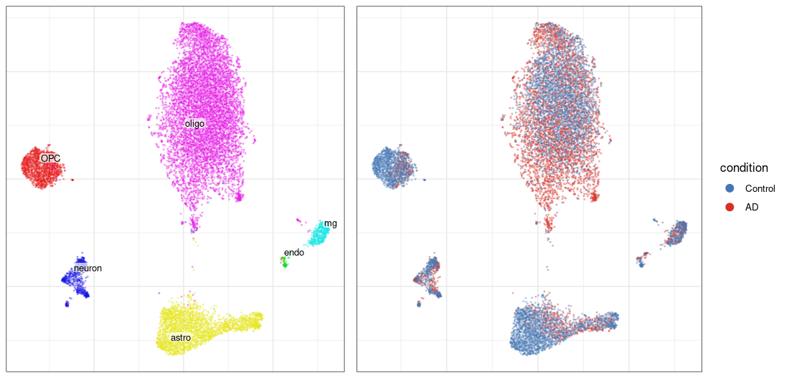<!-- -->

The oligodendrocyte cluster shows a visible condition structure on the embedding (the lower part is mostly AD, the
center mostly control); the AD nuclei of the OPCs sit on one side of their cluster, and the other cell types mix.

## Check the design

``` r
cao$checkDesign(test = "condition")
```

    Design check: 12 samples, 6 covariates, test variable 'condition'
      association with 'condition': median.pct.mt 0.60, median.umi 0.29, median.genes 0.26, n.cells 0.04, sex 0.00
      Warning (6):
        - 2 of 6 'Control' samples have 'n.cells' outside the range of 'AD' (439-1550): adjusted for 'n.cells', the condition effect there rests on a fitted trend of 'n.cells' beyond the values observed in 'AD' -> compare with the samples in the common range of 'n.cells' (cao$excludeSamples())
        - 3 of 6 'Control' samples have 'median.umi' above the range of 'AD' (542-1040): adjusted for 'median.umi', the condition effect there rests on a fitted trend of 'median.umi' beyond the values observed in 'AD' -> compare with the samples in the common range of 'median.umi' (cao$excludeSamples())
        - 3 of 6 'Control' samples have 'median.genes' above the range of 'AD' (434-716): adjusted for 'median.genes', the condition effect there rests on a fitted trend of 'median.genes' beyond the values observed in 'AD' -> compare with the samples in the common range of 'median.genes' (cao$excludeSamples())
        - 4 of 6 'AD' samples have 'median.pct.mt' above the range of 'Control' (0.0562-0.44): adjusted for 'median.pct.mt', the condition effect there rests on a fitted trend of 'median.pct.mt' beyond the values observed in 'Control' -> compare with the samples in the common range of 'median.pct.mt' (cao$excludeSamples())
        - 'median.pct.mt' is strongly associated with 'condition' (0.60): adjusting for it estimates the condition effect not explained by median.pct.mt -> consider reporting both models (cao$checkSensitivity())
        - 'batch' (high-cardinality, not used as a covariate) is nested in 'condition': each batch holds one condition, so a batch effect cannot be separated from the condition effect -> report this limitation; 'batch' can serve as a permutation block only if it crosses 'condition'
      Note (7):
        - 'n.cells' and 'median.umi' are associated (0.34) -> adjusting for both estimates each one's unique contribution only
        - 'n.cells' and 'median.genes' are associated (0.35) -> adjusting for both estimates each one's unique contribution only
        - 'median.umi' and 'median.genes' are associated (1.00) -> adjusting for both estimates each one's unique contribution only
        - 'sex' and 'median.pct.mt' are associated (0.38) -> adjusting for both estimates each one's unique contribution only
        - 'n.cells' and 'median.pct.mt' are associated (0.36) -> adjusting for both estimates each one's unique contribution only
        - 'median.umi' and 'median.pct.mt' are associated (0.78) -> adjusting for both estimates each one's unique contribution only
        - 'median.genes' and 'median.pct.mt' are associated (0.77) -> adjusting for both estimates each one's unique contribution only

Two warnings: the mitochondrial fraction differs strongly between the arms (association 0.60), and `batch`,
although not usable as a covariate, is nested in the condition: each batch contains one condition only, so a batch
effect is indistinguishable from the disease effect (a model `~ condition + batch` cannot be built). The technical
summaries are correlated with each other (`median.umi` and `median.genes` nearly perfectly). Including `batch`
explicitly shows how closely the technical summaries follow the batches:

``` r
cao$checkDesign(test = "condition", covariates = c("batch", "sex", "median.umi", "median.pct.mt"))
```

    Design check: 12 samples, 5 covariates, test variable 'condition'
      association with 'condition': batch 0.77, median.pct.mt 0.60, median.umi 0.29, sex 0.00
      Error (1):
        - 'condition' is fully determined by 'batch' (each batch contains one condition): the condition effect cannot be separated from batch -> do not adjust for 'batch', or test it instead
      Warning (4):
        - 'batch' is strongly associated with 'condition' (0.77): adjusting for it estimates the condition effect not explained by batch -> consider reporting both models (cao$checkSensitivity())
        - 3 of 6 'Control' samples have 'median.umi' above the range of 'AD' (542-1040): adjusted for 'median.umi', the condition effect there rests on a fitted trend of 'median.umi' beyond the values observed in 'AD' -> compare with the samples in the common range of 'median.umi' (cao$excludeSamples())
        - 4 of 6 'AD' samples have 'median.pct.mt' above the range of 'Control' (0.0562-0.44): adjusted for 'median.pct.mt', the condition effect there rests on a fitted trend of 'median.pct.mt' beyond the values observed in 'Control' -> compare with the samples in the common range of 'median.pct.mt' (cao$excludeSamples())
        - 'median.pct.mt' is strongly associated with 'condition' (0.60): adjusting for it estimates the condition effect not explained by median.pct.mt -> consider reporting both models (cao$checkSensitivity())
      Note (6):
        - 'batch' and 'sex' are associated (0.77) -> adjusting for both estimates each one's unique contribution only
        - 'batch' and 'median.umi' are associated (0.97) -> adjusting for both estimates each one's unique contribution only
        - 'batch' and 'median.pct.mt' are associated (0.99) -> adjusting for both estimates each one's unique contribution only
        - 'sex' and 'median.pct.mt' are associated (0.38) -> adjusting for both estimates each one's unique contribution only
        - 'median.umi' and 'median.pct.mt' are associated (0.78) -> adjusting for both estimates each one's unique contribution only
        - 'batch' is high-cardinality -> not suitable as a covariate

The technical summaries are nearly batch-level quantities (association 0.97-0.99 with `batch`), which is why they
are tied to the condition. The plots below refer to this second check, with the batch among the covariates.

``` r
cao$plotDesign("balance")
```

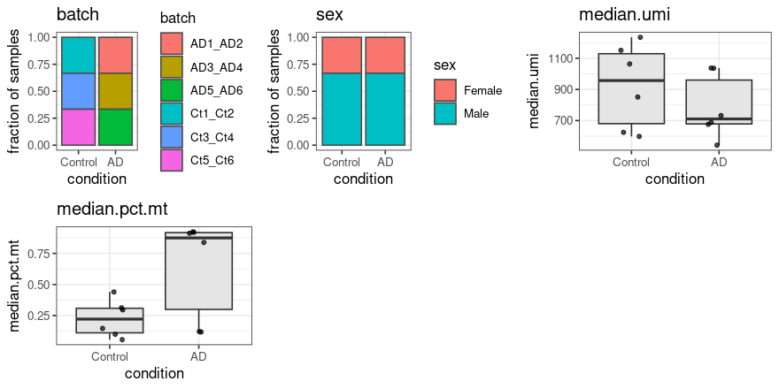<!-- -->

``` r
cao$plotDesign("associations")
```

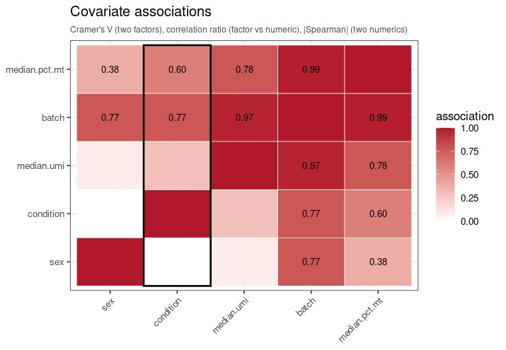<!-- -->

Sex is balanced (two female samples per arm), but the female samples of the AD arm come from one batch.

## Screen covariates

The screen tests every usable covariate against the sample-to-sample expression distances of each cell type, alone
(marginal) and adjusted for the other screened covariates (partial). `endo` (72 nuclei, 3 samples with at least 10
nuclei) is not screened, as the printout says.

``` r
cao$screenCovariates(n.permutations = 199)
```

    Covariate screen: 6 covariates x 5 cell types, marginal + partial mode, permutation p-values (199 permutations)
      not screened (fewer than 6 samples): endo
      partial mode fell back to marginal in 2 of 5 cell types (too few residual degrees of freedom for the full covariate set)
    No covariate is associated with expression in >= 1 cell types (partial, FDR 5%).
    Marginal only (not separable from the other covariates): condition, median.umi, median.genes, median.pct.mt
    Strongly tied to 'condition' (possible over-adjustment): median.pct.mt (0.60)
    all cell types (partial, FDR 5%): no covariate
    composition (partial, FDR 5%): no covariate
    Suggested model: ~condition   (not applied; see cao$setModel())

``` r
cao$plotCovariateScreen()
```

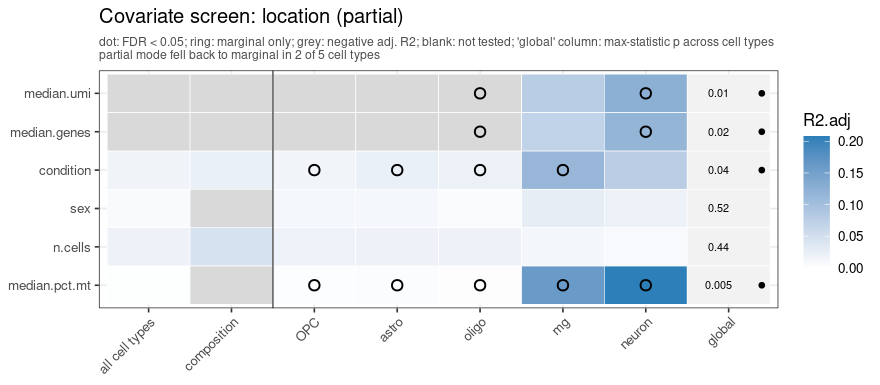<!-- -->

Marginally, the condition is associated with the expression distances of OPCs, astrocytes, oligodendrocytes and
microglia (FDR 5%), the mitochondrial fraction with every cell type, and the UMI and gene counts with the
oligodendrocytes and neurons (rings). Partially, adjusting for the five other
covariates with twelve samples, no covariate is significant in any single cell type: with batch-level technical
differences this strongly tied to the arms, the condition and the technical summaries cannot be distinguished
statistically, and the printout lists them as "not separable from the other covariates". Across cell types the
technical summaries still stand out (global max-statistic p-values 0.005-0.02 for `median.pct.mt`, `median.umi` and
`median.genes`), and so does the condition (0.04). In microglia and neurons (10 and 11 samples) the partial test falls back to the marginal
one, as the printout and the heatmap subtitle say. No covariate has a
significant dispersion association in any cell type. The main model
is `~ condition`, and the sensitivity analysis below shows what adjusting for the technical covariates does.

``` r
cao$plotVariancePartition(c("condition", "median.pct.mt", "sex"))
```

    skipped (fewer than 6 samples or a constant covariate): endo

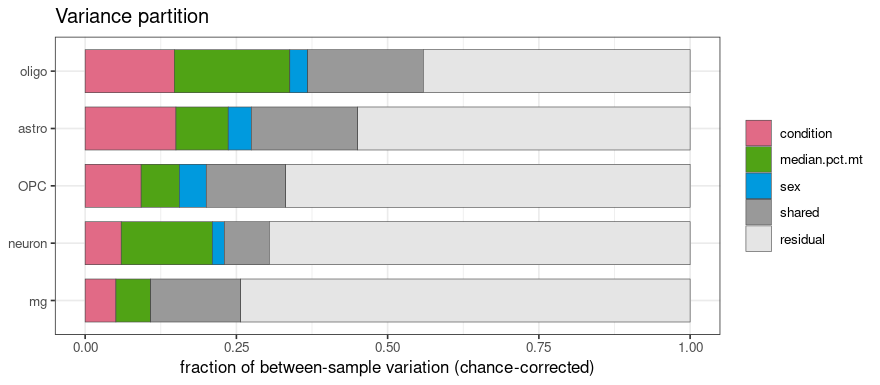<!-- -->

Condition and mitochondrial fraction each have a unique share and a comparable shared share of the between-sample
variation; sex explains little. `endo` is skipped: its three samples are all male.

### Sample maps

The maps show the samples in two dimensions (MDS of the sample distances) for one cell type, for all cell types combined, or for the cell-type composition; the subtitles give the chance-corrected R² and permutation p-value of each color and shape variable on its own (the screen's marginal mode; the screen's summary lines print the partial mode where the degrees of freedom allow it).

The unadjusted sample distances averaged over all cell types, colored by the condition and by the mitochondrial
fraction, and the composition:

``` r
cowplot::plot_grid(
  cao$plotSampleDistances(color.by = "condition", shape.by = "batch"),
  cao$plotSampleDistances(color.by = "median.pct.mt", shape.by = "sex"),
  cao$plotSampleDistances(space = "composition", color.by = "condition", shape.by = "batch"),
  ncol = 3)
```

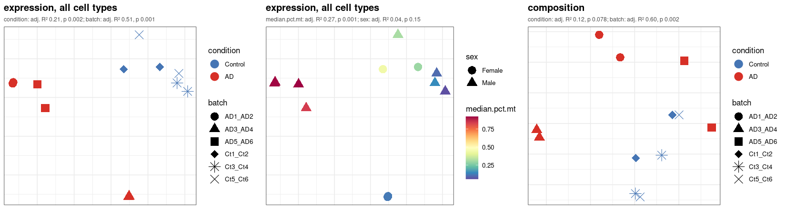<!-- -->

The first axis separates the four AD samples with a high mitochondrial fraction (`AD1_AD2`, `AD5_AD6`) from the
controls; the clean female batch `AD3_AD4` lies toward the control side of that axis and is set apart from all other
samples on the second axis. Samples of the same batch are neighbors except `Ct5_Ct6` (`Ct6`, mitochondrial fraction
0.31, sits with `Ct1_Ct2`, `Ct5` with `Ct3_Ct4`), and the batch explains more of the distances than the condition (adj.
R² 0.51 vs 0.21), a reminder that sample and batch effects cannot be told apart in this design. The composition is a
property of the batch (adj. R² 0.60) more than of the condition (0.12, p 0.078): the two `AD3_AD4` samples lie far from
the other AD samples.

## Set the model

``` r
cao$setModel(~ condition, test = "condition")
```

    Model: ~condition      dispersion: ~condition
    Test: condition: AD vs Control  (reference 'Control': first level of the factor as set; to change: test = "condition: Control vs AD")
           unadjusted; permutations: block (924 distinct); 12 of 12 samples can change their value; smallest p-value 0.0011
           shift > 0: AD samples differ from Control samples in a common direction, beyond within-group variability
    Samples: 12 used.   Issues: none

The reference is `Control` (first factor level), and the permutations are exact label permutations: with 6 + 6
samples there are 924 distinct relabelings, all of which are enumerated, so the smallest attainable p-value is
1/925 = 0.0011 for a cell type with all 12 samples and higher for cell types present in fewer samples (0.1 for
`endo`, 5 samples); the results summary below gives this range. The statistics of the expression shift and
composition tests do not change when AD and Control are swapped, so each relabeling of 6 + 6 samples is tied with its
mirror image and the smallest p-value these tests can reach is 2/924 = 0.0022 (the raw p-value of the astrocytes and
OPCs below).

## Expression shifts per cell type

``` r
res <- cao$estimateExpressionShiftMagnitudes()
res
```

    Expression shifts: condition: AD vs Control; unadjusted; 924 block permutations (smallest p 0.0011-0.038); statistic gsd
     celltype  n n.mag shift padj.shift  var padj.var total padj.total
        astro 12    12  0.71     0.0065 0.31    0.190  0.91     0.0018
        oligo 12    12  0.66     0.0130 0.57    0.011  1.06     0.0018
          OPC 12    12  0.45     0.0065 0.25    0.220  0.58     0.0018
           mg 11    10  0.26     0.0087 0.12    0.220  0.31     0.0350
       neuron 12    11  0.16     0.0180 0.22    0.300  0.26     0.0350
         endo  5    NA    NA     0.1000   NA       NA    NA         NA
      5 of 6 cell types with a significant shift (BH 5%); global p: shift 0.00433, var 0.00541, total 0.00108
      tested without a magnitude (fewer than 2 samples per level with >= 10 cells): endo
      (normalized effects; full tables in $results and $wide)

``` r
cao$plotExpressionShiftMagnitudes(show.ci = TRUE, show.genes = TRUE)
```

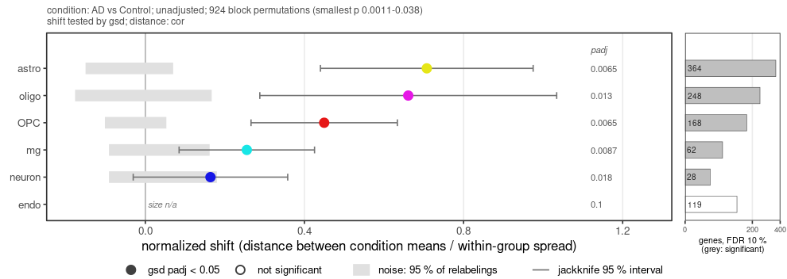<!-- -->

Cell types are ordered by the size of the shift; filled points have a significant shift by the gene-level test, the gray
band is the range of the shift with shuffled labels, the intervals are the jackknife 95 % intervals, and the margin counts
the genes changed at a gene-level FDR of 10 % (gray bars for significant shifts; `endo`, not significant, gets a white
bar). Five of the six cell types have a significant shift. Astrocytes, oligodendrocytes and OPCs show the largest shifts
(normalized shift 0.4-0.7), microglia and neurons smaller ones (0.26 and 0.16; the neuron shift lies within the noise band of shuffled labels,
although the gene-level test calls it). `endo` is tested in the 5 samples with at
least 5 nuclei and is not significant; too few samples have the 10 nuclei that the magnitudes need, so it is shown
without a size. This matches the paper's emphasis on glia.

The dispersion change, compared at equal numbers of nuclei per sample (the control samples contribute many more
astrocytes and OPCs than the AD samples), is positive in the glia but significant only in the oligodendrocytes: the
AD oligodendrocytes are more heterogeneous than the control ones. Astrocytes and OPC carry a dagger: their cell numbers
are tied to the condition, which makes the dispersion test anticonservative, and even so it is not significant.

``` r
cao$plotExpressionShiftMagnitudes(effect = "var")
```

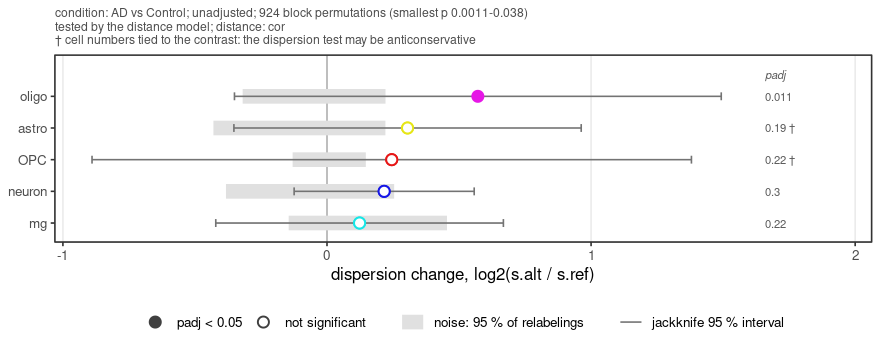<!-- -->

The next plot shows where the oligodendrocyte heterogeneity comes from.

### Behind one cell type

``` r
cao$plotShiftDetail("oligo", label.samples = TRUE)
```

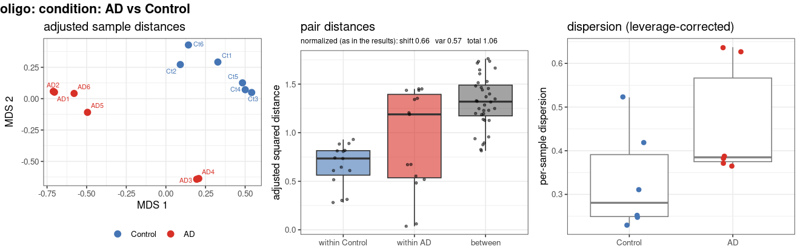<!-- -->

The AD samples form two groups: `AD3`/`AD4` (the female batch with control-like technical metrics) and the other
four. The within-AD distances therefore span a wide range, which is the dispersion effect. The control samples are
more compact, in two subgroups (`Ct1`/`Ct2`/`Ct6` and `Ct3`/`Ct4`/`Ct5`).

``` r
cao$plotSampleInfluence()
```

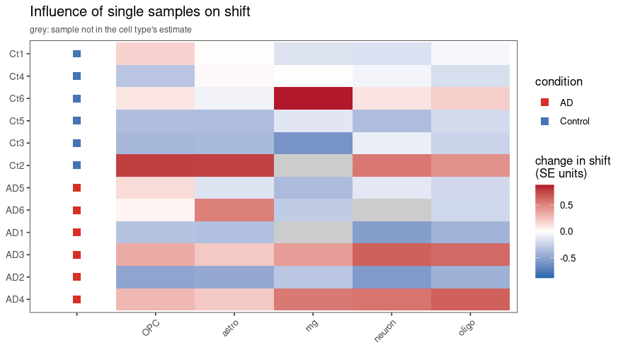<!-- -->

Leaving out `AD3` or `AD4` increases the shift in every cell type (they pull the AD mean toward the controls), as
does leaving out `Ct2` in the four types it enters; the largest single change is `Ct6` in the microglia. All changes
are below one jackknife standard error (at most about 0.9), so no single sample drives the result.

## Robustness

The shifts are re-estimated with the three technical summaries flagged by the screen added one at a time and all
together (given explicitly: no covariate is significant in a single cell type, so the automatic choice adds none).
Continuous covariates require Freedman-Lane residual permutations (199 for the distance refits; the gene-level test
is refitted with the main result's count). Each cell type gets two verdicts: the size of the shift (the distance-model
magnitude: stable, changes by more than half, sign depends on the model, driven by one sample, or near zero when the
current shift lies within the noise band of shuffled labels) and its significance (the gene-level test of the main
result, refitted under every model; filled points).

``` r
cao$checkSensitivity(covariate.sets = list(current = ~ condition, "plus median.pct.mt" = ~ condition + median.pct.mt,
                                           "plus median.umi" = ~ condition + median.umi, "plus median.genes" = ~ condition + median.genes,
                                           "all screened" = ~ condition + median.pct.mt + median.umi + median.genes),
                     n.permutations = 199)
```

    Sensitivity of 'condition: AD vs Control' (shift) across 5 models: current [~condition]; plus median.pct.mt [~condition + median.pct.mt]; plus median.umi [~condition + median.umi]; plus median.genes [~condition + median.genes]; all screened [~condition + median.pct.mt + median.umi + median.genes]
      magnitude: distance model; significance: gsd (adjusted p < 0.05)
      OPC      magnitude stable; significant in all 5 models
      astro    magnitude estimate changes by 85% (all screened); significant in all 5 models
      oligo    magnitude estimate changes by 85% (all screened); significant in all 5 models
      mg       magnitude estimate changes by 72% (all screened); significant in all 5 models
      neuron   magnitude near zero (within the relabeling band); significant in 1 of 5 models (not with: plus median.pct.mt, plus median.umi, plus median.genes, all screened)

``` r
cao$plotSensitivity()
```

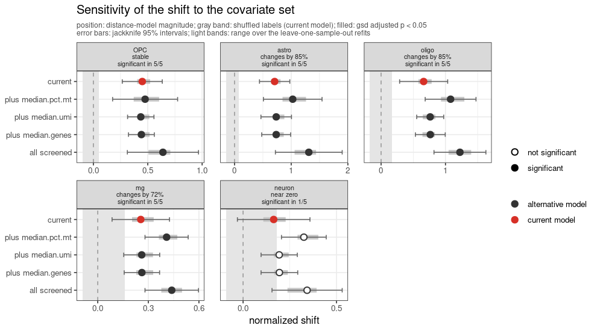<!-- -->

Astrocytes, oligodendrocytes, OPCs and microglia are significant in all five models. Adding the UMI or gene counts
changes the normalized shifts little; adding the mitochondrial fraction increases them markedly in all types but the
OPCs (0.45 to 0.48; astrocytes 0.71 to about 1.0, oligodendrocytes 0.66 to about 1.1, microglia 0.26 to 0.41), and adding all three
increases them in every type (astrocytes about 1.3, oligodendrocytes 1.2, OPCs 0.64, microglia 0.44), which the
magnitude verdicts record as changes of 72-85 % (the OPCs stay within half and read "stable"). The shifts grow because
removing the technical structure shrinks the within-arm spread that normalizes them. The neuron shift of the current
model (0.16) lies within the noise band ("near zero"); the gene-level test calls it only in the current model (adjusted
p 0.05-0.17 with any of the technical summaries added). The condition effect on the *location* of the samples of the
four glial types is therefore not removed by adjusting for the quality metrics, even though the screen could not attribute it uniquely to the condition. `endo`
has no magnitude and is not part of the sensitivity analysis.

## Composition

``` r
cao$estimateCellLoadings()
cao$plotCellLoadings(center = "both")
```

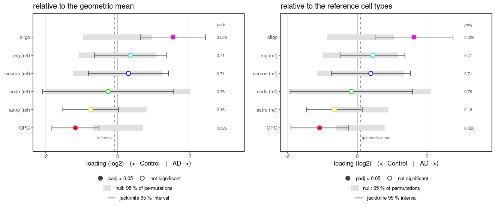<!-- -->

Relative to the geometric mean of all cell types, the AD samples have relatively more oligodendrocytes and fewer OPCs
(adjusted p 0.026 for both); the astrocyte loading is negative but not significant.

The right panel centers the loadings on the reference set, the largest block of cell types whose proportions do not
change relative to each other (pairwise permutation tests of the loading differences): here the astrocytes,
endothelial cells, microglia and neurons, since no pair among them separates, while the OPCs separate from the
microglia and the oligodendrocytes from the astrocytes and OPCs. Read against that block, the composition change of
this small cohort is an expansion of the oligodendrocytes and a loss of OPCs. In both panels the filled points and
the p-values are the reference-free test relative to the geometric mean, and the dashed line marks the other frame's
zero; the global test rejects (p 0.017).

``` r
cao$plotContrastTree()
```

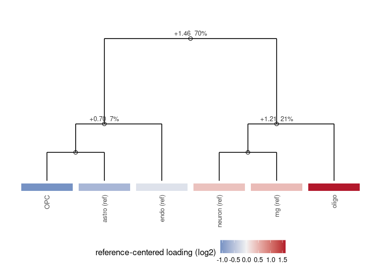<!-- -->

The contrast tree explains the compositional shift with as few balances as possible: each node compares the
geometric-mean proportions of its two sides between the conditions (the log2 ratio, the significance code of its
adjusted permutation p-value and the share of the shift it explains); the samples' own ratios are shown at the significant nodes,
and the tiles are the reference-centered loadings. The root balance, OPCs, endothelial cells and astrocytes against
neurons, microglia and oligodendrocytes, carries 70 % of the shift (log2 ratio 1.5, p 0.050, adjusted 0.12), and the
oligodendrocytes against neurons and microglia another 21 % (p 0.019, adjusted 0.097); neither node passes the
adjustment over the five nodes, although the global test rejects.

``` r
cao$plotCodaCellTypes(value = "predicted")
```

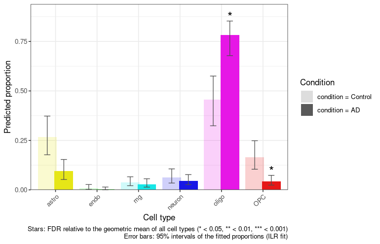<!-- -->

The model-predicted proportions at the two conditions do not depend on the reference set (the stars are the per-type
test relative to the geometric mean, the error bars 95 % intervals of the fitted proportions): oligodendrocytes make up 46 % of the nuclei in the controls and 78 % in AD,
astrocytes 27 % and 9 %, OPCs 17 % and 4 %.

The same check for the composition: the loadings refitted under alternative covariate sets, with jackknife intervals
from leaving out each sample.

``` r
cao$checkSensitivity(analysis = "composition", covariate.sets = list(current = ~ condition, "plus median.pct.mt" = ~ condition + median.pct.mt,
                                           "plus median.umi" = ~ condition + median.umi),
                     n.permutations = 199)
```

    Sensitivity of 'condition: AD vs Control' (loading) across 3 models: current [~condition]; plus median.pct.mt [~condition + median.pct.mt]; plus median.umi [~condition + median.umi]
      magnitude: loading (log2, relative to the geometric mean); significance: permutation test (vs the geometric mean) (adjusted p < 0.05)
      oligo    magnitude driven by sample AD5; significant in 2 of 3 models (not with: plus median.umi)
      OPC      magnitude stable; significant in 2 of 3 models (not with: plus median.umi)
      astro    magnitude near zero (within the relabeling band); not significant in any of 3 models
      mg       magnitude near zero (within the relabeling band); not significant in any of 3 models
      neuron   magnitude near zero (within the relabeling band); not significant in any of 3 models
      endo     magnitude near zero (within the relabeling band); significant in 1 of 3 models (only with: plus median.pct.mt)

``` r
cao$plotSensitivity(analysis = "composition")
```

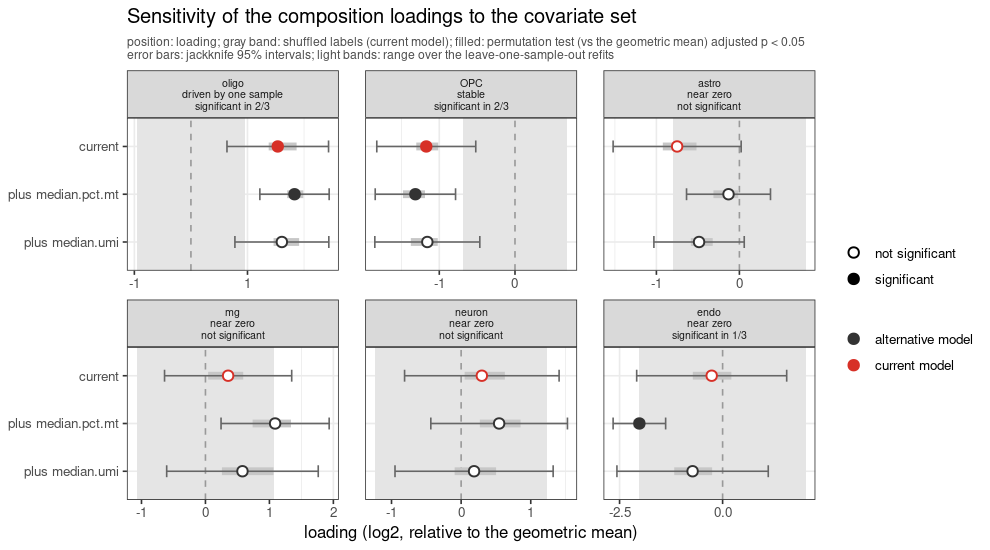<!-- -->

The oligodendrocyte and OPC loadings keep their size and stay significant when the mitochondrial fraction is added,
and lose significance (but not size) when the median UMI count is added, which is associated with the condition and
nearly a batch-level quantity. The oligodendrocyte loading is flagged as driven by one sample (`AD5`): leaving it out
raises the loading from 1.5 to 1.9, a change that stands out among the leave-one-out refits, but the loading stays
large and positive. The astrocyte loading, the
third-largest, is within the relabeling band under every model.

## The 10x batches

Each 10x batch holds the two patients of one condition (`AD1_AD2`, ..., `Ct5_Ct6`), so the batch is nested in the
condition. The main model treats the 12 samples as 12 independent observations of the condition. The grouping term
`(1 | batch)` treats the batch as the unit: the condition is then exchanged between whole batches.

``` r
cao$setModel(~ condition + (1 | batch), test = "condition")
```

    Model: ~condition + (1 | batch)      dispersion: ~condition
           grouping term (1 | batch): not fitted; the tested variable is exchanged within its levels; levels that hold one value of it are exchanged as wholes
    Test: condition: AD vs Control  (reference 'Control': first level of the factor as set; to change: test = "condition: Control vs AD")
           unadjusted; permutations: block (20 distinct); 12 of 12 samples can change their value; smallest p-value 0.05
           shift > 0: AD samples differ from Control samples in a common direction, beyond within-group variability
    Samples: 12 used.   Issues: 1 warning, 2 notes
      warning: test 'condition: AD vs Control': only 20 distinct permutations; the smallest attainable p-value is 0.05 -> fewer strata (block.vars), or more samples
      note: test 'condition: AD vs Control': 6 of the 6 levels of 'batch' that hold one value of the tested variable are exchanged as wholes, among levels with the same make-up
      note: the tested variable 'condition' takes one value within every level of 'batch': the levels are the independent units, and whole levels are exchanged among levels with the same make-up (6 of 6 levels)

``` r
cao$estimateExpressionShiftMagnitudes(name = "shifts.batch", verbose = FALSE)
cao$estimateCellLoadings(name = "coda.batch", verbose = FALSE)
```

``` r
sh <- function(nm) { r <- cao$test.results[[nm]]$results; r <- r[r$effect == "shift", ]; setNames(r$padj, r$celltype) }
ct <- names(sh("expression.shifts"))
data.frame(shift.padj.samples = signif(sh("expression.shifts")[ct], 2), shift.padj.batches = signif(sh("shifts.batch")[ct], 2), row.names = ct)
```

           shift.padj.samples shift.padj.batches
    astro              0.0065               0.15
    oligo              0.0130               0.15
    OPC                0.0065               0.15
    mg                 0.0087               0.15
    neuron             0.0180               0.36
    endo               0.1000               0.50

``` r
pc <- function(nm) cao$test.results[[nm]]$contrast$per_cell$padj
data.frame(composition.padj.samples = signif(pc("coda"), 2), composition.padj.batches = signif(pc("coda.batch")[names(pc("coda"))], 2))
```

           composition.padj.samples composition.padj.batches
    OPC                       0.026                     0.30
    astro                     0.160                     0.40
    endo                      0.760                     0.80
    mg                        0.710                     0.60
    neuron                    0.710                     0.72
    oligo                     0.026                     0.30

Exchanging whole batches leaves 20 distinct arrangements of the condition (6 batches, 3 of each condition), so the
smallest attainable p-value is 0.05, and 0.1 for the expression shift and composition tests, whose statistics do not
change when the two conditions are swapped. The astrocytes, oligodendrocytes, OPCs and microglia, and the OPC and
oligodendrocyte loadings, reach this floor (raw p 0.1); after the adjustment across cell types no cell type is
significant for either test (expression shifts: adjusted p 0.15 or more, against 0.0065-0.018 for five cell types when
the samples are the units; composition: 0.30 or more, against 0.026 for OPCs and oligodendrocytes). The estimates
themselves (the shifts, and the loadings relative to the geometric mean) do not change, since the grouping term is not
fitted; what changes is the number of independent units.

The residual map tests whether the batch explains the sample distances left after removing the condition: the batch
explains 32 % of the variation (p 0.003), and the two samples of `AD1_AD2` and of `AD3_AD4` lie on top of each
other. The two patients of a batch are therefore, on average, more alike than two patients of the same condition from
different batches, and the 12 samples are not 12 independent observations. The fraction of mitochondrial reads, which
differs between the batches, explains 14 % (p 0.011). With six batches the data cannot separate the effect of AD from
batch-to-batch variation as firmly as the per-sample test suggests: the per-sample p-values are likely too small,
since they treat the two patients of a batch as independent (an argument from the residual map, not tested here), and
the batch-level test has too few arrangements to reach significance. The rest of the notebook keeps the per-sample model,
and its p-values should be read with this in mind.

``` r
cowplot::plot_grid(cao$plotSampleDistances(values = "residual", color.by = "batch", shape.by = "condition"),
                   cao$plotSampleDistances(values = "residual", color.by = "median.pct.mt", shape.by = "condition"), ncol = 2)
```

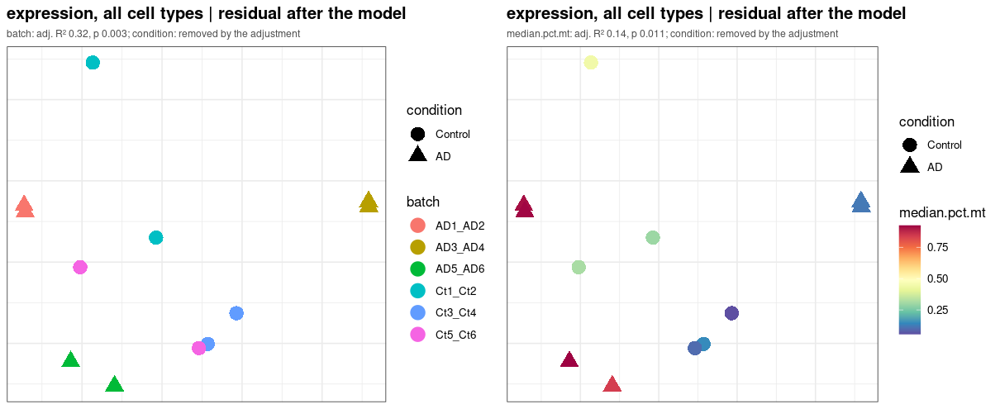<!-- -->

``` r
cao$setModel(~ condition, test = "condition", verbose = FALSE)
```

## Differential expression

Pseudobulk limma-voom on the same contrast. Because the nuclei are shallow (500-1,200 UMIs), genes are kept when
detected in at least 1% of the nuclei of a cell type (the default 5% leaves only 400-900 genes).

``` r
de <- cao$estimateDEPerCellType(test = "limma-voom", min.cell.count = 5, min.cell.frac = 0.01)
```

    Preparing matrices for DE

    Estimating DE per cell type

    DEs not calculated for 1 cell group(s): endo

`endo` is skipped (fewer than 3 samples at a compared level; the expression shifts test it from 5 nuclei per sample).

``` r
cao$plotVolcano(cell.types = "astro")
```

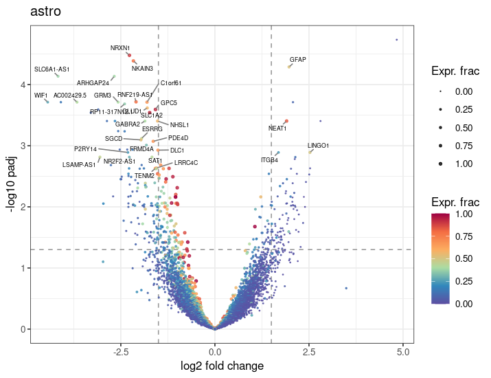<!-- -->

Among the up-regulated astrocyte genes are reactive-astrocyte markers (`GFAP`, `NEAT1`, `ITGB4`); most of the
labeled top genes are down-regulated (`NRXN1`, `NKAIN3`, `SLC6A1-AS1`, `GRM3`).

The number of DE genes (BH 5%) is highest in the astrocytes (about 350), followed by OPCs (about 240) and
oligodendrocytes (about 180), with few genes in microglia and neurons; unlike the shift magnitudes, the OPCs come before
the oligodendrocytes.

## Functional interpretation

The DE tables feed a gene set enrichment analysis per cell type (GSEA on GO biological processes, through
clusterProfiler; a few minutes). The GSEA p-values are estimated by sampling, so the run is seeded to make the
figures reproducible (`seed = TRUE` works on one core only, see the notes).

``` r
cao$estimateOntology(type = "GSEA", org.db = org.Hs.eg.db::org.Hs.eg.db, seed = TRUE, n.cores = 1)
```

The collapsed heatmap groups related terms: terms are first clustered by the genes they share, then by their
enrichment pattern across cell types, and each cluster is labeled by its most frequent words (the number before
the label is the number of terms in the cluster). `n` is the number of clusters; the function reduces it with a
warning when fewer are available (16 for the up-regulated terms, 8 for the down-regulated ones here).

``` r
cao$plotOntologyHeatmapCollapsed(name = "GSEA", genes = "up", n = 16, clust.method = "ward.D")
```

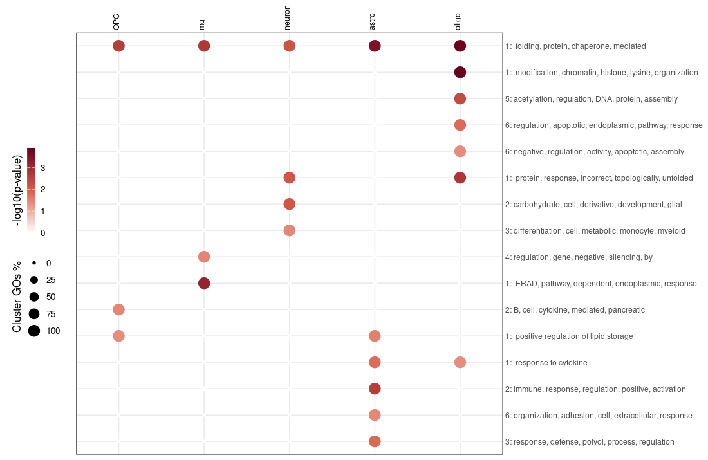<!-- -->

``` r
cao$plotOntologyHeatmapCollapsed(name = "GSEA", genes = "down", n = 8, clust.method = "ward.D")
```

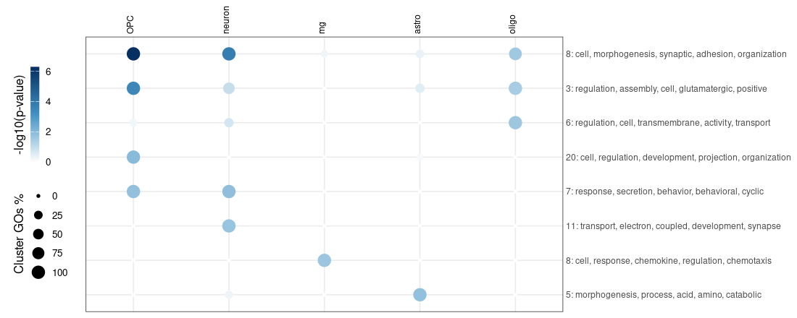<!-- -->

Chaperone-mediated protein folding is up in all five cell types; the other up-regulated programs are mostly
cell-type specific: in astrocytes immune and defense responses, response to cytokine (also in oligodendrocytes) and
cell adhesion / extracellular organization, in line with the reactive-astrocyte markers of the DE table (`GFAP`,
`ITGB4`, `NEAT1`); in oligodendrocytes chromatin and histone modification, the unfolded-protein response (also in
neurons) and the regulation of apoptosis; in neurons glial-development and carbohydrate-derivative terms; in microglia
ERAD and gene silencing; in OPCs cytokine-mediated terms and lipid storage, the latter shared with astrocytes. The
down-regulated terms are mainly synaptic, cell-adhesion and projection programs in OPCs, neurons and oligodendrocytes,
with chemokine / chemotaxis terms in microglia and amino-acid catabolic terms in astrocytes. The
per-cell-type view lists the terms of one cell type that pass FDR 5% (five for the astrocytes: two protein-folding and three immune / defense terms):

``` r
cao$plotOntology(cell.type = "astro", name = "GSEA", genes = "up")
```

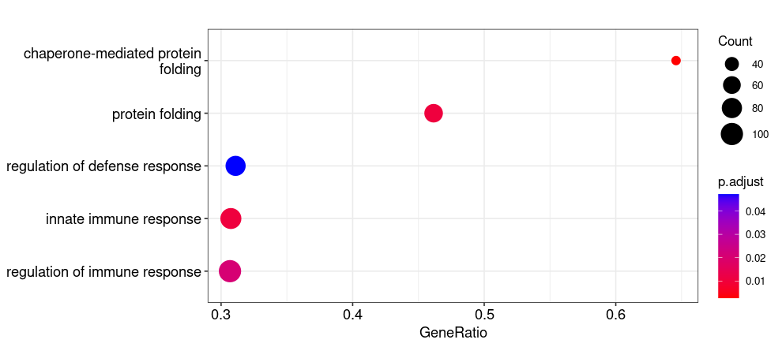<!-- -->

## Cluster-free analyses

The two cluster-free maps ask the composition and the expression question in neighborhoods of the cell graph instead of
in the annotated cell types, so that a change confined to part of a type, or spread across types, is found where it is.
A neighborhood is a diffusion neighborhood: the cells a heat kernel on the graph reaches from a cell, with the kernel
strength set so that a typical neighborhood covers a given share of the cells (`scale`). The default `scale = "auto"`
runs a scan over 1, 3 and 5 % of the cells for both maps under the same relabelings, picks the scale whose own map calls the most
cells (the finest one when a scale calls nearly every cell), and reports the map at that scale alone, so that the q-values and effects of the map belong to one neighborhood
size; the choice of the scale is itself tested by relabeling, and no cell's adjusted p is below the p-value of that test. One value tests a single scale, and a vector reports the scan itself. Cells are adjusted by the pooled permutation
false-discovery rate (the number of cells beyond a threshold under the relabelings, pooled over all cells, against the
observed number), and the adjusted z-score of a cell is the tail z of its q-value. The chunks print the scales tried and
the one chosen, and the annotated embedding is drawn next to each map so that the populations can be followed. The thin black
lines outline the regions where the cells significant at an adjusted p of 0.05 are the majority.

### Cluster-free density shifts

The density map tests, in every neighborhood, whether the arms differ in how many of their cells fall there: each
sample's kernel density is tested on the log scale with the same model. The panels show the annotation, the effect (the
log2 fold change of the density) and the adjusted z-scores.

``` r
cao$estimateCellDensity(method = "graph")
```

    kNN neighborhoods of at least 97 cells (8.1 per sample)

``` r
cao$estimateDiffCellDensity()
```

    diffusion neighborhoods at 1 %, 3 %, 5 % of the cells (auto: one scale is chosen)

    scale 0.01: heat kernel beta 19.5

    scale 0.03: heat kernel beta 26.3

    scale 0.05: heat kernel beta 28.7

    8489 of 9758 cells at FDR 10 % (scale 5 % chosen)

``` r
cowplot::plot_grid(cao$plotEmbedding(color.by = "cell.groups", title = "cell type"),
                   cao$plotDiffCellDensity(what = "effect", title = "density change (log2 FC)", outline = TRUE),
                   cao$plotDiffCellDensity(title = "adjusted z", outline = TRUE), ncol = 3)
```

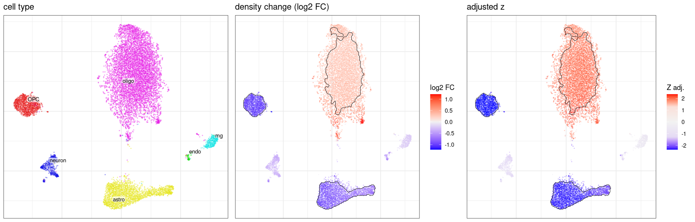<!-- -->

The scan picks the 5 % scale (neighborhoods of about 450 cells; the message above), the coarsest of the shared 1, 3 and
5 % set, and at that scale the map is a smoothed version of the composition result: the OPCs and astrocytes are depleted
in AD (log2 fold change -1.1 and -0.9; all of the OPCs and 99 % of the astrocytes at FDR 5 %) and the oligodendrocytes
are denser (+0.4; 77 % of their cells at FDR 5 %), each significant in the per-type summary
below (adjusted p 0.019), while the neurons, microglia and endothelial cells are not called (almost none of their cells, per-type adjusted p 0.34-0.54). With 12 samples the calls follow the type boundaries; the only within-type features are the gradient in the
astrocytes (the main body more depleted than the tail that extends to the right) and a small, strongly enriched
oligodendrocyte group at the lower right of the cluster. 76 % of all cells are called at FDR 5 % and 87 % at FDR 10 %
(the count in the message).
Cells at a boundary between two cell types whose composition differs can show a difference that belongs to their
neighborhood rather than to themselves (the small `endo` group next to the microglia is an example to treat with care).

### Cluster-free expression shifts

The expression map tests the contrast in each neighborhood with the per-gene statistic of the per-type test
(`statistic = "gsd"`: the contrast of each gene over its standard error, combined adaptively over the genes detected in
at least 5 % of the neighborhood's cells), on neighborhoods of the scale's size around centers that cover the graph (the message gives their number and size);
each cell averages the tested neighborhoods that contain it. The shift panel shows the size of the change (the mean
squared gene z-score of the neighborhood, about 1 without a change) and the right panel the adjusted z-scores, one-sided
(0 means not significant).

``` r
cao$estimateClusterFreeExpressionShifts(n.permutations = 499)
```

    10324 genes (per neighborhood: those detected in >= 5 % of its cells)

    diffusion neighborhoods at 1 %, 3 %, 5 % of the cells (auto: one scale is chosen), at least 97 cells each (8.1 per sample)

    scale 0.01: heat kernel beta 19.5, 428 centers, neighborhoods of 103 cells (median, 99 smallest)

    scale 0.03: heat kernel beta 26.3, 182 centers, neighborhoods of 303 cells (median, 193 smallest)

    scale 0.05: heat kernel beta 28.7, 85 centers, neighborhoods of 513 cells (median, 253 smallest)

    9725 of 9758 cells keep adjusted z >= 1.28 (scale 3 % chosen)

``` r
cao$plotClusterFreeExpressionShifts(adjusted = TRUE, outline = TRUE)
```

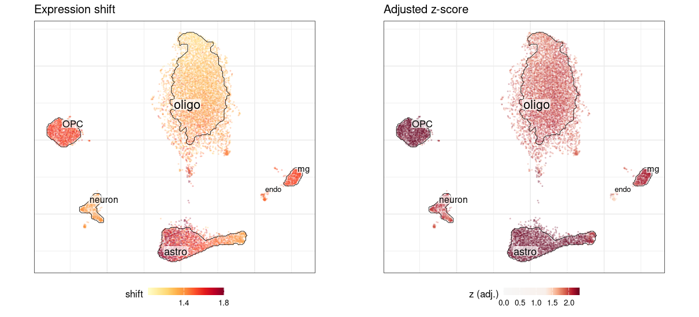<!-- -->

The map tests each nucleus's neighborhood with the per-gene statistic of the per-type test (left: the mean squared
gene z-score of the neighborhood, about 1 without a change). The scan picks the 3 % scale (182 neighborhoods of about 300 nuclei; the message above). It agrees with the
cluster-based result only in part: the astrocytes, OPC and microglia are shifted most (median 1.54-1.58), the
endothelial cells next (1.47), and the neurons and oligodendrocytes least (1.39 and 1.35), although the
oligodendrocytes have the second-largest per-type shift. The adjusted z-scores (right) are one-sided, from the
pooled permutation false-discovery rate of the neighborhood-averaged statistic: five of the six types are significant in the per-
type summary, with 95-100 % of the astrocytes, OPC, microglia, neurons and oligodendrocytes passing FDR 5 %; the
endothelial cells (72 nuclei, 14 % passing) are not (adjusted p 0.06). Every nucleus is tested. As for the density, a shift at the
boundary of two cell types with different compositions can reflect the neighborhood rather than the cell.

Both maps are summarized per cell type by an exact group-level permutation test: the mean per-cell statistic of the type
is compared with the same mean under the relabelings shared by all cells, so the dependence between neighboring cells is
carried along, and the result is adjusted across types. The labels give the share of the type's cells called at FDR 5 %.

``` r
cao$estimateClusterFreeSummary("cell.density")
cao$estimateClusterFreeSummary("cluster.free.expr.shifts")
cowplot::plot_grid(cao$plotClusterFreeSummary("cell.density"), cao$plotClusterFreeSummary("cluster.free.expr.shifts"), ncol = 2)
```

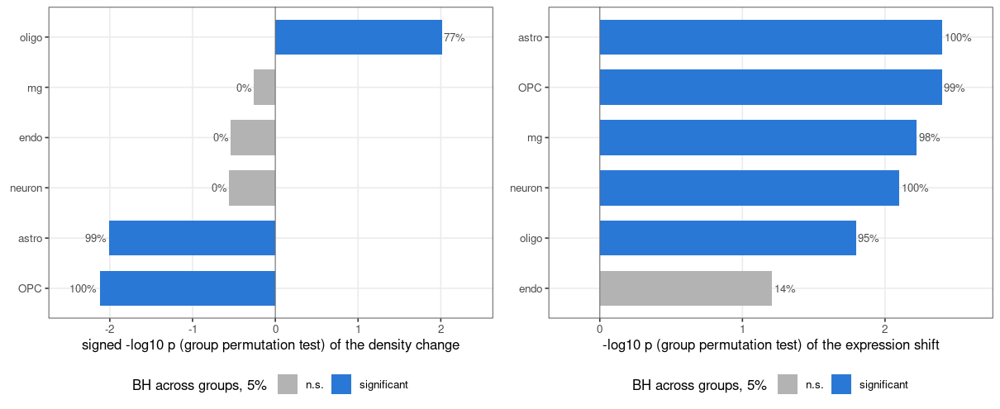<!-- -->

## Summary

- AD vs Control expression shifts are strongest in astrocytes, oligodendrocytes and OPCs, smaller in microglia and
  marginal in neurons, consistent with the paper. Composition shifts toward oligodendrocytes and away from OPCs in AD (the
  astrocyte loading is negative but not significant); the density map calls the depletion in all OPCs and 99 % of the
  astrocytes and the enrichment in 77 % of the oligodendrocytes at FDR 5 %. Astrocyte DE recovers the reactive signature (`GFAP`).
- The AD oligodendrocytes are more heterogeneous than the control ones (`var` effect, at equal numbers of nuclei), and
  the heterogeneity is the batch structure: `AD3_AD4` versus the two other AD batches. In the other glia the
  dispersion change is positive but not significant once the cell numbers are accounted for.
- The covariates are the weak point of this dataset. Batch is nested in the condition (the design check refuses
  `~ condition + batch`), and the technical quality metrics are batch-level quantities that differ between the arms
  (mitochondrial fraction association 0.60). The screen cannot attribute the between-sample variation uniquely to the
  condition. Adjusting for the technical covariates, singly or together, does not remove the shifts of astrocytes,
  oligodendrocytes, OPCs and microglia (significant in all five models; the normalized shifts grow rather than
  shrink), so the location shift is not a simple quality artifact. The small neuron shift, within the noise band in
  size, loses significance when any of the technical summaries is added, and a batch effect confounded with the disease
  cannot be excluded from these data: with the batch as the unit (`(1 | batch)`, whole batches exchanged) no cell type
  is significant for either the expression shifts or the composition.

## Session info

``` r
sessionInfo()
```

    R version 4.2.2 Patched (2022-11-10 r83330)
    Platform: x86_64-pc-linux-gnu (64-bit)
    Running under: Ubuntu 20.04.6 LTS

    Matrix products: default
    BLAS:   /usr/lib/x86_64-linux-gnu/blas/libblas.so.3.9.0
    LAPACK: /usr/lib/x86_64-linux-gnu/lapack/liblapack.so.3.9.0

    locale:
     [1] LC_CTYPE=en_US.UTF-8       LC_NUMERIC=C              
     [3] LC_TIME=en_US.UTF-8        LC_COLLATE=en_US.UTF-8    
     [5] LC_MONETARY=en_US.UTF-8    LC_MESSAGES=en_US.UTF-8   
     [7] LC_PAPER=en_US.UTF-8       LC_NAME=C                 
     [9] LC_ADDRESS=C               LC_TELEPHONE=C            
    [11] LC_MEASUREMENT=en_US.UTF-8 LC_IDENTIFICATION=C       

    attached base packages:
    [1] stats     graphics  grDevices utils     datasets  methods   base     

    other attached packages:
    [1] dplyr_1.1.4    ggplot2_4.0.2  conos_1.5.4    igraph_2.1.4   cacoa_0.5.0   
    [6] Matrix_1.6-1.1

    loaded via a namespace (and not attached):
      [1] uuid_1.2-1                  shadowtext_0.1.6           
      [3] N2R_1.0.4                   circlize_0.4.16            
      [5] fastmatch_1.1-6             systemfonts_1.3.2          
      [7] plyr_1.8.9                  lazyeval_0.2.2             
      [9] splines_4.2.2               BiocParallel_1.32.6        
     [11] GenomeInfoDb_1.34.9         urltools_1.7.3             
     [13] digest_0.6.37               foreach_1.5.2              
     [15] yulab.utils_0.2.5           htmltools_0.5.8.1          
     [17] GOSemSim_2.24.0             viridis_0.6.4              
     [19] GO.db_3.16.0                magrittr_2.0.3             
     [21] RMTstat_0.3.1               memoise_2.0.1              
     [23] cluster_2.1.4               doParallel_1.0.17          
     [25] ComplexHeatmap_2.14.0       Biostrings_2.66.0          
     [27] annotate_1.76.0             graphlayouts_1.2.2         
     [29] matrixStats_1.5.0           R.utils_2.12.2             
     [31] sccore_1.0.6                enrichplot_1.18.4          
     [33] colorspace_2.1-0            rappdirs_0.3.3             
     [35] blob_1.2.4                  ggrepel_0.9.6              
     [37] pagoda2_1.0.11              xfun_0.53                  
     [39] jsonlite_2.0.0              crayon_1.5.2               
     [41] RCurl_1.98-1.12             scatterpie_0.2.5           
     [43] brew_1.0-10                 iterators_1.0.14           
     [45] ape_5.8-1                   glue_1.8.0                 
     [47] polyclip_1.10-7             gtable_0.3.6               
     [49] zlibbioc_1.44.0             XVector_0.38.0             
     [51] GetoptLong_1.0.5            DelayedArray_0.24.0        
     [53] leidenAlg_1.1.5             Rook_1.2                   
     [55] shape_1.4.6.1               BiocGenerics_0.44.0        
     [57] abind_1.4-8                 scales_1.4.0               
     [59] DOSE_3.24.2                 DBI_1.1.3                  
     [61] Rcpp_1.1.0                  coda.base_1.0.3            
     [63] viridisLite_0.4.2           xtable_1.8-4               
     [65] clue_0.3-65                 tidytree_0.4.6             
     [67] gridGraphics_0.5-1          bit_4.6.0                  
     [69] stats4_4.2.2                htmlwidgets_1.6.4          
     [71] httr_1.4.7                  fgsea_1.24.0               
     [73] RColorBrewer_1.1-3          pkgconfig_2.0.3            
     [75] XML_3.99-0.14               R.methodsS3_1.8.2          
     [77] farver_2.1.2                locfit_1.5-9.8             
     [79] ggplotify_0.1.2             tidyselect_1.2.1           
     [81] labeling_0.4.3              rlang_1.1.7                
     [83] reshape2_1.4.4              AnnotationDbi_1.60.2       
     [85] pbmcapply_1.5.1             tools_4.2.2                
     [87] cachem_1.1.0                downloader_0.4.1           
     [89] cli_3.6.5                   generics_0.1.4             
     [91] RSQLite_2.3.1               gson_0.1.0                 
     [93] evaluate_1.0.5              stringr_1.5.1              
     [95] fastmap_1.2.0               yaml_2.3.10                
     [97] ggtree_3.6.2                org.Hs.eg.db_3.16.0        
     [99] fs_1.6.6                    knitr_1.50                 
    [101] bit64_4.6.0-1               tidygraph_1.3.1            
    [103] purrr_1.1.0                 KEGGREST_1.38.0            
    [105] ggraph_2.2.2                nlme_3.1-161               
    [107] R.oo_1.25.0                 ggiraph_0.9.0              
    [109] aplot_0.2.8                 compiler_4.2.2             
    [111] png_0.1-8                   treeio_1.22.0              
    [113] tibble_3.3.0                tweenr_2.0.3               
    [115] geneplotter_1.76.0          stringi_1.8.7              
    [117] drat_0.2.3                  lattice_0.20-45            
    [119] psych_2.5.6                 vctrs_0.6.5                
    [121] pillar_1.11.0               lifecycle_1.0.4            
    [123] triebeard_0.4.1             GlobalOptions_0.1.2        
    [125] data.table_1.17.8           cowplot_1.2.0              
    [127] bitops_1.0-9                irlba_2.3.5.1              
    [129] patchwork_1.3.2             GenomicRanges_1.50.2       
    [131] qvalue_2.30.0               R6_2.6.1                   
    [133] gridExtra_2.3               IRanges_2.32.0             
    [135] codetools_0.2-18            MASS_7.3-58                
    [137] SummarizedExperiment_1.28.0 DESeq2_1.38.3              
    [139] rjson_0.2.21                withr_3.0.2                
    [141] mnormt_2.1.1                S4Vectors_0.36.2           
    [143] GenomeInfoDbData_1.2.9      mgcv_1.8-41                
    [145] parallel_4.2.2              clusterProfiler_4.6.2      
    [147] ggfun_0.2.0                 grid_4.2.2                 
    [149] tidyr_1.3.1                 HDO.db_0.99.1              
    [151] rmarkdown_2.29              S7_0.2.0                   
    [153] MatrixGenerics_1.10.0       dendsort_0.3.4             
    [155] Rtsne_0.17                  ggforce_0.5.0              
    [157] Biobase_2.58.0             

