Cacoa on the multiple sclerosis cortex dataset (Schirmer et al. 2019)
================
Cacoa developers
2026-11-18

- <a href="#load-data" id="toc-load-data">Load data</a>
- <a href="#check-the-design" id="toc-check-the-design">Check the design</a>
- <a href="#screen-covariates" id="toc-screen-covariates">Screen covariates</a>
  - <a href="#sample-maps" id="toc-sample-maps">Sample maps</a>
- <a href="#set-the-model" id="toc-set-the-model">Set the model</a>
- <a href="#expression-shifts-per-cell-type" id="toc-expression-shifts-per-cell-type">Expression shifts per cell type</a>
  - <a href="#behind-one-cell-type" id="toc-behind-one-cell-type">Behind one cell type</a>
- <a href="#robustness-to-the-covariates" id="toc-robustness-to-the-covariates">Robustness to the covariates</a>
- <a href="#composition" id="toc-composition">Composition</a>
  - <a href="#the-samples-behind-the-composition-result" id="toc-the-samples-behind-the-composition-result">The samples behind the composition result</a>
  - <a href="#composition-with-a-random-intercept-for-the-sequencing-batch" id="toc-composition-with-a-random-intercept-for-the-sequencing-batch">Composition with a random intercept for the sequencing batch</a>
  - <a href="#composition-without-sample-4_d9" id="toc-composition-without-sample-4_d9">Composition without sample 4_D9</a>
  - <a href="#robustness-of-the-composition" id="toc-robustness-of-the-composition">Robustness of the composition</a>
- <a href="#the-sequencing-batch" id="toc-the-sequencing-batch">The sequencing batch</a>
- <a href="#lesion-stage" id="toc-lesion-stage">Lesion stage</a>
- <a href="#differential-expression-per-cell-type" id="toc-differential-expression-per-cell-type">Differential expression per cell type</a>
- <a href="#functional-interpretation" id="toc-functional-interpretation">Functional interpretation</a>
- <a href="#cluster-free-analyses" id="toc-cluster-free-analyses">Cluster-free analyses</a>
  - <a href="#cluster-free-density-shifts" id="toc-cluster-free-density-shifts">Cluster-free density shifts</a>
  - <a href="#cluster-free-expression-shifts" id="toc-cluster-free-expression-shifts">Cluster-free expression shifts</a>
- <a href="#summary" id="toc-summary">Summary</a>
- <a href="#session-info" id="toc-session-info">Session info</a>

This notebook runs the Cacoa workflow on the snRNA-seq dataset of Schirmer et al. (Nature 2019): nuclei from
cortical lesions of multiple sclerosis (MS) patients and from control cortex, 21 samples (12 MS, 9 control) and 46,340
nuclei after the filtering of the Cacoa preprint (the study's own thresholds plus nuclei with a mitochondrial fraction
above 0.1 and Scrublet doublets removed). The question is one contrast, **MS versus control**, with the simplest model `~ diagnosis`. The study
comes with a number of sample-level covariates (brain region, sex, age, capture and sequencing batch, RIN, PMI), and
several of them are confounded with the diagnosis. They are not put into the model; instead the notebook shows how
Cacoa exposes their relevance: the design check, the covariate screen, the variance partition, sample maps colored by
covariates, and a sensitivity analysis of the main result to adjusting for them.

``` r
library(cacoa)
library(conos)
library(ggplot2)
```

## Load data

`prepare_ms_data.R` (next to this notebook) refreshes the Conos object of the Cacoa preprint (built with an older
pagoda2/conos version) and stores it with the preprint's annotation. The cell-type annotation of the study is
condition-specific for two populations (`EN-L2-3-Cntl` / `EN-L2-3-MS` and `OL-Cntl` / `OL-MS-1` / `OL-MS-2`); the
preprint merged those labels, otherwise the cell types would be aliased with the diagnosis.

``` r
ms <- readRDS(params$data.file)
con <- ms$con
cell.groups <- ms$cell.groups
table(cell.groups)
```

    cell.groups
       Astrocytes       B cells       EN-L2-3         EN-L4       EN-L5-6 
             5286            43          5915          3033          2851 
           EN-MIX        EN-PYR    Endo cells      Glia-MIX         IN-PV 
             2228          2024           346           564          1855 
           IN-SST       IN-SV2C        IN-VIP     Microglia            OL 
             1434           766          2681          1391         12071 
              OPC    Phagocytes Stromal cells       T cells 
             3556           132            95            69 

The sample metadata is derived from the cell metadata table: one row per sample with the diagnosis and every
sample-level covariate. `stage` (acute/chronic active, chronic inactive, control) refines the diagnosis;
`lesion_stage` is 0 in every control and a different value in each MS sample, i.e. an index of the MS samples rather
than a covariate, so it is shown here and then dropped.

``` r
cell.meta <- read.delim(params$meta.file)
sample.meta <- unique(cell.meta[, c("sample", "diagnosis", "stage", "age", "sex", "region", "Capbatch", "Seqbatch",
                                    "RIN", "PMI", "lesion_stage")])
rownames(sample.meta) <- sample.meta$sample
sample.meta <- sample.meta[names(con$samples), -1]
sample.meta
```

               diagnosis                stage age    sex         region Capbatch
    1_A4              MS Acute/Chronic active  35 female motor-premotor     CAP1
    1_A9              MS     Chronic inactive  55   male       temporal     CAP3
    25G_P3C1     Control              Control  35   male       parietal     CAP5
    2_B4         Control              Control  82   male motor-premotor     CAP1
    2_B9              MS     Chronic inactive  53   male       parietal     CAP3
    371G_A3D3         MS Acute/Chronic active  40   male     prefrontal     CAP5
    3_C4              MS Acute/Chronic active  50 female motor-premotor     CAP1
    4_A5         Control              Control  61 female     prefrontal     CAP1
    4_D9              MS     Chronic inactive  48 female       parietal     CAP3
    5546_BA9     Control              Control  34 female     prefrontal     CAP7
    5609_BA9     Control              Control  54 female     prefrontal     CAP7
    5787_BA9     Control              Control  39   male     prefrontal     CAP7
    5981_BA9     Control              Control  44 female     prefrontal     CAP7
    5_B5              MS Acute/Chronic active  51 female       temporal     CAP1
    6_C5         Control              Control  64   male motor-premotor     CAP1
    7_D5              MS Acute/Chronic active  42 female       temporal     CAP2
    7_G10             MS Acute/Chronic active  34 female       parietal     CAP4
    8_E5         Control              Control  68   male     prefrontal     CAP2
    8_H10             MS Acute/Chronic active  40   male     prefrontal     CAP4
    MS200_A303        MS     Chronic inactive  44 female     prefrontal     CAP6
    MS377_A2D2        MS Acute/Chronic active  50 female     prefrontal     CAP6
               Seqbatch RIN PMI lesion_stage
    1_A4           SEQ1 7.0   9            1
    1_A9           SEQ2 7.1  16           11
    25G_P3C1       SEQ3 6.8  22            0
    2_B4           SEQ1 8.5  21            0
    2_B9           SEQ2 7.0  13            9
    371G_A3D3      SEQ3 7.9  27            3
    3_C4           SEQ1 8.9  22            6
    4_A5           SEQ1 7.3  15            0
    4_D9           SEQ2 9.1  21           12
    5546_BA9       SEQ5 8.3  27            0
    5609_BA9       SEQ5 8.5   6            0
    5787_BA9       SEQ5 7.9  16            0
    5981_BA9       SEQ5 7.8  19            0
    5_B5           SEQ1 9.0  10            4
    6_C5           SEQ1 7.5  18            0
    7_D5           SEQ1 8.7  11            5
    7_G10          SEQ2 8.9  12            2
    8_E5           SEQ1 8.5  30            0
    8_H10          SEQ2 7.6  27            8
    MS200_A303     SEQ4 9.0  20           10
    MS377_A2D2     SEQ4 8.9  22            7

``` r
sample.meta$lesion_stage <- NULL
```

The rows are put in the order of the Conos samples; this is a tidy-up only, but the row order also fixes the
permutation set drawn for a given seed.

``` r
cao <- Cacoa$new(con, sample.metadata = sample.meta, cell.groups = cell.groups, n.cores = params$n.cores)
```

    Sample metadata: 21 samples, 9 columns
      usable (9): diagnosis [Control 9, MS 12], stage [Acute/Chronic active 8, Chronic inactive 4, Control 9], age [num, 34-82], sex [female 12, male 9], region [4 levels], Capbatch [7 levels], Seqbatch [5 levels], RIN [num, 6.8-9.1], ...

    Next: cao$checkDesign() and cao$screenCovariates(), or cao$setModel(test = "<variable>").

``` r
cao$setOptions(n.permutations = 499, seed = 1)
cao$plot.params <- list(size = 0.2, alpha = 0.2, font.size = 3)
cao$sample.groups.palette <- c(Control = "#4575b4", MS = "#d73027")
```

The condition palette is named so that the plots made before the model is set use the same two colors as the ones
made after it.

``` r
cowplot::plot_grid(cao$plotEmbedding(color.by = "cell.groups"), cao$plotEmbedding(color.by = "diagnosis"), ncol = 2)
```

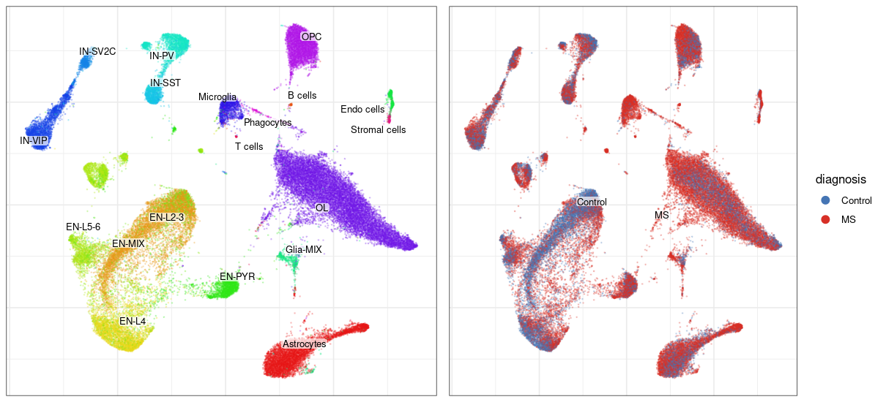<!-- -->

Oligodendrocytes (OL) and the upper-layer excitatory neurons (EN-L2-3) are the largest populations; the MS and
control nuclei mix within most cell types but occupy different parts of the OL and EN-L2-3 clouds, which is why the
original annotation split them by condition.

## Check the design

The design check works on the metadata alone: associations between covariates, the balance of each covariate over the
two arms, and structural problems for a model that would adjust for them.

``` r
cao$checkDesign(test = "diagnosis")
```

    Design check: 21 samples, 9 covariates, test variable 'diagnosis'
      association with 'diagnosis': stage 0.97, Seqbatch 0.57, Capbatch 0.47, age 0.34, RIN 0.24, region 0.21, PMI 0.14, sex 0.00
      Error (1):
        - 'diagnosis' is fully determined by 'stage' (each stage contains one diagnosis): the diagnosis effect cannot be separated from stage -> do not adjust for 'stage', or test it instead
      Warning (4):
        - 'stage' is strongly associated with 'diagnosis' (0.97): adjusting for it estimates the diagnosis effect not explained by stage -> consider reporting both models (cao$checkSensitivity())
        - 4 of 9 'Control' samples have 'age' above the range of 'MS' (34-55): adjusted for 'age', the diagnosis effect there rests on a fitted trend of 'age' beyond the values observed in 'MS' -> compare with the samples in the common range of 'age' (cao$excludeSamples())
        - 'Seqbatch' is strongly associated with 'diagnosis' (0.57): adjusting for it estimates the diagnosis effect not explained by Seqbatch -> consider reporting both models (cao$checkSensitivity())
        - 7 of 12 'MS' samples have 'RIN' above the range of 'Control' (6.8-8.5): adjusted for 'RIN', the diagnosis effect there rests on a fitted trend of 'RIN' beyond the values observed in 'Control' -> compare with the samples in the common range of 'RIN' (cao$excludeSamples())
      Note (25):
        - 'stage' and 'age' are associated (0.40) -> adjusting for both estimates each one's unique contribution only
        - 'age' and 'region' are associated (0.40) -> adjusting for both estimates each one's unique contribution only
        - 'stage' and 'Capbatch' are associated (0.59) -> adjusting for both estimates each one's unique contribution only
        - 'age' and 'Capbatch' are associated (0.63) -> adjusting for both estimates each one's unique contribution only
        - 'region' and 'Capbatch' are associated (0.42) -> adjusting for both estimates each one's unique contribution only
        - 'stage' and 'Seqbatch' are associated (0.45) -> adjusting for both estimates each one's unique contribution only
        - 'age' and 'Seqbatch' are associated (0.55) -> adjusting for both estimates each one's unique contribution only
        - 'region' and 'Seqbatch' are associated (0.41) -> adjusting for both estimates each one's unique contribution only
        - 'Capbatch' and 'Seqbatch' are associated (0.94) -> adjusting for both estimates each one's unique contribution only
        - 'sex' and 'RIN' are associated (0.53) -> adjusting for both estimates each one's unique contribution only
        - 'Capbatch' and 'RIN' are associated (0.54) -> adjusting for both estimates each one's unique contribution only
        - 'Seqbatch' and 'RIN' are associated (0.48) -> adjusting for both estimates each one's unique contribution only
        - 'sex' and 'PMI' are associated (0.38) -> adjusting for both estimates each one's unique contribution only
        - 'region' and 'PMI' are associated (0.46) -> adjusting for both estimates each one's unique contribution only
        - 'Capbatch' and 'PMI' are associated (0.42) -> adjusting for both estimates each one's unique contribution only
        - 'Seqbatch' and 'PMI' are associated (0.36) -> adjusting for both estimates each one's unique contribution only
        - 'age' differs between the levels of 'diagnosis' (association 0.34) -> adjust for 'age' and compare with the unadjusted result (cao$checkSensitivity())
        - 1 cell(s) of diagnosis x region hold a single sample -> estimates in those cells rest on one sample
        - 1 empty cell(s) in diagnosis x region -> the design is unbalanced; a marginal contrast cannot average over empty cells
        - 4 cell(s) of diagnosis x Capbatch hold a single sample -> estimates in those cells rest on one sample
        - 4 empty cell(s) in diagnosis x Capbatch -> the design is unbalanced; a marginal contrast cannot average over empty cells
        - 'Capbatch' differs between the levels of 'diagnosis' (association 0.47) -> adjust for 'Capbatch' and compare with the unadjusted result (cao$checkSensitivity())
        - 2 cell(s) of diagnosis x Seqbatch hold a single sample -> estimates in those cells rest on one sample
        - 3 empty cell(s) in diagnosis x Seqbatch -> the design is unbalanced; a marginal contrast cannot average over empty cells
        - 2 of 9 'Control' samples have 'PMI' outside the range of 'MS' (9-27): adjusted for 'PMI', the diagnosis effect there rests on a fitted trend of 'PMI' beyond the values observed in 'MS' -> compare with the samples in the common range of 'PMI' (cao$excludeSamples())

``` r
cao$plotDesign("balance")
```

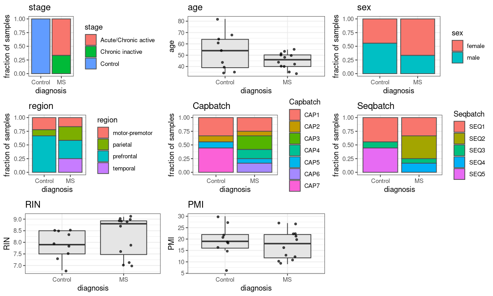<!-- -->

``` r
cao$plotDesign("associations")
```

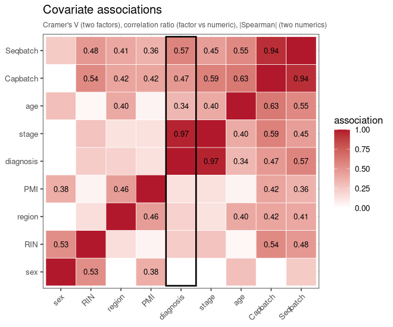<!-- -->

The check finds what the study design implies. `stage` is a refinement of the diagnosis (every stage belongs to one
arm), so it cannot be adjusted for. The batches are nested in the diagnosis: capture batch CAP7 (sequencing batch SEQ5)
contains only controls, CAP3, CAP4 and CAP6 (SEQ2, SEQ4) only MS samples, and only CAP1, CAP2 and CAP5 contain both
arms. Controls are older on average (median 54 vs 46 years) and more often from the prefrontal cortex (6 of 9 vs 4 of
12). Sex, RIN and PMI are only weakly associated with the diagnosis (0.00, 0.24 and 0.14), although the MS samples are more
often female (8 of 12 vs 4 of 9); the check still warns that 7 of the 12 MS samples have a higher RIN than any control,
and notes that 2 controls have a PMI outside the range of the MS samples. The check also notes that several covariates are associated with each other (age with
batch, batch with region, the two batches with each other), so a model with several of them estimates only each one's
unique contribution.

## Screen covariates

The screen tests every covariate against the sample-to-sample expression distances of each cell type. Cell types with
fewer than 6 samples are skipped (here `Phagocytes` and `Stromal cells`), and a covariate that is constant
among a cell type's samples is skipped for that cell type.

``` r
cao$screenCovariates(n.permutations = 199)
```

    Covariate screen: 9 covariates x 15 cell types, marginal + partial mode, permutation p-values (199 permutations)
      not screened (fewer than 6 samples): Phagocytes, Stromal cells
      partial mode fell back to marginal in 15 of 15 cell types (too few residual degrees of freedom for the full covariate set)
    Associated with expression in >= 3 cell types (partial, FDR 5%): Seqbatch (13 types, global p 0.005), Capbatch (11 types, global p 0.005)
    Strongly tied to 'diagnosis' (possible over-adjustment): stage (0.97), Seqbatch (0.57)
    all cell types (marginal, partial fell back, FDR 5%): Capbatch (adj. R2 0.18), Seqbatch (adj. R2 0.17), stage (adj. R2 0.06)
    composition (marginal, partial fell back, FDR 5%): Capbatch (adj. R2 0.43), Seqbatch (adj. R2 0.42), stage (adj. R2 0.21), diagnosis (adj. R2 0.15), region (adj. R2 0.14)
    Suggested model: ~diagnosis + Capbatch   (not applied; see cao$setModel())

``` r
cao$plotCovariateScreen()
```

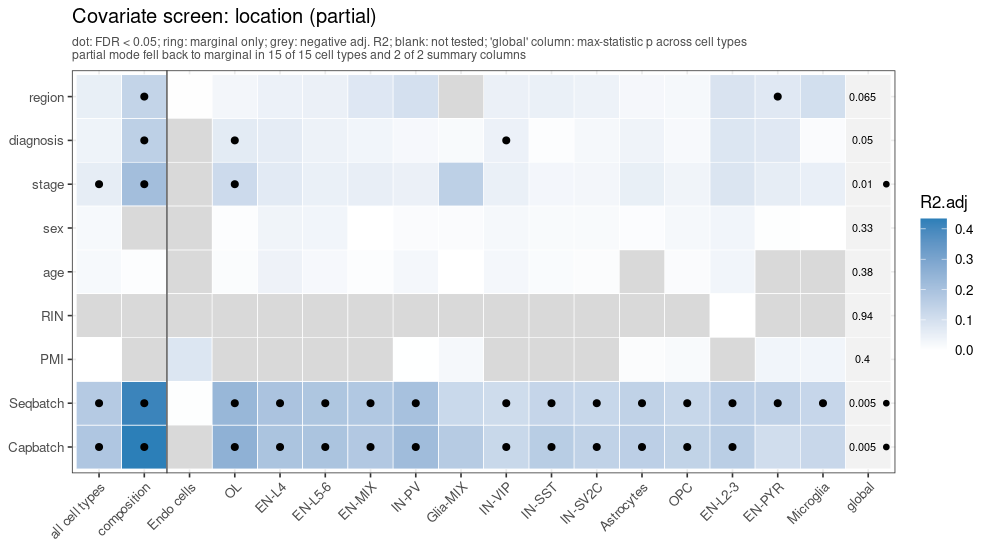<!-- -->

``` r
cao$plotCovariateSummary()
```

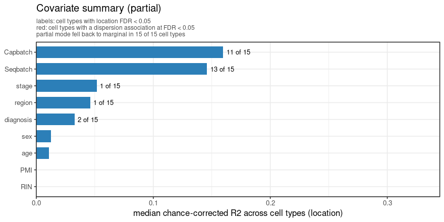<!-- -->

The batches dominate: sequencing and capture batch are associated with expression in 13 and 11 of the 15 screened cell types and explain about 15 and 16 % of the between-sample variation in the median (the summary bars show the median location R2 with
the number of significant cell types; dispersion associations are reported only as counts, and no covariate has
one). The diagnosis itself passes the FDR threshold in IN-VIP and OL and in the composition summary column; `stage` tracks it and passes in OL and in the all-cell-types and composition columns. Sex, age, RIN and PMI are not associated with expression in any cell type, and region only in EN-PYR (and with the composition, adj. R2 0.14). Two caveats about the screen on this design:
with 21 samples and 9 covariates, several with many levels, the partial mode (each covariate adjusted for all
others) has too few residual degrees of freedom and falls back to the marginal test in every cell type, so the two
modes coincide here; and the screen flags `stage` and `Seqbatch` as strongly tied to the diagnosis (possible
over-adjustment) and therefore suggests only `~ diagnosis + Capbatch`, although Capbatch is nested in the diagnosis
as well (association 0.47, just under the flagging threshold), as the design check said. The variance partition
shows the same picture for the three covariates of interest: batch first (up to about a quarter of the variation, in
OL), diagnosis a distant second (at most about 3 %), age close to nothing (about 2 % in microglia).

``` r
cao$plotVariancePartition(c("diagnosis", "Capbatch", "age"))
```

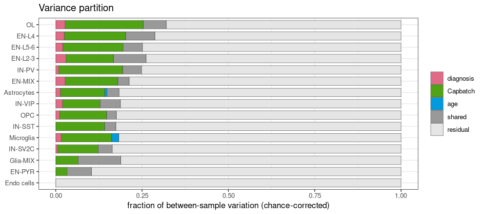<!-- -->

### Sample maps

The maps show the samples in two dimensions (MDS of the sample distances) for one cell type, for all cell types combined, or for the cell-type composition; the subtitles give the chance-corrected R² and permutation p-value of each color and shape variable on its own (the screen's marginal mode; the screen's summary lines print the partial mode where the degrees of freedom allow it).

The sample maps make the covariate structure visible without a model. In EN-L2-3 the capture batch explains twice as
much as the diagnosis (adj. R² 0.16 against 0.08): the CAP1 controls sit together at the right, the CAP7 controls in the
upper half. Averaged over all cell types, the samples group by sequencing batch rather than by diagnosis (0.17 against 0.04): the SEQ1 samples fill the right and lower part of the map, controls and MS samples apart, while the SEQ2/SEQ4 MS
samples and the SEQ5 controls share the left half, which is the pattern behind the screen result. The composition follows the sequencing batch even more closely (0.42; diagnosis 0.15): the SEQ5 controls, the SEQ1 samples and the SEQ2
samples form separate groups.

``` r
cowplot::plot_grid(
  cao$plotSampleDistances(cell.type = "EN-L2-3", color.by = "Capbatch", shape.by = "diagnosis"),
  cao$plotSampleDistances(color.by = "diagnosis", shape.by = "Seqbatch"),
  cao$plotSampleDistances(space = "composition", color.by = "diagnosis", shape.by = "Seqbatch"),
  ncol = 3)
```

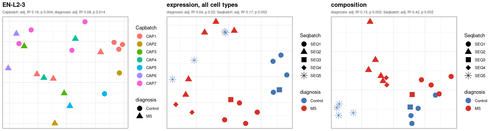<!-- -->

## Set the model

The model contains only the diagnosis. The reference level is `Control` (matched by name); `shift > 0` means that MS
samples differ from control samples in a common direction. With two arms of 12 and 9 samples, label permutations are
exact (block permutations, 293,930 distinct relabelings).

``` r
cao$setModel(~ diagnosis, test = "diagnosis")
```

    Model: ~diagnosis      dispersion: ~diagnosis
    Test: diagnosis: MS vs Control  (reference 'Control': matched a control-like name; to change: test = "diagnosis: Control vs MS")
           unadjusted; permutations: block (293,930 distinct); 21 of 21 samples can change their value; smallest p-value 0.002
           shift > 0: MS samples differ from Control samples in a common direction, beyond within-group variability
    Samples: 21 used.   Issues: none

## Expression shifts per cell type

Two questions are asked per cell type: whether its expression changed, tested gene by gene (the contrast of each
gene over its standard error, the gene z-scores combined adaptively; `statistic = "gsd"`, permutation p-values adjusted
across cell types), and how much, from a model of the sample-to-sample distances (`shift`: the distance between the
arm means relative to the within-arm spread; `var`: the log2 ratio of the arm dispersions at equal cell numbers).

``` r
res <- cao$estimateExpressionShiftMagnitudes()
```

    Building pseudobulk profiles per cell type...

    Testing 19 cell type(s), 1 test(s) with gsd (19756 genes, per type those in >= 5 % of its cells), 499 permutations...

    Building pseudobulk profiles per cell type...

    Testing 17 cell type(s), 1 test(s), 499 permutations (auto)...

    Skipped 4 cell type/test combination(s): contrast involves a level absent in this cell type; too few samples with enough cells

    Note: Endo cells: only 120 distinct permutations: the smallest attainable p-value is 0.00833

    Note: Glia-MIX: only 84 distinct permutations: the smallest attainable p-value is 0.0119

    Note: Microglia: only 91 distinct permutations: the smallest attainable p-value is 0.011

    2 of 15 cell types with a significant shift at FDR 5% (global p = 0.048).

``` r
res
```

    Expression shifts: diagnosis: MS vs Control; unadjusted; 499 block permutations (smallest p 0.002-0.012); statistic gsd
       celltype  n n.mag shift padj.shift   var padj.var total padj.total
         EN-PYR 16    12  0.20      0.063  0.36     0.15  0.37      0.030
        EN-L2-3 20    20  0.18      0.055  0.08     0.47  0.21      0.066
             OL 21    20  0.15      0.045  0.24     0.15  0.25      0.045
          EN-L4 20    20  0.13      0.063  0.07     0.62  0.16      0.110
      Microglia 15    14  0.10      0.045  0.31     0.47  0.24      0.420
         IN-VIP 21    21  0.10      0.055  0.05     0.62  0.12      0.066
        EN-L5-6 20    20  0.09      0.063  0.04     0.62  0.11      0.100
     Astrocytes 21    21  0.08      0.063  0.08     0.62  0.11      0.066
         EN-MIX 21    20  0.07      0.055  0.08     0.47  0.10      0.110
       Glia-MIX 15     9  0.05      0.340  0.22     0.62  0.14      0.420
        IN-SV2C 21    21  0.05      0.210  0.01     0.82  0.05      0.110
          IN-PV 21    21  0.04      0.210  0.04     0.62  0.06      0.160
            OPC 21    21  0.04      0.055  0.06     0.62  0.06      0.110
         IN-SST 21    21  0.01      0.200  0.01     0.82  0.02      0.660
     Endo cells 11    10 -0.02      0.200 -0.03     0.82 -0.03      0.800
      2 of 15 cell types with a significant shift (BH 5%); global p: shift 0.048, var 0.05, total 0.04
      not tested: Phagocytes, Stromal cells, B cells, T cells
      (normalized effects; full tables in $results and $wide)

Cell types are tested in the samples with at least 5 of their nuclei (`n`); the magnitudes come from the samples with at
least 10 (`n.mag`), because a profile of a handful of nuclei is mostly sampling noise, which shrinks the distance-based
shift. `Microglia` are tested in 15 samples (they are abundant in the lesions and rare in control cortex); `Phagocytes`
(one control sample), `Stromal cells` (MS only), T cells and B cells are not.

``` r
cao$plotExpressionShiftMagnitudes(show.ci = TRUE, show.genes = TRUE)
```

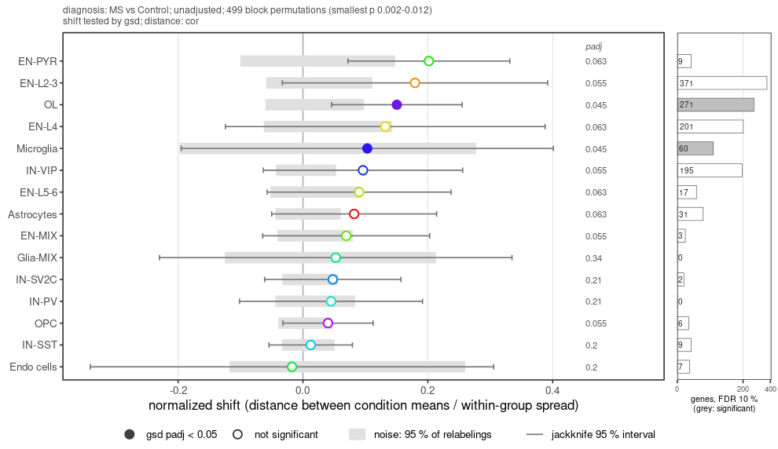<!-- -->

Cell types are ordered by the size of the shift; filled points have a significant shift by the gene-level test, the gray
band is the range of the shift with shuffled labels, the intervals are the jackknife 95 % intervals, and the margin counts
the genes changed at a gene-level FDR of 10 %. Two of the 15 tested cell types have a significant shift at FDR 5 %, the oligodendrocytes and the microglia (adjusted p 0.045); the gene-level test puts EN-L2-3, IN-VIP, EN-MIX and OPC just above the threshold (0.055) and EN-PYR, EN-L4, EN-L5-6 and the astrocytes at 0.063, and the global p of the shift test is 0.048. By size, EN-PYR leads (0.20), followed by EN-L2-3 (0.18), the oligodendrocytes (0.15) and EN-L4 (0.13), then a group of small shifts: microglia, IN-VIP, EN-L5-6, astrocytes and EN-MIX (0.07-0.10), `Glia-MIX`, IN-SV2C, IN-PV and OPC (0.04-0.05), and IN-SST and the endothelial cells at zero. The largest shifts are not the significant ones: EN-PYR and EN-L2-3 lie outside the range that shuffled labels give (gray band), as do the oligodendrocytes, IN-VIP and the astrocytes, but EN-PYR's magnitude rests on 12 samples and the gene-level test, which decides significance, finds a consistent change in neither at the 5 % level. The shifts are small (normalized shift up to 0.20); of the two significant types the oligodendrocyte estimate lies above the band and the microglial one inside its wide band: the gene-level test detects a consistent change that is small relative to the donor-to-donor spread.

The jackknife intervals say the same: 13 of the 15 intervals include zero, the microglial one among them; only those of EN-PYR and the oligodendrocytes exclude it. The two statements are compatible: the change is consistent in direction across the donors (what
the permutation test sees), but its size depends on single samples (what the jackknife sees). The genes changed at a gene-level FDR of 10 % are concentrated in EN-L2-3 (371), the oligodendrocytes (271), EN-L4 (201) and IN-VIP (195), with 60 in the microglia and 31 in the astrocytes.

``` r
cao$plotExpressionShiftMagnitudes(effect = "var")
```

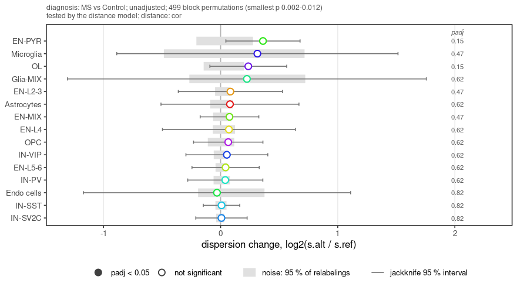<!-- -->

The dispersion change, compared at equal numbers of nuclei per sample, is positive in most cell types (MS samples more heterogeneous) but significant in none; EN-PYR and the oligodendrocytes come closest (adjusted p 0.15).

The sample-level pictures below show which samples set the size of the shifts.

### Behind one cell type

``` r
cao$plotShiftDetail("EN-L2-3")
```

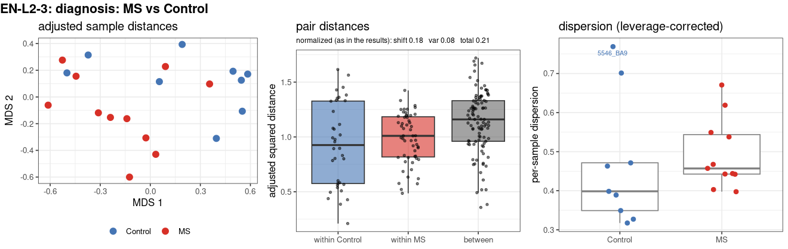<!-- -->

In EN-L2-3 the between-arm pair distances are larger than the within-arm distances, but the control arm is itself heterogeneous: two control samples have the highest per-sample dispersion of the arm, 5546_BA9 (capture batch CAP7) above all.

``` r
cao$plotSampleInfluence()
```

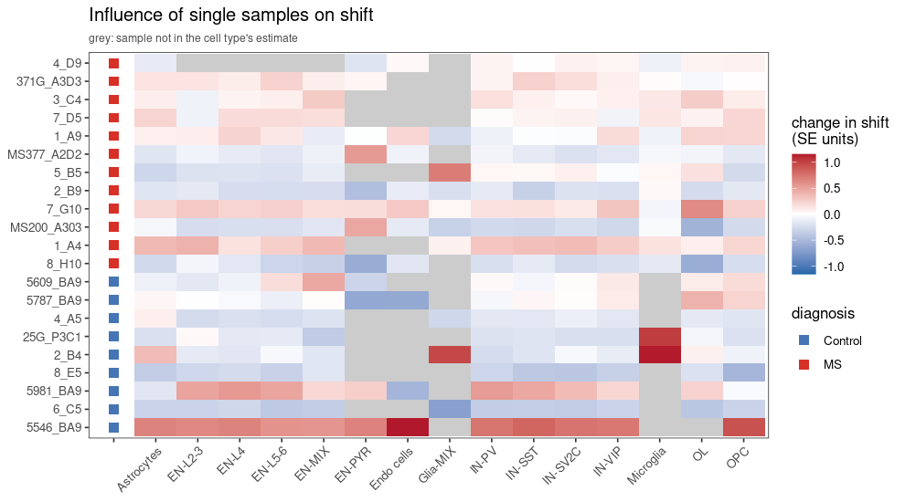<!-- -->

<!-- NEW (round 32): the same diagnostics layout as for the composition -->
``` r
cao$plotFitDiagnostics("expression.shifts")
```

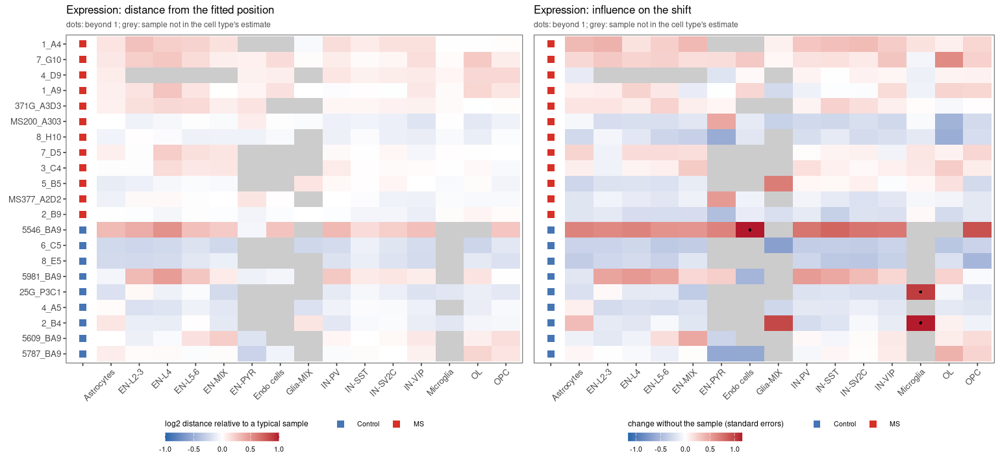<!-- -->

``` r
cowplot::plot_grid(cao$plotSampleDistances(values = "residual", color.by = "Seqbatch", shape.by = "diagnosis"),
                   cao$plotSampleDistances(values = "residual", color.by = "RIN", shape.by = "diagnosis"),
                   cao$plotSampleDistances(values = "residual", color.by = "region", shape.by = "diagnosis"), ncol = 3)
```

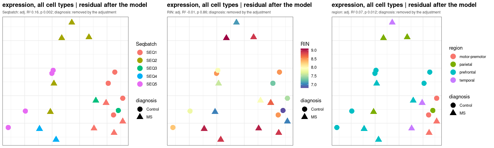<!-- -->

The residual maps show the samples on the distances that remain once the diagnosis is removed from the profiles
(`values = "residual"`), colored by variables that are not in the model. The sequencing batch explains 16 % of these
residual distances (p 0.002), the region 7 % (p 0.012), the RNA integrity nothing (p 0.86): of the three variables
shown, the sequencing batch explains the largest part of what remains after the diagnosis. The section "The sequencing batch" below asks what this does to the
results.

<!-- END NEW -->

The influence map makes the dependence explicit: leaving out the control sample 5546_BA9 increases the shift by about
half a standard error in nearly every cell type (it is a control that looks MS-like in expression), and 5981_BA9 acts
the same way in the neurons. The MS sample 1_A4 acts the same way in the excitatory neurons (an MS sample that looks
control-like), while leaving out 2_B9 or 8_H10 lowers the shift slightly in most types; in the microglia, which few control samples carry, two controls (2_B4 and 25G_P3C1) raise the shift most. No single sample creates the effect, but a few samples set its size.

## Robustness to the covariates

The shifts are re-estimated under alternative adjustment sets: unadjusted (the current model), plus each of the top
screened covariates, and all of them together when the degrees of freedom allow. `stage` is excluded from the candidate
covariates (aliased with the diagnosis), so each cell type is compared across five models: unadjusted, plus `Seqbatch`, plus `Capbatch`, plus `region`, and all screened covariates together (the two batches add nothing to each other, because every sequencing batch is a union of capture batches). EN-PYR and endothelial cells have too few samples for the batch-adjusted models. Each cell type gets two
verdicts. The magnitude verdict compares the distance-model estimates across the models and checks the influence of
single samples (read from the current result); a shift within the noise band of shuffled labels is "near zero", and its
changes are not judged. The significance verdict counts the models in which the gene-level test, refitted under each
model, calls the shift (adjusted p < 0.05); filled points in the plot. Each model's estimate carries its jackknife 95 %
interval and, as a thin line, its range over the leave-one-sample-out refits.

``` r
cao$checkSensitivity(n.permutations = 199)
```

    Sensitivity of 'diagnosis: MS vs Control' (shift) across 5 models: current [~diagnosis]; plus Seqbatch [~diagnosis + Seqbatch]; plus Capbatch [~diagnosis + Capbatch]; plus region [~diagnosis + region]; all screened [~diagnosis + Seqbatch + Capbatch + region]
      magnitude: distance model; significance: gsd (adjusted p < 0.05)
      EN-PYR     magnitude stable; not significant in any of 2 models
      EN-L2-3    magnitude driven by sample 5546_BA9; significant in 1 of 5 models (only with: plus Seqbatch)
      OL         magnitude driven by sample 7_G10; significant in 3 of 5 models (not with: plus Capbatch, all screened)
      EN-L4      magnitude near zero (within the relabeling band); significant in 1 of 5 models (only with: plus Seqbatch)
      Microglia  magnitude near zero (within the relabeling band); significant in 1 of 5 models (not with: plus Seqbatch, plus Capbatch, plus region, all screened)
      IN-VIP     magnitude driven by sample 5546_BA9; significant in 2 of 5 models (only with: plus Seqbatch, plus region)
      EN-L5-6    magnitude near zero (within the relabeling band); not significant in any of 5 models
      Astrocytes magnitude driven by sample 5546_BA9; not significant in any of 5 models
      EN-MIX     magnitude near zero (within the relabeling band); significant in 1 of 5 models (only with: plus region)
      Glia-MIX   magnitude near zero (within the relabeling band); not significant in any of 4 models
      IN-SV2C    magnitude near zero (within the relabeling band); not significant in any of 5 models
      IN-PV      magnitude near zero (within the relabeling band); not significant in any of 5 models
      OPC        magnitude near zero (within the relabeling band); significant in 2 of 5 models (only with: plus Seqbatch, plus region)
      Endo cells magnitude near zero (within the relabeling band); not significant in any of 2 models
      IN-SST     magnitude near zero (within the relabeling band); not significant in any of 5 models

``` r
cao$plotSensitivity()
```

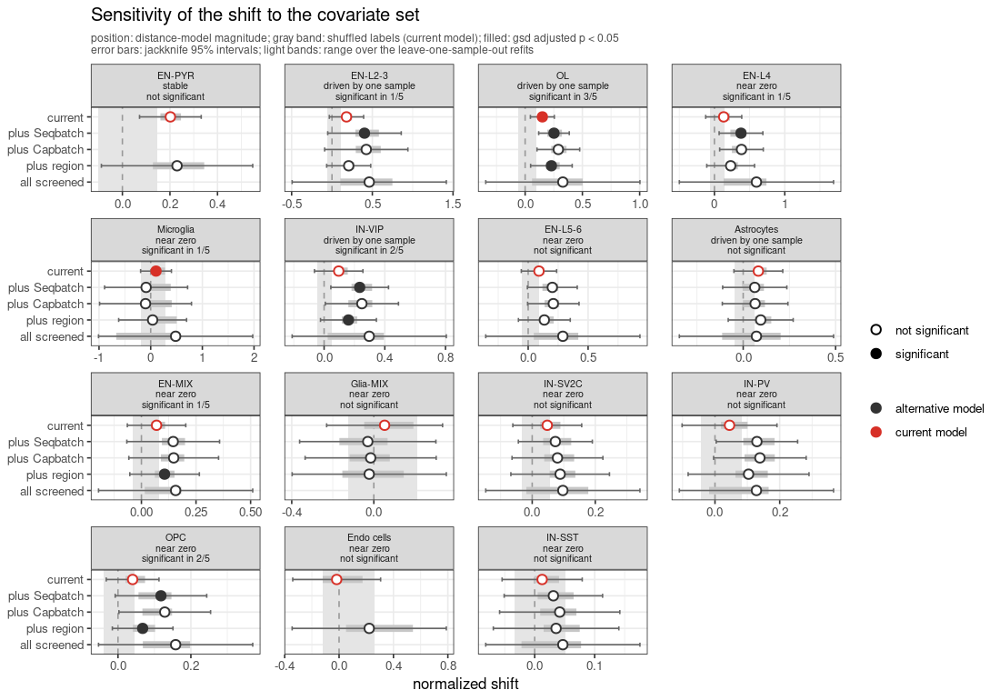<!-- -->

In size, adjusting for either batch does not remove the diagnosis effect; it makes it larger in most cell types: EN-L2-3 goes from 0.18 to about 0.4 and EN-L4 from 0.13 to 0.38, the shifts of EN-L5-6, EN-MIX, IN-VIP, OPC and IN-PV double or more, and that of OL grows from 0.15 to 0.25-0.29, because the batch-adjusted contrast is estimated within the mixed batches (CAP1, CAP2 and CAP5, which make up SEQ1
and SEQ3), where the MS-control difference is not diluted by the between-batch variation. Taken at face value the batch
effect masks part of the disease effect rather than producing it.

The significance does not follow the size: with the sequencing batch in the model the gene-level test calls EN-L2-3, EN-L4, OL, IN-VIP and OPC (adjusted p 0.04), not EN-L5-6, EN-MIX, microglia or astrocytes; with the capture batch in the model it calls no cell type (seven types sit exactly at adjusted p 0.05, the others above), with the region OL, IN-VIP, EN-MIX and OPC, and with all screened covariates together none. With batches nested in the diagnosis
the adjusted contrast rests on the 5 MS and 5 control samples of the mixed batches and on few distinct relabelings, so
the larger estimate comes with less power.

The magnitude verdicts add that the size depends on single samples: leaving out the control 5546_BA9 changes it markedly in EN-L2-3, IN-VIP and the astrocytes ("driven by one sample"), the MS sample 7_G10 in the oligodendrocytes; EN-PYR is stable, and the other ten types lie within the noise band of shuffled labels. The conclusion that MS cortex differs from control cortex in these
cell types is robust in direction, not in size. For EN-PYR and the endothelial cells only the unadjusted and the region-adjusted models can be fitted (neither significant). Three glial types go the other way: the microglial shift turns slightly negative once either batch is adjusted for (0.10 to about -0.1), and the astrocyte (0.08 to 0.06) and `Glia-MIX` (0.05 to about -0.02) shifts shrink, so for these the batch structure, not the diagnosis alone, may carry the difference.

## Composition

The compositional analysis tests the same contrast on the cell-type proportions (log-ratios, presented against a
reference set of cell types that do not change relative to each other).

``` r
cao$estimateCellLoadings()
cao$plotCellLoadings(center = "both", min.effect = 1.5)
```

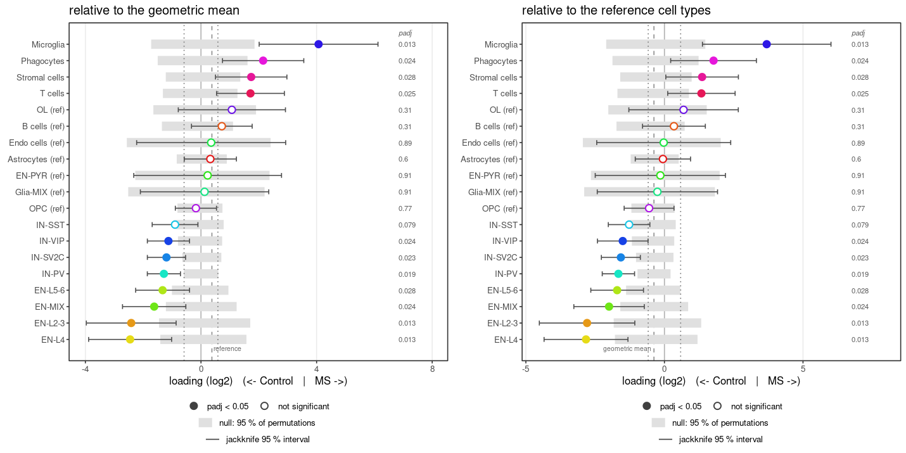<!-- -->

The lines through the points are jackknife 95 % intervals of the loadings (one sample left out at a time); the dotted lines
mark a 1.5-fold change. The table gives the loadings with their model-based 95 % intervals (`ci.low`, `ci.high`, close to the
jackknife ones), the number of cells each loading rests on, and how far it moves when the pseudocount is halved or doubled.

``` r
knitr::kable(codaLoadingsTable(cao$test.results$coda, min.effect = 1.5), digits = 3)
```

| celltype      | loading | fold.change |    se | ci.low | ci.high |  pval |  padj | reference | median.cells | n.zero | pseudocount.shift | beyond.min.effect |
|:--------------|--------:|------------:|------:|-------:|--------:|------:|------:|:----------|-------------:|-------:|------------------:|:------------------|
| Microglia     |   4.069 |      16.778 | 0.926 |  2.131 |   6.006 | 0.002 | 0.013 | FALSE     |           42 |      3 |             0.323 | TRUE              |
| EN-L4         |  -2.451 |       0.183 | 0.815 | -4.158 |  -0.745 | 0.002 | 0.013 | FALSE     |          130 |      1 |             0.253 | TRUE              |
| EN-L2-3       |  -2.413 |       0.188 | 0.875 | -4.245 |  -0.581 | 0.002 | 0.013 | FALSE     |          253 |      1 |             0.233 | FALSE             |
| IN-PV         |  -1.283 |       0.411 | 0.311 | -1.935 |  -0.631 | 0.004 | 0.019 | FALSE     |           84 |      0 |             0.393 | TRUE              |
| IN-SV2C       |  -1.194 |       0.437 | 0.350 | -1.927 |  -0.461 | 0.006 | 0.023 | FALSE     |           30 |      0 |             0.372 | FALSE             |
| Phagocytes    |   2.151 |       4.440 | 0.737 |  0.607 |   3.694 | 0.008 | 0.024 | FALSE     |            1 |      8 |             0.526 | TRUE              |
| EN-MIX        |  -1.619 |       0.325 | 0.576 | -2.825 |  -0.414 | 0.010 | 0.024 | FALSE     |           62 |      0 |             0.217 | FALSE             |
| IN-VIP        |  -1.126 |       0.458 | 0.386 | -1.934 |  -0.319 | 0.010 | 0.024 | FALSE     |          116 |      0 |             0.314 | FALSE             |
| T cells       |   1.712 |       3.277 | 0.670 |  0.311 |   3.114 | 0.012 | 0.025 | FALSE     |            0 |     11 |             0.662 | FALSE             |
| Stromal cells |   1.737 |       3.335 | 0.595 |  0.492 |   2.983 | 0.016 | 0.028 | FALSE     |            3 |      6 |             0.579 | FALSE             |
| EN-L5-6       |  -1.328 |       0.398 | 0.484 | -2.340 |  -0.316 | 0.016 | 0.028 | FALSE     |          110 |      0 |             0.253 | FALSE             |
| IN-SST        |  -0.897 |       0.537 | 0.428 | -1.793 |  -0.002 | 0.050 | 0.079 | FALSE     |           60 |      0 |             0.283 | FALSE             |
| B cells       |   0.721 |       1.648 | 0.609 | -0.553 |   1.995 | 0.226 | 0.312 | TRUE      |            0 |     16 |             0.384 | FALSE             |
| OL            |   1.069 |       2.097 | 0.897 | -0.809 |   2.946 | 0.230 | 0.312 | TRUE      |          593 |      0 |             0.128 | FALSE             |
| Astrocytes    |   0.323 |       1.251 | 0.417 | -0.550 |   1.196 | 0.474 | 0.600 | TRUE      |          264 |      0 |             0.282 | FALSE             |
| OPC           |  -0.175 |       0.885 | 0.371 | -0.953 |   0.602 | 0.648 | 0.770 | TRUE      |          141 |      0 |             0.320 | FALSE             |
| Endo cells    |   0.352 |       1.277 | 1.237 | -2.237 |   2.941 | 0.798 | 0.892 | TRUE      |            5 |      7 |             0.045 | FALSE             |
| EN-PYR        |   0.230 |       1.173 | 1.241 | -2.367 |   2.828 | 0.866 | 0.914 | TRUE      |           39 |      1 |             0.133 | FALSE             |
| Glia-MIX      |   0.124 |       1.090 | 1.093 | -2.164 |   2.412 | 0.914 | 0.914 | TRUE      |            8 |      2 |             0.056 | FALSE             |

### The samples behind the composition result

``` r
cao$plotCodaSamples(n.top = 12)
```

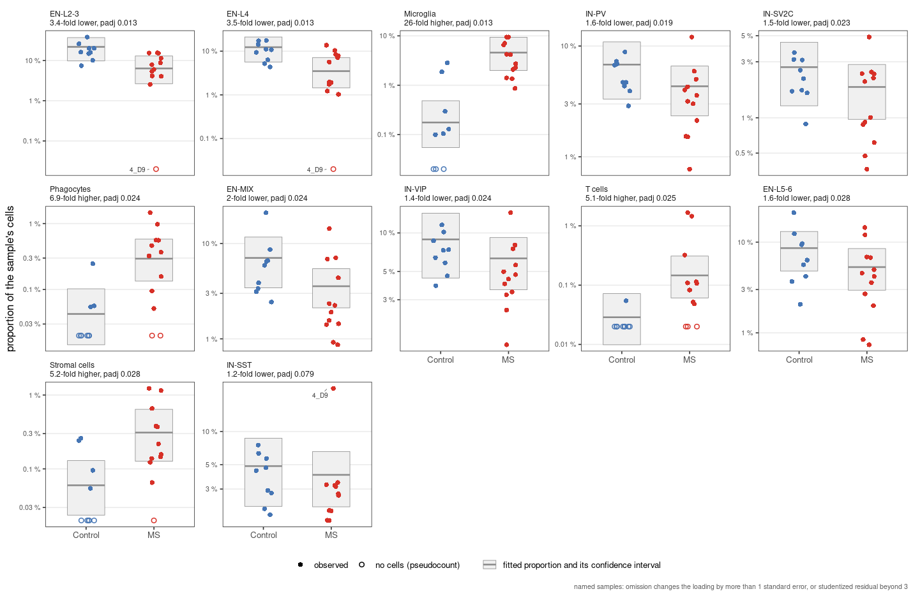<!-- -->

``` r
cao$plotFitDiagnostics("composition")
```

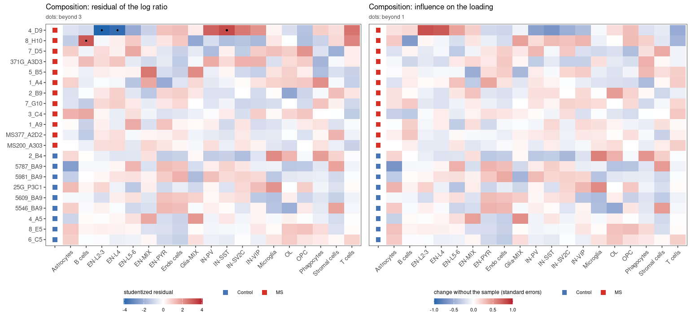<!-- -->

The samples' proportions of the 12 cell types with the smallest adjusted p-values, with the fitted proportion of each
condition (gray box): the changes are carried by most samples of each condition rather than by a few. One MS sample
stands out: `4_D9` has no cells of the upper-layer excitatory neurons `EN-L2-3` and `EN-L4` (open circles, drawn at the
pseudocount) and the largest IN-SST proportion of all samples. The fit diagnostics show the same sample from the side
of the model: it has the three studentized residuals beyond 3 (`EN-L2-3`, `EN-L4`, IN-SST) and moves the `EN-L2-3` and
`EN-L4` loadings by about one standard error when left out; one other residual beyond 3 is `8_H10` in the B cells. The
model without `4_D9` is fitted below.

### Composition with a random intercept for the sequencing batch

``` r
cao$estimateCellLoadings(formula = ~ diagnosis + (1 | Seqbatch), random.baseline = TRUE, name = "coda.batch")
cao$plotCellLoadings(name = "coda.batch", center = "both", min.effect = 1.5)
```

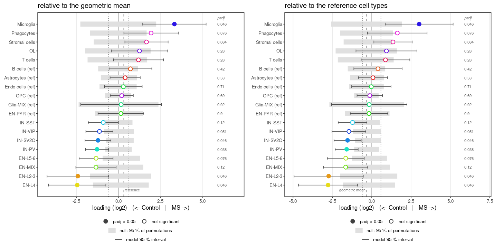<!-- -->

``` r
round(cao$test.results$coda.batch$random$icc, 2)   # share of each cell type's variance between sequencing batches
```

       Astrocytes       B cells       EN-L2-3         EN-L4       EN-L5-6 
             0.32          0.00          0.00          0.00          0.00 
           EN-MIX        EN-PYR    Endo cells      Glia-MIX         IN-PV 
             0.41          0.87          0.91          0.13          0.18 
           IN-SST       IN-SV2C        IN-VIP     Microglia            OL 
             0.00          0.18          0.00          0.50          0.50 
              OPC    Phagocytes Stromal cells       T cells 
             0.59          0.09          0.06          0.24 

With `random.baseline = TRUE` the grouping term `(1 | Seqbatch)` is fitted as a random baseline per sequencing batch:
each cell type's log ratio gets a random intercept per batch, the loadings are generalized least-squares estimates with
a variance ratio estimated per cell type, and they are tested by their t statistics against 499 relabeled data sets on
which the whole fit is repeated, with the residuals, freed of the correlation within batches, exchanged among all
samples. (Without it the grouping term would only restrict the relabeling: the diagnosis exchanged within batches, and
batches that hold one diagnosis exchanged as wholes among batches of the same make-up.) The printed values are the
share of each cell type's variance that lies between the batches. Five cell types remain significant (EN-L2-3, EN-L4,
IN-PV, IN-SV2C and microglia; adjusted p 0.038-0.046), IN-VIP just misses (0.051), and the microglial loading is 3.3
instead of 4.1 (log2); the loadings of EN-L2-3, EN-L4, EN-L5-6, IN-VIP, IN-SST and the B cells are those of the fixed-effect model,
because their between-batch share is estimated at zero.

### Composition without sample 4_D9

``` r
cao$excludeSamples("4_D9")
cao$estimateCellLoadings(name = "coda.no4D9")
cao$plotCellLoadings(name = "coda.no4D9", center = "both", min.effect = 1.5)
```

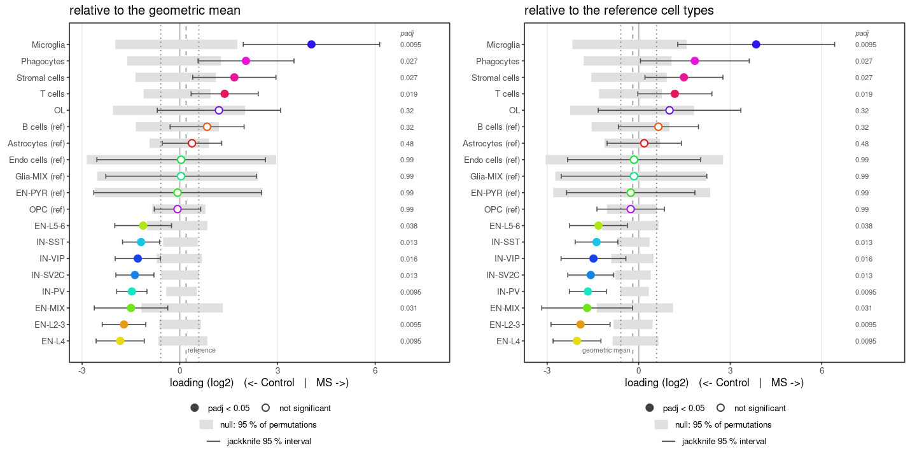<!-- -->

``` r
cao$excludeSamples(NULL)
```

<!-- END NEW -->

Each point is the loading of the contrast on a cell type (log2), relative to the geometric mean of all cell types
(left) or centered on the reference set (right; reference types marked "(ref)", the dashed line the other frame's
zero); the gray band holds 95 % of the loading under permuted labels, so a filled point outside it is a significant
change, by the reference-free test in both panels. The composition reflects the lesion biology reported by the study:
the excitatory neurons of layers 2-6 (EN-L2-3, EN-L4, EN-L5-6, EN-MIX) and the PV, SV2C and VIP interneurons are depleted
in the MS samples (adjusted p 0.013-0.028; IN-SST at 0.079), while microglia (0.013), phagocytes, T cells and stromal
cells (0.024-0.028) are enriched.

The reference set is the largest block of cell types whose proportions do not change relative to each other (pairwise
permutation tests of the loading differences): here the seven glial and vascular populations (astrocytes, OL, OPC,
EN-PYR, Glia-MIX, endothelial and B cells). The eight neuronal types form a block of their own that moves as one, and
the composition cannot tell which of two blocks of similar size is the stable one, so the one closest to the center of
the composition is taken; the test relative to the geometric mean of all cell types remains the primary one.

``` r
cao$plotContrastTree()
```

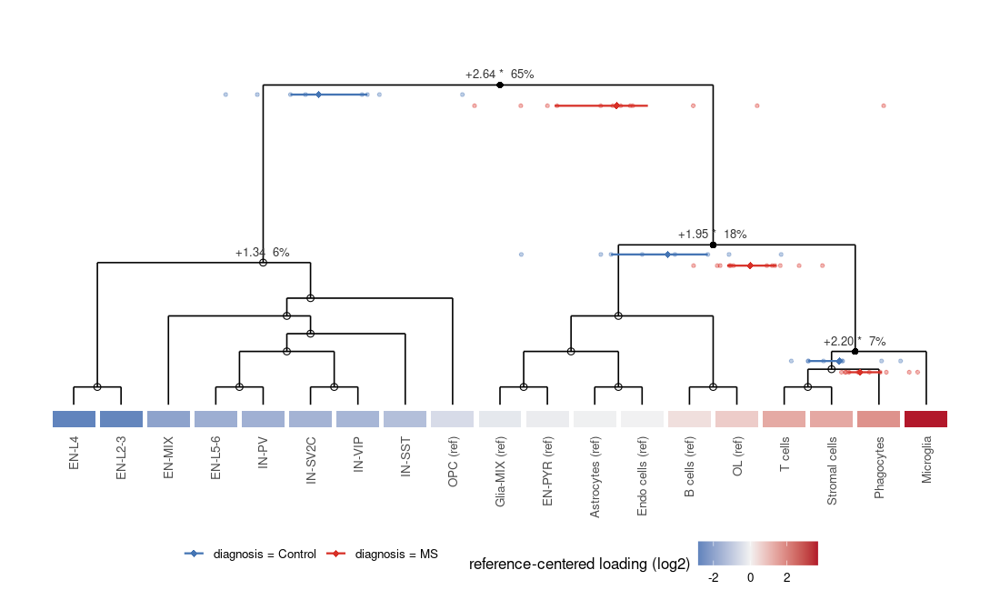<!-- -->

The contrast tree explains the compositional shift with as few balances as possible: each node compares the
geometric-mean proportions of its two sides between the conditions (the log2 ratio, the significance code of its
permutation p-value and the share of the shift it explains); the samples' own ratios are shown at the significant nodes,
and the tiles are the reference-centered loadings. The root balance sets the eight neuronal types and the OPCs against the
other ten populations (glia, EN-PYR, vascular and immune cells; log2 ratio 2.6, adjusted p 0.018, 65 % of the shift);
below it, the microglia, phagocytes, T cells and stromal cells against OL, astrocytes, EN-PYR, Glia-MIX, endothelial
and B cells (1.9, 0.018, 18 %), and below that the microglia against the T cells, stromal cells and phagocytes (2.2, 0.036, 7 %). These three
significant balances explain 90 % of the shift.

``` r
cao$plotCodaCellTypes(value = "predicted")
```

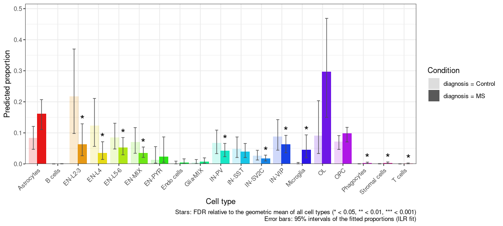<!-- -->

The model-predicted proportions at the two conditions do not depend on the reference set (the stars are the per-type
test relative to the geometric mean, the error bars 95 % intervals of the fitted proportions): the layer 2-3 and layer 4 excitatory neurons make up 22 % and 12 % of the nuclei
in the controls against 6 % and 3.5 % in MS, while oligodendrocytes go from 9 % to 30 %, astrocytes from 8 % to 16 %
and microglia from 0.2 % to 4.6 %.

### Robustness of the composition

The sensitivity analysis of the expression shifts applies to the composition as well: the loadings are refitted
under the same alternative covariate sets, and under every model with each sample left out.

``` r
cao$checkSensitivity(analysis = "composition", n.permutations = 199)
```

    Sensitivity of 'diagnosis: MS vs Control' (loading) across 5 models: current [~diagnosis]; plus Seqbatch [~diagnosis + Seqbatch]; plus Capbatch [~diagnosis + Capbatch]; plus region [~diagnosis + region]; all screened [~diagnosis + Seqbatch + Capbatch + region]
      magnitude: loading (log2, relative to the geometric mean); significance: permutation test (vs the geometric mean) (adjusted p < 0.05)
      Microglia     magnitude stable; significant in 2 of 5 models (not with: plus Seqbatch, plus Capbatch, all screened)
      EN-L4         magnitude driven by sample 4_D9; significant in 1 of 5 models (not with: plus Seqbatch, plus Capbatch, plus region, all screened)
      EN-L2-3       magnitude driven by sample 4_D9; significant in 1 of 5 models (not with: plus Seqbatch, plus Capbatch, plus region, all screened)
      Phagocytes    magnitude estimate changes by 64% (plus Seqbatch); significant in 2 of 5 models (not with: plus Seqbatch, plus Capbatch, all screened)
      Stromal cells magnitude stable; significant in 2 of 5 models (not with: plus Seqbatch, plus Capbatch, all screened)
      T cells       magnitude driven by sample 4_D9; significant in 1 of 5 models (not with: plus Seqbatch, plus Capbatch, plus region, all screened)
      EN-MIX        magnitude stable; significant in 2 of 5 models (not with: plus Seqbatch, plus Capbatch, all screened)
      EN-L5-6       magnitude stable; significant in 2 of 5 models (not with: plus Seqbatch, plus Capbatch, all screened)
      IN-PV         magnitude stable; significant in 2 of 5 models (not with: plus Seqbatch, plus Capbatch, all screened)
      IN-SV2C       magnitude stable; significant in 2 of 5 models (not with: plus Seqbatch, plus Capbatch, all screened)
      IN-VIP        magnitude estimate changes by 72% (all screened); significant in 1 of 5 models (not with: plus Seqbatch, plus Capbatch, plus region, all screened)
      OL            magnitude near zero (within the relabeling band); not significant in any of 5 models
      IN-SST        magnitude near zero (within the relabeling band); not significant in any of 5 models
      B cells       magnitude near zero (within the relabeling band); not significant in any of 5 models
      Endo cells    magnitude near zero (within the relabeling band); not significant in any of 5 models
      Astrocytes    magnitude near zero (within the relabeling band); not significant in any of 5 models
      EN-PYR        magnitude near zero (within the relabeling band); not significant in any of 5 models
      OPC           magnitude near zero (within the relabeling band); not significant in any of 5 models
      Glia-MIX      magnitude near zero (within the relabeling band); not significant in any of 5 models

``` r
cao$plotSensitivity(analysis = "composition")
```

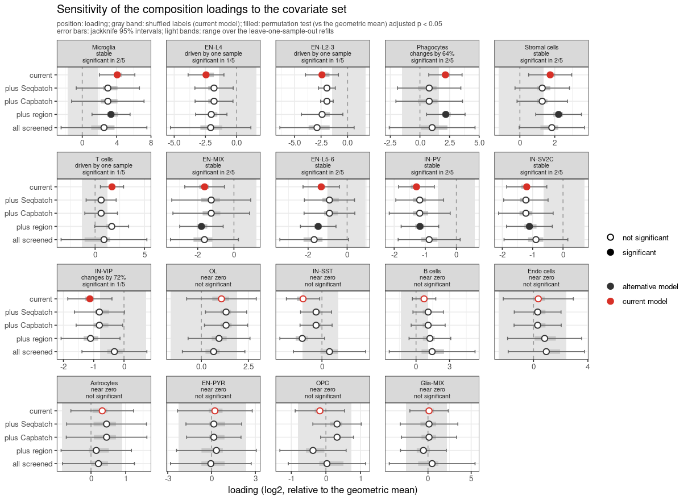<!-- -->

No cell type is called in all five models. With either batch in the model, or with all screened covariates together,
no loading is significant (adjusted p 0.11 or more): adjusting for either batch shrinks the loadings of the excitatory
layers, of `IN-VIP` and `IN-SST` and of the immune populations by a fifth to two thirds (EN-L4 from -2.5 to -1.8,
EN-L5-6 from -1.3 to -0.9, IN-SST from -0.9 to -0.3, microglia from 4.1 to 3.0, phagocytes from 2.2 to 0.8, in log2),
while the loadings of the PV and SV2C interneurons stay near -1.2. The region-adjusted model keeps microglia,
phagocytes, stromal cells, IN-PV, IN-SV2C, EN-L5-6 and EN-MIX (adjusted p 0.038-0.041) and loses EN-L2-3, EN-L4,
IN-VIP and the T cells (0.06-0.10). As with the expression shifts, the batch-adjusted contrasts rest on the mixed
batches only, and the two batch variables give the same estimates. Three loadings are "driven by one sample": leaving
out the MS sample `4_D9` changes those of EN-L2-3, EN-L4 and the T cells by a fifth or more. The glial loadings (OL
1.1, astrocytes 0.3, OPC -0.2), and those of IN-SST and the B cells, lie within the band of shuffled labels and are not
significant in any model. Unlike the expression shifts, the jackknife intervals of the current model agree with the
permutation test: they exclude zero for every significant cell type (microglia 2.0 to 6.1, EN-L2-3 -4.0 to -0.9,
IN-VIP -1.9 to -0.4).

## The sequencing batch

The design check found the sequencing batch associated with the diagnosis (0.57), and the residual maps above show the
samples grouping by batch once the diagnosis is removed. Two questions follow: does the batch change the data on its
own, and what do the results become when the diagnosis is only compared within batches?

``` r
table(sample.meta$diagnosis, sample.meta$Seqbatch)
```

             
              SEQ1 SEQ2 SEQ3 SEQ4 SEQ5
      Control    4    0    1    0    4
      MS         4    5    1    2    0

``` r
cao$excludeSamples(rownames(sample.meta)[sample.meta$diagnosis != "Control"])
cao$setModel(~ Seqbatch, test = "Seqbatch: all")
```

    Model: ~Seqbatch      dispersion: ~Seqbatch
    Test: Seqbatch (3 levels)
           unadjusted; permutations: block (630 distinct); 9 of 9 samples can change their value; smallest p-value 0.002
           location: the levels of Seqbatch differ in where their samples sit (a common direction per level), beyond within-level variability
    Samples: 9 used.   Issues: 1 warning
      warning: only 6 residual degrees of freedom (n = 9, 3 parameters) -> fewer covariates, or restrict to the test variable

``` r
cao$estimateCellLoadings(name = "coda.controls.batch")$results
```

         celltype       R2    R2.adj R2.partial       F df nu    r.eff p.location
    1 composition 0.693056 0.5619914   0.693056 6.77377  2  6 11.93783      0.014
         F.disp R2.disp.adj p.dispersion n scheme n.perm n.perm.distinct exhaustive
    1 0.3764216 -0.08453671         0.35 9  block    499             630      FALSE
      p.floor padj.location padj.dispersion p.fwer.location p.fwer.dispersion flags
    1   0.002         0.014            0.35           0.014              0.35      

``` r
cao$excludeSamples(NULL)
```

Among the 9 controls alone there is no diagnosis to confound, and the composition differs between their three
sequencing batches: the batch explains 56 % of the composition (chance-corrected R2 of the whole-factor test, p 0.014).
The batch is therefore associated with the measured composition without the diagnosis being involved, although among
the controls it is still aligned with age and region (the four SEQ5 controls are 34-54 years old and all prefrontal,
the four SEQ1 controls 61-82 years old). Two of the five batches hold MS samples only (`SEQ2`,
`SEQ4`) and one controls only (`SEQ5`), so a comparison over all samples mixes such batch differences into the MS
effect; only `SEQ1` and `SEQ3` hold both diagnoses (10 of the 21 samples).

``` r
cao$setModel(~ diagnosis + (1 | Seqbatch), test = "diagnosis")
```

    Model: ~diagnosis + (1 | Seqbatch)      dispersion: ~diagnosis
           grouping term (1 | Seqbatch): not fitted; the tested variable is exchanged within its levels
    Test: diagnosis: MS vs Control  (reference 'Control': matched a control-like name; to change: test = "diagnosis: Control vs MS")
           unadjusted; permutations: block within 5 strata (140 distinct); 10 of 21 samples can change their value; smallest p-value 0.0071
           shift > 0: MS samples differ from Control samples in a common direction, beyond within-group variability
    Samples: 21 used.   Issues: 1 warning, 1 note
      warning: test 'diagnosis: MS vs Control': only 140 distinct permutations; the smallest attainable p-value is 0.00714 -> fewer strata (block.vars), or more samples
      note: 'Seqbatch': 3 of 5 levels hold one value of 'diagnosis'; their samples keep it in every relabeling (10 of 21 samples can change their value)

``` r
cao$estimateExpressionShiftMagnitudes(name = "shifts.batch", verbose = FALSE)
cao$estimateCellLoadings(name = "coda.batch.relabel", verbose = FALSE)
```

``` r
sh <- function(nm) { r <- cao$test.results[[nm]]$results; r <- r[r$effect == "shift", ]; r }
a <- sh("expression.shifts"); b <- sh("shifts.batch"); m <- merge(a[, c("celltype", "estimate.norm", "padj")], b[, c("celltype", "estimate.norm", "padj")],
                                                                 by = "celltype", all = TRUE, suffixes = c(".all.samples", ".within.batch"))
m[, -1] <- signif(m[, -1], 2); m[order(m$padj.within.batch), ]
```

         celltype estimate.norm.all.samples padj.all.samples
    2     EN-L2-3                     0.180            0.055
    3       EN-L4                     0.130            0.063
    5      EN-MIX                     0.069            0.055
    12     IN-VIP                     0.096            0.055
    4     EN-L5-6                     0.090            0.063
    9       IN-PV                     0.045            0.210
    10     IN-SST                     0.012            0.200
    14         OL                     0.150            0.045
    15        OPC                     0.040            0.055
    13  Microglia                     0.100            0.045
    1  Astrocytes                     0.082            0.063
    11    IN-SV2C                     0.048            0.210
    6      EN-PYR                     0.200            0.063
    8    Glia-MIX                     0.053            0.340
    7  Endo cells                    -0.018            0.200
       estimate.norm.within.batch padj.within.batch
    2                       0.180             0.025
    3                       0.130             0.025
    5                       0.069             0.025
    12                      0.096             0.025
    4                       0.090             0.033
    9                       0.045             0.033
    10                      0.012             0.033
    14                      0.150             0.033
    15                      0.040             0.033
    13                      0.100             0.050
    1                       0.082             0.083
    11                      0.048             0.083
    6                       0.200             0.180
    8                       0.053             0.460
    7                      -0.018             1.000

``` r
colSums(m[, c("padj.all.samples", "padj.within.batch")] < 0.05, na.rm = TRUE)
```

     padj.all.samples padj.within.batch 
                    2                 9 

``` r
pc <- function(nm) cao$test.results[[nm]]$contrast$per_cell$padj
ct <- names(pc("coda"))
cp <- cbind(all.samples = pc("coda")[ct], within.batch = pc("coda.batch.relabel")[ct], random.intercept = pc("coda.batch")[ct])
signif(cp[order(cp[, "all.samples"]), ], 2); colSums(cp < 0.05)
```

                  all.samples within.batch random.intercept
    EN-L2-3             0.013        0.054            0.046
    EN-L4               0.013        0.054            0.046
    Microglia           0.013        0.100            0.046
    IN-PV               0.019        0.054            0.038
    IN-SV2C             0.023        0.054            0.046
    EN-MIX              0.024        0.190            0.120
    IN-VIP              0.024        0.097            0.051
    Phagocytes          0.024        0.380            0.076
    T cells             0.025        0.290            0.280
    EN-L5-6             0.028        0.140            0.076
    Stromal cells       0.028        0.140            0.084
    IN-SST              0.079        0.290            0.120
    B cells             0.310        0.090            0.420
    OL                  0.310        0.054            0.280
    Astrocytes          0.600        0.290            0.530
    OPC                 0.770        0.860            0.690
    Endo cells          0.890        0.440            0.710
    EN-PYR              0.910        0.710            0.900
    Glia-MIX            0.910        0.860            0.920

         all.samples     within.batch random.intercept 
                  11                0                5 

``` r
cowplot::plot_grid(cao$plotExpressionShiftMagnitudes(name = "expression.shifts") + ggplot2::ggtitle("all samples"),
                   cao$plotExpressionShiftMagnitudes(name = "shifts.batch") + ggplot2::ggtitle("within sequencing batches"), ncol = 2)
```

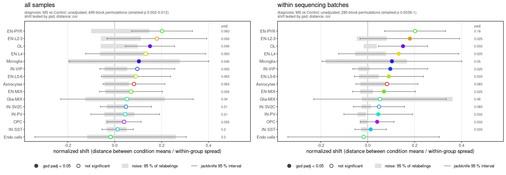<!-- -->

With the grouping term `(1 | Seqbatch)` the diagnosis is exchanged only within `SEQ1` and `SEQ3`; the samples of the
single-diagnosis batches keep their label in every relabeling (140 distinct relabelings, smallest p 0.0071).

- Composition: of the 11 cell types significant over all samples, none remains when the diagnosis is compared within
  batches, and 5 remain with a random intercept per batch (the layer 2-3 and 4 excitatory neurons, the PV and SV2C
  interneurons and the microglia, adjusted p 0.038-0.046). Given the batch effect among the controls, the composition
  result over all samples cannot be taken at face value; the random-intercept model, which keeps every sample but
  allows each batch its own baseline, is the more credible estimate.
- Expression shifts: the opposite. The magnitudes are the same in both models (the same samples and profiles), but
  within batches 9 of 15 cell types are significant against 2 over all samples (the microglia sit at adjusted p 0.050
  and are drawn filled in the plot). The plots show the likely reason for the distance model: its noise bands, the range
  of the shift under relabeling, are narrower within batches in most cell types, because relabeling across batches
  moves the batch differences into the null distribution and makes it wider; the null distribution of the gene-level
  test is not shown, and the same narrowing there is an argument by analogy. One of the nine, the SST interneurons, has
  a shift of only 0.012: the gene-level test, which combines the z-scores of all its genes (only 9 of them pass a
  gene-level FDR of 10 %), finds a consistent change that the distance model measures as very small.

The same batch structure thus inflates one result and hides another; which depends on whether the batch differences
end up in the estimate (composition) or in the null distribution (expression shifts).

``` r
cao$setModel(~ diagnosis + age + sex + RIN + (1 | Seqbatch), test = "diagnosis")
```

    Model: ~diagnosis + age + sex + RIN + (1 | Seqbatch)      dispersion: ~diagnosis
           grouping term (1 | Seqbatch): not fitted; the tested variable is exchanged within its levels
    Test: diagnosis: MS vs Control  (reference 'Control': matched a control-like name; to change: test = "diagnosis: Control vs MS")
           adjusted for age, sex, RIN; permutations: block within 8 strata (10 distinct); 7 of 21 samples can change their value; smallest p-value 0.1
           shift > 0: MS samples differ from Control samples in a common direction, beyond within-group variability
    Samples: 21 used.   Issues: 3 warnings, 2 notes
      warning: test 'diagnosis: MS vs Control': 4 of 9 'Control' samples have 'age' above the range of 'MS' (34-55): adjusted for 'age', the diagnosis effect there rests on a fitted trend of 'age' beyond the values observed in 'MS' -> compare with the samples in the common range of 'age' (cao$excludeSamples())
      warning: test 'diagnosis: MS vs Control': 7 of 12 'MS' samples have 'RIN' above the range of 'Control' (6.8-8.5): adjusted for 'RIN', the diagnosis effect there rests on a fitted trend of 'RIN' beyond the values observed in 'Control' -> compare with the samples in the common range of 'RIN' (cao$excludeSamples())
      warning: test 'diagnosis: MS vs Control': only 10 distinct permutations; the smallest attainable p-value is 0.1 -> fewer strata (block.vars), or more samples
      note: test 'diagnosis: MS vs Control': continuous covariate(s) age, RIN with grouping variable(s) Seqbatch: the rows of the design are exchanged within the groups (the covariate moves with the tested variable; approximate)
      note: 'Seqbatch': 3 of 5 levels hold one value of 'diagnosis'; their samples keep it in every relabeling (7 of 21 samples can change their value)

``` r
cao$setModel(~ diagnosis, test = "diagnosis", verbose = FALSE)
```

With 21 samples there is no room for covariates as well: adjusting for age, sex and RNA integrity within batches
leaves 7 samples that can change their label and 10 distinct relabelings (smallest p 0.1), and the design check warns
that 4 controls are older and 7 MS samples have a higher RNA integrity than any sample of the other group. The
sensitivity analysis above shows the effect of these covariates without the grouping term.

## Lesion stage

`stage` has three levels: control, acute or chronic active lesions, and chronic inactive lesions. The composition is
tested for the factor as a whole; the expression shifts, which are estimated for comparisons of two levels, for each
lesion stage against control, as two tests of one model.

``` r
cao$setModel(~ stage, test = "stage: all")
```

    Model: ~stage      dispersion: ~stage
    Test: stage (3 levels)
           unadjusted; permutations: block (> 10 million distinct); 21 of 21 samples can change their value; smallest p-value 0.002
           location: the levels of stage differ in where their samples sit (a common direction per level), beyond within-level variability
    Samples: 21 used.   Issues: none

``` r
cao$estimateCellLoadings(name = "coda.stage")$results
```

         celltype        R2    R2.adj R2.partial        F df nu    r.eff p.location
    1 composition 0.2975483 0.2112539  0.2975483 3.812269  2 18 5.934479      0.002
        F.disp R2.disp.adj p.dispersion  n scheme n.perm n.perm.distinct exhaustive
    1 0.156206 -0.08738359        0.912 21  block    499       145495350      FALSE
      p.floor padj.location padj.dispersion p.fwer.location p.fwer.dispersion flags
    1   0.002         0.002           0.912           0.002             0.912      

``` r
cao$setModel(~ stage, test = c("stage: Acute/Chronic active vs Control", "stage: Chronic inactive vs Control"))
```

    Model: ~stage      dispersion: ~stage
    Test 1: stage: Acute/Chronic active vs Control  (reference 'Control': as requested)
           unadjusted; permutations: block (24,310 distinct); 17 of 21 samples can change their value; smallest p-value 0.002
           shift > 0: Acute/Chronic active samples differ from Control samples in a common direction, beyond within-group variability
    Test 2: stage: Chronic inactive vs Control  (reference 'Control': as requested)
           unadjusted; permutations: block (715 distinct); 13 of 21 samples can change their value; smallest p-value 0.002
           shift > 0: Chronic inactive samples differ from Control samples in a common direction, beyond within-group variability
    Samples: 21 used.   Issues: none

``` r
st <- cao$estimateExpressionShiftMagnitudes(name = "shifts.stage", verbose = FALSE)
st
```

    Expression shifts: stage: Acute/Chronic active vs Control; unadjusted; 499 block permutations (smallest p 0.002-0.05); statistic gsd
       celltype  n n.mag shift padj.shift  var padj.var total padj.total
         EN-PYR 16    12  0.15       0.15 0.51     0.84  0.40       0.11
             OL 21    20  0.14       0.09 0.19     0.84  0.22       0.11
        EN-L2-3 20    20  0.14       0.12 0.13     0.84  0.19       0.11
          EN-L4 20    20  0.10       0.15 0.18     0.84  0.17       0.15
      Microglia 15    14  0.07       0.09 0.26     0.84  0.18       0.60
         IN-VIP 21    21  0.07       0.11 0.06     0.84  0.09       0.15
     Astrocytes 21    21  0.06       0.15 0.03     0.96  0.07       0.27
        EN-L5-6 20    20  0.06       0.11 0.06     0.84  0.08       0.15
            OPC 21    21  0.04       0.15 0.01     0.96  0.04       0.47
         EN-MIX 21    20  0.03       0.09 0.11     0.84  0.07       0.27
        IN-SV2C 21    21  0.02       0.51 0.03     0.88  0.03       0.47
          IN-PV 21    21  0.01       0.52 0.07     0.84  0.04       0.60
         IN-SST 21    21 -0.01       0.43 0.00     0.96 -0.01       0.87
       Glia-MIX 15     9 -0.03       0.61 0.25     0.84  0.06       0.86
     Endo cells 11    10 -0.06       0.73 0.08     0.84 -0.04       0.86
      0 of 15 cell types with a significant shift (BH 5%); global p: shift 0.042, var 0.296, total 0.052
    Expression shifts: stage: Chronic inactive vs Control; unadjusted; 499 block permutations (smallest p 0.002-0.067); statistic gsd
       celltype  n n.mag shift padj.shift   var padj.var total padj.total
       Glia-MIX 15     9  0.45       0.26 -0.12     0.97  0.39      0.210
             OL 21    20  0.37       0.03 -0.11     0.97  0.32      0.030
        EN-L2-3 20    20  0.32       0.12 -0.09     0.97  0.28      0.043
         EN-MIX 21    20  0.31       0.09 -0.33     0.97  0.17      0.043
          EN-L4 20    20  0.27       0.19 -0.07     0.97  0.25      0.043
      Microglia 15    14  0.25       0.19  0.21     0.97  0.35      0.210
          IN-PV 21    21  0.21       0.18 -0.21     0.97  0.13      0.051
        EN-L5-6 20    20  0.21       0.18 -0.08     0.97  0.18      0.043
         EN-PYR 16    12  0.21       0.27  0.37     0.43  0.38      0.043
     Astrocytes 21    21  0.17       0.19  0.01     0.97  0.17      0.043
         IN-VIP 21    21  0.17       0.15 -0.01     0.97  0.16      0.043
         IN-SST 21    21  0.13       0.15 -0.18     0.58  0.06      0.078
        IN-SV2C 21    21  0.12       0.26 -0.07     0.97  0.10      0.047
            OPC 21    21  0.09       0.18  0.02     0.97  0.09      0.078
     Endo cells 11    10 -0.03       0.48  0.04     0.97 -0.02      0.910
      1 of 15 cell types with a significant shift (BH 5%); global p: shift 0.01, var 0.058, total 0.03
      not tested: Phagocytes, Stromal cells, B cells, T cells
      (normalized effects; full tables in $results and $wide)

``` r
cowplot::plot_grid(cao$plotExpressionShiftMagnitudes(name = "shifts.stage", test = 1), cao$plotExpressionShiftMagnitudes(name = "shifts.stage", test = 2), ncol = 2)
```

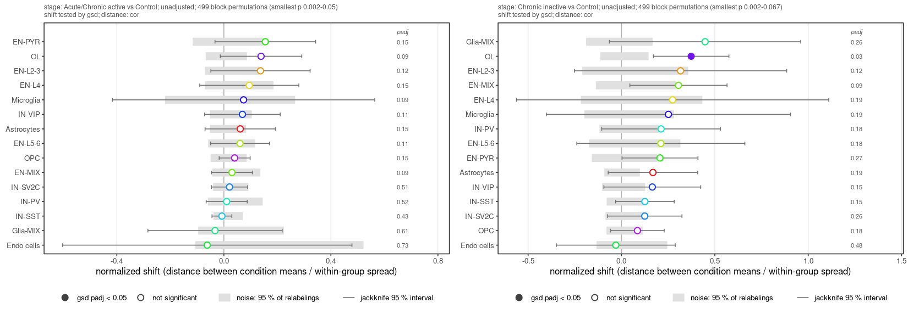<!-- -->

``` r
cao$setModel(~ diagnosis, test = "diagnosis", verbose = FALSE)
```

The lesion stage changes the composition as a whole (chance-corrected R2 0.21, p 0.002 for the three levels). In
the expression shifts the chronic inactive lesions differ from the controls more than the acute or chronic active ones
(normalized shifts up to 0.45 in `Glia-MIX` and 0.37 in the oligodendrocytes, against at most 0.15 for the active lesions, 0.14 in their oligodendrocytes), but
with 4 chronic inactive samples only the oligodendrocytes reach significance (adjusted p 0.03); the active lesions have
no significant shift in any cell type. The stage is associated with the sequencing batch (0.45), and all four chronic
inactive samples come from the MS-only batches SEQ2 and SEQ4, so the comparison of this stage with the controls is
entirely a comparison between batches.

## Differential expression per cell type

Differential expression per cell type uses pseudobulk profiles and the stored model (limma-voom; no resampling, so
the counts are point estimates).

``` r
de <- cao$estimateDEPerCellType(test = "limma-voom", min.cell.count = 10)
head(de[["EN-L2-3"]]$res[, c("Gene", "log2FoldChange", "pvalue", "padj", "CellFrac")], 10)
```

                     Gene log2FoldChange       pvalue        padj   CellFrac
    COL11A1       COL11A1     -1.3991843 9.541812e-07 0.008759117 0.30380389
    STXBP5-AS1 STXBP5-AS1     -1.1671547 1.321532e-06 0.008759117 0.62333052
    APOD             APOD      1.6872866 2.326344e-06 0.009482614 0.10600169
    PTPN14         PTPN14     -0.8362038 3.899605e-06 0.009482614 0.27404903
    MOB3B           MOB3B     -0.8614598 4.003255e-06 0.009482614 0.43736264
    MIR3976HG   MIR3976HG     -1.8177292 4.292070e-06 0.009482614 0.16415892
    HDAC9           HDAC9     -0.7238421 5.282546e-06 0.010003633 0.89771767
    AC026167.1 AC026167.1     -1.1607460 9.482292e-06 0.015712157 0.08385461
    PTCHD4         PTCHD4     -1.3558503 1.235488e-05 0.017232207 0.21927303
    LINC01202   LINC01202     -1.5868586 1.299955e-05 0.017232207 0.19306847

``` r
cao$plotNumberOfDEGenes()
```

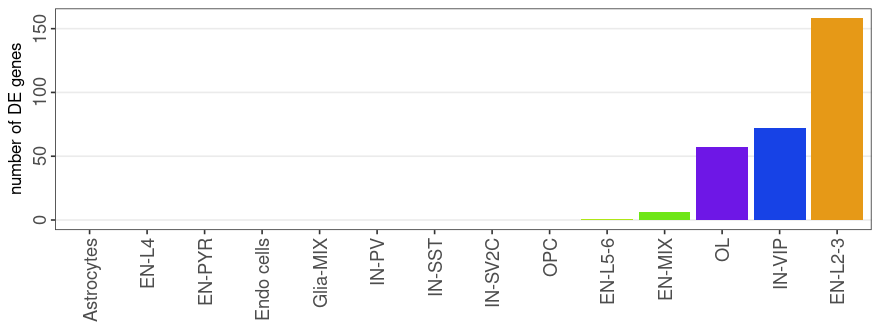<!-- -->

``` r
cao$plotVolcano(cell.types = "EN-L2-3")
```

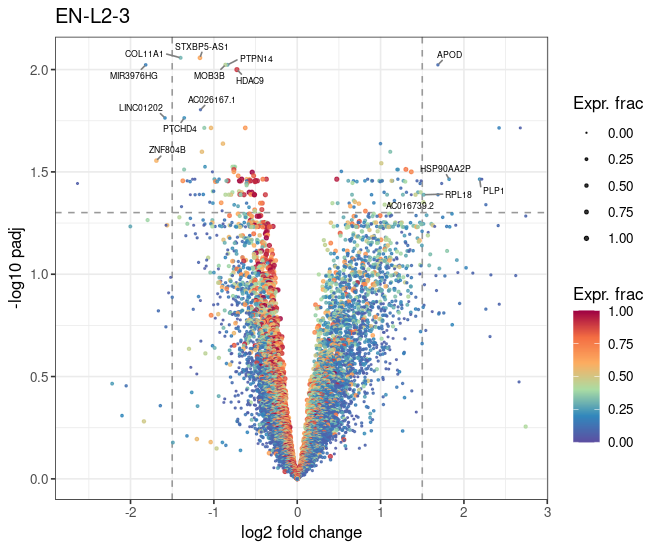<!-- -->

The number of DE genes follows the expression shifts only in part: EN-L2-3 has by far the most (about 160 at FDR 5 %), then IN-VIP (about 70) and OL (about 60), while EN-L4, EN-L5-6 and EN-PYR, with the next-largest shifts, have almost
none; astrocytes and endothelial cells have none, and microglia and phagocytes are not in the DE test. In the
EN-L2-3 volcano the labeled genes with the largest fold changes are up in MS; they include the heat-shock pseudogene
HSP90AA2P and `PLP1`, an oligodendrocyte transcript whose higher level in MS nuclei is a reminder that ambient RNA from
the demyelinating lesion environment contributes to neuronal pseudobulk profiles. The most significant genes (top of the
plot) have moderate fold changes, and nine of the top ten are lower in MS.

## Functional interpretation

Gene-set enrichment (GSEA on the ranked DE statistics of every tested cell type) turns the gene lists into terms. The
collapsed heatmap clusters the terms by their shared genes and enrichment pattern across cell types and labels each
cluster by its most frequent words (the number before the label is the number of terms in the cluster; generic words
are excluded from the labels).

``` r
cao$estimateOntology(type = "GSEA", org.db = org.Hs.eg.db::org.Hs.eg.db, seed = TRUE, n.cores = 1)
```

``` r
cao$plotOntologyHeatmapCollapsed(name = "GSEA", genes = "up", n = 25, clust.method = "ward.D",
                                 exclude.words = c("regulation", "process", "cell", "cellular", "positive", "negative", "pathway"))
```

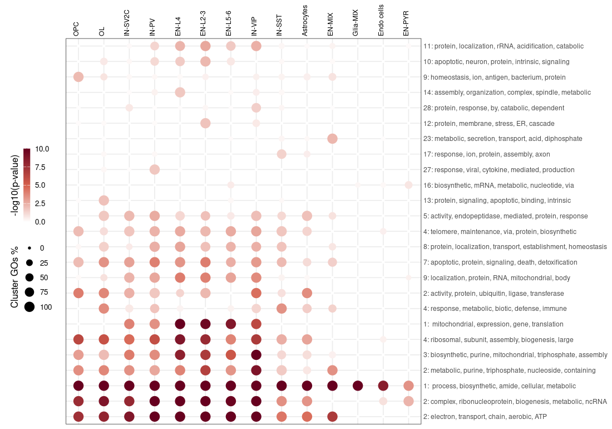<!-- -->

``` r
cao$plotOntologyHeatmapCollapsed(name = "GSEA", genes = "down", n = 25, clust.method = "ward.D",
                                 exclude.words = c("regulation", "process", "cell", "cellular", "positive", "negative", "pathway"))
```

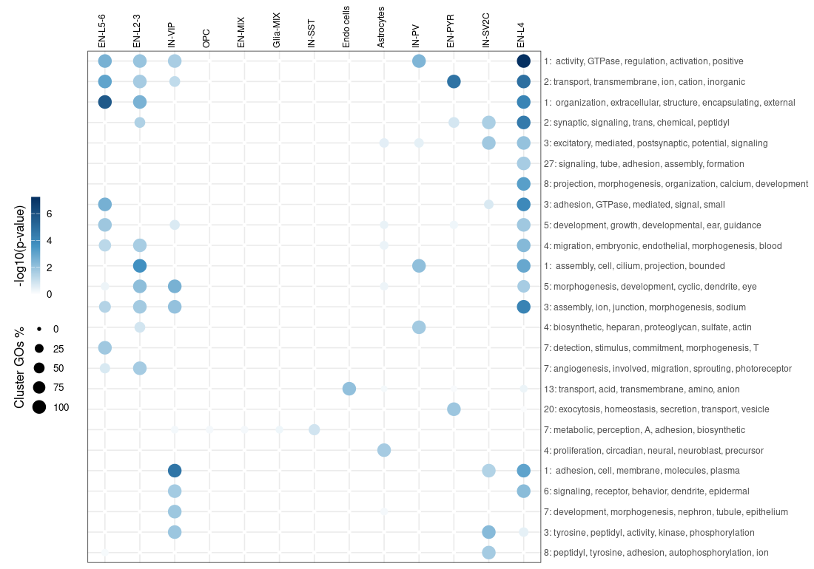<!-- -->

``` r
cao$plotOntology(cell.type = "EN-L2-3", name = "GSEA", genes = "up", n = 12)
```

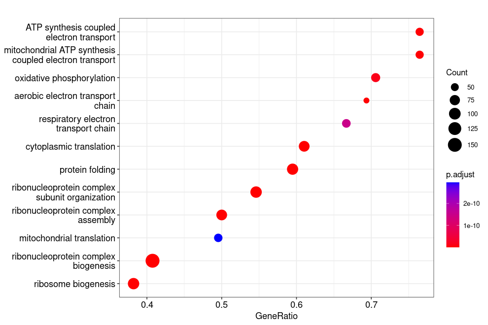<!-- -->

The excitatory neurons of layers 2-6 and the interneurons share the same up-regulated programs (EN-MIX weakly,
EN-PYR hardly at all): oxidative phosphorylation and
the electron transport chain, cytoplasmic translation and ribosome biogenesis, protein folding and the regulation of
cell death. This is the neuronal stress response described by Schirmer et al.; the heat-shock genes of the volcano
sit in the protein-folding terms, and the dotplot for EN-L2-3 lists the individual terms. Oligodendrocytes, OPC and
astrocytes show the same oxidative-phosphorylation and translation clusters, with an antigen-related cluster weakly
enriched in OPC. Down-regulated in the neurons and in Glia-MIX are ion
transport, synaptic signaling and cell adhesion, the synaptic-loss side of the same picture. (The dotplot chunk
hides a deprecation warning from the enrichplot package.)

## Cluster-free analyses

The two cluster-free maps ask the composition and the expression question in neighborhoods of the cell graph instead of
in the annotated cell types, so that a change confined to part of a type, or spread across types, is found where it is.
A neighborhood is a diffusion neighborhood: the cells a heat kernel on the graph reaches from a cell, with the kernel
strength set so that a typical neighborhood covers a given share of the cells (`scale`). The default `scale = "auto"`
runs a scan over 1, 3 and 5 % of the cells for both maps (neighborhoods at 10 % would take in the halo around a changed population) under the same relabelings, picks the scale whose own map calls the most
cells (the finest one when a scale calls nearly every cell), and reports the map at that scale alone, so that the q-values and effects of the map belong to one neighborhood
size; the choice of the scale is itself tested under the relabelings, and no cell's adjusted p is below the p-value of that test. One value tests a single scale, and a vector reports the scan itself. Cells are adjusted by the pooled permutation
false-discovery rate (the number of cells beyond a threshold under the relabelings, pooled over all cells, against the
observed number), and the adjusted z-score of a cell is the tail z of its q-value. The chunks print the scales tried and
the one chosen, and the annotated embedding is drawn next to each map so that the populations can be followed. The thin black
lines outline the regions where the cells significant at an adjusted p of 0.05 are the majority.

### Cluster-free density shifts

The density map tests, in every neighborhood, whether the arms differ in how many of their cells fall there: each
sample's kernel density is tested on the log scale with the same model. The panels show the annotation, the effect (the
log2 fold change of the density) and the adjusted z-scores.

``` r
cao$estimateCellDensity(method = "graph")
```

    kNN neighborhoods of at least 210 cells (10.0 per sample)

``` r
cao$estimateDiffCellDensity()
```

    diffusion neighborhoods at 1 %, 3 %, 5 % of the cells (auto: one scale is chosen)

    scale 0.01: heat kernel beta 20.3

    scale 0.03: heat kernel beta 28.7

    scale 0.05: heat kernel beta 42.4

    20751 of 46340 cells at FDR 10 % (scale 1 % chosen)

``` r
cowplot::plot_grid(cao$plotEmbedding(color.by = "cell.groups", title = "cell type"),
                   cao$plotDiffCellDensity(what = "effect", title = "density change (log2 FC)", outline = TRUE),
                   cao$plotDiffCellDensity(title = "adjusted z", outline = TRUE), ncol = 3)
```

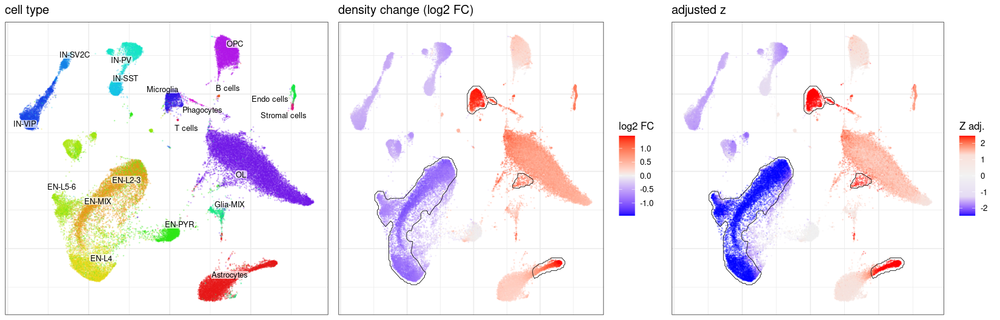<!-- -->

The scan picks the 1 % scale (neighborhoods of about 460 cells), the finest of the shared 1, 3 and 5 % set: with the
coarsest scale now 5 % rather than 10 %, the finest scale calls the most cells. The map calls the immune and vascular
populations as enriched in MS (microglia, phagocytes and B cells: log2 fold change +1.1 to +1.4 and 81-99 % of their cells at FDR 5 %; the T cells +0.9 with 26 %; the endothelial and stromal cells gain as much, +0.9, with 20 % and 1 % of their few cells called) and the upper-layer excitatory neurons as depleted
(`EN-L2-3` -0.9 with 91 % of its cells, `EN-L4` 83 %, `EN-MIX` 71 %, `EN-L5-6` 53 %); 8 of the 19 types are significant
in the per-type summary below (the endothelial and stromal cells sit at adjusted p 0.07-0.08 with their few cells). The glia gain density by smaller amounts: the oligodendrocytes (+0.7, with 6 % of their cells passing and a per-type adjusted p of 0.08) and the astrocytes (+0.3, 21 % of their cells, the tail examined below;
adjusted p 0.07); the inhibitory neurons are mildly depleted (-0.3 to -0.5) but not called (adjusted p 0.08-0.20), and
`EN-PYR` and the OPCs are unchanged. 31 % of all cells are called at FDR 5 % and 45 % at FDR 10 % (the count in the
message).

The preprint's cluster-free figure singled out a "tail" of the astrocytes: a sub-population expressing GFAP, CD44 and
TNC, markers of reactive astrocytes, that is denser in MS and was not visible at the type level. The default map
reports the one scale that calls the most cells, 1 % here, where the tail stands out most sharply: about 1,100 astrocyte cells (21 %) are called at FDR 5 %, with a median log2 fold change of +1.2 at 1 % against +0.30 for the
other astrocytes (at the former 10 % scale the same cells had +0.9 against +0.4, the tail blending into a type-wide
gain). The scan stored with the result holds every scale, so the picture can be read at each cell's own scale: the scan
view below shows each cell's density change at its best scale (for about 40 % of the tail cells 1 %, for the rest 3 or 5 %;
for nearly all other astrocytes 5 %) and the scan's q-value, next to the markers, on the astrocyte region of the embedding.

``` r
ast <- names(cao$cell.groups)[cao$cell.groups == "Astrocytes"]
sc <- cao$test.results$cell.density$diff$permutation$scales
cells <- names(sc$best)
best.effect <- sc$effect[cbind(seq_along(cells), match(sc$best, sc$scale))]; names(best.effect) <- cells
lims <- apply(cao$embedding[ast, ], 2, quantile, c(0.002, 0.998)); zoom <- list(xlim(lims[, 1]), ylim(lims[, 2]))
expr <- cao$getJointCountMatrix(raw = FALSE)
genes <- c("GFAP", "CD44", "TNC", "SHISA9")
diverging <- colorRampPalette(c("#2166ac", "grey92", "#b2182b"))
gg <- c(list(cao$plotEmbedding(colors = pmax(pmin(best.effect, 1.5), -1.5), palette = diverging, title = "density change at each cell's best scale") + zoom,
             cao$plotEmbedding(colors = pmin(-log10(sc$scan.q), 3), title = "scan: -log10 q (capped at 3)") + zoom),
        lapply(genes, function(g) cao$plotEmbedding(colors = expr[cells, g], title = g) + zoom))
cowplot::plot_grid(plotlist = gg, ncol = 3)
```

    Warning: Removed 40988 rows containing missing values or values outside the scale range
    (`geom_point()`).
    Removed 40988 rows containing missing values or values outside the scale range
    (`geom_point()`).
    Removed 40988 rows containing missing values or values outside the scale range
    (`geom_point()`).
    Removed 40988 rows containing missing values or values outside the scale range
    (`geom_point()`).
    Removed 40988 rows containing missing values or values outside the scale range
    (`geom_point()`).
    Removed 40988 rows containing missing values or values outside the scale range
    (`geom_point()`).

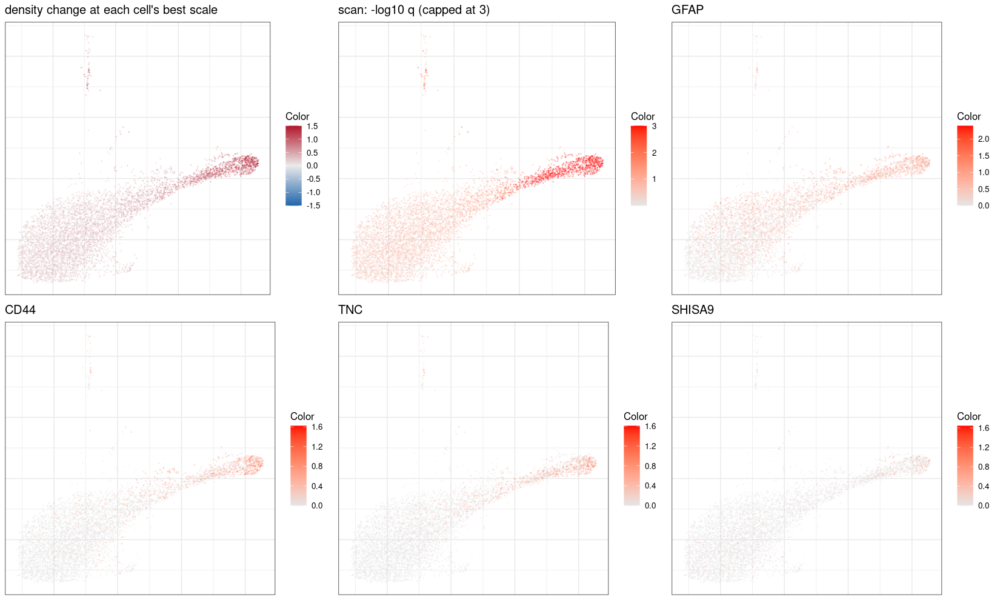<!-- -->

``` r
m <- tapply(expr[ast, "SHISA9"], cao$sample.per.cell[ast], mean)
df <- data.frame(sample = names(m), expr = as.numeric(m), condition = sample.meta[names(m), "diagnosis"])
ggplot(df, aes(condition, expr, color = condition)) + geom_boxplot(outlier.shape = NA) + geom_jitter(width = 0.15, size = 2) +
  scale_color_manual(values = cao$sample.groups.palette, guide = "none") + labs(x = NULL, y = "SHISA9, mean expression in astrocytes per sample") + cao$plot.theme
```

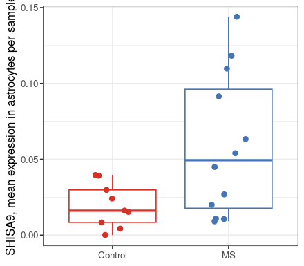<!-- -->

### Cluster-free expression shifts

The expression map tests the contrast in each neighborhood with the per-gene statistic of the per-type test
(`statistic = "gsd"`: the contrast of each gene over its standard error, combined adaptively over the genes detected in
at least 5 % of the neighborhood's cells), on neighborhoods of the scale's size around centers that cover the graph (the message gives their number and size);
each cell averages the tested neighborhoods that contain it. The shift panel shows the size of the change (the mean
squared gene z-score of the neighborhood, about 1 without a change) and the right panel the adjusted z-scores, one-sided
(0 means not significant).

``` r
cao$estimateClusterFreeExpressionShifts(n.permutations = 499)
```

    17232 genes (per neighborhood: those detected in >= 5 % of its cells)

    diffusion neighborhoods at 1 %, 3 %, 5 % of the cells (auto: one scale is chosen), at least 210 cells each (10.0 per sample)

    scale 0.01: heat kernel beta 20.3, 750 centers, neighborhoods of 468 cells (median, 332 smallest)

    scale 0.03: heat kernel beta 28.7, 122 centers, neighborhoods of 1447 cells (median, 792 smallest)

    scale 0.05: heat kernel beta 42.4, 70 centers, neighborhoods of 2410 cells (median, 709 smallest)

    43196 of 46340 cells keep adjusted z >= 1.28 (scale 5 % chosen)

``` r
cao$plotClusterFreeExpressionShifts(adjusted = TRUE, outline = TRUE)
```

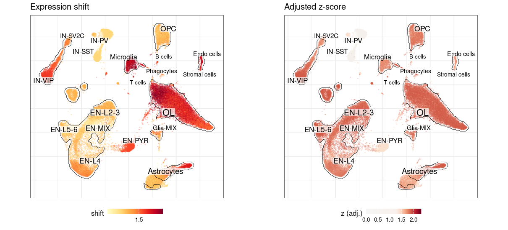<!-- -->

In MS the expression difference is largely diffuse: the scan picks the 5 % scale (70 neighborhoods of about 2,400 cells), almost every neighborhood is shifted (the left panel) and 83 % of the cells are called at FDR 5 % (the right panel). The microglia, endothelial and stromal cells stand out (median shift 1.7; 98 % of the microglia called); the phagocytes, oligodendrocytes, IN-VIP, the excitatory neurons other than EN-PYR and OPC follow (1.3-1.7, 95-100 % called), the astrocytes, `Glia-MIX` and the SV2C interneurons are called in part (65-74 %), and the PV and SST interneurons and the pyramidal neurons little or not at all (0-16 %). The per-type summary (the mean statistic of each type against its permutations) is significant after adjustment for 15 of the 19 types; the B cells and EN-PYR sit at adjusted p 0.05-0.07, and IN-PV and IN-SST are not significant (0.12). A
diffuse component of this kind is what a donor-level difference aligned with the diagnosis produces, and the
capture and sequencing batches are such a difference here (see the sensitivity analysis). A shift at a boundary between cell types
whose composition differs between the arms (microglia next to phagocytes) can also be a neighborhood effect, the
cell-type mix of the neighborhood rather than the expression of its cells differing between MS and control.

Both maps are summarized per cell type by an exact group-level permutation test: the mean per-cell statistic of the type
is compared with the same mean under the relabelings shared by all cells, so the dependence between neighboring cells is
carried along, and the result is adjusted across types. The labels give the share of the type's cells called at FDR 5 %.

``` r
cao$estimateClusterFreeSummary("cell.density")
cao$estimateClusterFreeSummary("cluster.free.expr.shifts")
cowplot::plot_grid(cao$plotClusterFreeSummary("cell.density"), cao$plotClusterFreeSummary("cluster.free.expr.shifts"), ncol = 2)
```

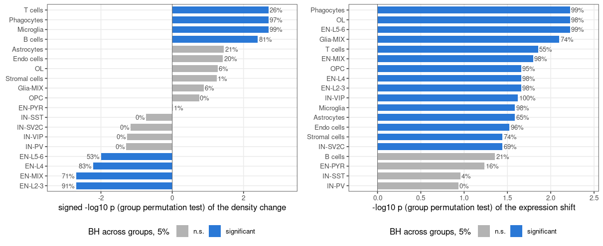<!-- -->

## Summary

- MS cortex differs from control cortex in expression by small, consistent shifts: the gene-level test calls the oligodendrocytes and the microglia at FDR 5 % and puts the upper-layer excitatory neurons, IN-VIP, EN-MIX, OPC, EN-PYR, EN-L4, EN-L5-6 and the astrocytes just above the threshold (adjusted p 0.055-0.063); EN-PYR and EN-L2-3 have the largest shifts, EN-L2-3 by far the most DE genes, in line with the neuronal stress and loss described by Schirmer et al.; the composition shows neuronal depletion and immune
  infiltration, which the density map calls in most cells of the excitatory neurons of layers 2-6, the microglia and phagocytes (53-99 % of
  their cells) but not in the interneurons.
- The effects are small and their size depends on a few samples, in particular the control 5546_BA9; the jackknife interval of the microglial shift, one of the two the gene-level test calls, includes zero, and that shift lies inside what shuffled labels give.
- The covariates matter in different ways. Capture and sequencing batch are the strongest structure in the data but are
  nested in the diagnosis, so they can neither be cleanly adjusted for nor ruled out: adjusting for them increases the
  estimated shifts in most cell types, but with the capture batch in the model no shift remains significant. `stage` is
  a refinement of the diagnosis. Age and region are unbalanced between the arms; age is not associated with expression in
  any cell type, region only in EN-PYR (and with the composition); sex, RIN and PMI are only weakly associated with the
  diagnosis (although 7 MS samples have a higher RIN than any control) and are not associated with expression.
- Functionally, the neurons and the glia up-regulate oxidative phosphorylation and translation, the neurons also
  protein folding (the stress signature), and the neurons and Glia-MIX down-regulate ion transport and synaptic terms.
- Microglia, the cell type with the most striking lesion biology, are rare in control cortex; from 5 nuclei per sample
  they can be tested (15 samples) and show a significant, small shift, which however vanishes once batch is adjusted
  for. The cluster-free density map, which borrows the neighboring cells, calls them enriched; the cluster-free expression map shows them among the most shifted cells of the dataset (median shift 1.7, with the endothelial and stromal cells), with 98 % of their cells called at FDR 5 %.

## Session info

``` r
sessionInfo()
```

    R version 4.2.2 Patched (2022-11-10 r83330)
    Platform: x86_64-pc-linux-gnu (64-bit)
    Running under: Ubuntu 20.04.6 LTS

    Matrix products: default
    BLAS:   /usr/lib/x86_64-linux-gnu/blas/libblas.so.3.9.0
    LAPACK: /usr/lib/x86_64-linux-gnu/lapack/liblapack.so.3.9.0

    locale:
     [1] LC_CTYPE=en_US.UTF-8       LC_NUMERIC=C              
     [3] LC_TIME=en_US.UTF-8        LC_COLLATE=en_US.UTF-8    
     [5] LC_MONETARY=en_US.UTF-8    LC_MESSAGES=en_US.UTF-8   
     [7] LC_PAPER=en_US.UTF-8       LC_NAME=C                 
     [9] LC_ADDRESS=C               LC_TELEPHONE=C            
    [11] LC_MEASUREMENT=en_US.UTF-8 LC_IDENTIFICATION=C       

    attached base packages:
    [1] stats     graphics  grDevices utils     datasets  methods   base     

    other attached packages:
    [1] ggplot2_4.0.2  conos_1.5.4    igraph_2.1.4   cacoa_0.5.0    Matrix_1.6-1.1

    loaded via a namespace (and not attached):
      [1] uuid_1.2-1                  shadowtext_0.1.6           
      [3] N2R_1.0.4                   circlize_0.4.16            
      [5] fastmatch_1.1-6             systemfonts_1.3.2          
      [7] plyr_1.8.9                  lazyeval_0.2.2             
      [9] splines_4.2.2               BiocParallel_1.32.6        
     [11] GenomeInfoDb_1.34.9         urltools_1.7.3             
     [13] digest_0.6.37               foreach_1.5.2              
     [15] yulab.utils_0.2.5           htmltools_0.5.8.1          
     [17] GOSemSim_2.24.0             viridis_0.6.4              
     [19] GO.db_3.16.0                magrittr_2.0.3             
     [21] RMTstat_0.3.1               memoise_2.0.1              
     [23] cluster_2.1.4               doParallel_1.0.17          
     [25] ComplexHeatmap_2.14.0       Biostrings_2.66.0          
     [27] annotate_1.76.0             graphlayouts_1.2.2         
     [29] matrixStats_1.5.0           R.utils_2.12.2             
     [31] sccore_1.0.6                enrichplot_1.18.4          
     [33] colorspace_2.1-0            rappdirs_0.3.3             
     [35] blob_1.2.4                  ggrepel_0.9.6              
     [37] pagoda2_1.0.11              xfun_0.53                  
     [39] dplyr_1.1.4                 jsonlite_2.0.0             
     [41] crayon_1.5.2                RCurl_1.98-1.12            
     [43] scatterpie_0.2.5            brew_1.0-10                
     [45] iterators_1.0.14            ape_5.8-1                  
     [47] glue_1.8.0                  polyclip_1.10-7            
     [49] gtable_0.3.6                zlibbioc_1.44.0            
     [51] XVector_0.38.0              GetoptLong_1.0.5           
     [53] DelayedArray_0.24.0         leidenAlg_1.1.5            
     [55] Rook_1.2                    shape_1.4.6.1              
     [57] BiocGenerics_0.44.0         abind_1.4-8                
     [59] scales_1.4.0                DOSE_3.24.2                
     [61] DBI_1.1.3                   Rcpp_1.1.0                 
     [63] coda.base_1.0.3             viridisLite_0.4.2          
     [65] xtable_1.8-4                clue_0.3-65                
     [67] tidytree_0.4.6              gridGraphics_0.5-1         
     [69] bit_4.6.0                   stats4_4.2.2               
     [71] htmlwidgets_1.6.4           httr_1.4.7                 
     [73] fgsea_1.24.0                RColorBrewer_1.1-3         
     [75] pkgconfig_2.0.3             XML_3.99-0.14              
     [77] R.methodsS3_1.8.2           farver_2.1.2               
     [79] locfit_1.5-9.8              ggplotify_0.1.2            
     [81] tidyselect_1.2.1            labeling_0.4.3             
     [83] rlang_1.1.7                 reshape2_1.4.4             
     [85] AnnotationDbi_1.60.2        pbmcapply_1.5.1            
     [87] tools_4.2.2                 cachem_1.1.0               
     [89] downloader_0.4.1            cli_3.6.5                  
     [91] generics_0.1.4              RSQLite_2.3.1              
     [93] gson_0.1.0                  evaluate_1.0.5             
     [95] stringr_1.5.1               fastmap_1.2.0              
     [97] yaml_2.3.10                 ggtree_3.6.2               
     [99] org.Hs.eg.db_3.16.0         fs_1.6.6                   
    [101] knitr_1.50                  bit64_4.6.0-1              
    [103] tidygraph_1.3.1             purrr_1.1.0                
    [105] KEGGREST_1.38.0             ggraph_2.2.2               
    [107] nlme_3.1-161                R.oo_1.25.0                
    [109] ggiraph_0.9.0               aplot_0.2.8                
    [111] compiler_4.2.2              png_0.1-8                  
    [113] treeio_1.22.0               tibble_3.3.0               
    [115] tweenr_2.0.3                geneplotter_1.76.0         
    [117] stringi_1.8.7               drat_0.2.3                 
    [119] lattice_0.20-45             psych_2.5.6                
    [121] vctrs_0.6.5                 pillar_1.11.0              
    [123] lifecycle_1.0.4             triebeard_0.4.1            
    [125] GlobalOptions_0.1.2         data.table_1.17.8          
    [127] cowplot_1.2.0               bitops_1.0-9               
    [129] irlba_2.3.5.1               patchwork_1.3.2            
    [131] GenomicRanges_1.50.2        qvalue_2.30.0              
    [133] R6_2.6.1                    gridExtra_2.3              
    [135] IRanges_2.32.0              codetools_0.2-18           
    [137] MASS_7.3-58                 SummarizedExperiment_1.28.0
    [139] DESeq2_1.38.3               rjson_0.2.21               
    [141] withr_3.0.2                 mnormt_2.1.1               
    [143] S4Vectors_0.36.2            GenomeInfoDbData_1.2.9     
    [145] mgcv_1.8-41                 parallel_4.2.2             
    [147] clusterProfiler_4.6.2       ggfun_0.2.0                
    [149] grid_4.2.2                  tidyr_1.3.1                
    [151] HDO.db_0.99.1               rmarkdown_2.29             
    [153] S7_0.2.0                    MatrixGenerics_1.10.0      
    [155] dendsort_0.3.4              Rtsne_0.17                 
    [157] ggforce_0.5.0               Biobase_2.58.0             

