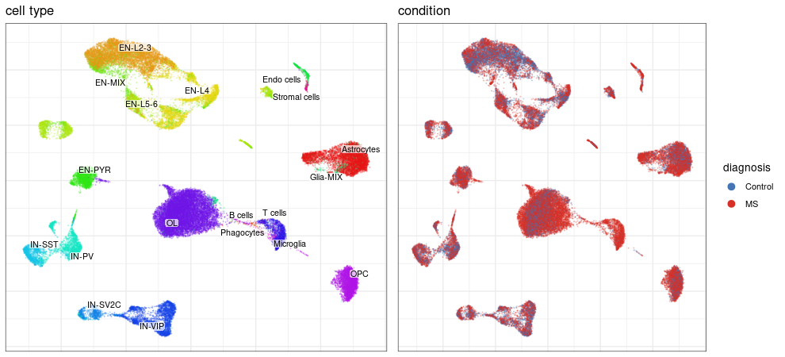
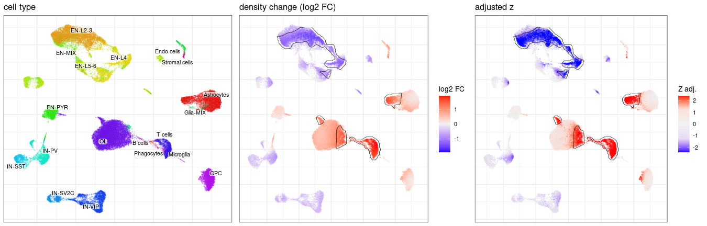
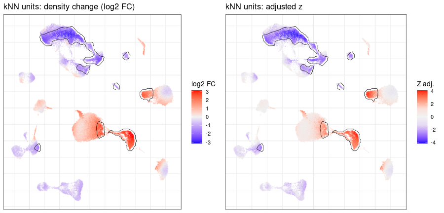
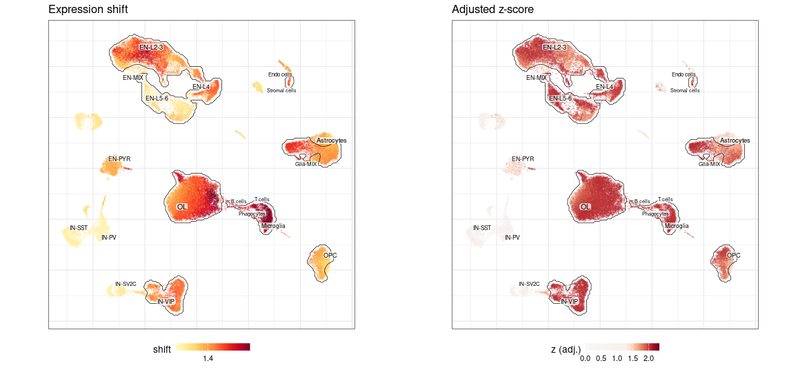
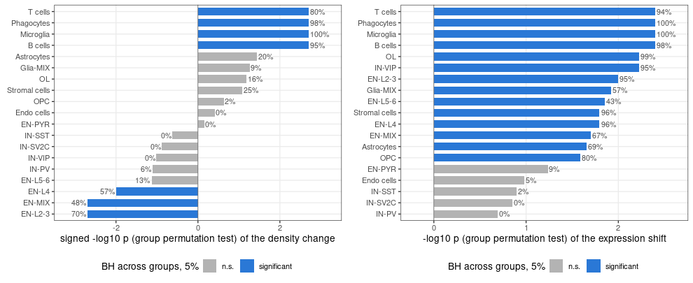

Cacoa on the multiple sclerosis cortex dataset: the cluster-free maps on
a Harmony-aligned graph
================
Cacoa developers
2026-11-15

- <a href="#load-data" id="toc-load-data">Load data</a>
- <a href="#cluster-free-density-shifts"
  id="toc-cluster-free-density-shifts">Cluster-free density shifts</a>
- <a href="#cluster-free-expression-shifts"
  id="toc-cluster-free-expression-shifts">Cluster-free expression
  shifts</a>
- <a href="#session-info" id="toc-session-info">Session info</a>

This notebook is a companion of `ms_cacoa.Rmd`: the same cells, counts
and annotation on a kNN graph of a Harmony embedding
(`prepare_ms_harmony.R`: 2,000 variable genes, 50 PCs, Harmony by
sample, 30 nearest neighbors on 30 Harmony dimensions, UMAP on the same)
instead of the Conos alignment graph. Only the graph-dependent parts are
rerun, the cluster-free density and expression-shift maps; the
cell-type-level analyses use the counts and the annotation alone and are
those of the main notebook. The PF companion
(`../pf/pf_cacoa_harmony.Rmd`, `../pf/pf_density_diagnosis.md`) shows
why the graph matters there: on the Conos alignment of that cohort the
density kernel leaks out of the populations present in only part of the
samples. Here the question is whether the maps of a cohort where the
Conos graph worked change with the alignment.

``` r
library(cacoa)
library(ggplot2)
library(dplyr)
```

## Load data

``` r
seu <- readRDS(params$data.file)
cell.meta <- read.delim(params$meta.file)
sample.meta <- unique(cell.meta[, c("sample", "diagnosis", "stage", "age", "sex", "region", "Capbatch", "Seqbatch", "RIN", "PMI")])
rownames(sample.meta) <- sample.meta$sample
sample.meta <- sample.meta[sort(unique(seu$sample)), -1]
table(sample.meta$diagnosis)
```

    ## 
    ## Control      MS 
    ##       9      12

``` r
cao <- Cacoa$new(seu, sample.metadata = sample.meta, sample.per.cell = factor(seu$sample), cell.groups = factor(seu$celltype),
                 embedding = seu@reductions$umap@cell.embeddings, graph.name = "RNA_nn", data.layer = "data", n.cores = params$n.cores)
```

    ## Sample metadata: 21 samples, 9 columns
    ##   usable (9): diagnosis [Control 9, MS 12], stage [Acute/Chronic active 8, Chronic inactive 4, Control 9], age [num, 34-82], sex [female 12, male 9], region [4 levels], Capbatch [7 levels], Seqbatch [5 levels], RIN [num, 6.8-9.1], ...

    ## Next: cao$checkDesign() and cao$screenCovariates(), or cao$setModel(test = "<variable>").

``` r
cao$setOptions(n.permutations = 499, seed = 1)
cao$plot.params <- list(size = 0.2, alpha = 0.2, font.size = 3)
cao$sample.groups.palette <- c(Control = "#4575b4", MS = "#d73027")
```

The graph used is Seurat’s kNN graph on the Harmony embedding (`RNA_nn`,
symmetrized). The thin black lines on the maps below outline the regions
where the cells significant at an adjusted p of 0.05 are the majority
(`outline = TRUE`).

``` r
cowplot::plot_grid(cao$plotEmbedding(color.by = "cell.groups", title = "cell type"),
                   cao$plotEmbedding(color.by = "diagnosis", title = "condition", mark.groups = FALSE, show.legend = TRUE), ncol = 2)
```

<!-- -->

``` r
cao$setModel(~ diagnosis, test = "diagnosis")
```

    ## Model: ~diagnosis      dispersion: ~diagnosis
    ## Test: diagnosis: MS vs Control  (reference 'Control': matched a control-like name; to change: test = "diagnosis: Control vs MS")
    ##        unadjusted; permutations: block (293,930 distinct); 21 of 21 samples can change their value; smallest p-value 0.002
    ##        shift > 0: MS samples differ from Control samples in a common direction, beyond within-group variability
    ## Samples: 21 used.   Issues: none

## Cluster-free density shifts

The same map as in the main notebook: the default diffusion
neighborhoods (`scale = "auto"`, a scan over 1, 3 and 5 % of the cells),
each sample’s kernel density tested on the log scale with the model,
cells adjusted by the pooled permutation false-discovery rate.

``` r
cao$estimateCellDensity(method = "graph")
```

    ## kNN neighborhoods of at least 210 cells (10.0 per sample)

``` r
cao$estimateDiffCellDensity()
```

    ## diffusion neighborhoods at 1 %, 3 %, 5 % of the cells (auto: one scale is chosen)

    ## scale 0.01: heat kernel beta 35.7

    ## scale 0.03: heat kernel beta 55

    ## scale 0.05: heat kernel beta 71.4

    ## 15040 of 46340 cells at FDR 10 % (scale 1 % chosen)

``` r
cowplot::plot_grid(cao$plotEmbedding(color.by = "cell.groups", title = "cell type"),
                   cao$plotDiffCellDensity(what = "effect", title = "density change (log2 FC)", outline = TRUE),
                   cao$plotDiffCellDensity(title = "adjusted z", outline = TRUE), ncol = 3)
```

<!-- -->

On the Harmony graph the scan picks the 1 % scale (neighborhoods of
about 470 nuclei), as on the Conos graph, and calls 15,040 of the 46,340
nuclei at FDR 10 % (32 %; 45 % there). The per-type shares below are
those at FDR 5 %, as in the summary plot. The immune expansions are
called on both graphs, here more completely (microglia, phagocytes, B
and T cells: 80-100 % of their nuclei, log2 fold changes 1.4-1.8; on
Conos 26 % of the T cells and 81-99 % of the others), and the neuronal
depletion is called in the same layers but less completely: 70 % of the
EN-L2-3 nuclei (91 % on Conos), 57 % of EN-L4 (83 %), 48 % of EN-MIX (71
%) and 13 % of EN-L5-6 (53 %; adjusted p 0.12 here, 0.024 there),
although the effects are of similar size (EN-L2-3 -1.1 against -0.9,
EN-L5-6 -0.5 against -0.6). Seven types pass the per-type test (eight on
Conos, where EN-L5-6 passes too); the endothelial and stromal nuclei are
called at 0 and 25 % here (per type 0.41 and 0.12) and at 20 % and 1 %
on the Conos graph (0.072 and 0.076).

The kNN neighborhoods of the graph itself (`scale = NULL`: the stored
units of `estimateCellDensity()`, 210 cells each) are the other
neighborhood definition available; they are one hop wide, so they cannot
leak the way a kernel can.

``` r
cao$estimateCellDensity(method = "graph", name = "cell.density.knn")
```

    ## kNN neighborhoods of at least 210 cells (10.0 per sample)

``` r
cao$estimateDiffCellDensity(name = "cell.density.knn", scale = NULL)
```

    ## 15024 of 46340 cells at FDR 10 %

``` r
cowplot::plot_grid(cao$plotDiffCellDensity(name = "cell.density.knn", what = "effect", title = "kNN units: density change (log2 FC)", outline = TRUE),
                   cao$plotDiffCellDensity(name = "cell.density.knn", title = "kNN units: adjusted z", outline = TRUE), ncol = 2)
```

<!-- -->

The kNN neighborhoods (210 nuclei) call the same number of nuclei
(15,024) with larger effects (microglia 2.7, EN-L2-3 -1.9) and the same
seven types; IN-PV and EN-L5-6 fall just short (0.051).

## Cluster-free expression shifts

``` r
cao$estimateClusterFreeExpressionShifts(n.permutations = 499)
```

    ## 17232 genes (per neighborhood: those detected in >= 5 % of its cells)

    ## diffusion neighborhoods at 1 %, 3 %, 5 % of the cells (auto: one scale is chosen), at least 210 cells each (10.0 per sample)

    ## scale 0.01: heat kernel beta 35.7, 347 centers, neighborhoods of 466 cells (median, 212 smallest)

    ## scale 0.03: heat kernel beta 55, 128 centers, neighborhoods of 1306 cells (median, 240 smallest)

    ## scale 0.05: heat kernel beta 71.4, 71 centers, neighborhoods of 1774 cells (median, 518 smallest)

    ## 39717 of 46340 cells keep adjusted z >= 1.28 (scale 5 % chosen)

``` r
cao$plotClusterFreeExpressionShifts(adjusted = TRUE, font.size = c(2, 3), outline = TRUE)
```

<!-- -->

The expression-shift map is close to the Conos one but somewhat weaker:
the scan picks 5 % on both graphs, 74 % of the nuclei pass FDR 5 % (83 %
there) and 14 of 19 types are significant (15). The immune populations
lead here (microglia 1.9, phagocytes 1.7, B and T cells 1.6, then OL,
EN-L2-3, IN-VIP and the stromal cells at about 1.5; on Conos the
endothelial, microglial and stromal nuclei at 1.7), EN-L2-3 and EN-L4
are called nearly in full (95-96 % of the nuclei) and EN-MIX and EN-L5-6
in part (67 % and 43 %; 98-99 % for all four on Conos), the endothelial
nuclei drop out (5 % called, 0.12; 96 % and 0.044 there) and the B cells
come in (98 %; 21 % there). IN-PV and IN-SST are not significant on
either graph, IN-SV2C only on the Conos graph (0.046), EN-PYR on
neither.

``` r
cao$estimateClusterFreeSummary("cell.density")
cao$estimateClusterFreeSummary("cluster.free.expr.shifts")
cowplot::plot_grid(cao$plotClusterFreeSummary("cell.density"), cao$plotClusterFreeSummary("cluster.free.expr.shifts"), ncol = 2)
```

<!-- -->

Per type the maps agree on the main result on both graphs: the immune
and microglial expansion with the loss of the upper-layer excitatory
neurons, and the expression shift of the glia. The Conos graph calls the
neuronal losses and the endothelial cells more completely, the Harmony
graph the lymphocytes and the stromal cells. On this cohort, where all
but the four smallest populations (B and T cells, phagocytes and stromal
cells) are present in most samples of both arms, the alignment changes
the margins, not the picture.

## Session info

``` r
sessionInfo()
```

    ## R version 4.2.2 Patched (2022-11-10 r83330)
    ## Platform: x86_64-pc-linux-gnu (64-bit)
    ## Running under: Ubuntu 20.04.6 LTS
    ## 
    ## Matrix products: default
    ## BLAS:   /usr/lib/x86_64-linux-gnu/blas/libblas.so.3.9.0
    ## LAPACK: /usr/lib/x86_64-linux-gnu/lapack/liblapack.so.3.9.0
    ## 
    ## locale:
    ##  [1] LC_CTYPE=en_US.UTF-8       LC_NUMERIC=C              
    ##  [3] LC_TIME=en_US.UTF-8        LC_COLLATE=en_US.UTF-8    
    ##  [5] LC_MONETARY=en_US.UTF-8    LC_MESSAGES=en_US.UTF-8   
    ##  [7] LC_PAPER=en_US.UTF-8       LC_NAME=C                 
    ##  [9] LC_ADDRESS=C               LC_TELEPHONE=C            
    ## [11] LC_MEASUREMENT=en_US.UTF-8 LC_IDENTIFICATION=C       
    ## 
    ## attached base packages:
    ## [1] stats     graphics  grDevices utils     datasets  methods   base     
    ## 
    ## other attached packages:
    ## [1] dplyr_1.1.4    ggplot2_4.0.2  cacoa_0.5.0    Matrix_1.6-1.1
    ## 
    ## loaded via a namespace (and not attached):
    ##   [1] nlme_3.1-161           spatstat.sparse_3.1-0  matrixStats_1.5.0     
    ##   [4] RcppAnnoy_0.0.22       RColorBrewer_1.1-3     httr_1.4.7            
    ##   [7] sctransform_0.4.2      tools_4.2.2            R6_2.6.1              
    ##  [10] irlba_2.3.5.1          KernSmooth_2.23-20     colorspace_2.1-0      
    ##  [13] uwot_0.2.3             lazyeval_0.2.2         withr_3.0.2           
    ##  [16] sp_2.2-0               tidyselect_1.2.1       gridExtra_2.3         
    ##  [19] compiler_4.2.2         progressr_0.15.1       cli_3.6.5             
    ##  [22] spatstat.explore_3.5-2 plotly_4.11.0          labeling_0.4.3        
    ##  [25] Seurat_4.3.0.1         scales_1.4.0           spatstat.data_3.1-8   
    ##  [28] lmtest_0.9-40          S7_0.2.0               ggridges_0.5.7        
    ##  [31] pbapply_1.7-4          goftest_1.2-3          stringr_1.5.1         
    ##  [34] digest_0.6.37          spatstat.utils_3.1-5   rmarkdown_2.29        
    ##  [37] pkgconfig_2.0.3        htmltools_0.5.8.1      parallelly_1.45.1     
    ##  [40] fastmap_1.2.0          htmlwidgets_1.6.4      rlang_1.1.7           
    ##  [43] shiny_1.11.1           farver_2.1.2           generics_0.1.4        
    ##  [46] zoo_1.8-14             jsonlite_2.0.0         spatstat.random_3.4-1 
    ##  [49] ica_1.0-3              magrittr_2.0.3         patchwork_1.3.2       
    ##  [52] Rcpp_1.1.0             abind_1.4-8            ape_5.8-1             
    ##  [55] reticulate_1.43.0      lifecycle_1.0.4        stringi_1.8.7         
    ##  [58] yaml_2.3.10            MASS_7.3-58            Rtsne_0.17            
    ##  [61] plyr_1.8.9             grid_4.2.2             parallel_4.2.2        
    ##  [64] listenv_0.9.1          promises_1.3.3         ggrepel_0.9.6         
    ##  [67] deldir_2.0-4           miniUI_0.1.2           lattice_0.20-45       
    ##  [70] sccore_1.0.6           cowplot_1.2.0          splines_4.2.2         
    ##  [73] tensor_1.5.1           knitr_1.50             pillar_1.11.0         
    ##  [76] igraph_2.1.4           spatstat.geom_3.5-0    future.apply_1.20.0   
    ##  [79] reshape2_1.4.4         codetools_0.2-18       leiden_0.4.3          
    ##  [82] glue_1.8.0             evaluate_1.0.5         SeuratObject_4.1.3    
    ##  [85] spatstat.univar_3.1-4  data.table_1.17.8      png_0.1-8             
    ##  [88] vctrs_0.6.5            httpuv_1.6.16          polyclip_1.10-7       
    ##  [91] gtable_0.3.6           RANN_2.6.2             purrr_1.1.0           
    ##  [94] tidyr_1.3.1            scattermore_1.2        future_1.67.0         
    ##  [97] xfun_0.53              mime_0.13              xtable_1.8-4          
    ## [100] later_1.4.4            survival_3.4-0         viridisLite_0.4.2     
    ## [103] tibble_3.3.0           cluster_2.1.4          globals_0.18.0        
    ## [106] fitdistrplus_1.2-4     ROCR_1.0-11
