Cacoa on the pulmonary fibrosis cohort of Natri et al. 2024: site, sex
and age
================
Cacoa developers
2026-11-19

- <a href="#load-data" id="toc-load-data">Load data</a>
- <a href="#check-the-design" id="toc-check-the-design">Check the design</a>
- <a href="#screen-covariates" id="toc-screen-covariates">Screen covariates</a>
  - <a href="#sample-maps" id="toc-sample-maps">Sample maps</a>
- <a href="#set-the-model" id="toc-set-the-model">Set the model</a>
- <a href="#composition" id="toc-composition">Composition</a>
- <a href="#expression-shifts-per-cell-type" id="toc-expression-shifts-per-cell-type">Expression shifts per cell type</a>
  - <a href="#behind-one-cell-type" id="toc-behind-one-cell-type">Behind one cell type</a>
- <a href="#adding-age" id="toc-adding-age">Adding age</a>
  - <a href="#age-among-the-controls" id="toc-age-among-the-controls">Age among the controls</a>
- <a href="#differential-expression-per-cell-type" id="toc-differential-expression-per-cell-type">Differential expression per cell type</a>
- <a href="#functional-interpretation" id="toc-functional-interpretation">Functional interpretation</a>
- <a href="#cluster-free-analyses" id="toc-cluster-free-analyses">Cluster-free analyses</a>
  - <a href="#cluster-free-density-shifts" id="toc-cluster-free-density-shifts">Cluster-free density shifts</a>
  - <a href="#cluster-free-expression-shifts" id="toc-cluster-free-expression-shifts">Cluster-free expression shifts</a>
- <a href="#ipf-versus-other-interstitial-lung-disease" id="toc-ipf-versus-other-interstitial-lung-disease">IPF versus other interstitial lung disease</a>
- <a href="#summary" id="toc-summary">Summary</a>
- <a href="#session-info" id="toc-session-info">Session info</a>

Natri et al. (2024, Nature Genetics) profiled lungs from patients with pulmonary fibrosis (PF) and from control
donors by scRNA-seq (10x) at two centers, the Translational Genomics Research Institute (`TGen`) and Vanderbilt
University (`Vanderbilt`), the centers of the Habermann et al. (2020) data used in the PF example. The data are taken
from GEO (GSE227136) with the authors' annotation (26 populations), one library per donor and at most 2,000 cells per
donor: 187,756 cells of 111 lungs (65 PF, 46 control), on a kNN graph of a Harmony embedding
(`prepare_natri_harmony.R`, next to this notebook). The PF lungs are idiopathic pulmonary fibrosis (`IPF`, 38) or
other interstitial lung diseases (`Other_ILD`, 27). The study records sex, age, smoking and ancestry, with missing
values in each.

The contrast of interest is **PF versus control**, with the center as a grouping term and sex as a covariate. The
notebook then asks what adding age does, since the controls are much younger than the patients, and compares IPF with
the other interstitial lung diseases. In short: the alveolar epithelium (AT1, AT2) and the capillaries are lost and
the airway-type epithelium (basal, KRT5-KRT17+ and secretory cells) expands, almost every population shifts in
expression, and the center changes nothing of this. Adding age reduces the significant composition changes from 12 to
4; a comparison restricted to the lungs whose ages overlap gives the same adjusted result, so the adjustment does not
rest on the youngest controls. IPF and the other interstitial lung diseases do not
differ significantly in composition or in expression.

``` r
library(cacoa)
library(ggplot2)
```

## Load data

``` r
seu <- readRDS(params$data.file)
samples <- sort(unique(seu$sample))
sample.meta <- readRDS(params$meta.file)[samples, c("condition", "subtype", "cohort", "sex", "age", "smoking", "ethnicity", "n.cells")]
summary(sample.meta)
```

       condition       subtype          cohort     sex          age       
     Control:46   Control  :46   TGen      :46   F   :28   Min.   :17.00  
     PF     :65   IPF      :38   Vanderbilt:65   M   :75   1st Qu.:50.00  
                  Other_ILD:27                   NA's: 8   Median :59.00  
                                                           Mean   :56.06  
                                                           3rd Qu.:65.00  
                                                           Max.   :74.00  
                                                           NA's   :14     
       smoking              ethnicity     n.cells    
     Former:21   African_American:11   Min.   : 324  
     N     :35   American_Indian : 1   1st Qu.:1466  
     Y     :30   European        :75   Median :2000  
     NA's  :25   Hispanic        : 3   Mean   :1691  
                 Other           : 1   3rd Qu.:2000  
                 South_Asian     : 1   Max.   :2000  
                 NA's            :19                 

``` r
table(seu$celltype)
```

            Arteriole               AT1               AT2             Basal 
                 3162              2605             20291              3362 
               Bcells         Capillary          Ciliated   Dendritic cells 
                 1558              3821             25900              7466 
           Fibroblast          Inflamed       KRT5-KRT17+         Lymphatic 
                 3900               239               680              1839 
             Lymphoid        Macrophage       Mesothelial          Monocyte 
                 3490              9628               793             58911 
              Myeloid             MyoFB MyoFB - Activated          Pericyte 
                 1162               229               518               949 
            PLIN2+ FB              PNEC     Proliferating         Secretory 
                  884                85              4020             15060 
              T cells            Venous 
                 9590              7614 

Sex is missing for 8 lungs and age for 14; a model that contains them uses the lungs with complete values (listwise
deletion, reported by the model).

``` r
cao <- Cacoa$new(seu, sample.metadata = sample.meta, sample.per.cell = factor(seu$sample), cell.groups = factor(seu$celltype),
                 embedding = seu@reductions$umap@cell.embeddings, graph.name = "RNA_nn", data.layer = "data", n.cores = params$n.cores)
```

    Sample metadata: 111 samples, 8 columns
      usable (8): condition [Control 46, PF 65], subtype [Control 46, IPF 38, Other_ILD 27], cohort [TGen 46, Vanderbilt 65], sex [F 28, M 75], age [num, 17-74], smoking [Former 21, N 35, Y 30], ethnicity [6 levels], n.cells [num, 324-2000]
      missing values: sex (8), age (14), smoking (25), ethnicity (19)

    Next: cao$checkDesign() and cao$screenCovariates(), or cao$setModel(test = "<variable>").

``` r
cao$setOptions(n.permutations = 499, seed = 1)
cao$plot.params <- list(size = 0.1, alpha = 0.1, font.size = c(2, 3))
cao$sample.groups.palette <- c(Control = "#4575b4", PF = "#d73027")
```

``` r
cowplot::plot_grid(cao$plotEmbedding(color.by = "cell.groups", title = "cell type"),
                   cao$plotEmbedding(color.by = "condition", title = "condition", mark.groups = FALSE, show.legend = TRUE), ncol = 2)
```

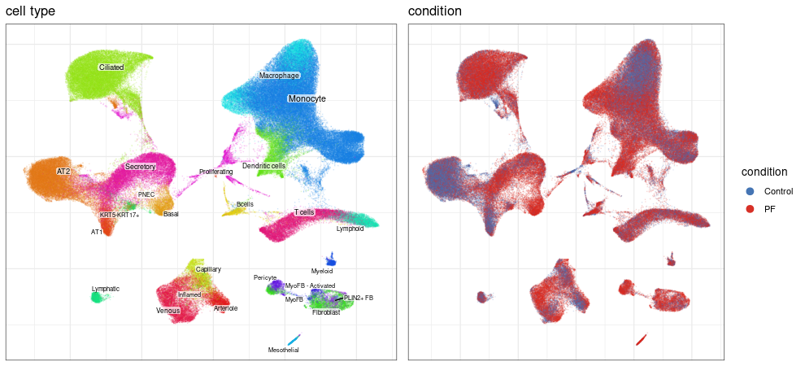<!-- -->

The embedding separates the epithelial (left), immune (right), endothelial and stromal (bottom) compartments. The
condition is mixed within most populations; the airway-type epithelium (basal, `KRT5-KRT17+`) comes mostly from PF
lungs.

## Check the design

``` r
cao$checkDesign(test = "condition")
```

    Design check: 111 samples, 8 covariates, test variable 'condition'
      association with 'condition': subtype 1.00, age 0.63, n.cells 0.23, cohort 0.00, sex 0.00, smoking 0.00, ethnicity 0.00
      Error (1):
        - 'condition' is fully determined by 'subtype' (each subtype contains one condition): the condition effect cannot be separated from subtype -> do not adjust for 'subtype', or test it instead
      Warning (3):
        - 'subtype' is strongly associated with 'condition' (1.00): adjusting for it estimates the condition effect not explained by subtype -> consider reporting both models (cao$checkSensitivity())
        - 16 of 37 'Control' samples have 'age' below the range of 'PF' (43-74): adjusted for 'age', the condition effect there rests on a fitted trend of 'age' beyond the values observed in 'PF' -> compare with the samples in the common range of 'age' (cao$excludeSamples())
        - 'age' is strongly associated with 'condition' (0.63): adjusting for it estimates the condition effect not explained by age -> consider reporting both models (cao$checkSensitivity())
      Note (4):
        - 'subtype' and 'age' are associated (0.64) -> adjusting for both estimates each one's unique contribution only
        - 'cohort' and 'smoking' are associated (0.44) -> adjusting for both estimates each one's unique contribution only
        - 4 cell(s) of condition x ethnicity hold a single sample -> estimates in those cells rest on one sample
        - 3 empty cell(s) in condition x ethnicity -> the design is unbalanced; a marginal contrast cannot average over empty cells

The design check finds what the study design implies: `subtype` determines the condition (it refines it), so it cannot
be a covariate of this contrast, and age is strongly associated with it (0.63 on the check's association scale). It
also reports that 16 of the 37 controls with a recorded age are younger than the youngest PF lung (43): adjusting for
age compares them with the patients through a fitted age trend beyond the ages observed in PF. The centers have
nearly the same share of PF lungs (26 of 46 at TGen, 39 of 65 at Vanderbilt; association 0.00), so the center cannot
confound the contrast; it can still add variation.

``` r
cao$plotDesign("balance")
```

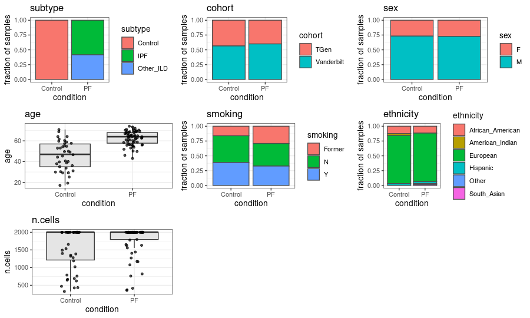<!-- -->

``` r
cao$plotDesign("associations")
```

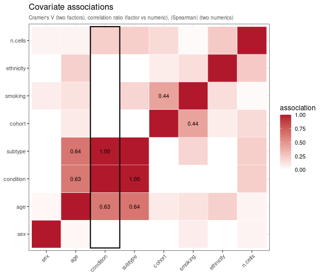<!-- -->

The association matrix shows every pair of metadata columns (Cramér's V for two factors, the correlation ratio for a
factor and a number). Age is associated with the condition (0.63) and with the subtype (0.64); the center is not
associated with the condition, and of the other columns most strongly with smoking (0.44).

## Screen covariates

``` r
cao$screenCovariates(n.permutations = 199)
```

    Covariate screen: 8 covariates x 23 cell types, marginal + partial mode, permutation p-values (199 permutations)
      not screened (fewer than 6 samples): Inflamed, MyoFB
      partial mode fell back to marginal in 4 of 23 cell types (too few residual degrees of freedom for the full covariate set)
    No covariate is associated with expression in >= 3 cell types (partial, FDR 5%).
    Marginal only (not separable from the other covariates): condition, subtype, cohort, age, smoking, n.cells
    Strongly tied to 'condition' (possible over-adjustment): subtype (1.00), age (0.63)
    all cell types (partial, FDR 5%): cohort (adj. R2 0.05), n.cells (adj. R2 0.01), subtype (adj. R2 0.01)
    composition (partial, FDR 5%): cohort (adj. R2 0.03)
    Suggested model: ~condition   (not applied; see cao$setModel())
    Note: constant within a cell type (not tested there): ethnicity in Myeloid

``` r
cao$plotCovariateScreen()
```

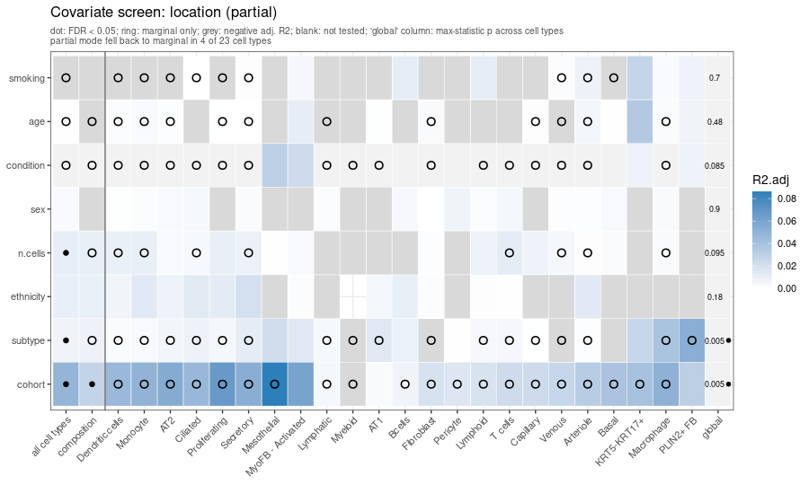<!-- -->

``` r
cao$plotCovariateSummary()
```

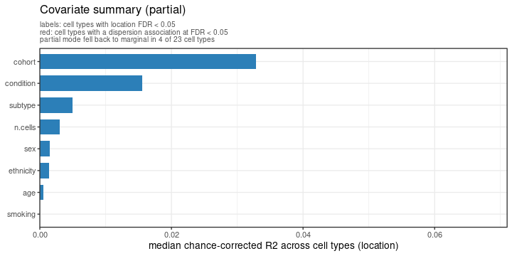<!-- -->

The screen finds no covariate associated with expression in three or more cell types after the others (partial mode);
the center explains the most (adjusted R2 0.05 across cell types, 0.03 for the composition). Within single cell types,
the condition, subtype, center, age, smoking and the number of cells are associated with expression only marginally
(each alone), not after adjustment for the other covariates; the condition and subtype, age and the condition, and the
center and smoking are associated with each other.

``` r
cao$plotVariancePartition(c("condition", "cohort", "sex", "age"))
```

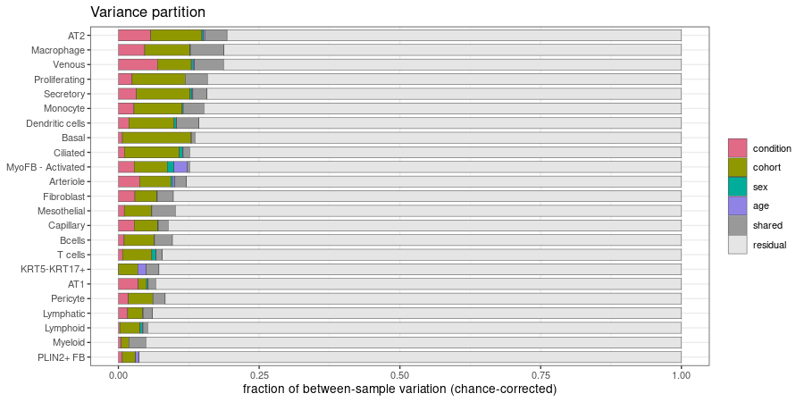<!-- -->

The variance partition splits the between-lung variation of each cell type's expression into the parts explained by
each variable alone, a shared part and a residual. In most cell types the center explains more than the condition (in
basal and ciliated cells about 10 % against 1 %), and the condition explains most in the AT2 cells, macrophages and
venous endothelial cells (about 5-7 %). Sex and age explain little on their own.

### Sample maps

``` r
cowplot::plot_grid(
  cao$plotSampleDistances(cell.type = "AT2", color.by = "cohort", shape.by = "condition"),
  cao$plotSampleDistances(color.by = "age", shape.by = "condition"),
  cao$plotSampleDistances(space = "composition", color.by = "cohort", shape.by = "condition"), ncol = 3)
```

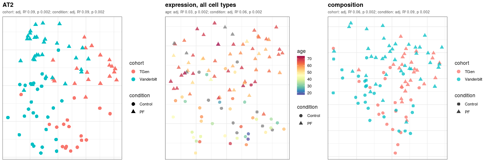<!-- -->

The sample maps place the lungs by the distances between their profiles: of the AT2 cells (left, color: center), of
all cell types together (middle, color: age) and of the composition (right, color: center); shape is the condition. In
the AT2 cells the lungs separate by both condition and center (9 % of the distances each); in the joint expression the
PF lungs and the older lungs occupy the same part of the map, which is the association of age and disease seen from
the data side. The composition separates by condition (9 %) more than by center (6 %).

## Set the model

``` r
cao$setModel(~ condition + sex + (1 | cohort), test = "condition")
```

    Model: ~condition + sex + (1 | cohort)      dispersion: ~condition
           grouping term (1 | cohort): not fitted; the tested variable is exchanged within its levels
    Test: condition: PF vs Control  (reference 'Control': matched a control-like name; to change: test = "condition: Control vs PF")
           adjusted for sex; permutations: block within 4 strata (> 10 million distinct); 103 of 103 samples can change their value; smallest p-value 0.002
           shift > 0: PF samples differ from Control samples in a common direction, beyond within-group variability
    Samples: 103 used, 8 dropped (THD0026, TILD102, TILD113, TILD116, VUHD108, VUHD109, VUHD111, VUHD114).   Issues: 1 warning
      warning: 8 sample(s) dropped for missing covariate values: THD0026, TILD102, TILD113, TILD116, VUHD108, VUHD109, VUHD111, VUHD114 -> complete the metadata or remove the covariate

The center is a grouping term: the condition is exchanged within centers. Sex is a covariate, which drops the 8 lungs
without it.

## Composition

``` r
cao$estimateCellLoadings()
cao$plotCellLoadings(center = "both")
```

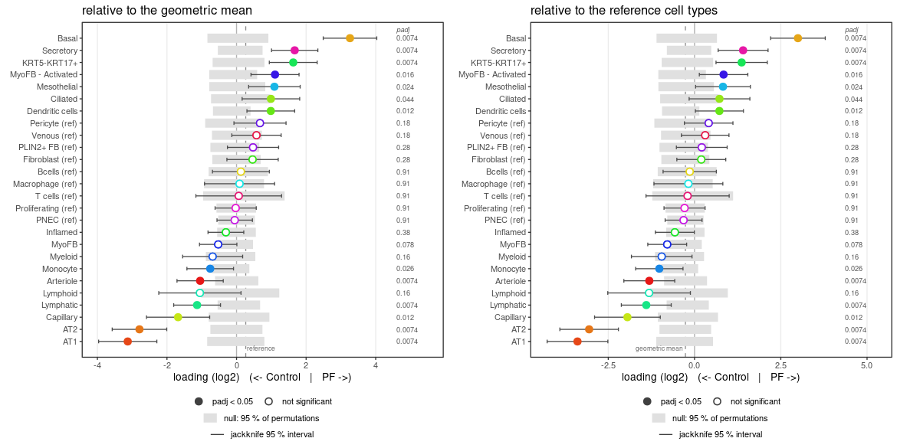<!-- -->

The composition test finds the changes known from the PF literature: AT1 and AT2 cells are depleted (about -3 log2
units relative to the geometric mean), the basal, `KRT5-KRT17+` and secretory cells are enriched, and the capillary,
arteriole and lymphatic endothelial cells are depleted (adjusted p 0.007-0.012). Smaller enrichments of the activated
myofibroblasts, mesothelial, ciliated and dendritic cells (0.012-0.044) and a depletion of the monocytes (0.026) follow.

``` r
knitr::kable(codaLoadingsTable(cao$test.results$coda, min.effect = 1.5), digits = 3)
```

| celltype          | loading | fold.change |    se | ci.low | ci.high |  pval |  padj | reference | median.cells | n.zero | pseudocount.shift | beyond.min.effect |
|:------------------|--------:|------------:|------:|-------:|--------:|------:|------:|:----------|-------------:|-------:|------------------:|:------------------|
| Basal             |   3.261 |       9.588 | 0.420 |  2.427 |   4.095 | 0.002 | 0.007 | FALSE     |            6 |     19 |             0.723 | TRUE              |
| AT1               |  -3.128 |       0.114 | 0.422 | -3.965 |  -2.290 | 0.002 | 0.007 | FALSE     |            5 |     28 |             0.880 | TRUE              |
| AT2               |  -2.790 |       0.145 | 0.394 | -3.572 |  -2.008 | 0.002 | 0.007 | FALSE     |           53 |      0 |             0.240 | TRUE              |
| Secretory         |   1.672 |       3.186 | 0.336 |  1.004 |   2.339 | 0.002 | 0.007 | FALSE     |           84 |      2 |             0.019 | TRUE              |
| KRT5-KRT17+       |   1.630 |       3.095 | 0.369 |  0.898 |   2.362 | 0.002 | 0.007 | FALSE     |            0 |     56 |             1.179 | TRUE              |
| Lymphatic         |  -1.134 |       0.456 | 0.335 | -1.799 |  -0.469 | 0.002 | 0.007 | FALSE     |            5 |     12 |             0.323 | FALSE             |
| Arteriole         |  -1.047 |       0.484 | 0.324 | -1.690 |  -0.403 | 0.002 | 0.007 | FALSE     |           15 |      7 |             0.235 | FALSE             |
| Capillary         |  -1.680 |       0.312 | 0.457 | -2.587 |  -0.773 | 0.004 | 0.012 | FALSE     |           11 |     18 |             0.400 | TRUE              |
| Dendritic cells   |   0.985 |       1.979 | 0.345 |  0.300 |   1.670 | 0.004 | 0.012 | FALSE     |           45 |      2 |             0.120 | FALSE             |
| MyoFB - Activated |   1.106 |       2.153 | 0.375 |  0.363 |   1.849 | 0.006 | 0.016 | FALSE     |            1 |     46 |             0.634 | FALSE             |
| Mesothelial       |   1.089 |       2.127 | 0.392 |  0.311 |   1.867 | 0.010 | 0.024 | FALSE     |            1 |     48 |             0.626 | FALSE             |
| Monocyte          |  -0.756 |       0.592 | 0.328 | -1.407 |  -0.106 | 0.012 | 0.026 | FALSE     |          435 |      0 |             0.189 | FALSE             |
| Ciliated          |   0.988 |       1.983 | 0.431 |  0.132 |   1.843 | 0.022 | 0.044 | FALSE     |          104 |      1 |             0.079 | FALSE             |
| MyoFB             |  -0.527 |       0.694 | 0.274 | -1.071 |   0.016 | 0.042 | 0.078 | FALSE     |            1 |     46 |             0.368 | FALSE             |
| Lymphoid          |  -1.053 |       0.482 | 0.593 | -2.230 |   0.124 | 0.090 | 0.156 | FALSE     |            3 |     36 |             0.191 | FALSE             |
| Myeloid           |  -0.687 |       0.621 | 0.414 | -1.509 |   0.135 | 0.100 | 0.162 | FALSE     |            4 |     15 |             0.232 | FALSE             |
| Pericyte          |   0.674 |       1.596 | 0.404 | -0.126 |   1.475 | 0.124 | 0.185 | TRUE      |            1 |     46 |             0.233 | FALSE             |
| Venous            |   0.573 |       1.488 | 0.364 | -0.148 |   1.295 | 0.128 | 0.185 | TRUE      |           40 |      5 |             0.060 | FALSE             |
| PLIN2+ FB         |   0.474 |       1.389 | 0.391 | -0.302 |   1.250 | 0.206 | 0.282 | TRUE      |            0 |     53 |             0.222 | FALSE             |
| Fibroblast        |   0.460 |       1.376 | 0.364 | -0.262 |   1.183 | 0.218 | 0.283 | TRUE      |           14 |      7 |             0.090 | FALSE             |
| Inflamed          |  -0.306 |       0.809 | 0.273 | -0.848 |   0.236 | 0.308 | 0.381 | FALSE     |            0 |     77 |             0.298 | FALSE             |
| Bcells            |   0.125 |       1.090 | 0.420 | -0.708 |   0.958 | 0.794 | 0.910 | TRUE      |            5 |     13 |             0.189 | FALSE             |
| Macrophage        |   0.086 |       1.062 | 0.480 | -0.867 |   1.040 | 0.834 | 0.910 | TRUE      |           47 |      3 |             0.025 | FALSE             |
| PNEC              |  -0.053 |       0.964 | 0.269 | -0.586 |   0.480 | 0.858 | 0.910 | TRUE      |            0 |     62 |             0.172 | FALSE             |
| T cells           |   0.063 |       1.045 | 0.609 | -1.145 |   1.271 | 0.910 | 0.910 | TRUE      |           21 |     15 |             0.011 | FALSE             |
| Proliferating     |  -0.025 |       0.983 | 0.290 | -0.601 |   0.551 | 0.910 | 0.910 | TRUE      |           30 |      0 |             0.183 | FALSE             |

``` r
cao$plotCodaSamples(n.top = 8)
```

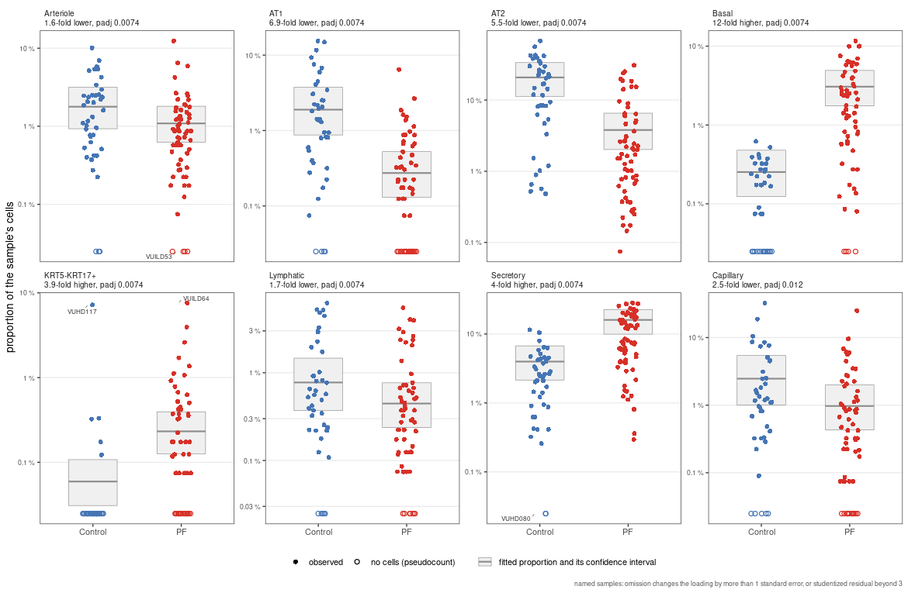<!-- -->

The per-lung proportions show what the loadings summarize: AT1 and AT2 cells fall about six-fold, basal cells rise
twelve-fold and `KRT5-KRT17+` cells four-fold, each as a shift of a broad distribution. Some control lungs have no
basal or `KRT5-KRT17+` cells at all (open circles at the bottom), which the model handles with a pseudocount.

``` r
cao$plotContrastTree()
```

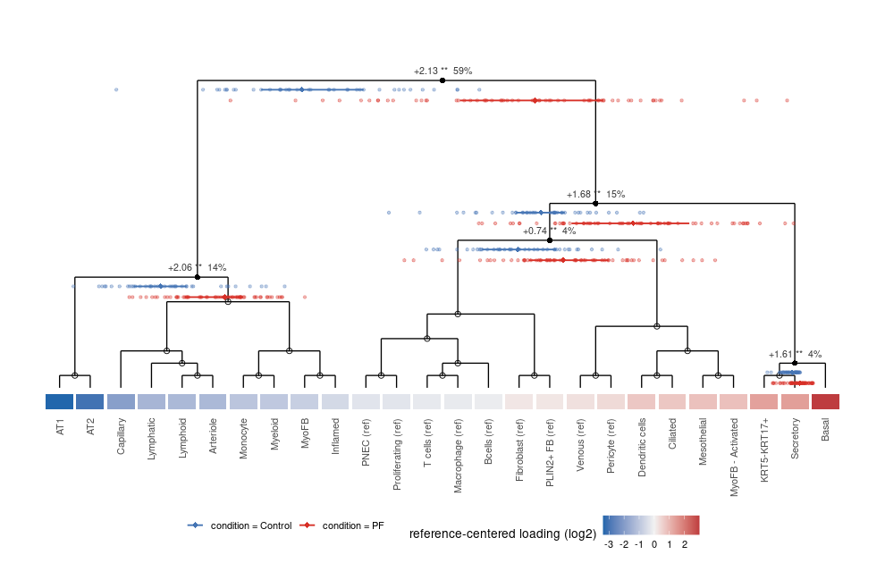<!-- -->

``` r
cao$plotCodaCellTypes(value = "predicted")
```

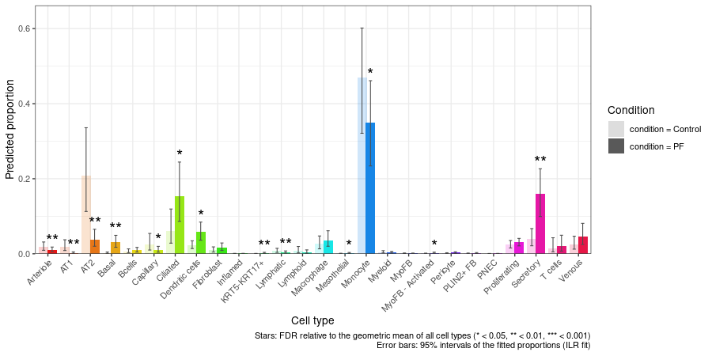<!-- -->

The contrast tree summarizes the composition change by successive splits of the cell types. The first split (2.13
log2 units, 59 % of the change) separates the AT1 and AT2 cells and the populations that decline with them
(capillary, lymphatic, arteriole, monocytes, myeloid and lymphoid cells, and the `MyoFB` and `Inflamed` populations)
from the rest. Within the first group a split (2.06, 14 %) separates AT1 and AT2 from the others; within the rest a
split (1.68, 15 %) isolates the expansion of the secretory, basal and `KRT5-KRT17+` cells. The predicted proportions
translate the loadings into fractions of the lung's cells: AT2 cells
from about 21 % to 4 %, secretory cells from 4 % to 16 %, monocytes from 47 % to 35 %.

``` r
cao$plotFitDiagnostics("composition")
```

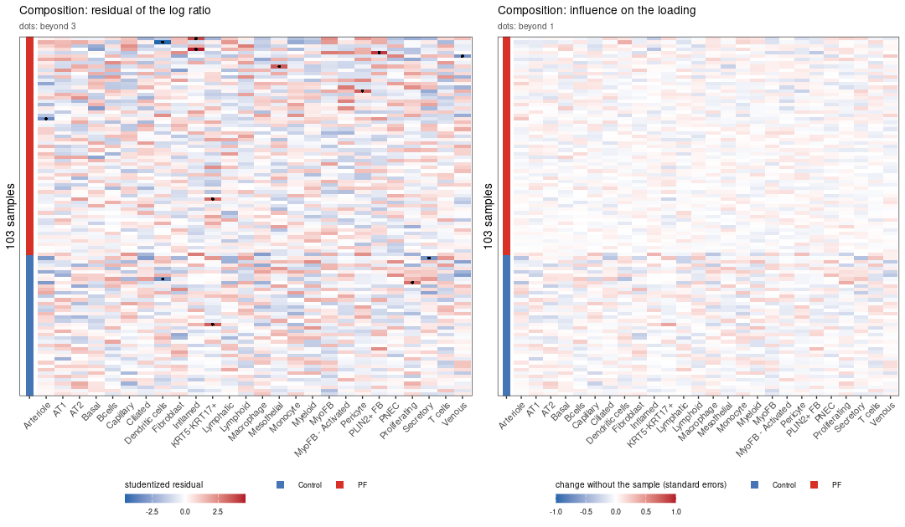<!-- -->

The fit diagnostics show a few lungs with residuals beyond three in single cell types, and no lung that changes a
loading by a standard error: the composition result does not rest on single lungs.

``` r
cao$checkSensitivity(analysis = "composition", n.permutations = 199)
```

    Sensitivity of 'condition: PF vs Control' (loading) across 3 models: unadjusted [~condition + (1 | cohort)]; current [~condition + sex + (1 | cohort)]; minus (1 | cohort) [~condition + sex]
      magnitude: loading (log2, relative to the geometric mean); significance: permutation test (vs the geometric mean) (adjusted p < 0.05)
      Basal             magnitude stable; significant in all 3 models
      AT1               magnitude stable; significant in all 3 models
      AT2               magnitude stable; significant in all 3 models
      Capillary         magnitude stable; significant in all 3 models
      Secretory         magnitude stable; significant in all 3 models
      KRT5-KRT17+       magnitude stable; significant in all 3 models
      Lymphatic         magnitude stable; significant in all 3 models
      MyoFB - Activated magnitude stable; significant in all 3 models
      Mesothelial       magnitude stable; significant in all 3 models
      Arteriole         magnitude stable; significant in all 3 models
      Dendritic cells   magnitude stable; significant in all 3 models
      Lymphoid          magnitude stable; not significant in any of 3 models
      Ciliated          magnitude stable; significant in 1 of 3 models (not with: unadjusted, minus (1 | cohort))
      Monocyte          magnitude stable; significant in 2 of 3 models (not with: minus (1 | cohort))
      Myeloid           magnitude near zero (within the relabeling band); not significant in any of 3 models
      Pericyte          magnitude near zero (within the relabeling band); not significant in any of 3 models
      Venous            magnitude near zero (within the relabeling band); not significant in any of 3 models
      MyoFB             magnitude stable; not significant in any of 3 models
      PLIN2+ FB         magnitude near zero (within the relabeling band); not significant in any of 3 models
      Fibroblast        magnitude near zero (within the relabeling band); not significant in any of 3 models
      Inflamed          magnitude near zero (within the relabeling band); not significant in any of 3 models
      Bcells            magnitude near zero (within the relabeling band); not significant in any of 3 models
      Macrophage        magnitude near zero (within the relabeling band); not significant in any of 3 models
      T cells           magnitude near zero (within the relabeling band); not significant in any of 3 models
      PNEC              magnitude near zero (within the relabeling band); not significant in any of 3 models
      Proliferating     magnitude near zero (within the relabeling band); not significant in any of 3 models

``` r
cao$plotSensitivity(analysis = "composition")
```

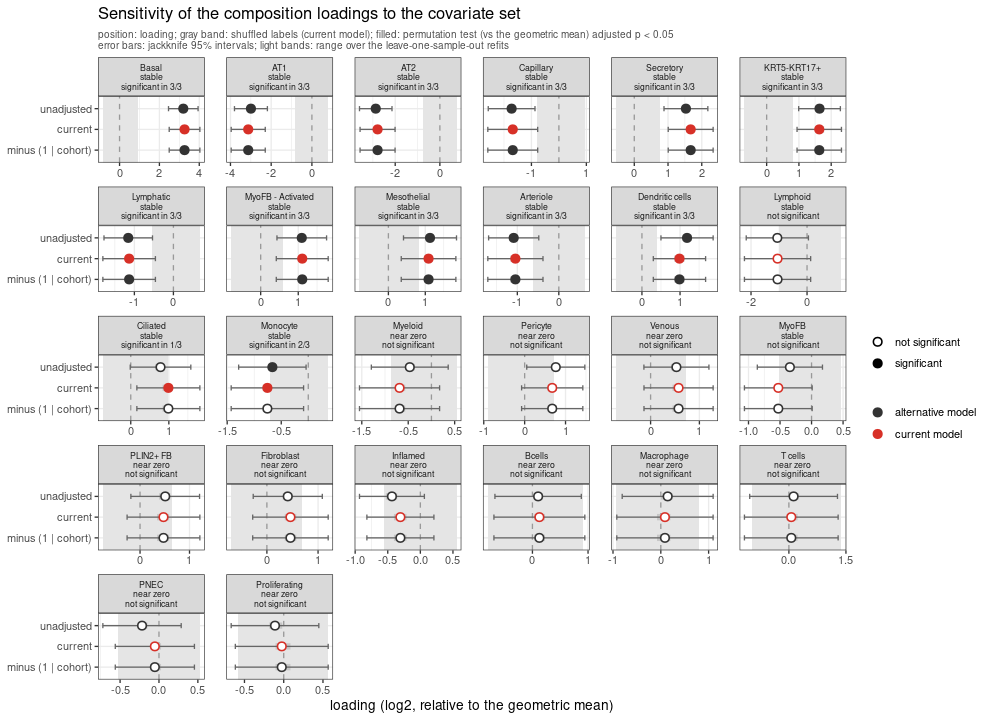<!-- -->

The composition is refitted without sex (on all 111 lungs, including the 8 without a recorded sex) and without the
grouping term. Eleven cell types are significant in all three models with stable loadings; the monocytes lose
significance when the center is ignored, and the ciliated cells are significant only in the current model. Neither the
center nor sex is behind the composition result.

## Expression shifts per cell type

``` r
res <- cao$estimateExpressionShiftMagnitudes()
```

    Building pseudobulk profiles per cell type...

    Testing 26 cell type(s), 1 test(s) with gsd (15617 genes, per type those in >= 5 % of its cells), 499 permutations...

    Building pseudobulk profiles per cell type...

    Testing 25 cell type(s), 1 test(s), 499 permutations (auto)...

    Skipped 1 cell type/test combination(s): too few samples with enough cells

    Note: Mesothelial: only 165 distinct permutations: the smallest attainable p-value is 0.00606

    Note: MyoFB - Activated: only 10 distinct permutations: the smallest attainable p-value is 0.1

    Note: Pericyte: only 56 distinct permutations: the smallest attainable p-value is 0.0179

    Note: PLIN2+ FB: only 36 distinct permutations: the smallest attainable p-value is 0.0278

    22 of 25 cell types with a significant shift at FDR 5% (global p = 0.002).

``` r
res
```

    Expression shifts: condition: PF vs Control; adjusted for sex; 499 block permutations (smallest p 0.002-0.17); statistic gsd
              celltype   n n.mag shift padj.shift   var padj.var total padj.total
                Venous  92    79  0.31     0.0026  0.22    0.011  0.42     0.0034
            Macrophage  90    83  0.25     0.0026  0.20    0.011  0.35     0.0034
                   AT2  92    86  0.22     0.0026  0.13    0.011  0.28     0.0034
              Pericyte  35    19  0.19     0.0026  0.38    0.180  0.37     0.1300
              Monocyte 103   103  0.14     0.0026  0.05    0.068  0.16     0.0034
             Secretory  97    90  0.14     0.0026  0.19    0.011  0.22     0.0034
            Fibroblast  76    60  0.13     0.0026  0.10    0.055  0.18     0.0034
             Arteriole  80    68  0.13     0.0026  0.07    0.044  0.15     0.0034
       Dendritic cells  97    92  0.12     0.0026  0.05    0.200  0.14     0.0034
         Proliferating  94    84  0.11     0.0026  0.06    0.140  0.14     0.0034
           Mesothelial  29    16  0.11     0.0026  0.06    0.610  0.13     0.0750
     MyoFB - Activated  26    11  0.10     0.1200  0.10    0.730  0.15     0.4400
                   AT1  53    39  0.10     0.0026 -0.07    0.250  0.08     0.0034
             Capillary  64    53  0.10     0.0026 -0.02    0.450  0.09     0.0034
                 Basal  61    48  0.07     0.0026  0.27    0.630  0.18     0.5000
             Lymphatic  55    38  0.06     0.0026  0.00    0.900  0.06     0.0034
               Myeloid  47    28  0.06     0.0200  0.09    0.044  0.09     0.0059
             PLIN2+ FB  25    16  0.06     0.0180  0.09    0.730  0.09     0.5800
                Bcells  54    32  0.05     0.0026  0.02    0.720  0.06     0.0850
               T cells  68    63  0.04     0.0026  0.05    0.044  0.06     0.0034
              Ciliated  97    94  0.04     0.0026  0.02    0.240  0.05     0.0059
              Lymphoid  50    41  0.02     0.0200 -0.02    0.280  0.01     0.3700
              Inflamed   6    NA    NA     0.6400    NA       NA    NA         NA
           KRT5-KRT17+  23    NA    NA     0.0026    NA       NA    NA         NA
                 MyoFB  13    NA    NA     0.1100    NA       NA    NA         NA
      22 of 25 cell types with a significant shift (BH 5%); global p: shift 0.002, var 0.002, total 0.002
      tested without a magnitude (fewer than 2 samples per level with >= 10 cells): Inflamed, KRT5-KRT17+, MyoFB
      not tested: PNEC
      (normalized effects; full tables in $results and $wide)

``` r
cao$plotExpressionShiftMagnitudes(show.ci = TRUE, show.genes = TRUE)
```

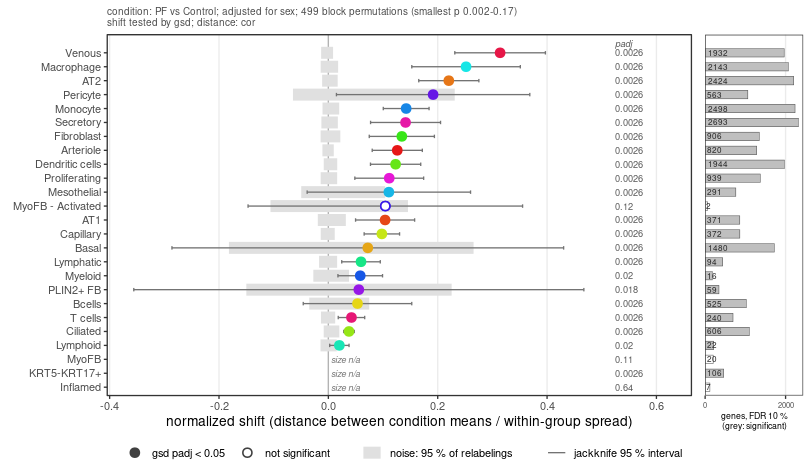<!-- -->

22 of 25 populations shift in expression (gsd, adjusted p < 0.05). The largest normalized shifts are those of the
venous endothelial cells (0.31), macrophages (0.25) and AT2 cells (0.22); the bars on the right count the genes with a
change at FDR 10 % (more than 1,900 in each of the venous cells, macrophages, AT2, monocytes, secretory and dendritic
cells). The pericyte, basal and `PLIN2+ FB` estimates have wide jackknife intervals and wide noise bands: only two or
three control lungs have enough of these cells.

``` r
cao$plotExpressionShiftMagnitudes(effect = "var")
```

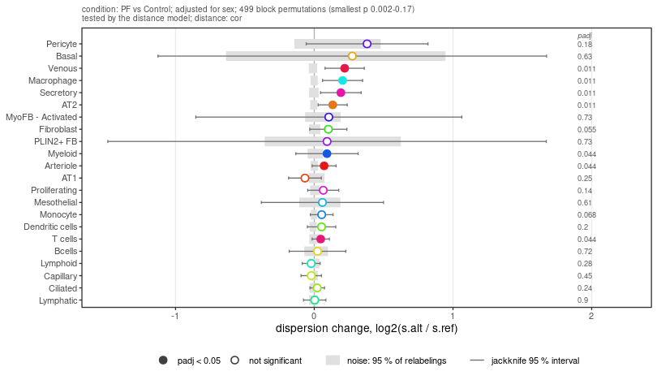<!-- -->

The dispersion effect tests whether PF lungs differ more from each other than control lungs. They do in the venous
endothelial cells, macrophages, secretory and AT2 cells (adjusted p 0.011) and in the myeloid cells, arterioles and T
cells (0.044); the PF lungs are more heterogeneous in the populations that change most.

### Behind one cell type

``` r
cao$plotShiftDetail("AT2")
```

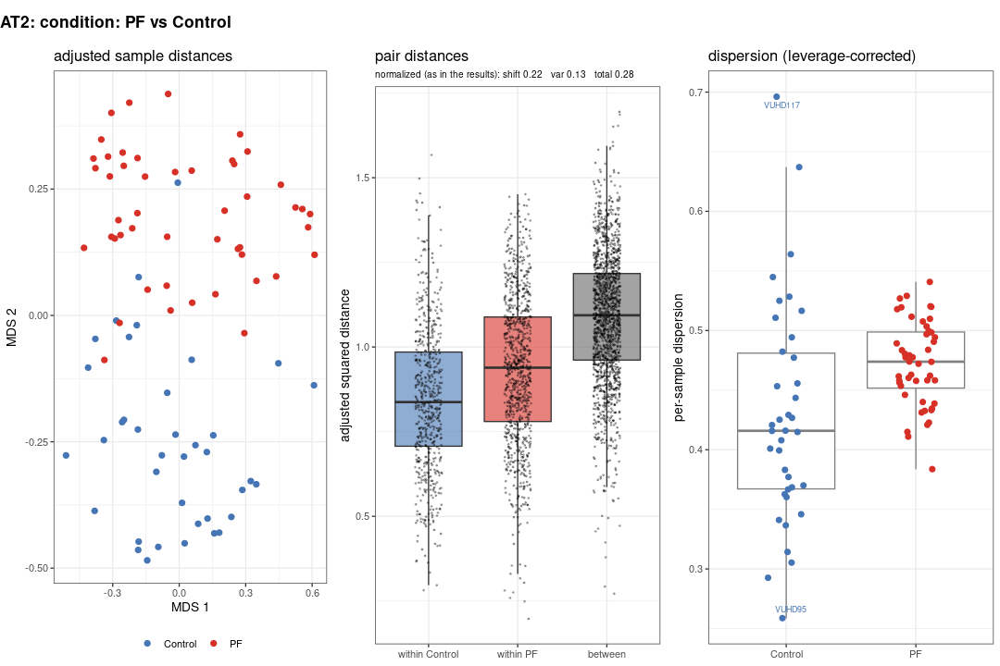<!-- -->

The detail of the AT2 cells shows the lungs on the adjusted distances (left), where PF and control lungs separate,
the distances between pairs of lungs (middle), where pairs of a PF and a control lung are the most different, and the
dispersion of each lung (right), higher and more uniform among the PF lungs. The shift (0.22) dominates the total
difference (0.28); the dispersion effect is smaller (0.13).

``` r
cao$plotSampleInfluence()
```

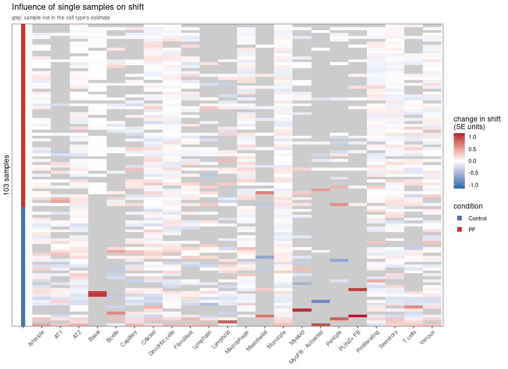<!-- -->

``` r
cao$plotFitDiagnostics("expression.shifts")
```

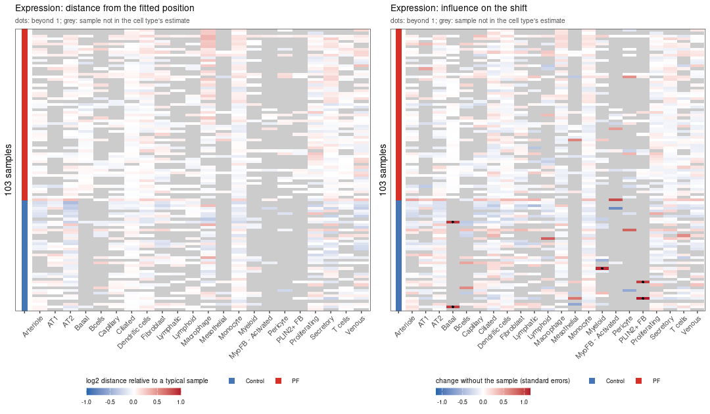<!-- -->

``` r
cowplot::plot_grid(cao$plotSampleDistances(values = "residual", color.by = "smoking", shape.by = "condition"),
                   cao$plotSampleDistances(values = "residual", color.by = "age", shape.by = "condition"),
                   cao$plotSampleDistances(values = "residual", color.by = "cohort", shape.by = "condition"), ncol = 3)
```

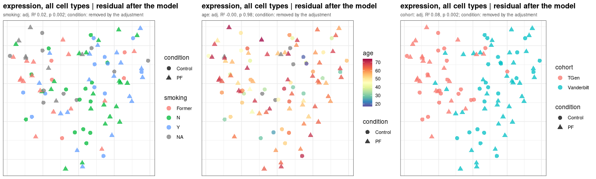<!-- -->

The residual maps show the sample distances left once the model's fixed part (condition and sex) is removed. The
center still structures them (8 %, p 0.002): it is a grouping term, which is not fitted but restricts the relabeling
to lungs of the same center, so its differences stay in the residuals and do not enter the comparison. The smoking
status explains 2 % (p 0.002); the lungs without a recorded status (gray) and the former smokers lie mostly on the side
of the TGen lungs (16 of the 17 lungs without a status and 14 of the 21 former smokers in the model are from TGen), so
this association may in part be that of the center. The age explains nothing of the residuals (p 0.98): within the
conditions, age is not associated with the remaining differences; the association with age seen on the map of the
joint expression above goes together with the condition and is removed with it. Whether the
condition effect is partly an age effect cannot be read from this map; the comparison of models with and without age
below addresses it.

The fit diagnostics of the expression shifts show no lung far from its fitted position; single lungs change the shift
of a few populations by more than a standard error (basal, myeloid and `PLIN2+ FB` cells, measured in 48, 28 and 16
lungs, with only two control lungs for the basal and `PLIN2+ FB` cells).

``` r
cao$checkSensitivity(n.permutations = 199)
```

    Sensitivity of 'condition: PF vs Control' (shift) across 3 models: unadjusted [~condition + (1 | cohort)]; current [~condition + sex + (1 | cohort)]; minus (1 | cohort) [~condition + sex]
      magnitude: distance model; significance: gsd (adjusted p < 0.05)
      Venous            magnitude stable; significant in all 3 models
      Macrophage        magnitude stable; significant in all 3 models
      AT2               magnitude stable; significant in all 3 models
      Monocyte          magnitude stable; significant in all 3 models
      Secretory         magnitude stable; significant in all 3 models
      Fibroblast        magnitude stable; significant in all 3 models
      Arteriole         magnitude stable; significant in all 3 models
      Dendritic cells   magnitude stable; significant in all 3 models
      Proliferating     magnitude stable; significant in all 3 models
      AT1               magnitude stable; significant in all 3 models
      Capillary         magnitude stable; significant in all 3 models
      Lymphatic         magnitude stable; significant in all 3 models
      T cells           magnitude stable; significant in all 3 models
      Ciliated          magnitude stable; significant in all 3 models
      Pericyte          magnitude near zero (within the relabeling band); significant in all 3 models
      Mesothelial       magnitude driven by sample VUHD112; significant in all 3 models
      MyoFB - Activated magnitude near zero (within the relabeling band); not significant in any of 3 models
      Basal             magnitude near zero (within the relabeling band); significant in all 3 models
      Myeloid           magnitude driven by sample VUHD071; significant in all 3 models
      PLIN2+ FB         magnitude near zero (within the relabeling band); significant in all 3 models
      Bcells            magnitude near zero (within the relabeling band); significant in all 3 models
      Lymphoid          magnitude driven by sample VUHD072; significant in all 3 models

``` r
cao$plotSensitivity()
```

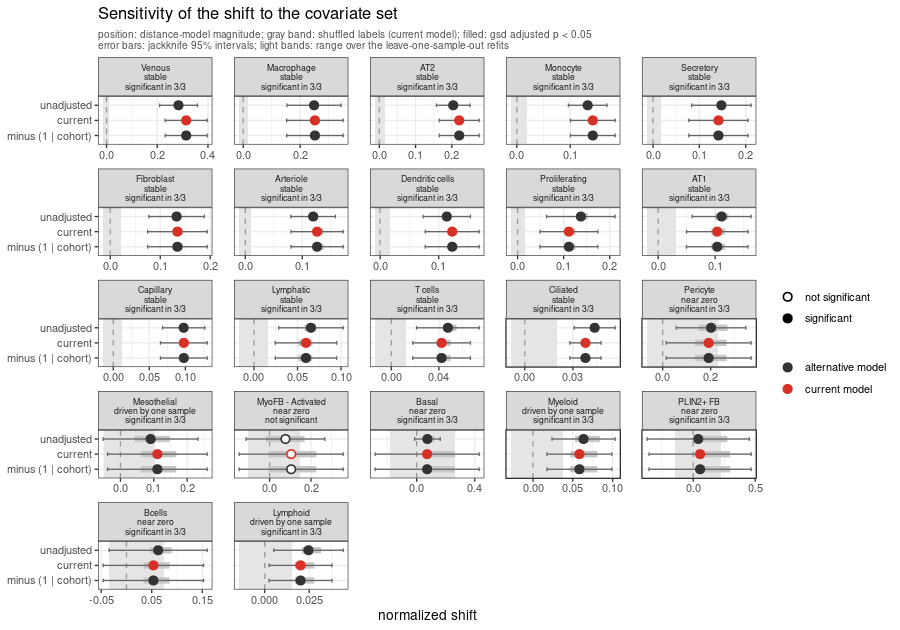<!-- -->

The sensitivity analysis refits the shifts without sex and without the grouping term (`minus (1 | cohort)`). Every
population keeps its result in all three models: the center changes nothing here. Three populations (myeloid,
lymphoid, mesothelial cells) have a magnitude carried mostly by one lung (named in the printout).

## Adding age

The controls are younger than the patients, and 16 of them are younger than any patient. Four models are compared,
all on lungs with complete sex and age: without and with age on all 97 such lungs, and without and with age on the 81
lungs aged 43 or more, where patients and controls cover the same ages.

``` r
tapply(sample.meta$age, sample.meta$condition, summary)
```

    $Control
       Min. 1st Qu.  Median    Mean 3rd Qu.    Max.    NA's 
      17.00   35.00   47.00   45.73   57.00   71.00       9 

    $PF
       Min. 1st Qu.  Median    Mean 3rd Qu.    Max.    NA's 
      43.00   57.75   64.00   62.43   68.00   74.00       5 

``` r
cnt <- table(cao$sample.per.cell, cao$cell.groups)
prop <- sweep(cnt + 0.5, 1, rowSums(cnt) + 0.5 * ncol(cnt), "/")
types <- c("T cells", "Dendritic cells", "Proliferating", "Monocyte", "AT2", "Secretory")
d <- do.call(rbind, lapply(types, function(t) data.frame(sample = rownames(prop), celltype = t, proportion = as.numeric(prop[, t]))))
d$age <- sample.meta[d$sample, "age"]; d$condition <- sample.meta[d$sample, "condition"]
ggplot(d[!is.na(d$age), ], aes(age, proportion, color = condition)) + geom_point(size = 1.3) +
  geom_smooth(method = "lm", formula = y ~ x, se = FALSE) + geom_vline(xintercept = 43, linetype = 2, color = "grey40") +
  scale_y_log10() + facet_wrap(~ celltype, scales = "free_y", ncol = 3) + scale_color_manual(values = cao$sample.groups.palette) +
  labs(y = "proportion of the lung's cells (log scale)", x = "age (dashed: youngest PF lung)") + cao$plot.theme
```

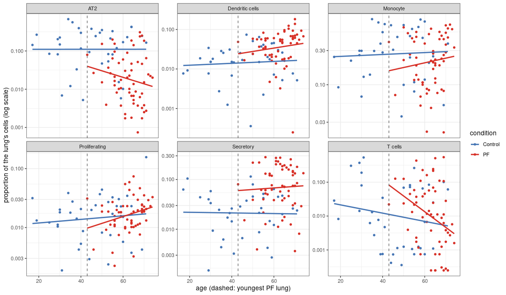<!-- -->

The proportions of six cell types against age, by condition, show where the young controls matter. The T-cell
fraction is high (19-54 %) in four of the 13 controls younger than 40 but 10 % or more in only two of the 24 older
controls (10 % and 26 %), and it declines steeply with age among the PF lungs; a comparison of PF with all controls
therefore depends on how many young controls there are. The fitted lines of the dendritic cells and proliferating cells
rise with age in both groups (among the controls alone these trends are not significant, see below). The secretory
cells show little trend with age within either group, although adding age to the model lowers their loading (below);
the AT2 cells are flat among the controls and decline with age among the PF lungs.

``` r
complete <- rownames(sample.meta)[!is.na(sample.meta$age) & !is.na(sample.meta$sex)]
cao$excludeSamples(setdiff(rownames(sample.meta), complete))
cao$setModel(~ condition + sex + (1 | cohort), test = "condition")
```

    Model: ~condition + sex + (1 | cohort)      dispersion: ~condition
           grouping term (1 | cohort): not fitted; the tested variable is exchanged within its levels
    Test: condition: PF vs Control  (reference 'Control': matched a control-like name; to change: test = "condition: Control vs PF")
           adjusted for sex; permutations: block within 4 strata (> 10 million distinct); 97 of 97 samples can change their value; smallest p-value 0.002
           shift > 0: PF samples differ from Control samples in a common direction, beyond within-group variability
    Samples: 97 used.   Issues: none

``` r
cao$estimateCellLoadings(name = "coda.complete")
cao$estimateExpressionShiftMagnitudes(name = "shifts.complete")
cao$setModel(~ condition + sex + age + (1 | cohort), test = "condition")
```

    Model: ~condition + sex + age + (1 | cohort)      dispersion: ~condition
           grouping term (1 | cohort): not fitted; the tested variable is exchanged within its levels
    Test: condition: PF vs Control  (reference 'Control': matched a control-like name; to change: test = "condition: Control vs PF")
           adjusted for sex, age; permutations: block within 4 strata (> 10 million distinct); 97 of 97 samples can change their value; smallest p-value 0.002
           shift > 0: PF samples differ from Control samples in a common direction, beyond within-group variability
    Samples: 97 used.   Issues: 1 warning, 1 note
      warning: test 'condition: PF vs Control': 16 of 37 'Control' samples have 'age' below the range of 'PF' (43-74): adjusted for 'age', the condition effect there rests on a fitted trend of 'age' beyond the values observed in 'PF' -> compare with the samples in the common range of 'age' (cao$excludeSamples())
      note: test 'condition: PF vs Control': continuous covariate(s) age with grouping variable(s) cohort: the rows of the design are exchanged within the groups (the covariate moves with the tested variable; approximate)

``` r
cao$estimateCellLoadings(name = "coda.age")
cao$estimateExpressionShiftMagnitudes(name = "shifts.age")
```

``` r
sh <- function(nm) { r <- cao$test.results[[nm]]$results; r[r$effect == "shift", c("celltype", "estimate.norm", "padj")] }
m <- merge(sh("shifts.complete"), sh("shifts.age"), by = "celltype", suffixes = c(".without.age", ".with.age"))
m[, -1] <- signif(m[, -1], 2); m[order(m$padj.without.age), ]
```

                celltype estimate.norm.without.age padj.without.age
    1          Arteriole                     0.130           0.0028
    2                AT1                     0.100           0.0028
    3                AT2                     0.220           0.0028
    4              Basal                     0.068           0.0028
    5             Bcells                     0.049           0.0028
    6          Capillary                     0.096           0.0028
    7           Ciliated                     0.037           0.0028
    8    Dendritic cells                     0.130           0.0028
    9         Fibroblast                     0.130           0.0028
    11       KRT5-KRT17+                        NA           0.0028
    12         Lymphatic                     0.068           0.0028
    14        Macrophage                     0.230           0.0028
    15       Mesothelial                     0.110           0.0028
    16          Monocyte                     0.130           0.0028
    20          Pericyte                     0.200           0.0028
    23         Secretory                     0.140           0.0028
    24           T cells                     0.038           0.0028
    25            Venous                     0.310           0.0028
    22     Proliferating                     0.110           0.0053
    21         PLIN2+ FB                     0.056           0.0200
    17           Myeloid                     0.054           0.0600
    13          Lymphoid                     0.017           0.1000
    18             MyoFB                        NA           0.1400
    19 MyoFB - Activated                     0.099           0.2100
    10          Inflamed                        NA           0.6600
       estimate.norm.with.age padj.with.age
    1                  0.1300        0.0042
    2                  0.1200        0.0042
    3                  0.2100        0.0042
    4                  0.0280        0.0042
    5                  0.1600        0.0140
    6                  0.0770        0.0042
    7                  0.0440        0.0042
    8                  0.1200        0.0042
    9                  0.1100        0.0042
    11                     NA        0.0140
    12                 0.0470        0.2200
    14                 0.2600        0.0042
    15                 0.2100        0.0850
    16                 0.1200        0.0042
    20                 0.2000        0.0250
    23                 0.1200        0.0042
    24                 0.0240        0.4000
    25                 0.2600        0.0042
    22                 0.0920        0.0230
    21                 0.0650        0.1500
    17                 0.0690        0.2500
    13                 0.0044        0.2500
    18                     NA        0.2500
    19                 0.2500        0.6000
    10                     NA        0.3000

``` r
lo <- function(nm) { x <- cao$test.results[[nm]]$contrast; data.frame(loading = x$loadings$obs / log(2), padj = x$per_cell$padj[names(x$loadings$obs)]) }
l1 <- lo("coda.complete"); l2 <- lo("coda.age")[rownames(l1), ]
d <- data.frame(loading.without.age = l1$loading, padj.without.age = l1$padj, loading.with.age = l2$loading, padj.with.age = l2$padj, row.names = rownames(l1))
signif(d[order(d$padj.without.age), ], 2)
```

                      loading.without.age padj.without.age loading.with.age
    AT1                            -3.200           0.0087           -3.100
    AT2                            -2.900           0.0087           -2.900
    Basal                           3.200           0.0087            2.900
    Dendritic cells                 1.100           0.0087            0.570
    KRT5-KRT17+                     1.600           0.0087            1.900
    Secretory                       1.500           0.0087            1.100
    Capillary                      -1.600           0.0150           -1.300
    Lymphatic                      -1.100           0.0200           -0.960
    Mesothelial                     1.100           0.0350            1.200
    Arteriole                      -0.920           0.0360           -1.200
    MyoFB - Activated               1.100           0.0380            1.200
    Ciliated                        1.100           0.0480            0.770
    Monocyte                       -0.630           0.0600           -1.100
    MyoFB                          -0.610           0.0670           -0.500
    Venous                          0.700           0.1000            0.640
    Lymphoid                       -0.980           0.1600           -0.330
    Myeloid                        -0.690           0.1700           -1.000
    PLIN2+ FB                       0.590           0.2100            0.920
    Pericyte                        0.630           0.2200            1.100
    Fibroblast                      0.360           0.4200            0.210
    Inflamed                       -0.250           0.4800           -0.051
    Macrophage                      0.200           0.8400           -0.190
    Bcells                         -0.095           0.8800            0.180
    PNEC                           -0.057           0.8800           -0.180
    Proliferating                  -0.049           0.8800           -0.640
    T cells                        -0.130           0.8800            0.780
                      padj.with.age
    AT1                       0.013
    AT2                       0.013
    Basal                     0.013
    Dendritic cells           0.510
    KRT5-KRT17+               0.013
    Secretory                 0.078
    Capillary                 0.100
    Lymphatic                 0.100
    Mesothelial               0.100
    Arteriole                 0.078
    MyoFB - Activated         0.100
    Ciliated                  0.290
    Monocyte                  0.120
    MyoFB                     0.230
    Venous                    0.250
    Lymphoid                  0.820
    Myeloid                   0.200
    PLIN2+ FB                 0.150
    Pericyte                  0.120
    Fibroblast                0.820
    Inflamed                  0.890
    Macrophage                0.870
    Bcells                    0.820
    PNEC                      0.810
    Proliferating             0.180
    T cells                   0.560

``` r
young <- rownames(sample.meta)[!is.na(sample.meta$age) & sample.meta$age < min(sample.meta$age[sample.meta$condition == "PF"], na.rm = TRUE)]
cao$excludeSamples(c(setdiff(rownames(sample.meta), complete), young))
table(cao$sample.meta$condition); tapply(cao$sample.meta$age, cao$sample.meta$condition, summary)
```

    Control      PF 
         21      60 

    $Control
       Min. 1st Qu.  Median    Mean 3rd Qu.    Max. 
      44.00   50.00   55.00   56.14   60.00   71.00 

    $PF
       Min. 1st Qu.  Median    Mean 3rd Qu.    Max. 
      43.00   57.75   64.00   62.43   68.00   74.00 

``` r
cao$setModel(~ condition + sex + (1 | cohort), test = "condition")
```

    Model: ~condition + sex + (1 | cohort)      dispersion: ~condition
           grouping term (1 | cohort): not fitted; the tested variable is exchanged within its levels
    Test: condition: PF vs Control  (reference 'Control': matched a control-like name; to change: test = "condition: Control vs PF")
           adjusted for sex; permutations: block within 4 strata (> 10 million distinct); 81 of 81 samples can change their value; smallest p-value 0.002
           shift > 0: PF samples differ from Control samples in a common direction, beyond within-group variability
    Samples: 81 used.   Issues: none

``` r
cao$estimateCellLoadings(name = "coda.common")
cao$estimateExpressionShiftMagnitudes(name = "shifts.common")
cao$setModel(~ condition + sex + age + (1 | cohort), test = "condition")
```

    Model: ~condition + sex + age + (1 | cohort)      dispersion: ~condition
           grouping term (1 | cohort): not fitted; the tested variable is exchanged within its levels
    Test: condition: PF vs Control  (reference 'Control': matched a control-like name; to change: test = "condition: Control vs PF")
           adjusted for sex, age; permutations: block within 4 strata (> 10 million distinct); 81 of 81 samples can change their value; smallest p-value 0.002
           shift > 0: PF samples differ from Control samples in a common direction, beyond within-group variability
    Samples: 81 used.   Issues: 1 note
      note: test 'condition: PF vs Control': continuous covariate(s) age with grouping variable(s) cohort: the rows of the design are exchanged within the groups (the covariate moves with the tested variable; approximate)

``` r
cao$estimateCellLoadings(name = "coda.common.age")
cao$estimateExpressionShiftMagnitudes(name = "shifts.common.age")
```

``` r
nms <- c(all = "coda.complete", all.age = "coda.age", common = "coda.common", common.age = "coda.common.age")
L <- sapply(nms, function(nm) lo(nm)[rownames(l1), "loading"]); P <- sapply(nms, function(nm) lo(nm)[rownames(l1), "padj"])
rownames(L) <- rownames(P) <- rownames(l1)
signif(L[order(P[, "all"]), ], 2)       # composition loadings (log2) in the four models
```

                         all all.age common common.age
    AT1               -3.200  -3.100 -3.200    -3.2000
    AT2               -2.900  -2.900 -2.900    -2.9000
    Basal              3.200   2.900  2.900     2.8000
    Dendritic cells    1.100   0.570  0.890     0.6400
    KRT5-KRT17+        1.600   1.900  1.800     1.9000
    Secretory          1.500   1.100  1.300     1.0000
    Capillary         -1.600  -1.300 -1.600    -1.4000
    Lymphatic         -1.100  -0.960 -1.100    -0.9800
    Mesothelial        1.100   1.200  0.930     1.1000
    Arteriole         -0.920  -1.200 -1.200    -1.1000
    MyoFB - Activated  1.100   1.200  1.100     1.2000
    Ciliated           1.100   0.770  0.900     0.7100
    Monocyte          -0.630  -1.100 -0.590    -0.8400
    MyoFB             -0.610  -0.500 -0.490    -0.3800
    Venous             0.700   0.640  0.770     0.6900
    Lymphoid          -0.980  -0.330 -0.470    -0.5000
    Myeloid           -0.690  -1.000 -1.100    -1.0000
    PLIN2+ FB          0.590   0.920  0.460     0.8100
    Pericyte           0.630   1.100  0.710     1.1000
    Fibroblast         0.360   0.210  0.180     0.2200
    Inflamed          -0.250  -0.051 -0.220     0.0260
    Macrophage         0.200  -0.190  0.380    -0.0021
    Bcells            -0.095   0.180  0.029     0.1800
    PNEC              -0.057  -0.180  0.017    -0.1500
    Proliferating     -0.049  -0.640 -0.170    -0.6000
    T cells           -0.130   0.780  0.650     0.7100

``` r
signif(P[order(P[, "all"]), ], 2)       # their adjusted p
```

                         all all.age common common.age
    AT1               0.0087   0.013  0.013      0.013
    AT2               0.0087   0.013  0.013      0.013
    Basal             0.0087   0.013  0.013      0.013
    Dendritic cells   0.0087   0.510  0.110      0.360
    KRT5-KRT17+       0.0087   0.013  0.013      0.013
    Secretory         0.0087   0.078  0.026      0.100
    Capillary         0.0150   0.100  0.037      0.100
    Lymphatic         0.0200   0.100  0.052      0.110
    Mesothelial       0.0350   0.100  0.150      0.110
    Arteriole         0.0360   0.078  0.026      0.083
    MyoFB - Activated 0.0380   0.100  0.092      0.110
    Ciliated          0.0480   0.290  0.240      0.360
    Monocyte          0.0600   0.120  0.330      0.220
    MyoFB             0.0670   0.230  0.280      0.430
    Venous            0.1000   0.250  0.230      0.270
    Lymphoid          0.1600   0.820  0.690      0.730
    Myeloid           0.1700   0.200  0.230      0.270
    PLIN2+ FB         0.2100   0.150  0.500      0.230
    Pericyte          0.2200   0.120  0.350      0.200
    Fibroblast        0.4200   0.820  0.720      0.780
    Inflamed          0.4800   0.890  0.690      0.990
    Macrophage        0.8400   0.870  0.690      1.000
    Bcells            0.8800   0.820  0.960      0.830
    PNEC              0.8800   0.810  0.960      0.780
    Proliferating     0.8800   0.180  0.720      0.220
    T cells           0.8800   0.560  0.600      0.620

``` r
colSums(P < 0.05)                       # cell types with adjusted p < 0.05
```

           all    all.age     common common.age 
            12          4          7          4 

``` r
snm <- c(all = "shifts.complete", all.age = "shifts.age", common = "shifts.common", common.age = "shifts.common.age")
S <- Reduce(function(a, b) merge(a, b, by = "celltype", all = TRUE), lapply(names(snm), function(k) { x <- sh(snm[[k]]); names(x)[-1] <- paste(names(x)[-1], k, sep = "."); x }))
S[, -1] <- signif(S[, -1], 2); S[order(S$padj.all), c("celltype", grep("^padj", names(S), value = TRUE), grep("^estimate", names(S), value = TRUE))]
```

                celltype padj.all padj.all.age padj.common padj.common.age
    1          Arteriole   0.0028       0.0042      0.0034          0.0034
    2                AT1   0.0028       0.0042      0.0034          0.0034
    3                AT2   0.0028       0.0042      0.0034          0.0034
    4              Basal   0.0028       0.0042      0.0034          0.0034
    5             Bcells   0.0028       0.0140      0.0059          0.0150
    6          Capillary   0.0028       0.0042      0.0059          0.0063
    7           Ciliated   0.0028       0.0042      0.0034          0.0034
    8    Dendritic cells   0.0028       0.0042      0.0034          0.0034
    9         Fibroblast   0.0028       0.0042      0.0034          0.0034
    11       KRT5-KRT17+   0.0028       0.0140          NA              NA
    12         Lymphatic   0.0028       0.2200      0.2000          0.3500
    14        Macrophage   0.0028       0.0042      0.0034          0.0034
    15       Mesothelial   0.0028       0.0850      0.0190          0.0550
    16          Monocyte   0.0028       0.0042      0.0034          0.0034
    20          Pericyte   0.0028       0.0250      0.0034          0.0034
    23         Secretory   0.0028       0.0042      0.0034          0.0034
    24           T cells   0.0028       0.4000      0.3700          0.3100
    25            Venous   0.0028       0.0042      0.0034          0.0034
    22     Proliferating   0.0053       0.0230      0.0034          0.0034
    21         PLIN2+ FB   0.0200       0.1500      0.0420          0.0800
    17           Myeloid   0.0600       0.2500      0.0410          0.2700
    13          Lymphoid   0.1000       0.2500      0.5800          0.4700
    18             MyoFB   0.1400       0.2500      0.1400          0.2100
    19 MyoFB - Activated   0.2100       0.6000          NA              NA
    10          Inflamed   0.6600       0.3000          NA              NA
       estimate.norm.all estimate.norm.all.age estimate.norm.common
    1              0.130                0.1300               0.0920
    2              0.100                0.1200               0.1000
    3              0.220                0.2100               0.1700
    4              0.068                0.0280                   NA
    5              0.049                0.1600               0.1100
    6              0.096                0.0770               0.0690
    7              0.037                0.0440               0.0340
    8              0.130                0.1200               0.1200
    9              0.130                0.1100               0.0890
    11                NA                    NA                   NA
    12             0.068                0.0470               0.0290
    14             0.230                0.2600               0.2700
    15             0.110                0.2100               0.1700
    16             0.130                0.1200               0.1200
    20             0.200                0.2000               0.1700
    23             0.140                0.1200               0.1100
    24             0.038                0.0240               0.0280
    25             0.310                0.2600               0.2200
    22             0.110                0.0920               0.1100
    21             0.056                0.0650                   NA
    17             0.054                0.0690               0.0790
    13             0.017                0.0044              -0.0005
    18                NA                    NA                   NA
    19             0.099                0.2500                   NA
    10                NA                    NA                   NA
       estimate.norm.common.age
    1                    0.1100
    2                    0.1200
    3                    0.1900
    4                        NA
    5                    0.1300
    6                    0.0670
    7                    0.0400
    8                    0.1100
    9                    0.0900
    11                       NA
    12                   0.0310
    14                   0.2500
    15                   0.2100
    16                   0.1100
    20                   0.1800
    23                   0.1200
    24                   0.0270
    25                   0.2200
    22                   0.0820
    21                       NA
    17                   0.0680
    13                   0.0031
    18                       NA
    19                       NA
    10                       NA

``` r
colSums(S[, grep("^padj", names(S))] < 0.05, na.rm = TRUE)
```

           padj.all    padj.all.age     padj.common padj.common.age 
                 20              16              18              15 

``` r
cao$excludeSamples(NULL)
cao$setModel(~ condition + sex + (1 | cohort), test = "condition")
```

    Model: ~condition + sex + (1 | cohort)      dispersion: ~condition
           grouping term (1 | cohort): not fitted; the tested variable is exchanged within its levels
    Test: condition: PF vs Control  (reference 'Control': matched a control-like name; to change: test = "condition: Control vs PF")
           adjusted for sex; permutations: block within 4 strata (> 10 million distinct); 103 of 103 samples can change their value; smallest p-value 0.002
           shift > 0: PF samples differ from Control samples in a common direction, beyond within-group variability
    Samples: 103 used, 8 dropped (THD0026, TILD102, TILD113, TILD116, VUHD108, VUHD109, VUHD111, VUHD114).   Issues: 1 warning
      warning: 8 sample(s) dropped for missing covariate values: THD0026, TILD102, TILD113, TILD116, VUHD108, VUHD109, VUHD111, VUHD114 -> complete the metadata or remove the covariate

The four models answer two questions. First, what adding age does on all lungs: the composition result shrinks from
12 to 4 significant cell types and the expression shifts from 20 to 16 populations. Age explains 39 % of the variance
of the PF/control indicator, so the standard error of the condition effect grows by a factor of 1.3 with age in the
model; the strongest changes keep their size (AT1 -3.2 against -3.1 log2 units), but several other loadings move
(dendritic cells 1.1 to 0.57, monocytes -0.63 to -1.1, T cells -0.13 to +0.78, proliferating cells -0.05 to -0.64).

Second, whether the adjusted result depends on the young controls, whose comparison with the patients rests on the
fitted age trend alone. It does not: on the 81 lungs in the common age range the adjusted loadings are close to those
on all lungs (dendritic cells 0.64, monocytes -0.84, T cells 0.71, proliferating cells -0.60), and the same four cell
types are significant (AT1, AT2, basal and `KRT5-KRT17+` cells). The unadjusted model on the common range lies in
between (7 significant types). Two kinds of change can be told apart:

- results that change when the young controls are left out, with or without age in the model, and agree on the
  common range with the age-adjusted result on all lungs: the T-cell loading (-0.13 on all lungs without age, about
  +0.7 in the three other models), the lymphoid loading (-0.98 against -0.3 to -0.5; not significant in any model)
  and the expression shifts of the lymphatic endothelial cells and T cells (significant only on all lungs without
  age): these came from the young controls;
- loadings that are similar on both ranges without age and move when age is added, on both ranges alike (dendritic
  cells 1.1 and 0.89 without age, 0.57 and 0.64 with age; monocytes -0.63 and -0.59, then -1.1 and -0.84;
  proliferating cells -0.05 and -0.17, then -0.64 and -0.60): within the common range the patients are still older
  (median 64 against 55), and the age trend estimated there produces these moves.

The age adjustment is therefore supported by the lungs whose ages overlap, and the age-adjusted result is the one to
report. The four composition changes and the expression shifts that survive it (16 populations on all lungs, 15 on the common
range) are separated from age in this cohort; for the other composition changes (secretory, capillary, arteriole,
lymphatic, mesothelial and activated myofibroblast cells, adjusted p 0.08-0.10 with age; dendritic and ciliated cells,
0.51 and 0.29) the cohort cannot tell disease from age: their adjusted estimates are smaller for some (secretory cells
1.1 against 1.5 log2 units, dendritic cells 0.57 against 1.1), similar or larger for others (arteriole -1.2 against
-0.92), and all are less precise.

### Age among the controls

``` r
cao$excludeSamples(rownames(sample.meta)[sample.meta$condition != "Control" | is.na(sample.meta$age) | is.na(sample.meta$sex)])
cao$setModel(~ age + sex + (1 | cohort), test = "age", numeric.step = 10)
```

    Model: ~age + sex + (1 | cohort)      dispersion: ~age
           grouping term (1 | cohort): not fitted; the tested variable is exchanged within its levels
    Test: age: per 10 units
           adjusted for sex; permutations: block within 4 strata (> 10 million distinct); 37 of 37 samples can change their value; smallest p-value 0.002
           shift > 0: samples move in a common direction as age increases (per 10 units)
    Samples: 37 used.   Issues: none

``` r
cao$estimateCellLoadings(name = "coda.controls.age")
cao$estimateExpressionShiftMagnitudes(name = "shifts.controls.age")
gap <- diff(tapply(sample.meta[complete, "age"], sample.meta[complete, "condition"], mean)) / 10   # mean age difference between PF and control, in decades
lc <- lo("coda.controls.age")[rownames(l1), ]
signif(data.frame(control.per.decade = lc$loading, padj.controls = lc$padj, expected.from.age.gap = lc$loading * gap,
                  PF.without.age = L[, "all"], PF.with.age = L[, "all.age"], row.names = rownames(l1))[order(lc$padj), ], 2)
```

                      control.per.decade padj.controls expected.from.age.gap
    Arteriole                      0.200          0.94                 0.330
    AT1                           -0.064          0.94                -0.110
    Basal                          0.220          0.94                 0.370
    Bcells                        -0.200          0.94                -0.330
    Capillary                      0.120          0.94                 0.200
    Ciliated                       0.073          0.94                 0.120
    Dendritic cells                0.110          0.94                 0.180
    Fibroblast                     0.210          0.94                 0.340
    KRT5-KRT17+                   -0.210          0.94                -0.350
    Lymphoid                      -0.240          0.94                -0.400
    Macrophage                    -0.110          0.94                -0.190
    Mesothelial                    0.090          0.94                 0.150
    Monocyte                       0.071          0.94                 0.120
    Myeloid                        0.150          0.94                 0.250
    MyoFB                         -0.062          0.94                -0.100
    MyoFB - Activated             -0.150          0.94                -0.240
    PLIN2+ FB                     -0.051          0.94                -0.085
    PNEC                          -0.180          0.94                -0.300
    Proliferating                  0.170          0.94                 0.280
    Secretory                      0.064          0.94                 0.110
    T cells                       -0.370          0.94                -0.620
    Venous                         0.130          0.94                 0.220
    AT2                            0.026          0.96                 0.044
    Inflamed                       0.011          0.96                 0.018
    Lymphatic                     -0.031          0.96                -0.052
    Pericyte                       0.018          0.96                 0.030
                      PF.without.age PF.with.age
    Arteriole                 -0.920      -1.200
    AT1                       -3.200      -3.100
    Basal                      3.200       2.900
    Bcells                    -0.095       0.180
    Capillary                 -1.600      -1.300
    Ciliated                   1.100       0.770
    Dendritic cells            1.100       0.570
    Fibroblast                 0.360       0.210
    KRT5-KRT17+                1.600       1.900
    Lymphoid                  -0.980      -0.330
    Macrophage                 0.200      -0.190
    Mesothelial                1.100       1.200
    Monocyte                  -0.630      -1.100
    Myeloid                   -0.690      -1.000
    MyoFB                     -0.610      -0.500
    MyoFB - Activated          1.100       1.200
    PLIN2+ FB                  0.590       0.920
    PNEC                      -0.057      -0.180
    Proliferating             -0.049      -0.640
    Secretory                  1.500       1.100
    T cells                   -0.130       0.780
    Venous                     0.700       0.640
    AT2                       -2.900      -2.900
    Inflamed                  -0.250      -0.051
    Lymphatic                 -1.100      -0.960
    Pericyte                   0.630       1.100

``` r
sc <- sh("shifts.controls.age"); sc[order(sc$padj), ]
```

              celltype estimate.norm      padj
    1      Mesothelial  0.0455146217 0.5280000
    3    Proliferating  0.0097802712 0.5280000
    2           Bcells  0.0161239115 0.8108571
    4       Macrophage  0.0071836900 0.8108571
    5        Secretory  0.0017615466 0.8108571
    12          Venous -0.0003517578 0.8108571
    13 Dendritic cells -0.0004952164 0.8108571
    6        Arteriole  0.0014397889 0.9580000
    7         Monocyte  0.0008447088 0.9580000
    8         Ciliated  0.0007898104 0.9580000
    9        Capillary  0.0006432997 0.9580000
    10         T cells  0.0004355468 0.9580000
    11             AT1  0.0003837570 0.9580000
    14             AT2 -0.0005383950 0.9580000
    15        Lymphoid -0.0007150361 0.9580000
    16       Lymphatic -0.0016854942 0.9580000
    17      Fibroblast -0.0025656083 0.9580000
    18         Myeloid -0.0202007636 0.9580000
    55           Basal            NA 0.9580000
    56           MyoFB            NA 0.9580000
    57        Pericyte            NA 0.9580000
    58       PLIN2+ FB            NA 0.9580000

``` r
cao$excludeSamples(NULL)
cao$setModel(~ condition + sex + (1 | cohort), test = "condition")
```

    Model: ~condition + sex + (1 | cohort)      dispersion: ~condition
           grouping term (1 | cohort): not fitted; the tested variable is exchanged within its levels
    Test: condition: PF vs Control  (reference 'Control': matched a control-like name; to change: test = "condition: Control vs PF")
           adjusted for sex; permutations: block within 4 strata (> 10 million distinct); 103 of 103 samples can change their value; smallest p-value 0.002
           shift > 0: PF samples differ from Control samples in a common direction, beyond within-group variability
    Samples: 103 used, 8 dropped (THD0026, TILD102, TILD113, TILD116, VUHD108, VUHD109, VUHD111, VUHD114).   Issues: 1 warning
      warning: 8 sample(s) dropped for missing covariate values: THD0026, TILD102, TILD113, TILD116, VUHD108, VUHD109, VUHD111, VUHD114 -> complete the metadata or remove the covariate

``` r
cao$plotCodaSamples(name = "coda.controls.age", n.top = 4)
```

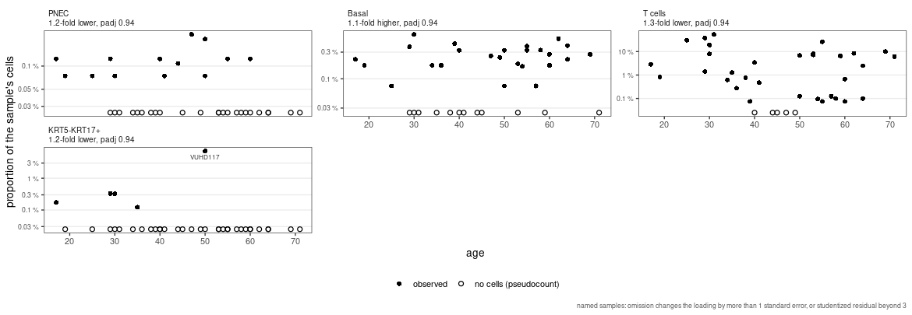<!-- -->

Among the 37 controls alone, no cell type changes significantly with age, in composition or in expression (adjusted
p 0.53 or more): 37 lungs cannot establish the age trends. The trends point, however, in the direction that explains
how the adjustment moves the PF loadings. The T cells decline by 0.37 log2 units per decade among the controls, which
over the 17-year age difference between the groups predicts a difference of -0.62 from age alone; adjusting for age
moves the PF loading of the T cells from -0.13 to +0.78. The dendritic and proliferating cells rise with age among the
controls, and adjusting for age lowers their PF loadings. The monocytes rise only slightly among the controls (0.07
per decade, 0.12 over the age difference), much less than the adjustment moves their PF loading (-0.63 to -1.1). For
the T cells, dendritic and proliferating cells the age adjustment is therefore consistent with the age trends seen in
lungs without disease, as far as these few lungs can show.

## Differential expression per cell type

``` r
cao$estimateDEPerCellType(test = "limma-voom")
```

``` r
cao$plotNumberOfDEGenes()
```

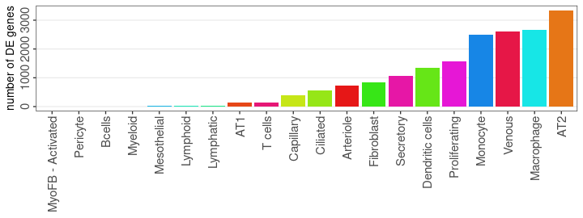<!-- -->

Differential expression per cell type uses limma-voom, which fits the grouping term `(1 | cohort)` as a random intercept:
one correlation between the lungs of a center, shared by all genes of a cell type (-0.01 to 0.15). With two centers
this correlation rests on two groups and is estimated imprecisely; it is small in every cell type, so the fit should be
close to one without the center (not compared here). The most genes are found in the AT2 cells (3,341), macrophages (2,665), venous endothelial
cells (2,611) and monocytes (2,503); the first three also have the largest shifts.

``` r
cao$plotVolcano(cell.types = "AT2")
```

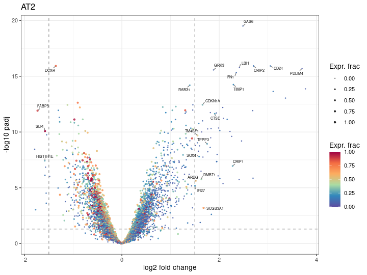<!-- -->

The volcano plot of the AT2 cells shows the differential expression behind their shift: GAS6, CD24, CRIP2, PDLIM4,
FN1 and TIMP1 are among the most significant increases, DCXR and FABP5 among the decreases (BLVRB, the second most
significant decrease, is not labeled). MMP7 (log2 fold change 3.1, not labeled) and SOX4 (1.6) are also significant;
both have been reported as markers of the transitional and aberrant epithelial states of fibrotic lungs.

## Functional interpretation

``` r
cao$estimateOntology(type = "GSEA", org.db = org.Hs.eg.db::org.Hs.eg.db, seed = TRUE, n.cores = 1)
```

``` r
cao$plotOntologyHeatmapCollapsed(name = "GSEA", genes = "up", n = 25, clust.method = "ward.D")
```

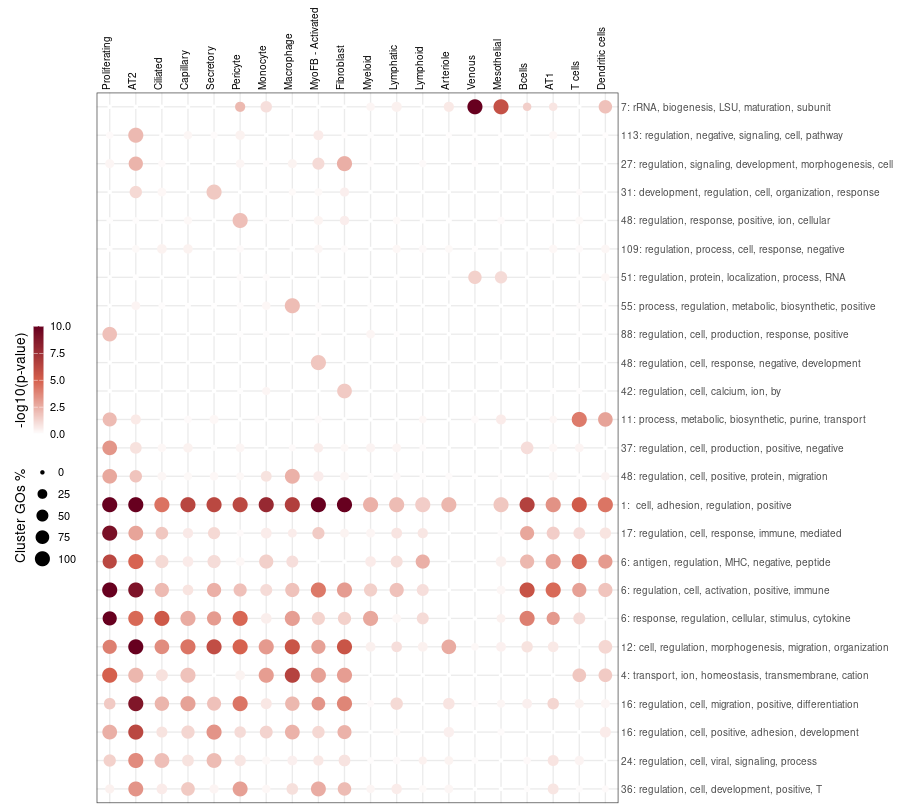<!-- -->

``` r
cao$plotOntologyHeatmapCollapsed(name = "GSEA", genes = "down", n = 25, clust.method = "ward.D")
```

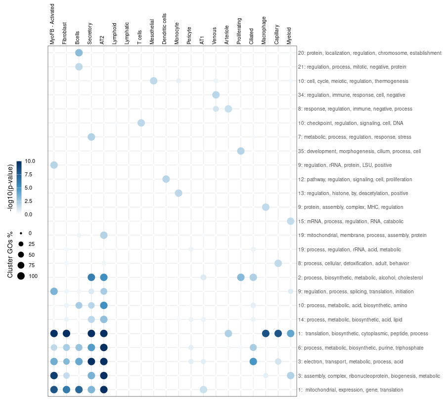<!-- -->

Gene set enrichment ranks GO terms per cell type. The terms up in PF are dominated by cell adhesion, migration and
morphogenesis: the cluster of adhesion terms is enriched in nearly every population, most strongly in the
proliferating, AT2, fibroblast and activated myofibroblast cells. Immune activation terms are up most in the
proliferating, AT2, AT1 and B cells; the venous endothelial and mesothelial cells stand out with ribosome biogenesis.
The terms down in PF are dominated by translation, mitochondrial gene expression and respiration, most strongly in the
AT2, secretory, fibroblast and activated myofibroblast cells.

## Cluster-free analyses

### Cluster-free density shifts

``` r
cao$estimateCellDensity(method = "graph")
```

    kNN neighborhoods of at least 1110 cells (10.0 per sample)

``` r
cao$estimateDiffCellDensity()
```

    diffusion neighborhoods at 1 %, 3 %, 5 % of the cells (auto: one scale is chosen)

    scale 0.01: heat kernel beta 35.7

    scale 0.03: heat kernel beta 55

    scale 0.05: heat kernel beta 84.9

    120278 of 187756 cells at FDR 10 % (scale 1 % chosen)

``` r
cowplot::plot_grid(cao$plotEmbedding(color.by = "cell.groups", title = "cell type"),
                   cao$plotDiffCellDensity(what = "effect", title = "density change (log2 FC)", outline = TRUE),
                   cao$plotDiffCellDensity(title = "adjusted z", outline = TRUE), ncol = 3)
```

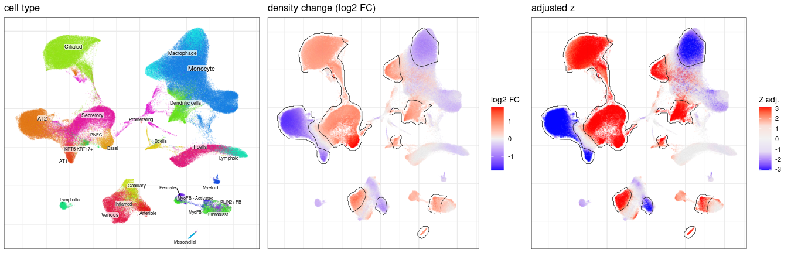<!-- -->

The density map calls 120,278 of the 187,756 cells (64 %) at FDR 10 %, at the finest scale (diffusion neighborhoods of
1 % of the cells): the AT2 cells lose density and the secretory, basal and ciliated cells gain it, and within the immune
compartment a region of the macrophages loses density while a region near the dendritic cells gains it: changes
within populations that the composition, which counts whole populations, cannot show.

### Cluster-free expression shifts

``` r
cao$estimateClusterFreeExpressionShifts(n.permutations = 499)
```

    14017 genes (per neighborhood: those detected in >= 5 % of its cells)

    diffusion neighborhoods at 1 %, 3 %, 5 % of the cells (auto: one scale is chosen), at least 1110 cells each (10.0 per sample)

    scale 0.01: heat kernel beta 35.7, 370 centers, neighborhoods of 1881 cells (median, 1111 smallest)

    scale 0.03: heat kernel beta 55, 129 centers, neighborhoods of 4502 cells (median, 1417 smallest)

    scale 0.05: heat kernel beta 84.9, 68 centers, neighborhoods of 7816 cells (median, 1840 smallest)

    173033 of 187756 cells keep adjusted z >= 1.28 (scale 1 % chosen)

``` r
cao$plotClusterFreeExpressionShifts(adjusted = TRUE, font.size = c(2, 3), outline = TRUE)
```

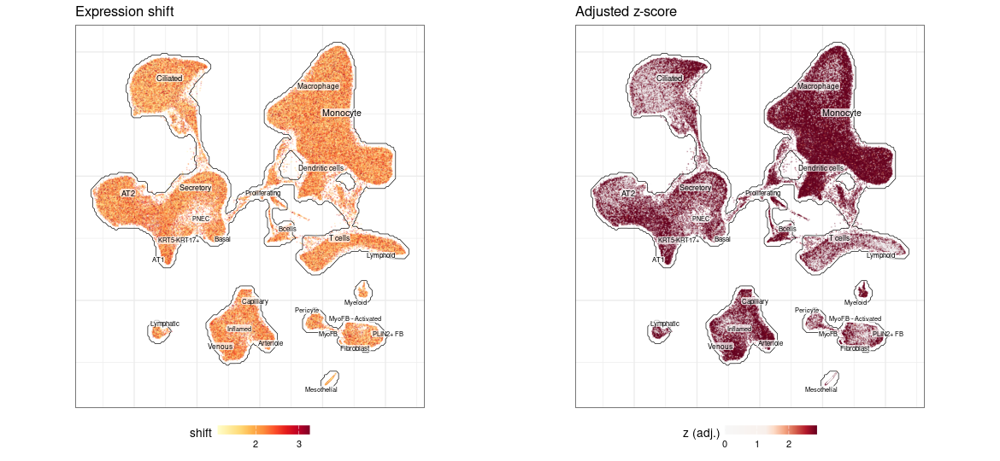<!-- -->

``` r
cao$estimateClusterFreeSummary("cell.density")
cao$estimateClusterFreeSummary("cluster.free.expr.shifts")
cowplot::plot_grid(cao$plotClusterFreeSummary("cell.density"), cao$plotClusterFreeSummary("cluster.free.expr.shifts"), ncol = 2)
```

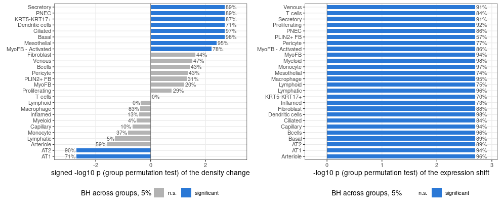<!-- -->

The expression-shift map calls 173,033 of the 187,756 cells (finest scale, neighborhoods of 1 % of the cells), and
the population summaries (right) are significant for all populations: the disease changes expression throughout the
lung, which the cell-type test also found (22 of 25 populations). The density summaries (left) agree with most of the
composition: the secretory, PNEC, basal, `KRT5-KRT17+`, ciliated, dendritic, mesothelial and activated myofibroblast
cells gain density, the AT1 and AT2 cells lose it. They differ in two respects: the PNEC cells, unchanged in the
composition, gain density, and the depletion of the capillary, arteriole, lymphatic and monocyte populations is not
significant on the density map.

## IPF versus other interstitial lung disease

``` r
cao$setModel(~ subtype + sex + (1 | cohort), test = "subtype: all")
```

    Model: ~subtype + sex + (1 | cohort)      dispersion: ~subtype
           grouping term (1 | cohort): not fitted; the tested variable is exchanged within its levels
    Test: subtype (3 levels)
           adjusted for sex; permutations: block within 4 strata (> 10 million distinct); 103 of 103 samples can change their value; smallest p-value 0.002
           location: the levels of subtype differ in where their samples sit (a common direction per level), beyond within-level variability
    Samples: 103 used, 8 dropped (THD0026, TILD102, TILD113, TILD116, VUHD108, VUHD109, VUHD111, VUHD114).   Issues: 1 warning
      warning: 8 sample(s) dropped for missing covariate values: THD0026, TILD102, TILD113, TILD116, VUHD108, VUHD109, VUHD111, VUHD114 -> complete the metadata or remove the covariate

``` r
cao$estimateCellLoadings(name = "coda.subtype.all", verbose = FALSE)$results
```

         celltype        R2    R2.adj R2.partial        F df nu    r.eff p.location
    1 composition 0.1207059 0.1021278  0.1212337 6.828971  2 99 9.683785      0.002
         F.disp R2.disp.adj p.dispersion   n scheme n.perm n.perm.distinct
    1 0.0991264 -0.01780413        0.888 103  block    499     7.00373e+44
      exhaustive p.floor padj.location padj.dispersion p.fwer.location
    1      FALSE   0.002         0.002           0.888           0.002
      p.fwer.dispersion flags
    1             0.888      

The whole-factor test asks whether the three levels of the subtype (control, IPF, other interstitial lung disease)
differ in composition at all, without choosing a pair. They do (adjusted R² 0.10, p 0.002); the dispersion of the
compositions does not differ (p 0.89). This is expected, since the PF lungs differ from the controls; the test does not
say whether the two disease groups differ from each other, which the comparison of IPF with the other diseases below
asks.

``` r
cao$setModel(~ subtype + sex + (1 | cohort), test = "subtype: IPF vs Other_ILD")
```

    Model: ~subtype + sex + (1 | cohort)      dispersion: ~subtype
           grouping term (1 | cohort): not fitted; the tested variable is exchanged within its levels
    Test: subtype: IPF vs Other_ILD  (reference 'Other_ILD': as requested)
           adjusted for sex; permutations: block within 4 strata (> 10 million distinct); 62 of 103 samples can change their value; smallest p-value 0.002
           shift > 0: IPF samples differ from Other_ILD samples in a common direction, beyond within-group variability
    Samples: 103 used, 8 dropped (THD0026, TILD102, TILD113, TILD116, VUHD108, VUHD109, VUHD111, VUHD114).   Issues: 1 warning
      warning: 8 sample(s) dropped for missing covariate values: THD0026, TILD102, TILD113, TILD116, VUHD108, VUHD109, VUHD111, VUHD114 -> complete the metadata or remove the covariate

``` r
cao$estimateCellLoadings(name = "coda.subtype")
cao$plotCellLoadings(name = "coda.subtype", center = "both")
```

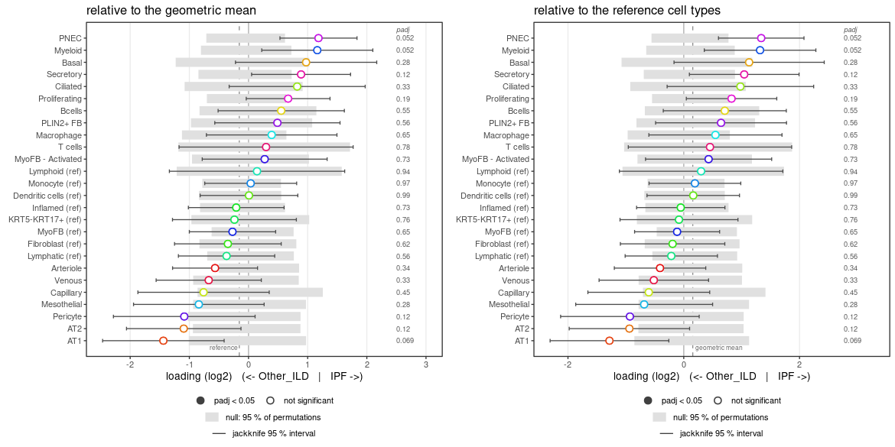<!-- -->

Among the PF lungs, IPF against the other interstitial lung diseases: the controls stay in the model as a third level,
but only the PF lungs (62) change their label. No cell type differs significantly in composition (smallest adjusted p
0.052: PNEC and myeloid cells higher in IPF).

``` r
cao$estimateExpressionShiftMagnitudes(name = "shifts.subtype")
cao$plotExpressionShiftMagnitudes(name = "shifts.subtype", show.ci = TRUE, show.genes = TRUE)
```

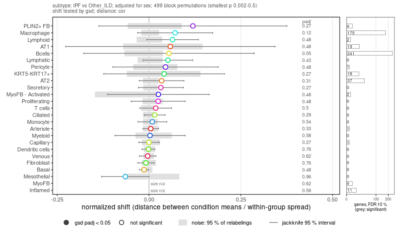<!-- -->

No population shifts significantly in expression either (smallest adjusted p 0.050, at the threshold: B cells,
measured in only 15 IPF and 6 other lungs). The other interstitial lung diseases are a mixture of diagnoses; with 36
against 26 lungs in the model, and fewer in most cell types, these data detect no difference from IPF, but they cannot
exclude differences of moderate size.

## Summary

- PF against control, relabeled within centers and adjusted for sex: loss of AT1, AT2 and capillary cells, expansion
  of the basal, `KRT5-KRT17+` and secretory cells, and expression shifts in 22 of 25 populations, the venous
  endothelial cells, macrophages and AT2 cells most. The center has no influence on these results.
- Age is strongly associated with the disease, and 16 controls are younger than any patient (the design check reports
  both). Adjusting for age keeps the size of the strongest changes but reduces the significant composition changes
  from 12 to 4 and the expression shifts from 20 to 16. The same adjusted result is obtained on the lungs in the
  common age range, so it does not rest on the youngest controls; some unadjusted results (the T-cell loading and
  the T-cell and lymphatic expression shifts) came from them.
- IPF and the other interstitial lung diseases do not differ significantly.

## Session info

``` r
sessionInfo()
```

    R version 4.2.2 Patched (2022-11-10 r83330)
    Platform: x86_64-pc-linux-gnu (64-bit)
    Running under: Ubuntu 20.04.6 LTS

    Matrix products: default
    BLAS:   /usr/lib/x86_64-linux-gnu/blas/libblas.so.3.9.0
    LAPACK: /usr/lib/x86_64-linux-gnu/lapack/liblapack.so.3.9.0

    locale:
     [1] LC_CTYPE=en_US.UTF-8       LC_NUMERIC=C              
     [3] LC_TIME=en_US.UTF-8        LC_COLLATE=en_US.UTF-8    
     [5] LC_MONETARY=en_US.UTF-8    LC_MESSAGES=en_US.UTF-8   
     [7] LC_PAPER=en_US.UTF-8       LC_NAME=C                 
     [9] LC_ADDRESS=C               LC_TELEPHONE=C            
    [11] LC_MEASUREMENT=en_US.UTF-8 LC_IDENTIFICATION=C       

    attached base packages:
    [1] stats     graphics  grDevices utils     datasets  methods   base     

    other attached packages:
    [1] ggplot2_4.0.2  cacoa_0.5.0    Matrix_1.6-1.1

    loaded via a namespace (and not attached):
      [1] spatstat.explore_3.5-2      reticulate_1.43.0          
      [3] tidyselect_1.2.1            RSQLite_2.3.1              
      [5] AnnotationDbi_1.60.2        htmlwidgets_1.6.4          
      [7] grid_4.2.2                  BiocParallel_1.32.6        
      [9] Rtsne_0.17                  scatterpie_0.2.5           
     [11] codetools_0.2-18            ica_1.0-3                  
     [13] future_1.76.0               miniUI_0.1.2               
     [15] withr_3.0.2                 spatstat.random_3.4-1      
     [17] colorspace_2.1-0            GOSemSim_2.24.0            
     [19] progressr_0.15.1            Biobase_2.58.0             
     [21] knitr_1.50                  uuid_1.2-1                 
     [23] Seurat_4.3.0.1              stats4_4.2.2               
     [25] ROCR_1.0-11                 tensor_1.5.1               
     [27] pbmcapply_1.5.1             DOSE_3.24.2                
     [29] listenv_0.9.1               MatrixGenerics_1.10.0      
     [31] labeling_0.4.3              GenomeInfoDbData_1.2.9     
     [33] mnormt_2.1.1                polyclip_1.10-7            
     [35] bit64_4.6.0-1               farver_2.1.2               
     [37] downloader_0.4.1            parallelly_1.45.1          
     [39] vctrs_0.7.3                 treeio_1.22.0              
     [41] generics_0.1.4              gson_0.1.0                 
     [43] xfun_0.53                   R6_2.6.1                   
     [45] GenomeInfoDb_1.34.9         graphlayouts_1.2.2         
     [47] locfit_1.5-9.8              spatstat.univar_3.1-4      
     [49] ggiraph_0.9.0               DelayedArray_0.24.0        
     [51] bitops_1.0-9                spatstat.utils_3.1-5       
     [53] cachem_1.1.0                fgsea_1.24.0               
     [55] gridGraphics_0.5-1          promises_1.3.3             
     [57] scales_1.4.0                ggraph_2.2.2               
     [59] enrichplot_1.18.4           gtable_0.3.6               
     [61] globals_0.20.0              goftest_1.2-3              
     [63] tidygraph_1.3.1             S7_0.2.0                   
     [65] rlang_1.1.7                 systemfonts_1.3.2          
     [67] splines_4.2.2               lazyeval_0.2.2             
     [69] dichromat_2.0-1             spatstat.geom_3.5-0        
     [71] yaml_2.3.10                 reshape2_1.4.4             
     [73] abind_1.4-8                 httpuv_1.6.16              
     [75] qvalue_2.30.0               clusterProfiler_4.6.2      
     [77] tools_4.2.2                 psych_2.5.6                
     [79] ggplotify_0.1.2             sccore_1.0.6               
     [81] RColorBrewer_1.1-3          coda.base_1.0.3            
     [83] BiocGenerics_0.44.0         ggridges_0.5.7             
     [85] Rcpp_1.1.0                  plyr_1.8.9                 
     [87] zlibbioc_1.44.0             purrr_1.2.2                
     [89] RCurl_1.98-1.12             deldir_2.0-4               
     [91] pbapply_1.7-4               viridis_0.6.4              
     [93] cowplot_1.2.0               S4Vectors_0.36.2           
     [95] zoo_1.8-14                  SummarizedExperiment_1.28.0
     [97] SeuratObject_4.1.3          ggrepel_0.9.6              
     [99] cluster_2.1.4               fs_1.6.6                   
    [101] magrittr_2.0.3              data.table_1.17.8          
    [103] scattermore_1.2             lmtest_0.9-40              
    [105] RANN_2.6.2                  fitdistrplus_1.2-4         
    [107] matrixStats_1.5.0           patchwork_1.3.2            
    [109] mime_0.13                   evaluate_1.0.5             
    [111] xtable_1.8-4                XML_3.99-0.14              
    [113] HDO.db_0.99.1               IRanges_2.32.0             
    [115] gridExtra_2.3               compiler_4.2.2             
    [117] tibble_3.3.0                KernSmooth_2.23-20         
    [119] crayon_1.5.2                shadowtext_0.1.6           
    [121] htmltools_0.5.8.1           mgcv_1.8-41                
    [123] ggfun_0.2.0                 later_1.4.4                
    [125] geneplotter_1.76.0          tidyr_1.3.2                
    [127] aplot_0.2.8                 DBI_1.1.3                  
    [129] tweenr_2.0.3                MASS_7.3-58                
    [131] rappdirs_0.3.3              cli_3.6.5                  
    [133] parallel_4.2.2              igraph_2.1.4               
    [135] GenomicRanges_1.50.2        pkgconfig_2.0.3            
    [137] sp_2.2-0                    plotly_4.11.0              
    [139] spatstat.sparse_3.1-0       annotate_1.76.0            
    [141] ggtree_3.6.2                XVector_0.38.0             
    [143] yulab.utils_0.2.5           stringr_1.5.1              
    [145] digest_0.6.37               sctransform_0.4.2          
    [147] RcppAnnoy_0.0.22            spatstat.data_3.1-8        
    [149] Biostrings_2.66.0           rmarkdown_2.29             
    [151] leiden_0.4.3                fastmatch_1.1-6            
    [153] tidytree_0.4.6              uwot_0.2.3                 
    [155] shiny_1.11.1                lifecycle_1.0.5            
    [157] nlme_3.1-161                jsonlite_2.0.0             
    [159] viridisLite_0.4.2           pillar_1.11.0              
    [161] lattice_0.20-45             KEGGREST_1.38.0            
    [163] fastmap_1.2.0               httr_1.4.7                 
    [165] survival_3.4-0              GO.db_3.16.0               
    [167] glue_1.8.0                  png_0.1-8                  
    [169] bit_4.6.0                   ggforce_0.5.0              
    [171] stringi_1.8.7               blob_1.2.4                 
    [173] DESeq2_1.38.3               org.Hs.eg.db_3.16.0        
    [175] memoise_2.0.1               dplyr_1.2.1                
    [177] irlba_2.3.5.1               future.apply_1.20.0        
    [179] ape_5.8-1                  

