Cacoa on OneK1K: age as a continuous variable
================
Cacoa developers
2026-11-19

- <a href="#load-data" id="toc-load-data">Load data</a>
- <a href="#check-the-design" id="toc-check-the-design">Check the design</a>
- <a href="#screen-covariates" id="toc-screen-covariates">Screen covariates</a>
  - <a href="#sample-maps" id="toc-sample-maps">Sample maps</a>
- <a href="#set-the-model" id="toc-set-the-model">Set the model</a>
- <a href="#composition" id="toc-composition">Composition</a>
- <a href="#expression-shifts-per-cell-type" id="toc-expression-shifts-per-cell-type">Expression shifts per cell type</a>
  - <a href="#behind-one-cell-type" id="toc-behind-one-cell-type">Behind one cell type</a>
  - <a href="#robustness-to-the-covariates" id="toc-robustness-to-the-covariates">Robustness to the covariates</a>
- <a href="#age-as-a-continuous-variable-against-age-groups" id="toc-age-as-a-continuous-variable-against-age-groups">Age as a continuous variable against age groups</a>
  - <a href="#residuals" id="toc-residuals">Residuals</a>
- <a href="#differential-expression-per-cell-type" id="toc-differential-expression-per-cell-type">Differential expression per cell type</a>
- <a href="#cluster-free-analyses" id="toc-cluster-free-analyses">Cluster-free analyses</a>
  - <a href="#cluster-free-density-shifts" id="toc-cluster-free-density-shifts">Cluster-free density shifts</a>
  - <a href="#cluster-free-expression-shifts" id="toc-cluster-free-expression-shifts">Cluster-free expression shifts</a>
- <a href="#summary" id="toc-summary">Summary</a>
- <a href="#session-info" id="toc-session-info">Session info</a>

Yazar et al. (2022, Science) profiled peripheral blood mononuclear cells of 981 healthy donors aged 19 to 97 by
scRNA-seq (10x, OneK1K). Donors were processed in pools, several donors per library, and assigned back to their cells
by genotype. This notebook uses 200 of the donors, 20 from each of ten age bins that each hold a tenth of the cohort's donors
(so the ages follow the cohort's distribution: median 67, nine donors aged 30 or younger) and evenly from the sexes (100 women, 100 men), at most 800 cells per donor: 158,866 cells in 22 populations of the
authors' annotation (rare populations merged), on a kNN graph of a Harmony embedding (`prepare_onek1k_harmony.R`,
next to this notebook). The 200 donors come from 70 pools of one to seven donors.

The tested variable is **age**, a continuous variable: every result is a change per decade of age. Sex is a
covariate, and the pool is a grouping term, so that age is only compared among donors processed together. In short:
naive CD8 and CD4 T cells decline with age and cytotoxic and effector-memory populations (CD8 effector memory, CD4
cytotoxic, NK cells) and CD16 monocytes increase, and the expression of most T and NK populations shifts. With age
shuffled among the donors (three shuffles, run outside this notebook), the composition test, the test of each cell
type's expression shift and the density map call nothing; the expression-shift map calls cells in two of the three
shuffles (see the cluster-free section).

``` r
library(cacoa)
library(ggplot2)
```

## Load data

``` r
seu <- readRDS(params$data.file)
samples <- sort(unique(seu$sample))
sample.meta <- readRDS(params$meta.file)[samples, c("age", "sex", "pool")]
sample.meta$n.cells <- as.vector(table(seu$sample)[samples])   # cells per donor in this object (at most 800)
sample.meta$pool <- factor(sample.meta$pool)
summary(sample.meta)
```

          age            sex           pool        n.cells     
     Min.   :19.00   female:100   P65    :  7   Min.   :524.0  
     1st Qu.:57.00   male  :100   P29    :  6   1st Qu.:799.0  
     Median :67.00                P44    :  6   Median :800.0  
     Mean   :64.13                P55    :  6   Mean   :794.3  
     3rd Qu.:75.25                P3     :  5   3rd Qu.:800.0  
     Max.   :97.00                P36    :  5   Max.   :800.0  
                                  (Other):165                  

``` r
table(seu$celltype)
```

    B intermediate       B memory        B naive      CD14 Mono      CD16 Mono 
              3398           3537           8927           5483           2268 
           CD4 CTL      CD4 Naive        CD4 TCM        CD4 TEM      CD8 Naive 
              2404          31691          36660           3876           6717 
           CD8 TCM        CD8 TEM           cDC2            gdT           HSPC 
              1935          19478            704           2635            249 
              MAIT             NK  NK_CD56bright            pDC    Plasmablast 
              1105          22602            941            230            497 
          Platelet           Treg 
               242           3287 

`pool` has 70 levels for 200 donors; the constructor sets it aside from the screen as high-cardinality, and it enters
the model below as a grouping term.

``` r
cao <- Cacoa$new(seu, sample.metadata = sample.meta, sample.per.cell = factor(seu$sample), cell.groups = factor(seu$celltype),
                 embedding = seu@reductions$umap@cell.embeddings, graph.name = "RNA_nn", data.layer = "data", n.cores = params$n.cores)
```

    Sample metadata: 200 samples, 4 columns
      usable (3): age [num, 19-97], sex [female 100, male 100], n.cells [num, 524-800]
      excluded from screening (1): pool (high-cardinality)

    Next: cao$checkDesign() and cao$screenCovariates(), or cao$setModel(test = "<variable>").

``` r
cao$setOptions(n.permutations = 499, seed = 1)
cao$plot.params <- list(size = 0.1, alpha = 0.1, font.size = c(2, 3))
```

``` r
cowplot::plot_grid(cao$plotEmbedding(color.by = "cell.groups", title = "cell type"),
                   cao$plotEmbedding(color.by = "age", title = "age", mark.groups = FALSE, show.legend = TRUE), ncol = 2)
```

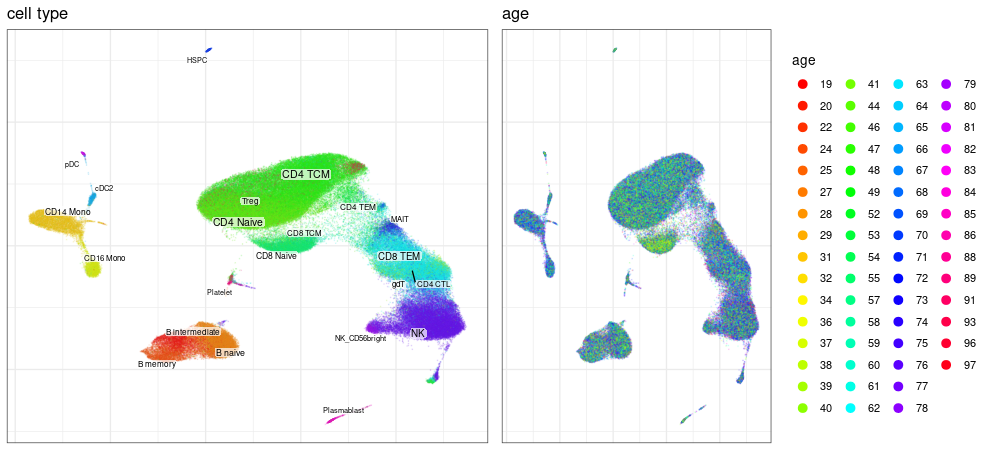<!-- -->

## Check the design

``` r
cao$checkDesign(test = "age")
```

    Design check: 200 samples, 3 covariates, test variable 'age'
      association with 'age': n.cells 0.02, sex 0.00
      no issues found

Age and sex are not associated (the donors were drawn evenly over both). Ages within a pool are more similar than
between pools (58 % of the age variance lies between pools, against about 35 % for pools drawn at random), so the pool is a candidate confounder, which the grouping
term handles.

``` r
cao$plotDesign("balance")
```

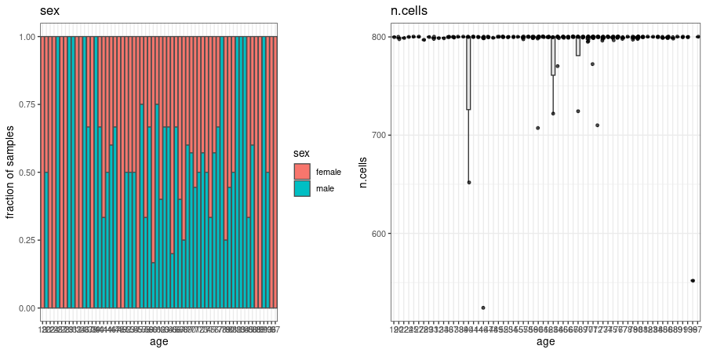<!-- -->

``` r
cao$plotDesign("associations")
```

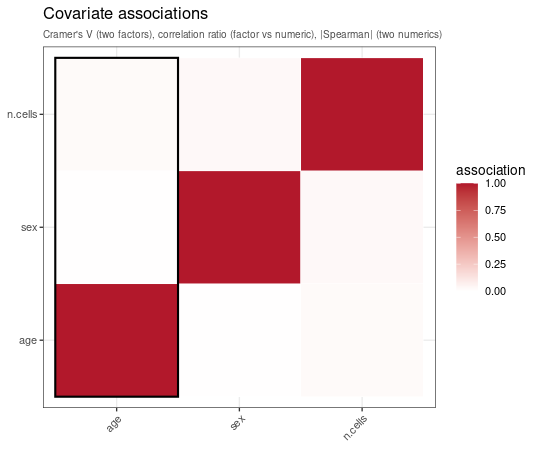<!-- -->

## Screen covariates

``` r
cao$screenCovariates(n.permutations = 199)
```

    Covariate screen: 3 covariates x 19 cell types, marginal + partial mode, permutation p-values (199 permutations)
      partial mode fell back to marginal in 1 of 19 cell types (too few residual degrees of freedom for the full covariate set)
    Associated with expression in >= 3 cell types (partial, FDR 5%): sex (16 types, global p 0.005), age (11 types, global p 0.005)
    all cell types (partial, FDR 5%): sex (adj. R2 0.03), age (adj. R2 0.01)
    composition (partial, FDR 5%): age (adj. R2 0.06), n.cells (adj. R2 0.01), sex (adj. R2 0.01)
    Suggested model: ~age + sex   (not applied; see cao$setModel())

``` r
cao$plotCovariateScreen()
```

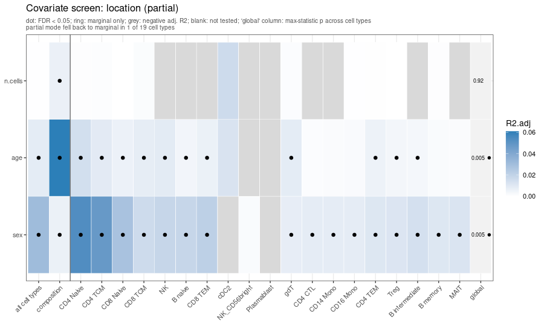<!-- -->

``` r
cao$plotCovariateSummary()
```

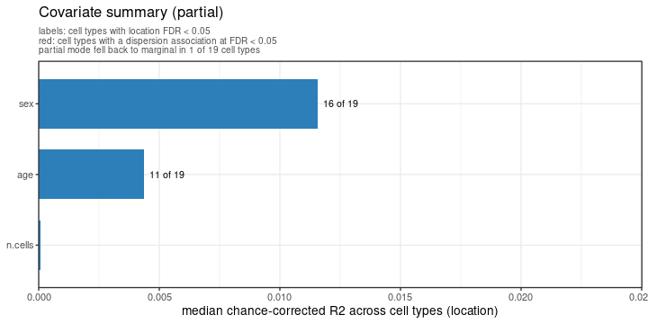<!-- -->

Sex is associated with the expression of 16 of 19 screened cell types, age with 11; age explains more of the
composition (adjusted R2 0.06) than sex (0.01).

``` r
cao$plotVariancePartition(c("age", "sex"))
```

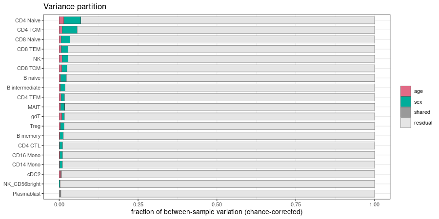<!-- -->

The variance partition splits the between-donor variation of each cell type's expression into the parts explained by
age and by sex alone, a shared part and a residual. Both shares are small: sex explains up to about 5 % (in the naive
and central-memory CD4 T cells), age up to about 2 %. Most of the variation between donors is not explained by either;
an age effect is detected here because 200 donors give power to small, consistent changes.

### Sample maps

``` r
cowplot::plot_grid(
  cao$plotSampleDistances(cell.type = "CD8 Naive", color.by = "age", shape.by = "sex"),
  cao$plotSampleDistances(color.by = "age", shape.by = "sex"),
  cao$plotSampleDistances(space = "composition", color.by = "age", shape.by = "sex"), ncol = 3)
```

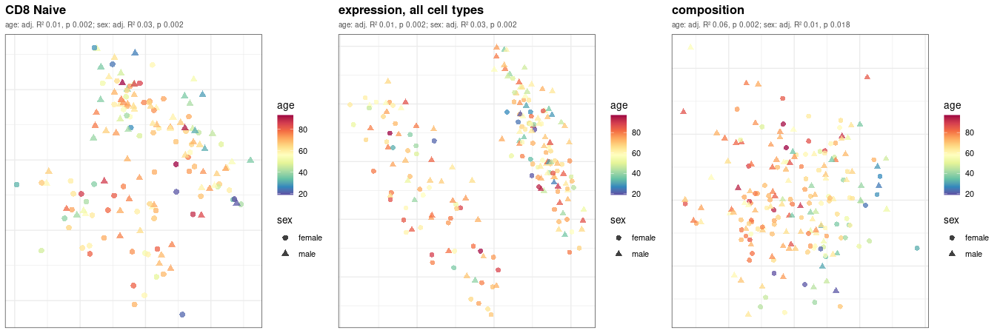<!-- -->

The sample maps place the donors by the distances between their profiles: of the naive CD8 T cells (left), of all
cell types together (middle) and of the composition (right). The subtitles give the share of the distances explained by
each variable and its permutation p-value. Age explains 6 % of the composition distances but only 1 % of the expression
distances; the donors do not separate visibly by age on any of the maps. Age thus accounts for a larger share of the
differences between donors in composition than in expression; the two shares come from different spaces and are not a
direct comparison of effect sizes.

## Set the model

``` r
cao$setModel(~ age + sex + (1 | pool), test = "age", numeric.step = 10)   # effects per decade
```

    Model: ~age + sex + (1 | pool)      dispersion: ~age
           grouping term (1 | pool): not fitted; the tested variable is exchanged within its levels; levels that hold one value of it are exchanged as wholes
    Test: age: per 10 units
           adjusted for sex; permutations: block within 95 strata (> 10 million distinct); 173 of 200 samples can change their value; smallest p-value 0.002
           shift > 0: samples move in a common direction as age increases (per 10 units)
    Samples: 200 used.   Issues: 2 notes
      note: test 'age: per 10 units': 11 of the 13 levels of 'pool' that hold one value of the tested variable are exchanged as wholes, among levels with the same make-up; the others keep their value
      note: 'pool': 13 of 70 levels hold one value of 'age'; 11 of them are exchanged as wholes among levels with the same make-up, the others keep their value (173 of 200 samples can change their value)

With a continuous tested variable the contrast is a step of `numeric.step` units of it: here 10 years, so loadings
and shifts are changes per decade. Within the pools the ages are exchanged among the donors of the same sex. Pools
with a single donor are exchanged as wholes among themselves; 27 donors keep their age in every relabeling.

## Composition

``` r
cao$estimateCellLoadings()
cao$plotCellLoadings(center = "both")
```

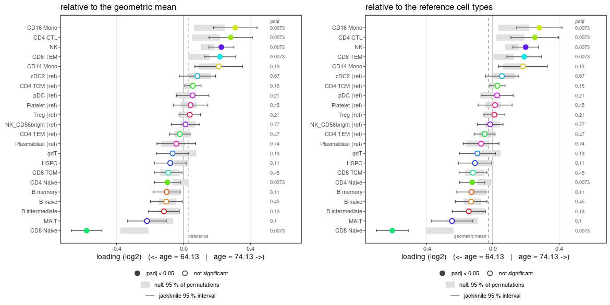<!-- -->

The loadings are the change of each population's log proportion per decade. Naive CD8 T cells decline most (about
0.6 log2 units per decade relative to the reference populations, 1.5-fold), naive CD4 T cells decline, and CD16
monocytes, cytotoxic CD4 T cells, NK cells and CD8 effector-memory cells increase (adjusted p 0.007 for all six).

``` r
lo <- cao$test.results$coda$contrast$per_cell
data.frame(p = signif(lo$pval, 2), padj = signif(lo$padj, 2))[order(lo$pval), ][1:12, ]
```

                       p   padj
    CD16 Mono      0.002 0.0073
    CD4 CTL        0.002 0.0073
    CD4 Naive      0.002 0.0073
    CD8 Naive      0.002 0.0073
    CD8 TEM        0.002 0.0073
    NK             0.002 0.0073
    MAIT           0.032 0.1000
    HSPC           0.044 0.1100
    B memory       0.046 0.1100
    CD14 Mono      0.058 0.1300
    gdT            0.068 0.1300
    B intermediate 0.072 0.1300

``` r
cao$plotCodaSamples(n.top = 8)
```

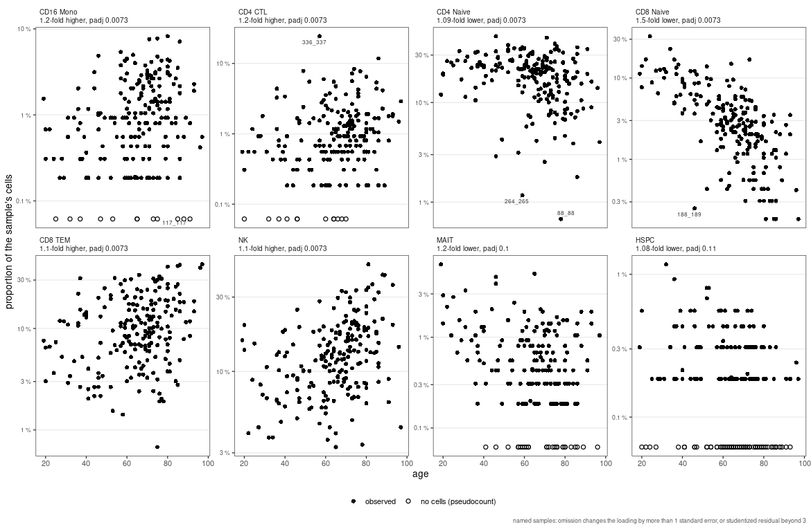<!-- -->

The per-donor proportions show what the loadings summarize: the naive CD8 fraction falls from about 12 % of the cells
in donors aged 30 or younger (median of nine donors) to about 1-2 % above 70, with a wide spread at every age; for the populations that increase
the trend is shallower than the spread between donors of the same age.

``` r
cao$plotContrastTree()
```

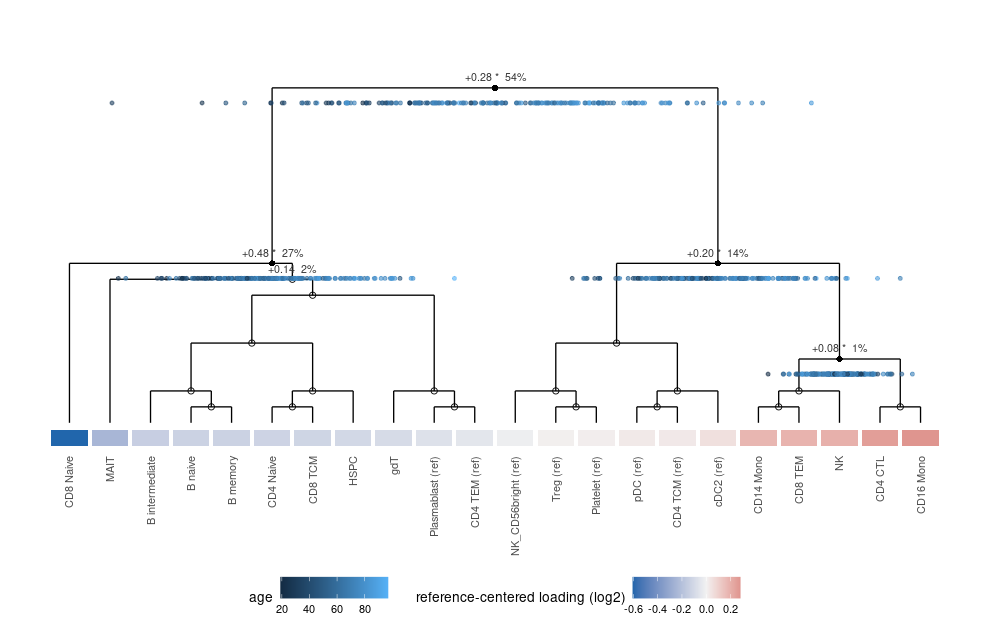<!-- -->

The contrast tree summarizes the composition change by successive splits of the cell types into two groups, each
with the change of the balance between them (log2 per decade, with its share of the total change). The first split
(+0.28 per decade, 54 % of the change) separates the populations that decline with age (naive CD8 and CD4 T cells,
MAIT cells, B cells, CD8 central-memory cells) from those that increase (CD16 and CD14 monocytes, NK cells, CD8
effector-memory and cytotoxic CD4 T cells); populations with loadings near zero fall on both sides. Within the declining group, the naive CD8 T cells separate from the rest
(+0.48, 27 %): their decline is the largest single component.

``` r
cao$plotFitDiagnostics("composition")
```

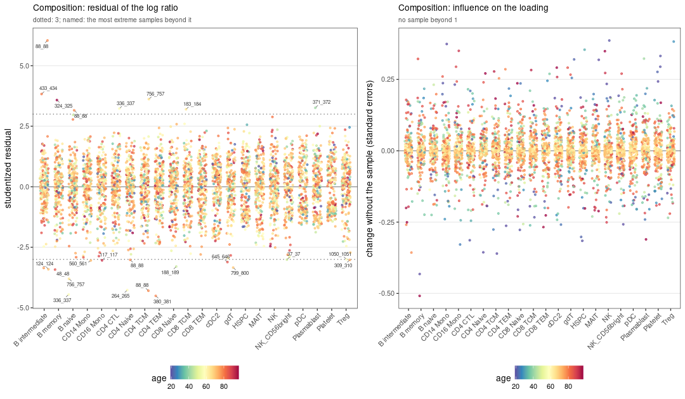<!-- -->

The fit diagnostics show, for every donor and cell type, the studentized residual of the log ratio (left) and how
much the loading changes when the donor is left out (right). A few donors lie more than three residual standard
deviations from the fit in single cell types (dots), but no donor changes any loading by a standard error: the
composition result does not rest on single donors.

``` r
cao$checkSensitivity(analysis = "composition", n.permutations = 199)
```

    Sensitivity of 'age: per 10 units' (loading) across 3 models: unadjusted [~age + (1 | pool)]; current [~age + sex + (1 | pool)]; minus (1 | pool) [~age + sex]
      magnitude: loading (log2, relative to the geometric mean); significance: permutation test (vs the geometric mean) (adjusted p < 0.05)
      CD8 Naive      magnitude stable; significant in all 3 models
      CD16 Mono      magnitude stable; significant in all 3 models
      CD4 CTL        magnitude stable; significant in all 3 models
      NK             magnitude stable; significant in all 3 models
      CD8 TEM        magnitude stable; significant in all 3 models
      CD4 Naive      magnitude stable; significant in all 3 models
      MAIT           magnitude near zero (within the relabeling band); significant in 2 of 3 models (only with: unadjusted, minus (1 | pool))
      CD14 Mono      magnitude near zero (within the relabeling band); significant in 2 of 3 models (only with: unadjusted, minus (1 | pool))
      B intermediate magnitude near zero (within the relabeling band); significant in 2 of 3 models (only with: unadjusted, minus (1 | pool))
      B naive        magnitude near zero (within the relabeling band); not significant in any of 3 models
      B memory       magnitude near zero (within the relabeling band); significant in 2 of 3 models (only with: unadjusted, minus (1 | pool))
      CD8 TCM        magnitude near zero (within the relabeling band); not significant in any of 3 models
      cDC2           magnitude near zero (within the relabeling band); not significant in any of 3 models
      HSPC           magnitude near zero (within the relabeling band); not significant in any of 3 models
      gdT            magnitude driven by sample 855_856; not significant in any of 3 models
      CD4 TCM        magnitude near zero (within the relabeling band); significant in 1 of 3 models (only with: unadjusted)
      pDC            magnitude near zero (within the relabeling band); not significant in any of 3 models
      Plasmablast    magnitude near zero (within the relabeling band); not significant in any of 3 models
      Platelet       magnitude near zero (within the relabeling band); not significant in any of 3 models
      Treg           magnitude near zero (within the relabeling band); not significant in any of 3 models
      CD4 TEM        magnitude near zero (within the relabeling band); not significant in any of 3 models
      NK_CD56bright  magnitude near zero (within the relabeling band); not significant in any of 3 models

``` r
cao$plotSensitivity(analysis = "composition")
```

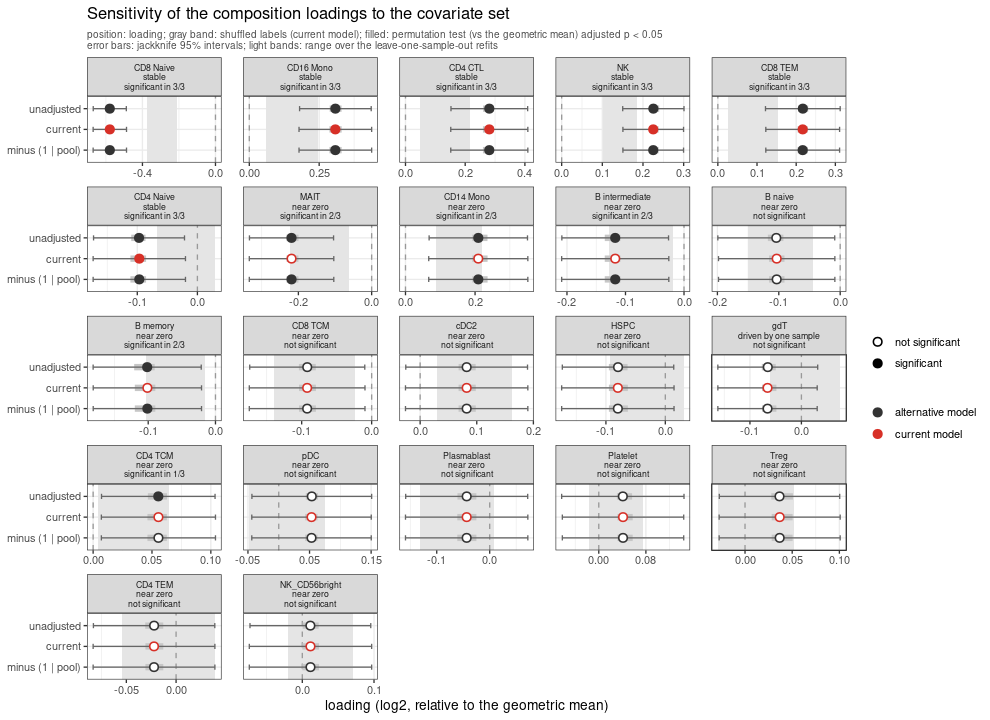<!-- -->

The composition is refitted without sex and without the grouping term. The six populations of the main result stay
significant in all three models with the same loadings. Four more (MAIT cells, CD14 monocytes, intermediate and memory B
cells) become significant when sex is left out or when the pool is ignored, and the CD4 central-memory T cells when sex is
left out: their loadings are small, within the range of shuffled labels, and their significance depends on the model.
For the four, leaving out either term is enough; for the pool, a
possible reason (not tested) is that donors of similar age were processed together.

## Expression shifts per cell type

``` r
res <- cao$estimateExpressionShiftMagnitudes()
```

    Building pseudobulk profiles per cell type...

    Testing 22 cell type(s), 1 test(s) with gsd (11020 genes, per type those in >= 5 % of its cells), 499 permutations...

    Building pseudobulk profiles per cell type...

    Testing 19 cell type(s), 1 test(s), 499 permutations (auto)...

    Note: 11 of the 13 levels of 'pool' that hold one value of the tested variable are exchanged as wholes, among levels with the same make-up; the others keep their value

    Note: B intermediate: 21 of the 22 levels of 'pool' that hold one value of the tested variable are exchanged as wholes, among levels with the same make-up; the others keep their value

    Note: B memory: 18 of the 20 levels of 'pool' that hold one value of the tested variable are exchanged as wholes, among levels with the same make-up; the others keep their value

    Note: B naive: 15 of the 17 levels of 'pool' that hold one value of the tested variable are exchanged as wholes, among levels with the same make-up; the others keep their value

    Note: CD14 Mono: 20 of the 21 levels of 'pool' that hold one value of the tested variable are exchanged as wholes, among levels with the same make-up; the others keep their value

    Note: CD16 Mono: 15 of the 15 levels of 'pool' that hold one value of the tested variable are exchanged as wholes, among levels with the same make-up

    Note: CD4 CTL: 25 of the 25 levels of 'pool' that hold one value of the tested variable are exchanged as wholes, among levels with the same make-up

    Note: CD4 Naive: 12 of the 14 levels of 'pool' that hold one value of the tested variable are exchanged as wholes, among levels with the same make-up; the others keep their value

    Note: CD4 TEM: 20 of the 21 levels of 'pool' that hold one value of the tested variable are exchanged as wholes, among levels with the same make-up; the others keep their value

    Note: CD8 Naive: 20 of the 23 levels of 'pool' that hold one value of the tested variable are exchanged as wholes, among levels with the same make-up; the others keep their value

    Note: CD8 TCM: 25 of the 26 levels of 'pool' that hold one value of the tested variable are exchanged as wholes, among levels with the same make-up; the others keep their value

    Note: cDC2: 7 of the 7 levels of 'pool' that hold one value of the tested variable are exchanged as wholes, among levels with the same make-up

    Note: gdT: 30 of the 32 levels of 'pool' that hold one value of the tested variable are exchanged as wholes, among levels with the same make-up; the others keep their value

    Note: MAIT: 23 of the 23 levels of 'pool' that hold one value of the tested variable are exchanged as wholes, among levels with the same make-up

    Note: NK_CD56bright: 9 of the 9 levels of 'pool' that hold one value of the tested variable are exchanged as wholes, among levels with the same make-up

    Note: Plasmablast: 7 of the 7 levels of 'pool' that hold one value of the tested variable are exchanged as wholes, among levels with the same make-up

    Note: Treg: 14 of the 16 levels of 'pool' that hold one value of the tested variable are exchanged as wholes, among levels with the same make-up; the others keep their value

    12 of 22 cell types with a significant shift at FDR 5% (global p = 0.004).

``` r
res
```

    Expression shifts: age: per 10 units; adjusted for sex; 499 block permutations (smallest p 0.002-0.5); statistic gsd
           celltype   n n.mag    shift padj.shift     var padj.var    total
               cDC2  60    13  0.00310      0.810  0.0320    0.480  1.5e-02
          CD4 Naive 200   198  0.00280      0.011  0.0130    0.076  7.5e-03
            CD4 TCM 200   200  0.00180      0.015  0.0039    0.300  3.1e-03
                 NK 200   200  0.00170      0.011 -0.0038    0.270  3.9e-04
            CD8 TCM 147    76  0.00170      0.011  0.0015    0.790  2.2e-03
                gdT 156   105  0.00140      0.015  0.0058    0.170  3.4e-03
          CD8 Naive 173   153  0.00120      0.170  0.0120    0.038  5.4e-03
            CD8 TEM 200   199  0.00120      0.011  0.0018    0.790  1.8e-03
            CD4 TEM 194   169  0.00110      0.013  0.0120    0.130  5.1e-03
          CD16 Mono 127    79  0.00080      0.018  0.0120    0.270  4.8e-03
            B naive 192   183  0.00080      0.071 -0.0022    0.300  1.9e-05
               Treg 188   154  0.00069      0.013  0.0032    0.140  1.8e-03
     B intermediate 175   122  0.00066      0.013 -0.0018    0.380  4.0e-05
               MAIT  80    34  0.00049      0.850 -0.0054    0.290 -1.4e-03
           B memory 184   153  0.00037      0.024 -0.0026    0.290 -5.1e-04
          CD14 Mono 154   123  0.00031      0.280  0.0034    0.230  1.5e-03
            CD4 CTL 124    69  0.00029      0.033 -0.0020    0.380 -4.0e-04
      NK_CD56bright  88    18 -0.00076      0.980 -0.0021    1.000 -1.5e-03
        Plasmablast  30     7 -0.00610      0.370 -0.0140    0.860 -1.1e-02
               HSPC   5    NA       NA      1.000      NA       NA       NA
                pDC  11    NA       NA      0.980      NA       NA       NA
           Platelet  10    NA       NA      0.130      NA       NA       NA
     padj.total
          0.930
          0.019
          0.120
          0.890
          0.025
          0.046
          0.019
          0.430
          0.028
          0.230
          1.000
          0.051
          1.000
          0.290
          0.430
          0.200
          0.930
          1.000
          0.930
             NA
             NA
             NA
      12 of 22 cell types with a significant shift (BH 5%); global p: shift 0.004, var 0.008, total 0.004
      tested without a magnitude (fewer than 2 samples per level with >= 10 cells): HSPC, pDC, Platelet
      (normalized effects; full tables in $results and $wide)

``` r
cao$plotExpressionShiftMagnitudes(show.ci = TRUE, show.genes = TRUE)
```

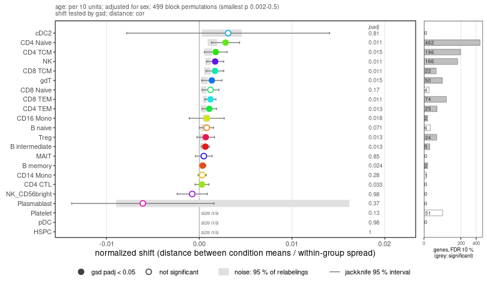<!-- -->

12 of 22 populations shift in expression with age (gsd, adjusted p < 0.05): all CD4 and CD8 T populations except the
naive CD8 cells, the NK and gamma-delta T cells, the regulatory T cells, CD16 monocytes and two B populations. The
normalized shifts per decade are small (at most 0.003: the distance between the expected profiles of donors ten years
apart, relative to the spread between donors of the same age), but consistent across many genes; the naive CD4 T cells
have the largest significant shift and the most genes changing (bars on the right).

``` r
g <- cao$test.results$expression.shifts$genes[[1]]
sig <- res$results$celltype[res$results$effect == "shift" & res$results$padj < 0.05]
lapply(g[intersect(sig, names(g))], function(x) head(x[, c("gene", "beta", "z")], 10))
```

    $`CD4 Naive`
           gene         beta         z
    1  LEF1-AS1 -0.003014843 -6.904458
    2     TSHZ2  0.008977490  6.688515
    3    TNFSF8  0.004611851  6.545984
    4      AIF1 -0.008541119 -6.486922
    5     LRRN3 -0.004510420 -6.147417
    6   ANKRD12  0.007224947  6.064535
    7       NOG -0.002427086 -5.681348
    8       EVL -0.007225016 -5.462138
    9     USP10  0.004793964  5.312895
    10   THEMIS -0.001912482 -5.262094

    $`CD4 TCM`
           gene         beta         z
    1      LYAR -0.003858107 -5.352793
    2  HLA-DPA1  0.004026130  5.317922
    3   ANKRD12  0.006715772  4.872128
    4     DDIT4  0.008289692  4.830979
    5     KLRB1 -0.017396238 -4.806920
    6     SYNE3  0.002239769  4.753764
    7    HP1BP3 -0.003546027 -4.749047
    8    SMCHD1  0.004408877  4.720881
    9    TNFSF8  0.003054059  4.647973
    10    STK38 -0.001929708 -4.589120

    $NK
          gene         beta         z
    1    PTGDS  0.044067393  5.869624
    2     XCL2 -0.015517500 -5.662113
    3    CLIC3 -0.017675485 -5.531684
    4    SYNE2  0.008297593  5.323987
    5  PIK3IP1  0.005794692  5.084644
    6  TSC22D3  0.019674974  4.728213
    7    UQCRB  0.011650436  4.528258
    8     RPS7  0.007112039  4.524322
    9      LTB -0.009692425 -4.472799
    10  FCER1G -0.019328447 -4.469060

    $`CD8 TCM`
          gene         beta         z
    1     CCL5 -0.051334943 -5.164387
    2     LMNA  0.010769752  4.544584
    3    APBA2 -0.007661169 -4.381783
    4     CD96 -0.009613803 -4.152934
    5  ZFP36L2  0.025226635  3.975398
    6    ABTB1 -0.006376469 -3.968212
    7   TAGLN2  0.013986947  3.954617
    8   NDUFB4  0.011326050  3.924611
    9   RALBP1 -0.007432676 -3.919285
    10  LGALS1  0.024032434  3.857958

    $gdT
             gene         beta         z
    1       KLRF1  0.021702454  5.386798
    2       RPL36 -0.014463966 -4.876989
    3        GZMH  0.039755898  4.630115
    4        NKG7  0.041026478  4.600652
    5       IGF2R  0.007706215  4.561936
    6      TYROBP  0.029235224  4.405275
    7         FYN  0.013542829  4.311834
    8       SYTL3  0.010698503  4.232035
    9  TRIM52-AS1  0.007192361  4.219180
    10       CCL5  0.033225136  4.198186

    $`CD8 TEM`
          gene         beta         z
    1    SYTL3  0.008306484  5.547315
    2    DDIT4  0.009335708  5.489117
    3    LIMD2 -0.008935447 -4.997225
    4   CLDND1 -0.006749694 -4.713545
    5     CD27 -0.010000247 -4.640108
    6     NMT2 -0.003394672 -4.501831
    7      LTB -0.016946320 -4.491362
    8    NOSIP -0.008700035 -4.429788
    9  SELENOH -0.005880878 -4.250631
    10   SYNE2  0.005811849  4.099104

    $`CD4 TEM`
                  gene         beta         z
    1            KLRB1 -0.048293007 -6.508761
    2             RPS8 -0.009352093 -4.402584
    3         HLA-DPA1  0.012940183  4.315092
    4  ENSG00000260927 -0.003877275 -4.219617
    5             PLP2  0.010870965  4.175311
    6         HLA-DPB1  0.011183214  4.136203
    7           TAGLN2  0.013264830  4.033713
    8            RPL12 -0.008339016 -3.861160
    9            RPL32 -0.008274369 -3.842325
    10           RPL34 -0.011065669 -3.757962

    $`CD16 Mono`
          gene         beta         z
    1  CCDC107 -0.007974682 -5.052462
    2   NBPF26 -0.004707684 -4.296083
    3    RC3H1 -0.005811352 -4.017876
    4     TAF3 -0.007014019 -3.931315
    5    DHRS7  0.008388416  3.846647
    6    LYRM4  0.006204843  3.782975
    7     STYX -0.004319650 -3.733236
    8     GGA2  0.004456047  3.722387
    9   ZMYND8 -0.005400768 -3.694477
    10    CD46 -0.008123004 -3.576416

    $Treg
         gene         beta         z
    1   NUCB2 -0.009292341 -4.879313
    2    PPA1  0.010607158  4.535068
    3   NOSIP -0.011440714 -4.248863
    4   RPS15 -0.008889687 -4.102782
    5    PEPD -0.005196940 -4.076183
    6  MT-ND1  0.015670990  3.990582
    7    RGS2  0.005959229  3.789844
    8  ZDHHC6  0.005378029  3.773731
    9    OPTN  0.008264633  3.746984
    10  RPL34 -0.010167620 -3.712253

    $`B intermediate`
          gene         beta         z
    1   LAPTM5  0.021925529  5.048234
    2     BTG1  0.019803245  4.330012
    3      LTB -0.025774756 -4.313515
    4     IGHM -0.023482277 -4.143261
    5   MALAT1  0.011480941  4.028029
    6   RPS15A -0.007342746 -3.770392
    7    HSPA4  0.007029930  3.696134
    8  CLEC17A -0.003957467 -3.457570
    9    RPL36 -0.008478343 -3.413922
    10    FTH1  0.010605004  3.387314

    $`B memory`
          gene         beta         z
    1    ITGB1 -0.016805834 -4.384218
    2   RPS15A -0.008481436 -4.330359
    3    TARS3 -0.003691592 -3.906576
    4    RPL13 -0.006369938 -3.898090
    5     COCH -0.007219196 -3.790954
    6  TSC22D3  0.019878220  3.750783
    7     BTG1  0.016513004  3.744103
    8     GAS5 -0.011523628 -3.677927
    9    VOPP1  0.007989943  3.674374
    10    IDI1  0.006311016  3.648400

    $`CD4 CTL`
          gene         beta         z
    1   LGALS1  0.033393912  4.187376
    2    RACK1  0.015674670  4.043527
    3     RPSA  0.014657522  3.808216
    4     NDE1  0.008325137  3.715388
    5    DEDD2  0.010138159  3.680811
    6  ZFP36L2  0.022487924  3.544982
    7    RAB5C -0.011444079 -3.532291
    8  AKAP17A -0.008621638 -3.483990
    9   ARID1A -0.009463375 -3.462474
    10    SBDS  0.011919818  3.354666

The genes with the largest age effect in the naive CD4 T cells include LRRN3 and NOG, which decrease with age, as
reported in whole-blood expression studies of aging; in the NK cells, PTGDS increases and XCL2 decreases.

``` r
cao$plotExpressionShiftMagnitudes(effect = "var")
```

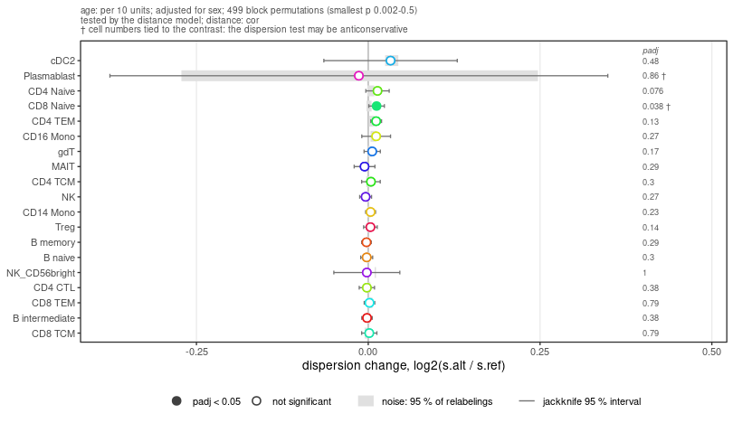<!-- -->

The dispersion effect asks whether donors become more or less different from each other with age, cell type by
cell type. Only the naive CD8 T cells change significantly (adjusted p 0.038, more dispersed at older ages); the dagger
marks that their cell numbers per donor depend on age (they decline), which can make this test anticonservative.

### Behind one cell type

``` r
cao$plotShiftDetail("CD4 Naive")
```

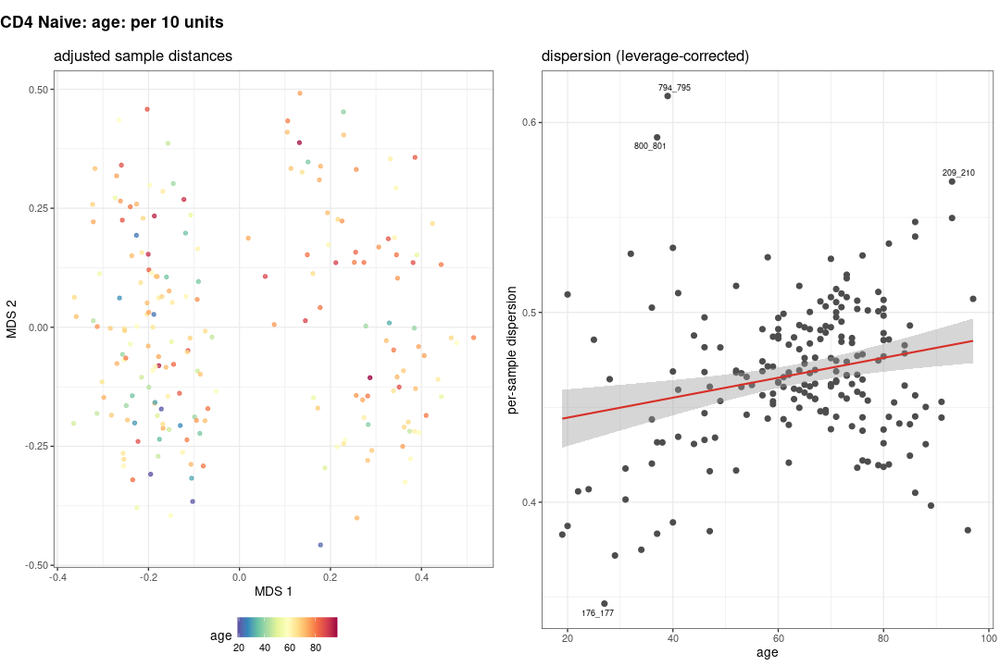<!-- -->

The detail of one cell type shows the donors on the distances of their naive CD4 T cell profiles after removing
sex (left), and each donor's dispersion against age (right). The age effect is not visible as a separation on the
map: it is a small shift shared by many genes, which the gene-level test accumulates. The dispersion rises slightly
with age, a trend that is not significant (adjusted p 0.076).

``` r
cao$plotSampleInfluence()
```

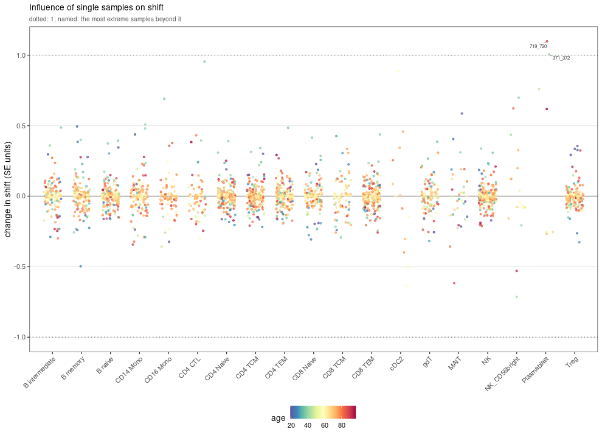<!-- -->

``` r
cao$plotFitDiagnostics("expression.shifts")
```

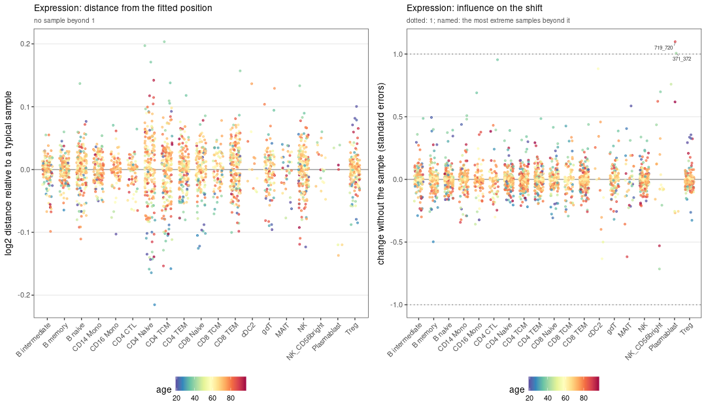<!-- -->

The fit diagnostics of the expression shifts show no donor far from its fitted position, and the influence of
single donors is below a standard error everywhere except in the plasmablasts, where few donors have enough cells.

### Robustness to the covariates

``` r
cao$checkSensitivity(n.permutations = 199)
```

    Sensitivity of 'age: per 10 units' (shift) across 3 models: unadjusted [~age + (1 | pool)]; current [~age + sex + (1 | pool)]; minus (1 | pool) [~age + sex]
      magnitude: distance model; significance: gsd (adjusted p < 0.05)
      CD4 Naive      magnitude stable; significant in all 3 models
      CD4 TCM        magnitude stable; significant in all 3 models
      NK             magnitude stable; significant in all 3 models
      CD8 TCM        magnitude stable; significant in all 3 models
      gdT            magnitude stable; significant in all 3 models
      CD8 TEM        magnitude stable; significant in all 3 models
      CD4 TEM        magnitude stable; significant in all 3 models
      B intermediate magnitude stable; significant in all 3 models
      Plasmablast    magnitude near zero (within the relabeling band); not significant in any of 3 models
      cDC2           magnitude near zero (within the relabeling band); not significant in any of 3 models
      CD8 Naive      magnitude stable; significant in 2 of 3 models (only with: unadjusted, minus (1 | pool))
      CD16 Mono      magnitude near zero (within the relabeling band); significant in all 3 models
      NK_CD56bright  magnitude driven by sample 164_165; not significant in any of 3 models
      B naive        magnitude stable; significant in 2 of 3 models (only with: unadjusted, minus (1 | pool))
      Treg           magnitude driven by sample 169_170; significant in all 3 models
      MAIT           magnitude near zero (within the relabeling band); not significant in any of 3 models
      B memory       magnitude near zero (within the relabeling band); significant in all 3 models
      CD14 Mono      magnitude near zero (within the relabeling band); not significant in any of 3 models
      CD4 CTL        magnitude near zero (within the relabeling band); significant in 2 of 3 models (not with: minus (1 | pool))

``` r
cao$plotSensitivity()
```

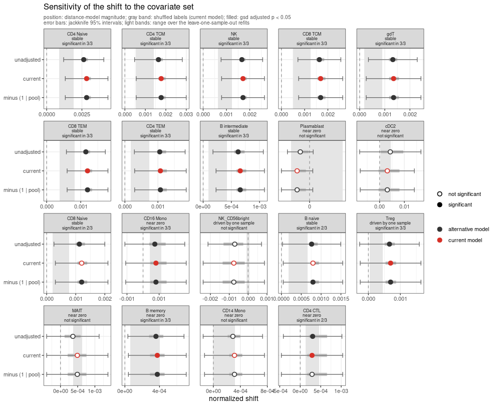<!-- -->

The sensitivity analysis refits the shifts without sex and without the grouping term, with jackknife intervals
(error bars) and the range of the leave-one-out estimates (light bands). Eleven populations are significant in all
three models and five in none. The naive CD8 and naive B cells are significant only without sex or without the pool; the cytotoxic CD4 T cells
lose significance when the pool is ignored. The magnitudes of these three change by at most 7 % between models, so
these differences are differences of significance near the threshold, not of the size of the effect.

## Age as a continuous variable against age groups

A common alternative is to split the donors into age groups. Here the same donors and model, with age replaced by a
split at the median (`old` against `young`).

``` r
sample.meta$age.group <- factor(ifelse(sample.meta$age > median(sample.meta$age), "old", "young"), levels = c("young", "old"))
cao$sample.meta <- sample.meta
cao$setModel(~ age.group + sex + (1 | pool), test = "age.group")
```

    Model: ~age.group + sex + (1 | pool)      dispersion: ~age.group
           grouping term (1 | pool): not fitted; the tested variable is exchanged within its levels; levels that hold one value of it are exchanged as wholes
    Test: age.group: old vs young  (reference 'young': first level of the factor as set; to change: test = "age.group: young vs old")
           adjusted for sex; permutations: block within 71 strata (> 10 million distinct); 134 of 200 samples can change their value; smallest p-value 0.002
           shift > 0: old samples differ from young samples in a common direction, beyond within-group variability
    Samples: 200 used.   Issues: 2 notes
      note: test 'age.group: old vs young': 32 of the 41 levels of 'pool' that hold one value of the tested variable are exchanged as wholes, among levels with the same make-up; the others keep their value
      note: 'pool': 41 of 70 levels hold one value of 'age.group'; 32 of them are exchanged as wholes among levels with the same make-up, the others keep their value (134 of 200 samples can change their value)

``` r
cao$estimateCellLoadings(name = "coda.groups", verbose = FALSE)
cao$estimateExpressionShiftMagnitudes(name = "shifts.groups", verbose = FALSE)
pc <- function(nm) cao$test.results[[nm]]$contrast$per_cell$padj
ct <- names(pc("coda")); cp <- cbind(continuous = pc("coda")[ct], groups = pc("coda.groups")[ct]); colSums(cp < 0.05)
```

    continuous     groups 
             6          3 

``` r
sh <- function(nm) { r <- cao$test.results[[nm]]$results; r <- r[r$effect == "shift", ]; setNames(r$padj, r$celltype) }
cs <- names(sh("expression.shifts")); ss <- cbind(continuous = sh("expression.shifts")[cs], groups = sh("shifts.groups")[cs]); colSums(ss < 0.05, na.rm = TRUE)
```

    continuous     groups 
            12         10 

``` r
signif(cbind(composition = cp[order(cp[, "continuous"]), ]), 2)[1:10, ]
```

              continuous groups
    CD16 Mono     0.0073  0.015
    CD4 CTL       0.0073  0.062
    CD4 Naive     0.0073  0.110
    CD8 Naive     0.0073  0.015
    CD8 TEM       0.0073  0.120
    NK            0.0073  0.015
    MAIT          0.1000  0.360
    B memory      0.1100  0.120
    HSPC          0.1100  0.310
    CD14 Mono     0.1300  0.062

``` r
signif(ss[order(ss[, "continuous"]), ], 2)
```

                   continuous groups
    CD4 Naive           0.011  0.014
    NK                  0.011  0.014
    CD8 TCM             0.011  0.046
    CD8 TEM             0.011  0.016
    CD4 TEM             0.013  0.016
    Treg                0.013  0.016
    B intermediate      0.013  0.100
    CD4 TCM             0.015  0.016
    gdT                 0.015  0.014
    CD16 Mono           0.018  0.150
    B memory            0.024  0.028
    CD4 CTL             0.033  0.063
    B naive             0.071  0.087
    Platelet            0.130  0.900
    CD8 Naive           0.170  0.016
    CD14 Mono           0.280  0.053
    Plasmablast         0.370  0.120
    cDC2                0.810  0.900
    MAIT                0.850  0.450
    NK_CD56bright       0.980  0.750
    pDC                 0.980  0.660
    HSPC                1.000     NA

``` r
cao$setModel(~ age + sex + (1 | pool), test = "age", numeric.step = 10, verbose = FALSE)
```

Splitting the donors at the median age loses evidence. The composition test finds 6 cell types with age as a number
and 3 with the two age groups; the CD4 CTL, naive CD4 and CD8 effector memory T cells are significant only with the
number (adjusted p 0.0073 against 0.06-0.12). The expression shifts find 12 cell types against 10: the intermediate B
cells, CD16 monocytes and CD4 CTL are significant only with the number, the naive CD8 T cells only with the groups
(adjusted p 0.17 against 0.016). The split at 67 years discards the order of the donors within each half: a donor of 30 and one of
65 count the same. The one cell type that gains (naive CD8) may change with age in a way a straight line describes
poorly, or the difference may come from the relabeling, which with two groups can change the value of fewer donors
(134 of 200, against 173); neither was tested here.

### Residuals

Two technical variables that are not in the model: the number of cells the donor had before the subsampling to
800 (`n.cells.all`), and the number in the pool's name (`pool.number`).

``` r
sample.meta$n.cells.all <- readRDS(params$meta.file)[rownames(sample.meta), "n.cells.all"]
sample.meta$pool.number <- as.integer(sub("^P", "", as.character(sample.meta$pool)))
cao$sample.meta <- sample.meta
cao$setModel(~ age + sex + (1 | pool), test = "age", numeric.step = 10, verbose = FALSE)
cowplot::plot_grid(cao$plotSampleDistances(values = "residual", color.by = "n.cells.all", shape.by = "sex"),
                   cao$plotSampleDistances(values = "residual", color.by = "pool.number", shape.by = "sex"),
                   cao$plotSampleDistances(space = "composition", values = "residual", color.by = "n.cells.all", shape.by = "sex"), ncol = 3)
```

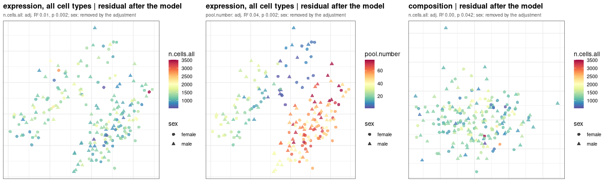<!-- -->

The residual maps show the donor distances left once age and sex are removed. The pool number structures the
expression residuals (4 %, p 0.002): donors of low-numbered pools lie on one side of the map, those of high-numbered
pools on the other. The pool number is also associated with age (Spearman correlation -0.30, older donors in
lower-numbered pools; this was computed separately from the notebook), so a difference between pools could be taken
for an age effect. The grouping term `(1 | pool)` guards the tests against this: age is relabeled only among donors of
the same pool, so differences between pools do not enter the relabeled comparisons; the exceptions are the 11 pools of a
single donor, which are exchanged as wholes among themselves. It does not remove the pool differences
from the estimates. The number of cells a donor had before subsampling explains 1 % of the expression residuals
(p 0.002) and a negligible share of the composition residuals (adjusted R² 0.00, p 0.042); it is not associated with age
(Spearman correlation 0.03).

## Differential expression per cell type

``` r
cao$estimateDEPerCellType(test = "limma-voom")
```

``` r
cao$plotNumberOfDEGenes()
```

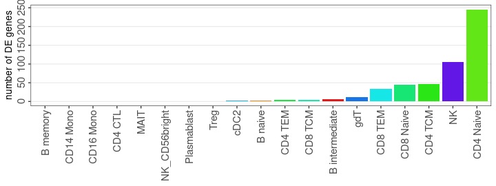<!-- -->

Differential expression per cell type uses limma-voom, which fits the grouping term `(1 | pool)` as a random intercept:
one correlation between the donors of a pool, shared by all genes of a cell type (0.00 to 0.20, largest in the CD4
central-memory and naive CD4 T cells). It finds genes in 11 of the 19 tested populations, most in the naive CD4 T cells
(246), the NK cells (105), the CD4 central-memory (46), naive CD8 (45) and CD8 effector-memory T cells (33). Eight of
the 11 also shift significantly in expression (gsd); the exceptions are the naive CD8 T cells (adjusted p 0.17), the
naive B cells (0.071, 3 genes) and the cDC2 (0.81, 2 genes). Conversely, four populations shift significantly without
any differentially expressed gene: the CD16 monocytes, regulatory T cells, memory B cells and cytotoxic CD4 T cells.

``` r
# the pool as a fixed factor (69 parameters) instead of a random intercept, on the same donors
cao$setModel(~ age + sex + pool, test = "age", numeric.step = 10, verbose = FALSE)
de.fixed <- cao$estimateDEPerCellType(test = "limma-voom", name = "de.pool.fixed", verbose = FALSE)
cao$setModel(~ age + sex + (1 | pool), test = "age", numeric.step = 10, verbose = FALSE)
nde <- function(d) vapply(d, function(x) sum(x$res$padj < 0.05, na.rm = TRUE), integer(1))
ct <- names(cao$test.results$de)
data.frame(random.intercept = nde(cao$test.results$de)[ct], pool.as.factor = nde(de.fixed)[ct],
           within.pool.correlation = round(attr(cao$test.results$de, "block.correlation")[ct], 2))
```

                   random.intercept pool.as.factor within.pool.correlation
    B intermediate                6              0                    0.05
    B memory                      0              0                    0.04
    B naive                       3              0                    0.08
    CD14 Mono                     0              0                    0.08
    CD16 Mono                     0              0                    0.06
    CD4 CTL                       0              0                    0.05
    CD4 Naive                   246             22                    0.17
    CD4 TCM                      46              1                    0.20
    CD4 TEM                       4              0                    0.05
    CD8 Naive                    45              2                    0.08
    CD8 TCM                       4              2                    0.05
    CD8 TEM                      33              0                    0.11
    cDC2                          2              0                    0.00
    gdT                          11              1                    0.05
    MAIT                          0              4                    0.04
    NK                          105              3                    0.13
    NK_CD56bright                 0              0                    0.03
    Plasmablast                   0             NA                      NA
    Treg                          0              0                    0.04

The same analysis with the pool as a fixed factor, 69 parameters for 200 donors, finds 35 genes in all cell types
together against 505: 22 against 246 in the naive CD4 T cells, 3 against 105 in the NK cells, 2 against 45 in the naive
CD8 T cells; only the MAIT cells have more genes with the fixed factor (4 against none). The within-pool correlations are
small: the pools differ little, and a likely reason for the loss (not tested separately) is that a parameter for each
pool costs more degrees of freedom than it removes variation. The gsd test of the expression shifts fits no pool parameters either; it only restricts the relabeling to
within pools.

``` r
cao$plotVolcano(cell.types = "CD4 Naive")
```

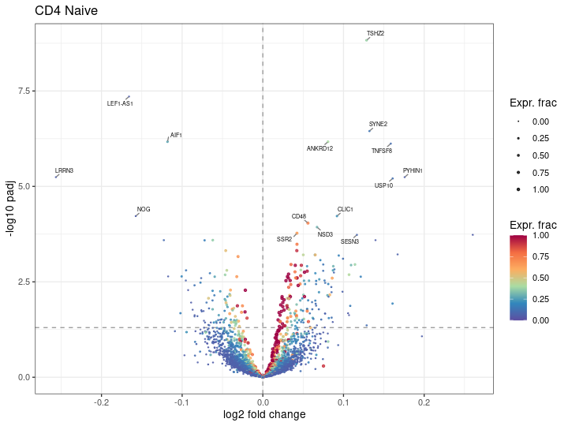<!-- -->

The volcano plot shows the limma-voom result of the naive CD4 T cells. Its fold changes are per decade of age, as
everywhere in this notebook, and small: 0.02 to 0.26 log2 units for the 246 significant genes, 155 of them higher with
age. The labeled genes are the 15 most significant ones; eight of them (LEF1-AS1, TSHZ2, TNFSF8, AIF1, LRRN3, ANKRD12,
NOG and USP10) are also among the ten genes that lead the gsd test of this cell type, and all ten of those genes are
significant here with the same direction.

## Cluster-free analyses

### Cluster-free density shifts

``` r
cao$estimateCellDensity(method = "graph")
```

    kNN neighborhoods of at least 1588 cells (7.9 per sample)

``` r
cao$estimateDiffCellDensity()
```

    diffusion neighborhoods at 1 %, 3 %, 5 % of the cells (auto: one scale is chosen)

    scale 0.01: heat kernel beta 40.6

    scale 0.03: heat kernel beta 50.5

    scale 0.05: heat kernel beta 60

    7669 of 158866 cells at FDR 10 % (scale 5 % chosen)

``` r
cowplot::plot_grid(cao$plotEmbedding(color.by = "cell.groups", title = "cell type"),
                   cao$plotDiffCellDensity(what = "effect", title = "density change per decade (log2)", outline = TRUE),
                   cao$plotDiffCellDensity(title = "adjusted z", outline = TRUE), ncol = 3)
```

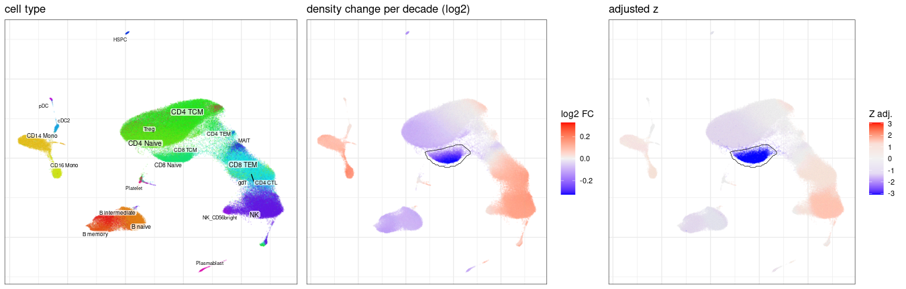<!-- -->

The density map calls 7,669 of the 158,866 cells at FDR 10 % (diffusion neighborhoods of 5 % of the cells): 90 % of the
naive CD8 T cells and a quarter of the CD8 central-memory cells, which lose density with age (outlined). The other changes of the composition are spread over
whole populations and are smaller per cell than this one.

### Cluster-free expression shifts

``` r
cao$estimateClusterFreeExpressionShifts(n.permutations = 499)
```

    9652 genes (per neighborhood: those detected in >= 5 % of its cells)

    diffusion neighborhoods at 1 %, 3 %, 5 % of the cells (auto: one scale is chosen), at least 1588 cells each (7.9 per sample)

    scale 0.01: heat kernel beta 40.6, 422 centers, neighborhoods of 1594 cells (median, 1589 smallest)

    scale 0.03: heat kernel beta 50.5, 142 centers, neighborhoods of 4769 cells (median, 1601 smallest)

    scale 0.05: heat kernel beta 60, 79 centers, neighborhoods of 7950 cells (median, 1789 smallest)

    146217 of 158866 cells keep adjusted z >= 1.28 (scale 3 % chosen)

``` r
cao$plotClusterFreeExpressionShifts(adjusted = TRUE, font.size = c(2, 3), outline = TRUE)
```

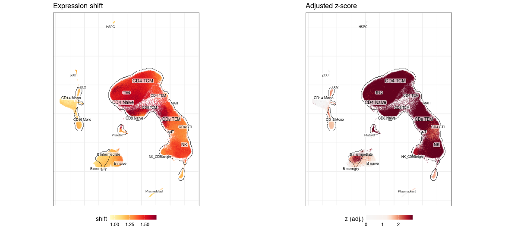<!-- -->

The expression-shift map tests the age effect on the expression of each cell's neighborhood, with the same model and
relabeling. At the chosen scale (diffusion neighborhoods of 3 % of the cells) 146,217 of the 158,866 cells keep an
adjusted z of at least 1.28: nearly all T and NK cells, and parts of the B cells, CD16 monocytes and cDC2. This
largely agrees with the cell-type test, where mainly T and NK populations shift, but the map also calls the MAIT cells,
naive CD8 T cells, CD56-bright NK cells and platelets, which the cell-type test does not find. The calls of this map are
protected at the level of the data set: the test of the chosen scale compares the number of called cells with that of
every relabeled data set and is designed so that about one data set in ten without any effect produces calls. When one
does, the calls are not scattered but cover whole regions, because overlapping neighborhoods share the same chance
association. With age shuffled among the donors, the map called nothing in one of three shuffles and 21 % and 29 % of
the cells in the other two, more often than that design rate (three shuffles are too few to estimate the rate); at the level of whole cell types, 40 shuffles gave
p-values below 0.05 in 5 % of the tests, as expected (both run outside this notebook). A map that calls most of the
cells is therefore to be read together with the cell-type test and with the size of the shift, not as evidence on its
own.

``` r
cao$estimateClusterFreeSummary("cell.density")
cao$estimateClusterFreeSummary("cluster.free.expr.shifts")
cowplot::plot_grid(cao$plotClusterFreeSummary("cell.density"), cao$plotClusterFreeSummary("cluster.free.expr.shifts"), ncol = 2)
```

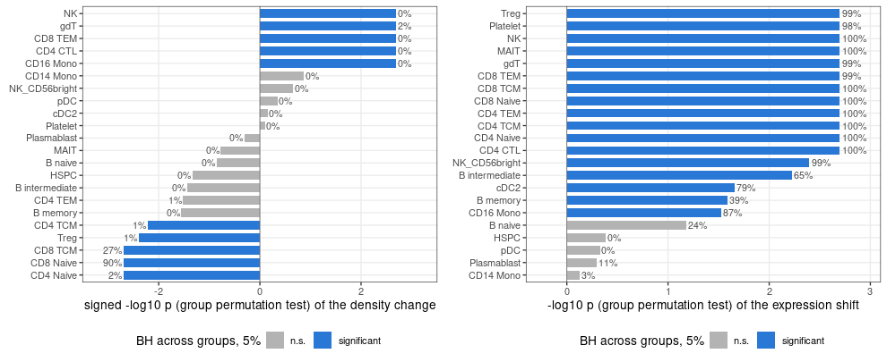<!-- -->

The summaries count the called cells per population and test each population as a whole against the relabelings. The
density changes (left) are significant for the naive CD4 and CD8 T cells, CD4 and CD8 central-memory and regulatory T
cells (lower density with age) and for the NK, gamma-delta T, CD8 effector-memory, cytotoxic CD4 T cells and CD16
monocytes (higher). The expression shifts (right) are significant for all T and NK populations, the intermediate and
memory B cells, the cDC2, the CD16 monocytes and the platelets, and not for the naive B cells, classical monocytes, pDC, plasmablasts
and progenitors.

## Summary

- Age is tested as a continuous variable, per decade, adjusted for sex and relabeled within processing pools; the
  pools are associated with age (their donors are of similar age), which the grouping term handles.
- The composition shows the known changes of the aging immune system: fewer naive CD8 and CD4 T cells, more cytotoxic
  and effector-memory T cells, NK cells and CD16 monocytes. 12 of 22 populations shift in expression, the T and NK
  populations most, with LRRN3 and NOG among the genes that decrease with age in the naive CD4 T cells.
- The density map calls cells mainly among the naive CD8 T cells (90 % of them); tested as whole populations, ten
  populations change in density. The expression-shift map calls nearly all T and NK cells; its test is designed to
  produce calls in about one data set in ten without any effect, it called whole regions in two of three shuffles of
  age here, and its calls are therefore read together with the cell-type test.

## Session info

``` r
sessionInfo()
```

    R version 4.2.2 Patched (2022-11-10 r83330)
    Platform: x86_64-pc-linux-gnu (64-bit)
    Running under: Ubuntu 20.04.6 LTS

    Matrix products: default
    BLAS:   /usr/lib/x86_64-linux-gnu/blas/libblas.so.3.9.0
    LAPACK: /usr/lib/x86_64-linux-gnu/lapack/liblapack.so.3.9.0

    locale:
     [1] LC_CTYPE=en_US.UTF-8       LC_NUMERIC=C              
     [3] LC_TIME=en_US.UTF-8        LC_COLLATE=en_US.UTF-8    
     [5] LC_MONETARY=en_US.UTF-8    LC_MESSAGES=en_US.UTF-8   
     [7] LC_PAPER=en_US.UTF-8       LC_NAME=C                 
     [9] LC_ADDRESS=C               LC_TELEPHONE=C            
    [11] LC_MEASUREMENT=en_US.UTF-8 LC_IDENTIFICATION=C       

    attached base packages:
    [1] stats     graphics  grDevices utils     datasets  methods   base     

    other attached packages:
    [1] ggplot2_4.0.2  cacoa_0.5.0    Matrix_1.6-1.1

    loaded via a namespace (and not attached):
      [1] spatstat.univar_3.1-4       plyr_1.8.9                 
      [3] igraph_2.1.4                lazyeval_0.2.2             
      [5] sp_2.2-0                    splines_4.2.2              
      [7] BiocParallel_1.32.6         listenv_0.9.1              
      [9] scattermore_1.2             GenomeInfoDb_1.34.9        
     [11] digest_0.6.37               htmltools_0.5.8.1          
     [13] memoise_2.0.1               magrittr_2.0.3             
     [15] tensor_1.5.1                cluster_2.1.4              
     [17] ROCR_1.0-11                 Biostrings_2.66.0          
     [19] globals_0.20.0              annotate_1.76.0            
     [21] matrixStats_1.5.0           spatstat.sparse_3.1-0      
     [23] sccore_1.0.6                colorspace_2.1-0           
     [25] blob_1.2.4                  ggrepel_0.9.6              
     [27] xfun_0.53                   dplyr_1.2.1                
     [29] crayon_1.5.2                RCurl_1.98-1.12            
     [31] jsonlite_2.0.0              progressr_0.15.1           
     [33] spatstat.data_3.1-8         survival_3.4-0             
     [35] zoo_1.8-14                  ape_5.8-1                  
     [37] glue_1.8.0                  polyclip_1.10-7            
     [39] gtable_0.3.6                zlibbioc_1.44.0            
     [41] XVector_0.38.0              leiden_0.4.3               
     [43] DelayedArray_0.24.0         future.apply_1.20.0        
     [45] BiocGenerics_0.44.0         abind_1.4-8                
     [47] scales_1.4.0                DBI_1.1.3                  
     [49] spatstat.random_3.4-1       miniUI_0.1.2               
     [51] Rcpp_1.1.0                  coda.base_1.0.3            
     [53] viridisLite_0.4.2           xtable_1.8-4               
     [55] reticulate_1.43.0           bit_4.6.0                  
     [57] stats4_4.2.2                htmlwidgets_1.6.4          
     [59] httr_1.4.7                  RColorBrewer_1.1-3         
     [61] Seurat_4.3.0.1              ica_1.0-3                  
     [63] pkgconfig_2.0.3             XML_3.99-0.14              
     [65] farver_2.1.2                uwot_0.2.3                 
     [67] deldir_2.0-4                locfit_1.5-9.8             
     [69] tidyselect_1.2.1            labeling_0.4.3             
     [71] rlang_1.1.7                 reshape2_1.4.4             
     [73] later_1.4.4                 AnnotationDbi_1.60.2       
     [75] cachem_1.1.0                pbmcapply_1.5.1            
     [77] tools_4.2.2                 cli_3.6.5                  
     [79] generics_0.1.4              RSQLite_2.3.1              
     [81] ggridges_0.5.7              evaluate_1.0.5             
     [83] stringr_1.5.1               fastmap_1.2.0              
     [85] yaml_2.3.10                 goftest_1.2-3              
     [87] knitr_1.50                  bit64_4.6.0-1              
     [89] fitdistrplus_1.2-4          purrr_1.2.2                
     [91] RANN_2.6.2                  KEGGREST_1.38.0            
     [93] pbapply_1.7-4               future_1.76.0              
     [95] nlme_3.1-161                mime_0.13                  
     [97] compiler_4.2.2              plotly_4.11.0              
     [99] png_0.1-8                   spatstat.utils_3.1-5       
    [101] tibble_3.3.0                geneplotter_1.76.0         
    [103] stringi_1.8.7               lattice_0.20-45            
    [105] psych_2.5.6                 vctrs_0.7.3                
    [107] pillar_1.11.0               lifecycle_1.0.5            
    [109] spatstat.geom_3.5-0         lmtest_0.9-40              
    [111] RcppAnnoy_0.0.22            data.table_1.17.8          
    [113] cowplot_1.2.0               bitops_1.0-9               
    [115] irlba_2.3.5.1               httpuv_1.6.16              
    [117] patchwork_1.3.2             GenomicRanges_1.50.2       
    [119] R6_2.6.1                    promises_1.3.3             
    [121] KernSmooth_2.23-20          gridExtra_2.3              
    [123] IRanges_2.32.0              parallelly_1.45.1          
    [125] codetools_0.2-18            dichromat_2.0-1            
    [127] MASS_7.3-58                 SummarizedExperiment_1.28.0
    [129] DESeq2_1.38.3               withr_3.0.2                
    [131] SeuratObject_4.1.3          sctransform_0.4.2          
    [133] mnormt_2.1.1                S4Vectors_0.36.2           
    [135] GenomeInfoDbData_1.2.9      mgcv_1.8-41                
    [137] parallel_4.2.2              grid_4.2.2                 
    [139] tidyr_1.3.2                 rmarkdown_2.29             
    [141] S7_0.2.0                    MatrixGenerics_1.10.0      
    [143] Rtsne_0.17                  spatstat.explore_3.5-2     
    [145] Biobase_2.58.0              shiny_1.11.1               

