Pulmonary fibrosis: IPF lung versus control lung (Habermann et al. 2020)
================
Cacoa developers
2026-11-18

- <a href="#load-data" id="toc-load-data">Load data</a>
- <a href="#check-the-design" id="toc-check-the-design">Check the design</a>
- <a href="#screen-covariates" id="toc-screen-covariates">Screen covariates</a>
  - <a href="#sample-maps" id="toc-sample-maps">Sample maps</a>
- <a href="#set-the-model" id="toc-set-the-model">Set the model</a>
  - <a href="#can-the-age-be-adjusted-for" id="toc-can-the-age-be-adjusted-for">Can the age be adjusted for?</a>
- <a href="#expression-shifts-per-cell-type" id="toc-expression-shifts-per-cell-type">Expression shifts per cell type</a>
  - <a href="#behind-one-cell-type" id="toc-behind-one-cell-type">Behind one cell type</a>
- <a href="#robustness-to-the-covariates" id="toc-robustness-to-the-covariates">Robustness to the covariates</a>
- <a href="#composition" id="toc-composition">Composition</a>
- <a href="#differential-expression-per-cell-type" id="toc-differential-expression-per-cell-type">Differential expression per cell type</a>
- <a href="#functional-interpretation" id="toc-functional-interpretation">Functional interpretation</a>
- <a href="#cluster-free-analyses" id="toc-cluster-free-analyses">Cluster-free analyses</a>
  - <a href="#cluster-free-density-shifts" id="toc-cluster-free-density-shifts">Cluster-free density shifts</a>
  - <a href="#cluster-free-expression-shifts" id="toc-cluster-free-expression-shifts">Cluster-free expression shifts</a>
- <a href="#summary" id="toc-summary">Summary</a>
- <a href="#session-info" id="toc-session-info">Session info</a>

Habermann et al. (2020, Science Advances) profiled lungs from pulmonary fibrosis patients and from organ donors by
scRNA-seq (10x). This is the main example of the Cacoa preprint, and as there only the idiopathic pulmonary fibrosis
(IPF) lungs and the controls are kept, which leaves 22 samples (12 IPF, 10 control; the NSIP, cHP, ILD and sarcoidosis
lungs are excluded) and 89,326 cells in 31 populations of the paper's annotation. The samples were processed at two
sites, TGen and Vanderbilt, and the study reports age, sex, smoking, 10x chemistry and the sequencing flowcell per
library.

The contrast of interest is **IPF versus control**, with `~ Diagnosis` as the model. The covariates are not in the
model; their relevance is examined at every step: design check, covariate screen, variance partition, sensitivity of
the main result to adding them, and sample-distance plots colored by them. Two of them matter in different ways: the
processing site is the strongest structure in the expression data but is balanced between the arms, and the age is
almost aliased with the diagnosis (controls are young donors, IPF lungs come from transplants of patients aged
54-74). In short: the epithelium changes most (transitional AT2, proliferating epithelial and secretory cells), the
composition shows the expansion of the basal and aberrant epithelium and the loss of AT1 cells, the site turns out to be
harmless, and the age cannot be separated from the diagnosis.

``` r
library(cacoa)
library(ggplot2)
library(dplyr)
```

## Load data

`prepare_pf_data.R` (next to this notebook) refreshes the Conos object of the preprint and stores it; the paper's
cell annotation travels with it. The samples of the object are the lungs (`Sample_Name`): the preprint's
preprocessing merged the libraries of the same lung, and 8 of the 22 samples consist of 2-3 libraries. The study's
metadata table has one row per library, so it is aggregated to the sample level: the categorical fields are
identical within a sample (with one exception, two ages recorded for VUILD65, where the first is taken), the
sequencing saturation is averaged over the libraries, and three technical summaries are computed from the cells of the
object: the number of cells, the median UMI count and the median mitochondrial fraction.

``` r
con <- readRDS(params$data.file)
cell.groups <- con$misc$cell_metadata$cellType
lib.meta <- readr::read_csv(params$lib.meta, show_col_types = FALSE, na = c("", "NA", "Unknown")) %>%
  filter(Diagnosis %in% c("Control", "IPF"))
cell.meta <- read.csv(params$cell.meta, row.names = 1) %>% filter(Diagnosis %in% c("Control", "IPF"))
sample.meta <- lib.meta %>%
  group_by(Sample_Name) %>%
  summarise(Diagnosis = first(Diagnosis), Processing_site = first(Processing_site), Chemistry = first(Chemistry),
            Gender = first(Gender), Age = as.integer(first(Age)), Tobacco = first(Tobacco), Flowcell_ID = first(Flowcell_ID),
            seq.saturation = mean(readr::parse_number(Sequencing_Saturation))) %>%
  left_join(cell.meta %>% group_by(Sample_Name) %>%
              summarise(Sample_Source = first(Sample_Source), n.cells = n(), median.umi = median(nCount_RNA), percent.mt = median(percent.mt)),
            by = "Sample_Name") %>%
  tibble::column_to_rownames("Sample_Name")
sample.meta <- sample.meta[names(con$samples), c("Diagnosis", "Processing_site", "Sample_Source", "Chemistry", "Gender", "Age", "Tobacco",
                                                 "Flowcell_ID", "n.cells", "median.umi", "percent.mt", "seq.saturation")]
sample.meta
```

            Diagnosis Processing_site Sample_Source  Chemistry Gender Age Tobacco
    THD0001   Control            TGen           DNA    5_prime      M  36       Y
    THD0002   Control            TGen           DNA    5_prime   <NA>  40    <NA>
    THD0005   Control            TGen           DNA    5_prime      M  NA    <NA>
    TILD001       IPF            TGen           NTI    5_prime      M  65       N
    TILD006       IPF            TGen           NTI    5_prime      F  72       Y
    TILD010       IPF            TGen           NTI    5_prime      F  74       N
    TILD015       IPF            TGen           NTI    5_prime      M  67       Y
    TILD028       IPF            TGen           NTI    5_prime      F  54       Y
    VUHD071   Control      Vanderbilt    Vanderbilt    5_prime      M  38       Y
    VUHD65    Control      Vanderbilt    Vanderbilt    5_prime      M  17       Y
    VUHD66    Control      Vanderbilt    Vanderbilt    5_prime      M  30       Y
    VUHD67    Control      Vanderbilt    Vanderbilt    5_prime      F  30       Y
    VUHD68    Control      Vanderbilt    Vanderbilt    5_prime      M  41       Y
    VUHD69    Control      Vanderbilt    Vanderbilt    5_prime      F  31       N
    VUHD70    Control      Vanderbilt    Vanderbilt    5_prime      M  54       Y
    VUILD53       IPF      Vanderbilt    Vanderbilt 3_prime_V2      F  56       Y
    VUILD59       IPF      Vanderbilt    Vanderbilt    5_prime      M  69       N
    VUILD60       IPF      Vanderbilt    Vanderbilt    5_prime      M  59       Y
    VUILD61       IPF      Vanderbilt    Vanderbilt    5_prime      M  66       Y
    VUILD63       IPF      Vanderbilt    Vanderbilt    5_prime      F  64       N
    VUILD64       IPF      Vanderbilt    Vanderbilt    5_prime      M  68       N
    VUILD65       IPF      Vanderbilt    Vanderbilt    5_prime      M  68       N
            Flowcell_ID n.cells median.umi percent.mt seq.saturation
    THD0001   H75C7DRXX    2218    11270.0   4.202246          69.30
    THD0002   H75C7DRXX    2647     8138.0   3.583093          53.00
    THD0005   H75C7DRXX    3494     4566.0   3.975558          68.10
    TILD001   HWYTFBBXX    2128     7156.5   3.363597          50.60
    TILD006   H75C7DRXX    3313     5209.0   4.424607          39.30
    TILD010   H75C7DRXX    1584     5526.0   4.158644          28.40
    TILD015   H75C7DRXX    6402     6243.5   3.412665          64.25
    TILD028   H75C7DRXX    4393     5084.0   4.645477          33.00
    VUHD071   H75C7DRXX    2195     3582.0   6.028051          24.70
    VUHD65    H5LLNDSXX    2552    10526.5   4.888157          90.50
    VUHD66    H5LLFDSXX    2802     7210.5   6.333184          83.50
    VUHD67    H5LLFDSXX    7612     6708.5   4.581390          71.50
    VUHD68    H5LM5DSXX    5815     9263.0   6.579316          67.80
    VUHD69    HWYTFBBXX     800     2771.5   3.962241          77.80
    VUHD70    HCKWNDSXX    1509     6938.0   4.507594          91.60
    VUILD53   H5LLGDSXX    1116     4502.5   5.240760          94.90
    VUILD59   H5LM5DSXX   15142     6804.0   6.595235          61.45
    VUILD60   H5LM5DSXX    8463     7572.0   9.379491          77.15
    VUILD61   HC73FDSXX    8408     8780.5   8.576853          78.90
    VUILD63   HH7HWDSXX    2124     4651.0   6.564424          80.90
    VUILD64   H75C7DRXX    1419     4229.0   9.849521          45.20
    VUILD65   H75C7DRXX    3190     5734.0   7.016695          53.60

`Sample_Source` is the tissue source: within TGen the controls come from an organ-donor network (`DNA`) and the IPF
lungs from a transplant institute (`NTI`), so it is the processing site refined by the diagnosis. The flowcell is
only partly tied to the site (one flowcell holds all TGen samples but one together with three Vanderbilt samples,
another is shared by a TGen and a Vanderbilt sample, and the other Vanderbilt samples are spread over seven more), and the
3' chemistry was used for a single sample. The constructor classifies the columns: the flowcell has too many levels
for 22 samples and is set aside, and the missing values (one age, one sex, two smoking statuses, recorded as
"Unknown" in the study) are reported.

``` r
cao <- Cacoa$new(con, sample.metadata = sample.meta, cell.groups = cell.groups, n.cores = params$n.cores)
```

    Sample metadata: 22 samples, 12 columns
      usable (11): Diagnosis [Control 10, IPF 12], Processing_site [TGen 8, Vanderbilt 14], Sample_Source [DNA 3, NTI 5, Vanderbilt 14], Chemistry [3_prime_V2 1, 5_prime 21], Gender [F 7, M 14], Age [num, 17-74], Tobacco [N 7, Y 13], n.cells [num, 800-15142], ...
      excluded from screening (1): Flowcell_ID (high-cardinality)
      missing values: Gender (1), Age (1), Tobacco (2)

    Next: cao$checkDesign() and cao$screenCovariates(), or cao$setModel(test = "<variable>").

``` r
cao$setOptions(n.permutations = 499, seed = 1)
cao$plot.params <- list(size = 0.1, alpha = 0.1, font.size = c(2, 3))
cao$sample.groups.palette <- c(Control = "#4575b4", IPF = "#d73027")
```

The condition palette is named so that the plots made before the model is set use the same two colors as the ones
made after it.

``` r
cowplot::plot_grid(cao$plotEmbedding(color.by = "cell.groups", title = "cell type"),
                   cao$plotEmbedding(color.by = "Diagnosis", title = "diagnosis", mark.groups = FALSE, show.legend = TRUE), ncol = 2)
```

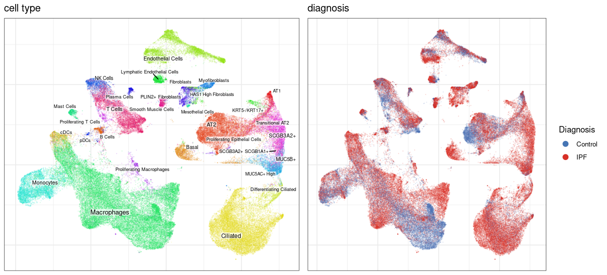<!-- -->

Macrophages and ciliated cells are the largest populations. The IPF cells dominate the ciliated and secretory
epithelium (`SCGB3A2+`, `MUC5B+`, `Basal`, `KRT5-/KRT17+`), the control cells the AT2 and AT1 regions; the immune
populations mix.

## Check the design

The design check works on the metadata alone: associations between covariates, the balance of each covariate over the
two arms, and structural problems for a model that would adjust for them.

``` r
cao$checkDesign(test = "Diagnosis")
```

    Design check: 22 samples, 11 covariates, test variable 'Diagnosis'
      association with 'Diagnosis': Age 0.89, Sample_Source 0.53, percent.mt 0.33, Tobacco 0.32, seq.saturation 0.27, median.umi 0.27, n.cells 0.25, Processing_site 0.00, Chemistry 0.00, Gender 0.00
      Warning (6):
        - 'Sample_Source' is strongly associated with 'Diagnosis' (0.53): adjusting for it estimates the Diagnosis effect not explained by Sample_Source -> consider reporting both models (cao$checkSensitivity())
        - 11 of 12 'IPF' samples have 'Age' above the range of 'Control' (17-54): adjusted for 'Age', the Diagnosis effect there rests on a fitted trend of 'Age' beyond the values observed in 'Control' -> compare with the samples in the common range of 'Age' (cao$excludeSamples())
        - 'Age' is strongly associated with 'Diagnosis' (0.89): adjusting for it estimates the Diagnosis effect not explained by Age -> consider reporting both models (cao$checkSensitivity())
        - 3 of 12 'IPF' samples have 'n.cells' above the range of 'Control' (800-7610): adjusted for 'n.cells', the Diagnosis effect there rests on a fitted trend of 'n.cells' beyond the values observed in 'Control' -> compare with the samples in the common range of 'n.cells' (cao$excludeSamples())
        - 5 of 10 'Control' samples have 'median.umi' outside the range of 'IPF' (4230-8780): adjusted for 'median.umi', the Diagnosis effect there rests on a fitted trend of 'median.umi' beyond the values observed in 'IPF' -> compare with the samples in the common range of 'median.umi' (cao$excludeSamples())
        - 7 of 12 'IPF' samples have 'percent.mt' outside the range of 'Control' (3.58-6.58): adjusted for 'percent.mt', the Diagnosis effect there rests on a fitted trend of 'percent.mt' beyond the values observed in 'Control' -> compare with the samples in the common range of 'percent.mt' (cao$excludeSamples())
      Note (19):
        - 'Processing_site' and 'Sample_Source' are associated (0.97) -> adjusting for both estimates each one's unique contribution only
        - 'Sample_Source' and 'Age' are associated (0.51) -> adjusting for both estimates each one's unique contribution only
        - 'Age' and 'Tobacco' are associated (0.43) -> adjusting for both estimates each one's unique contribution only
        - 'Gender' and 'median.umi' are associated (0.48) -> adjusting for both estimates each one's unique contribution only
        - 'Tobacco' and 'median.umi' are associated (0.41) -> adjusting for both estimates each one's unique contribution only
        - 'n.cells' and 'median.umi' are associated (0.43) -> adjusting for both estimates each one's unique contribution only
        - 'Processing_site' and 'percent.mt' are associated (0.64) -> adjusting for both estimates each one's unique contribution only
        - 'Sample_Source' and 'percent.mt' are associated (0.64) -> adjusting for both estimates each one's unique contribution only
        - 'Gender' and 'percent.mt' are associated (0.32) -> adjusting for both estimates each one's unique contribution only
        - 'Processing_site' and 'seq.saturation' are associated (0.49) -> adjusting for both estimates each one's unique contribution only
        - 'Sample_Source' and 'seq.saturation' are associated (0.57) -> adjusting for both estimates each one's unique contribution only
        - 'Chemistry' and 'seq.saturation' are associated (0.34) -> adjusting for both estimates each one's unique contribution only
        - 'Age' and 'seq.saturation' are associated (0.44) -> adjusting for both estimates each one's unique contribution only
        - 2 empty cell(s) in Diagnosis x Sample_Source -> the design is unbalanced; a marginal contrast cannot average over empty cells
        - 1 cell(s) of Diagnosis x Chemistry hold a single sample -> estimates in those cells rest on one sample
        - 1 empty cell(s) in Diagnosis x Chemistry -> the design is unbalanced; a marginal contrast cannot average over empty cells
        - 1 cell(s) of Diagnosis x Tobacco hold a single sample -> estimates in those cells rest on one sample
        - 'Tobacco' differs between the levels of 'Diagnosis' (association 0.32) -> adjust for 'Tobacco' and compare with the unadjusted result (cao$checkSensitivity())
        - 'percent.mt' differs between the levels of 'Diagnosis' (association 0.33) -> adjust for 'percent.mt' and compare with the unadjusted result (cao$checkSensitivity())

``` r
cao$plotDesign("balance")
```

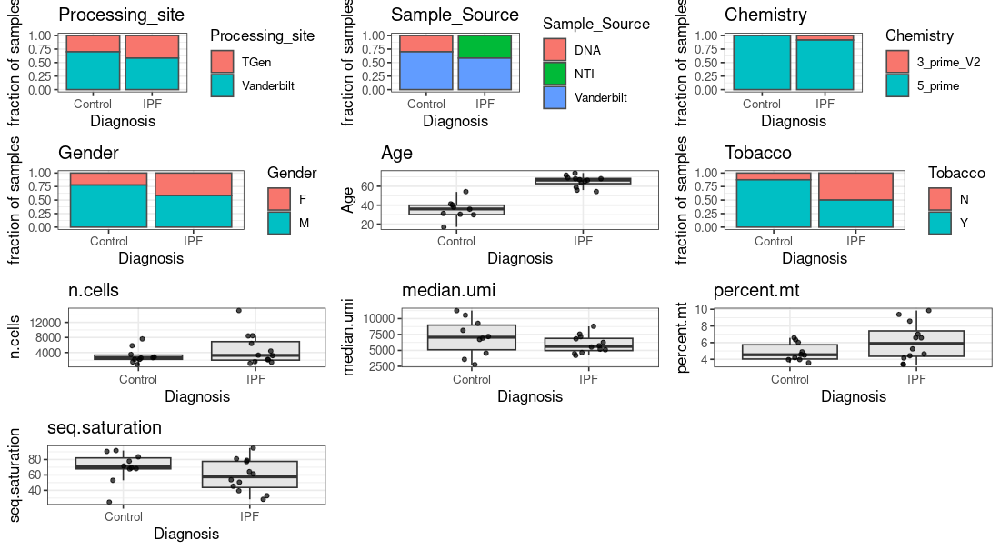<!-- -->

``` r
cao$plotDesign("associations")
```

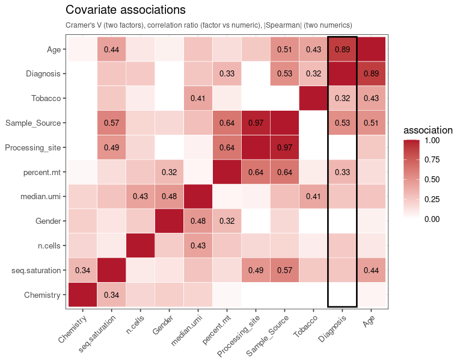<!-- -->

Age is the problem: the controls are 17-54 years old (median 36), the IPF patients 54-74 (median 66.5), an association
of 0.89 with the diagnosis. An age-adjusted model would estimate the IPF effect "at equal age", which this design
cannot support (no young IPF lungs, no old controls), and the check flags it for the sensitivity analysis rather than
for the model. `Sample_Source` is flagged for the same reason (it is the diagnosis within TGen). The processing site,
the chemistry and the sex are balanced between the arms; smoking and the mitochondrial fraction differ moderately
(more never-smokers and higher mitochondrial fractions among the IPF samples). The site is tied to the mitochondrial
fraction (0.64) and to the sequencing saturation (0.49), i.e. the two sites differ in their technical profile.

## Screen covariates

The screen tests every covariate against the sample-to-sample expression distances of each cell type, alone
(marginal) and adjusted for the other screened covariates (partial). It is run on a focused set: `Sample_Source` is
the site refined by the diagnosis (association 0.97 with the site), the chemistry is constant in all but one sample
and the flowcell is set aside by the constructor. Cell types with fewer than 6 samples are skipped.

``` r
cao$screenCovariates(covariates = c("Diagnosis", "Processing_site", "Age", "Gender", "Tobacco", "seq.saturation", "n.cells", "median.umi", "percent.mt"),
                     n.permutations = 499)
```

    Covariate screen: 9 covariates x 26 cell types, marginal + partial mode, permutation p-values (499 permutations)
      not screened (fewer than 6 samples): Mesothelial Cells, MUC5AC+ High, PLIN2+ Fibroblasts
      partial mode fell back to marginal in 15 of 26 cell types (too few residual degrees of freedom for the full covariate set)
    No covariate is associated with expression in >= 3 cell types (partial, FDR 5%).
    Marginal only (not separable from the other covariates): Diagnosis, Processing_site, Age, percent.mt
    Strongly tied to 'Diagnosis' (possible over-adjustment): Age (0.89)
    all cell types (partial, FDR 5%): no covariate
    composition (partial, FDR 5%): no covariate
    Suggested model: ~Diagnosis   (not applied; see cao$setModel())
    Note: constant within a cell type (not tested there): Tobacco in Plasma Cells

``` r
cao$plotCovariateScreen()
```

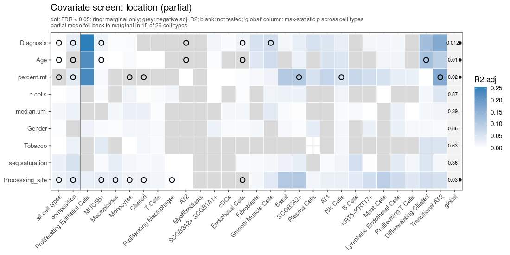<!-- -->

``` r
cao$plotCovariateSummary(mode = "marginal")
```

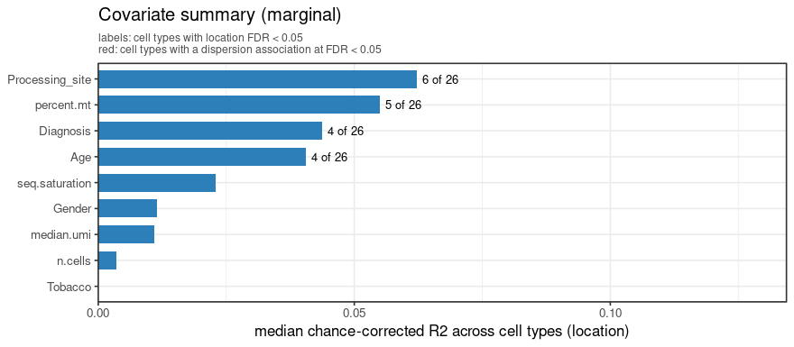<!-- -->

Marginally (the summary bars), the processing site is the strongest covariate (median chance-corrected R2 0.06, global
p 0.002, significant in 6 cell types), with the largest effects in the secretory and basal epithelium, the lymphatic
endothelium and the mast cells. The mitochondrial fraction follows (0.05, global p 0.008, 5 cell types; it is tied to
the site), then the diagnosis and the age (0.04, global p 0.004, 4 cell types each). The diagnosis and the age have the same profile across cell types (strongest
in `Transitional AT2`, `Proliferating Epithelial Cells` and `Differentiating Ciliated`), which is the aliasing seen
by the design check: in the partial mode, where each is adjusted for the other, both shrink. Sex, smoking, the number
of cells and the median UMI count explain nothing.

Two caveats about the screen on this design. With 22 samples and 9 covariates the partial mode runs out of residual
degrees of freedom in the smaller cell types and falls back to the marginal test (15 of 26 cell types, stated in the
printout and the heatmap). And in the partial mode (the heatmap) no single (covariate, cell type) pair reaches FDR 5%:
adjusted for the other covariates, the chance-corrected R2 of a single covariate rarely exceeds 0.1 here, and the
per-cell-type permutation p-values do not survive the Benjamini-Hochberg adjustment over the whole grid; the global
max-statistic p-values in the last column carry the signal instead (diagnosis and age 0.01, mitochondrial fraction
0.02, site 0.03). The screen therefore suggests no addition to `~ Diagnosis`.

The variance partition asks how much of the between-sample variation is diagnosis, how much is site, how much is age,
and how much is shared between them.

``` r
cao$plotVariancePartition(c("Diagnosis", "Processing_site", "Age"))
```

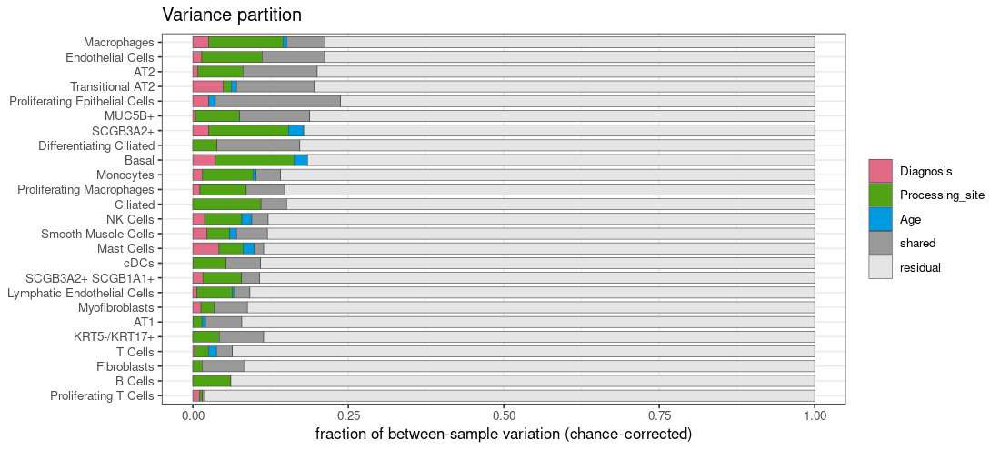<!-- -->

The site contributes a unique fraction of 5-13% in about half of the cell types, larger than the diagnosis except in
`Transitional AT2` and `Proliferating Epithelial Cells`, the types with the clearest IPF effect (the two are about equal
in the mast cells, and both are close to zero in the proliferating T cells). The age's unique fraction is small: what age explains
is shared with the diagnosis.

### Sample maps

The maps show the samples in two dimensions (MDS of the sample distances) for one cell type, for all cell types combined, or for the cell-type composition; the subtitles give the chance-corrected R² and permutation p-value of each color and shape variable on its own (the screen's marginal mode; the screen's summary lines print the partial mode where the degrees of freedom allow it).

The sample maps make the covariate structure visible without a model. In `Transitional AT2` the samples separate by
diagnosis (adj. R² 0.17) and not by site: the two TGen samples lie among the Vanderbilt controls, and the site's R² (0.06, p 0.02)
comes from both being controls. Averaged over all cell types, the diagnosis runs along one axis and the site along the
other (adj. R² 0.07 and 0.09), the pattern behind the screen result, and the age tracks the diagnosis. The composition
shows the same two directions (diagnosis 0.12, site 0.07).

``` r
cowplot::plot_grid(
  cao$plotSampleDistances(cell.type = "Transitional AT2", color.by = "Processing_site", shape.by = "Diagnosis"),
  cao$plotSampleDistances(color.by = "Diagnosis", shape.by = "Processing_site"),
  cao$plotSampleDistances(space = "composition", color.by = "Diagnosis", shape.by = "Processing_site"),
  ncol = 3)
```

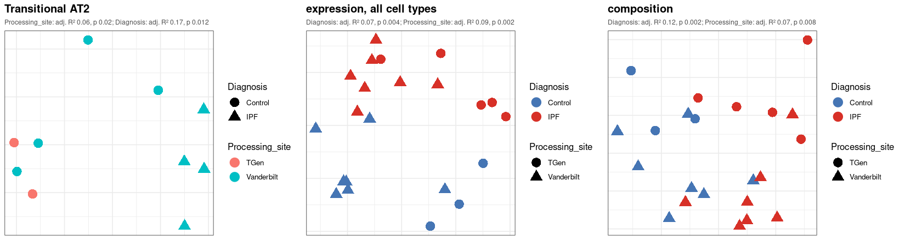<!-- -->

``` r
cao$plotSampleDistances(color.by = "Age", shape.by = "Diagnosis")
```

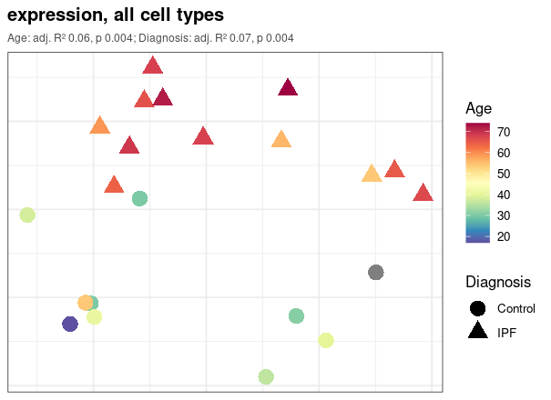<!-- -->

## Set the model

The model contains only the diagnosis. The reference level is `Control` (matched by name); `shift > 0` means that the
IPF samples differ from the control samples in a common direction. With 12 and 10 samples the label permutations are
exact (646,646 distinct relabelings).

``` r
cao$setModel(~ Diagnosis, test = "Diagnosis")
```

    Model: ~Diagnosis      dispersion: ~Diagnosis
    Test: Diagnosis: IPF vs Control  (reference 'Control': matched a control-like name; to change: test = "Diagnosis: Control vs IPF")
           unadjusted; permutations: block (646,646 distinct); 22 of 22 samples can change their value; smallest p-value 0.002
           shift > 0: IPF samples differ from Control samples in a common direction, beyond within-group variability
    Samples: 22 used.   Issues: none

### Can the age be adjusted for?

``` r
cao$setModel(~ Diagnosis + Age, test = "Diagnosis")
```

    Model: ~Diagnosis + Age      dispersion: ~Diagnosis
    Test: Diagnosis: IPF vs Control  (reference 'Control': matched a control-like name; to change: test = "Diagnosis: Control vs IPF")
           adjusted for Age; permutations: freedman-lane (> 10 million distinct); 21 of 21 samples can change their value; smallest p-value 0.002
           shift > 0: IPF samples differ from Control samples in a common direction, beyond within-group variability
    Samples: 21 used, 1 dropped (THD0005).   Issues: 2 warnings, 2 notes
      warning: 1 sample(s) dropped for missing covariate values: THD0005 -> complete the metadata or remove the covariate
      note: 'Diagnosis' is partly determined by the other covariates: 21% of its variance is independent of them, and its effect is estimated from that part -> check cao$checkDesign() for the association
      warning: test 'Diagnosis: IPF vs Control': 11 of 12 'IPF' samples have 'Age' above the range of 'Control' (17-54): adjusted for 'Age', the Diagnosis effect there rests on a fitted trend of 'Age' beyond the values observed in 'Control' -> compare with the samples in the common range of 'Age' (cao$excludeSamples())
      note: test 'Diagnosis: IPF vs Control': continuous covariate(s) Age: using Freedman-Lane residual permutation (approximate)

``` r
cao$setModel(~ Diagnosis, test = "Diagnosis", verbose = FALSE)
```

The model report shows what an age adjustment would rest on. Only 21 % of the variance of the diagnosis is independent
of the age, and 11 of the 12 IPF samples are older than every control (17-54 years). Adjusted for age, the IPF effect
would be estimated from a straight-line age trend continued beyond the ages seen in the controls, and its permutation
test would be approximate (residuals are permuted, because the age is continuous). One sample without an age would be
dropped. The notebook therefore keeps the diagnosis-only model; the age-adjusted fit is shown in the sensitivity
analysis below as a check, not as the result. Unlike the Natri cohort, whose patients and controls overlap in age from 43 years on, this
data set has no common age range to restrict the comparison to: only one IPF patient (54) lies within the control range.

## Expression shifts per cell type

For every cell type, each sample's cells are pooled into a profile, and two questions are asked. Whether the type
changed is tested gene by gene (the contrast of each gene over its standard error, the gene z-scores combined
adaptively; `statistic = "gsd"`), with permutation p-values adjusted across cell types. How much it changed comes from a
model of the sample-to-sample distances: `shift` is the distance between the arm means relative to the within-arm
spread, `var` the log2 ratio of the arm dispersions at equal cell numbers (tested by the distance model), `total` the
combination.

``` r
res <- cao$estimateExpressionShiftMagnitudes()
```

    Building pseudobulk profiles per cell type...

    Testing 31 cell type(s), 1 test(s) with gsd (16122 genes, per type those in >= 5 % of its cells), 499 permutations...

    Building pseudobulk profiles per cell type...

    Testing 29 cell type(s), 1 test(s), 499 permutations (auto)...

    Skipped 3 cell type/test combination(s): fewer than 2 samples in a contrasted level (Control: 1, IPF: 6); contrast involves a level absent in this cell type; too few samples with enough cells

    Note: AT1: only 120 distinct permutations: the smallest attainable p-value is 0.00833

    Note: Basal: only 91 distinct permutations: the smallest attainable p-value is 0.011

    Note: Fibroblasts: only 126 distinct permutations: the smallest attainable p-value is 0.00794

    Note: Plasma Cells: only 15 distinct permutations: the smallest attainable p-value is 0.0667

    Note: Proliferating Epithelial Cells: only 15 distinct permutations: the smallest attainable p-value is 0.0667

    Note: Proliferating T Cells: only 56 distinct permutations: the smallest attainable p-value is 0.0179

    Note: SCGB3A2+: only 91 distinct permutations: the smallest attainable p-value is 0.011

    19 of 28 cell types with a significant shift at FDR 5% (global p = 0.016).

``` r
res
```

    Expression shifts: Diagnosis: IPF vs Control; unadjusted; 499 block permutations (smallest p 0.002-0.067); statistic gsd
                           celltype  n n.mag shift padj.shift   var padj.var total
     Proliferating Epithelial Cells 10     6  0.96      0.043  0.61     0.75  1.48
                   Transitional AT2 14    10  0.43      0.019 -0.20     0.44  0.34
           Differentiating Ciliated 15    12  0.30      0.011  0.13     0.44  0.37
                             MUC5B+ 18    17  0.30      0.011  0.43     0.05  0.53
                  Endothelial Cells 21    21  0.24      0.014  0.13     0.22  0.30
                                AT2 19    19  0.21      0.011  0.11     0.44  0.26
                       Plasma Cells 10     6  0.20      0.200  0.55     0.44  0.48
                           SCGB3A2+ 17    14  0.19      0.011  0.40     0.60  0.38
                        Macrophages 22    22  0.18      0.019  0.13     0.36  0.23
                Smooth Muscle Cells 16    14  0.15      0.014  0.22     0.10  0.25
                                AT1 12    10  0.12      0.014 -0.07     0.75  0.10
                        Fibroblasts 13     9  0.12      0.044  0.16     0.44  0.18
                              Basal 15    14  0.11      0.043  0.39     0.51  0.28
                  SCGB3A2+ SCGB1A1+ 18    18  0.11      0.047  0.16     0.22  0.17
                               cDCs 19    17  0.10      0.030  0.08     0.70  0.14
                     Myofibroblasts 18    15  0.10      0.011  0.03     0.63  0.11
          Proliferating Macrophages 19    15  0.09      0.120  0.16     0.60  0.15
                          Monocytes 21    20  0.08      0.017  0.02     0.60  0.08
                           NK Cells 15    14  0.06      0.120 -0.05     0.44  0.05
                           Ciliated 22    21  0.05      0.017  0.10     0.36  0.09
                         Mast Cells 16    13  0.04      0.150 -0.02     0.89  0.03
                            T Cells 17    16  0.03      0.240 -0.02     0.75  0.03
        Lymphatic Endothelial Cells 17    10  0.03      0.040  0.03     0.61  0.04
              Proliferating T Cells 10     8 -0.01      0.620  0.21     0.44  0.06
                            B Cells 15    10 -0.04      0.270 -0.01     0.93 -0.04
                  Mesothelial Cells  7    NA    NA      0.200    NA       NA    NA
                       MUC5AC+ High  6    NA    NA      0.240    NA       NA    NA
                               pDCs  7    NA    NA      0.043    NA       NA    NA
     padj.total
          0.100
          0.024
          0.025
          0.024
          0.024
          0.029
          0.190
          0.300
          0.024
          0.024
          0.074
          0.060
          0.500
          0.060
          0.064
          0.074
          0.071
          0.060
          0.190
          0.097
          0.710
          0.620
          0.500
          0.640
          0.710
             NA
             NA
             NA
      19 of 28 cell types with a significant shift (BH 5%); global p: shift 0.016, var 0.024, total 0.01
      tested without a magnitude (fewer than 2 samples per level with >= 10 cells): Mesothelial Cells, MUC5AC+ High, pDCs
      not tested: KRT5-/KRT17+, PLIN2+ Fibroblasts, HAS1 High Fibroblasts
      (normalized effects; full tables in $results and $wide)

From 5 cells per sample, 28 cell types are tested; three disease-associated populations are not (the aberrant
basaloid cells `KRT5-/KRT17+`, `PLIN2+ Fibroblasts` and `HAS1 High Fibroblasts`, with at most one control sample).
Several small populations have a raised p-value floor (`Mesothelial Cells`, `MUC5AC+ High` and `pDCs`, 6-7 samples;
the notes printed during the run concern the distance model, which uses only the samples with at least 10 cells).
The magnitudes come from the samples with at least 10 cells (`n.mag`), because a profile of a handful of cells is mostly
sampling noise, which shrinks the distance-based shift; those three populations have too few such samples and are
tested without a magnitude.

``` r
cao$plotExpressionShiftMagnitudes(show.ci = TRUE, show.genes = TRUE)
```

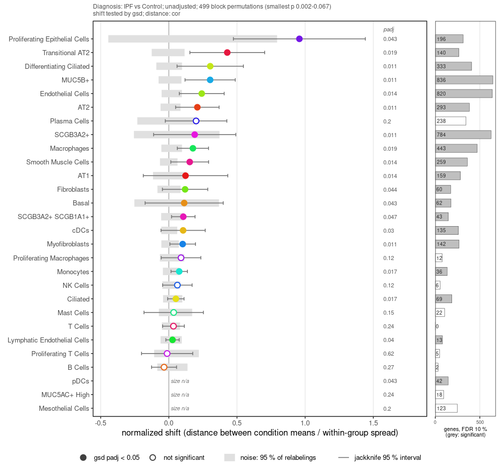<!-- -->

Cell types are ordered by the size of the shift; filled points have a significant shift by the gene-level test, the gray
band holds 95 % of the shifts with shuffled labels, the intervals are the jackknife 95 % intervals, and the margin counts
the genes changed at a gene-level FDR of 10 %. Nineteen of the 28 tested cell types have a significant shift. The largest are in the epithelium: proliferating
epithelial cells (0.96, but from only 6 samples with at least 10 cells, with a wide relabeling band), transitional AT2
(0.43), differentiating ciliated cells and `MUC5B+` secretory cells (0.30) and AT2 (0.21), together with the
endothelium (0.24); then `SCGB3A2+`, macrophages and smooth muscle (0.15-0.19), AT1, fibroblasts, `SCGB3A2+ SCGB1A1+`,
cDCs, basal cells and myofibroblasts (about 0.1), and small but significant shifts in monocytes, ciliated and lymphatic
endothelial cells. The plasma cells have a sizeable estimate from 6 samples and are not significant; the pDCs are significant without
a magnitude. The lymphocytes do not change. `Fibroblasts` and `AT1`, significant in the preprint, are
significant here too (13 and 12 samples with at least 5 cells; their magnitudes from 9 and 10 samples).

The jackknife intervals are wide for the small populations, and the gene counts follow both the shifts and the cell
numbers (about 800 in the endothelial, `MUC5B+` and `SCGB3A2+` cells, 240-440 in the macrophages, differentiating ciliated,
AT2, smooth muscle and plasma cells). The dispersion change, at equal cell numbers per sample, is
positive in most epithelial types (the IPF samples are more heterogeneous) but significant in none; `MUC5B+` and the
smooth muscle cells come closest.

``` r
cao$plotExpressionShiftMagnitudes(effect = "var")
```

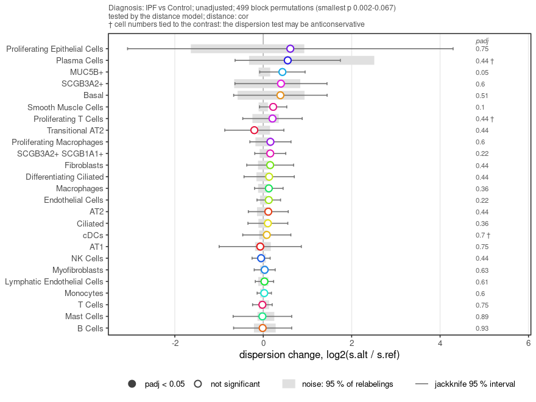<!-- -->

### Behind one cell type

``` r
cao$plotShiftDetail("Transitional AT2")
```

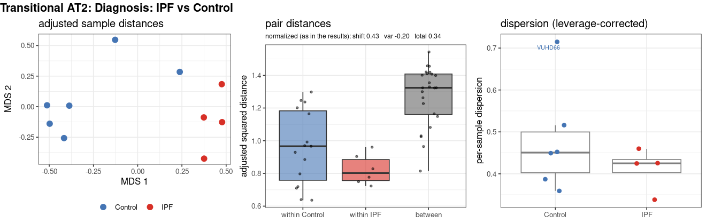<!-- -->

The transitional AT2 cells separate by arm along the first MDS axis, with one control closer to the IPF samples than to the other controls, and one
control (`VUHD66`) has an outlying dispersion. The IPF samples are, if anything, more similar to each
other than the controls, and the dispersion change at equal cell numbers is small and not significant (-0.20,
adjusted p 0.44).

``` r
cao$plotSampleInfluence()
```

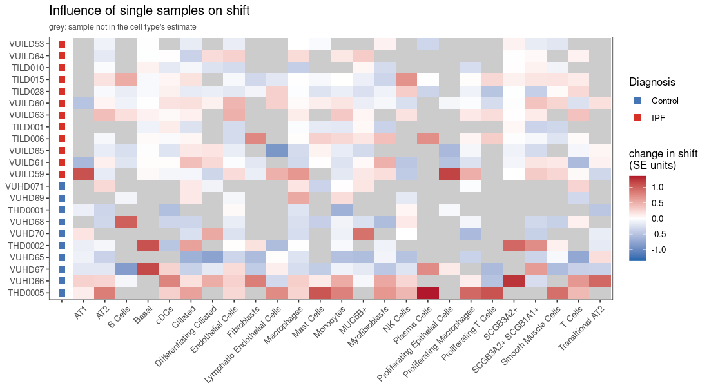<!-- -->

``` r
cowplot::plot_grid(cao$plotSampleDistances(values = "residual", color.by = "Processing_site", shape.by = "Diagnosis"),
                   cao$plotSampleDistances(values = "residual", color.by = "Tobacco", shape.by = "Diagnosis"),
                   cao$plotSampleDistances(values = "residual", color.by = "Age", shape.by = "Diagnosis"), ncol = 3)
```

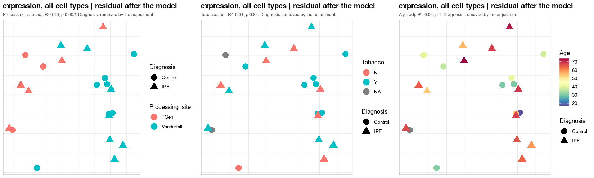<!-- -->

The residual maps show the sample distances left once the diagnosis is removed. The processing site still structures
them (10 %, p 0.002), as it did before the model: it is balanced between the arms, so it widens the within-arm spread
without biasing the comparison (the sensitivity analysis below adjusts for it). Smoking does not structure the residuals
(p 0.84), and neither does the age (p 1): whatever the age contributes to the expression profiles goes with the diagnosis
and is removed with it.

No single sample creates an effect, but a few set their size: leaving out the control `THD0005` (three libraries
merged, unknown age) increases the shift of every cell type it contributes to, by up to 1.4 jackknife standard errors
(plasma cells; about one in the proliferating T, mast and proliferating macrophage populations), `VUHD66` acts the
same way in `Transitional AT2`, and `VUILD59` (the largest sample) in `AT1`.

## Robustness to the covariates

The shifts are re-estimated under alternative adjustment sets, given explicitly because the screen proposes none: the
site, the age, the mitochondrial fraction, and site and age together. The set named `current` is the stored main
model, which the verdicts refer to.

``` r
cao$checkSensitivity(covariate.sets = list(current = ~ Diagnosis, "plus Processing_site" = ~ Diagnosis + Processing_site,
                                           "plus Age" = ~ Diagnosis + Age, "plus percent.mt" = ~ Diagnosis + percent.mt,
                                           "plus site and Age" = ~ Diagnosis + Processing_site + Age),
                     n.permutations = 199)
```

    Sensitivity of 'Diagnosis: IPF vs Control' (shift) across 5 models: current [~Diagnosis]; plus Processing_site [~Diagnosis + Processing_site]; plus Age [~Diagnosis + Age]; plus percent.mt [~Diagnosis + percent.mt]; plus site and Age [~Diagnosis + Processing_site + Age]
      magnitude: distance model; significance: gsd (adjusted p < 0.05)
      Proliferating Epithelial Cells magnitude driven by sample VUILD59; significant in 3 of 5 models (not with: plus Age, plus site and Age)
      Transitional AT2               magnitude driven by sample VUHD66; significant in 3 of 5 models (not with: plus Age, plus site and Age)
      Differentiating Ciliated       magnitude driven by sample VUHD65; significant in 3 of 5 models (not with: plus Age, plus site and Age)
      MUC5B+                         magnitude driven by sample VUHD70; significant in 3 of 5 models (not with: plus Age, plus site and Age)
      Endothelial Cells              magnitude estimate changes by 70% (plus percent.mt); significant in 3 of 5 models (not with: plus Age, plus site and Age)
      Plasma Cells                   magnitude estimate changes by 70% (plus Processing_site); not significant in any of 3 models
      AT2                            magnitude driven by sample THD0005; significant in 3 of 5 models (not with: plus Age, plus site and Age)
      SCGB3A2+                       magnitude near zero (within the relabeling band); significant in 3 of 5 models (not with: plus Age, plus site and Age)
      Macrophages                    magnitude driven by sample VUILD59; significant in 3 of 5 models (not with: plus Age, plus site and Age)
      Smooth Muscle Cells            magnitude driven by sample THD0005; significant in 3 of 5 models (not with: plus Age, plus site and Age)
      AT1                            magnitude near zero (within the relabeling band); significant in 2 of 5 models (not with: plus Age, plus percent.mt, plus site and Age)
      Fibroblasts                    magnitude sign depends on the model; significant in 2 of 5 models (not with: plus Processing_site, plus Age, plus site and Age)
      Basal                          magnitude near zero (within the relabeling band); significant in 2 of 5 models (not with: plus Age, plus percent.mt, plus site and Age)
      SCGB3A2+ SCGB1A1+              magnitude near zero (within the relabeling band); significant in 2 of 5 models (not with: plus Processing_site, plus Age, plus site and Age)
      cDCs                           magnitude driven by sample VUHD66; significant in 2 of 5 models (not with: plus Age, plus percent.mt, plus site and Age)
      Myofibroblasts                 magnitude estimate changes by 73% (plus site and Age); significant in 3 of 5 models (not with: plus Age, plus site and Age)
      Proliferating Macrophages      magnitude near zero (within the relabeling band); significant in 1 of 5 models (only with: plus Processing_site)
      Monocytes                      magnitude near zero (within the relabeling band); significant in 3 of 5 models (not with: plus Age, plus site and Age)
      NK Cells                       magnitude near zero (within the relabeling band); not significant in any of 5 models
      Ciliated                       magnitude near zero (within the relabeling band); significant in 3 of 5 models (not with: plus Age, plus site and Age)
      B Cells                        magnitude near zero (within the relabeling band); not significant in any of 5 models
      Mast Cells                     magnitude near zero (within the relabeling band); not significant in any of 5 models
      T Cells                        magnitude near zero (within the relabeling band); not significant in any of 5 models
      Lymphatic Endothelial Cells    magnitude near zero (within the relabeling band); significant in 1 of 5 models (not with: plus Processing_site, plus Age, plus percent.mt, plus site and Age)
      Proliferating T Cells          magnitude near zero (within the relabeling band); not significant in any of 5 models

``` r
cao$plotSensitivity()
```

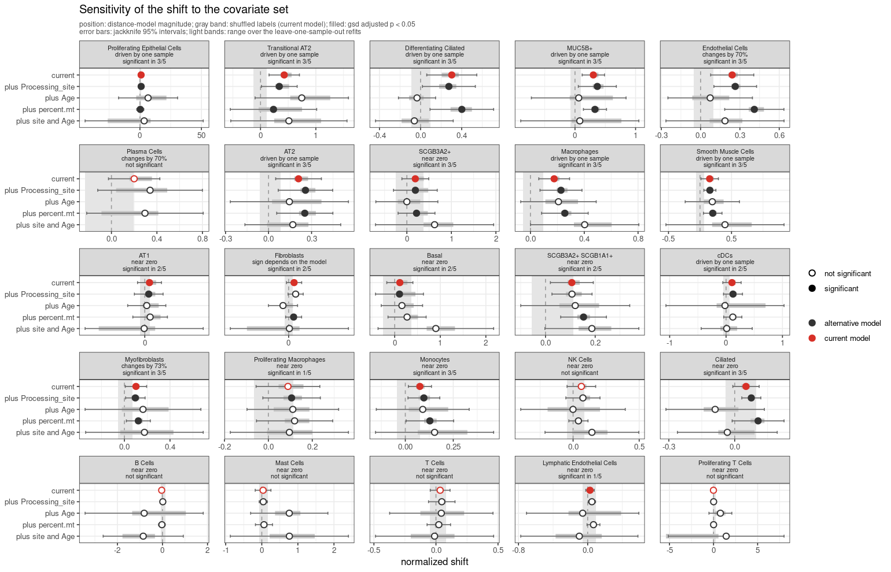<!-- -->

Each cell type gets two verdicts: the magnitude verdict compares the distance-model estimates across the models and
checks single samples (a shift within the noise band of shuffled labels is "near zero"); the significance verdict
counts the models in which the gene-level test, refitted under each model, calls the shift (filled points). The current
model calls 18 of the 25 cell types with a magnitude. Adjusting for the site keeps that picture: 16 cell types stay
significant (the fibroblasts, `SCGB3A2+ SCGB1A1+` and the lymphatic endothelium drop out, the proliferating macrophages
come in), and the estimates stay similar (the site structure is removed from the within-arm distances). Adjusting for
the mitochondrial fraction keeps 14 significant (AT1, the basal cells, cDCs and the lymphatic endothelium drop out) and
moves some sizes: it roughly halves the transitional AT2 shift (0.43 to
0.23), lowers the proliferating epithelial shift to about a third (0.96 to 0.29) and raises those of the endothelium and the differentiating ciliated cells to
about 0.4. Adjusting for the age leaves no cell type significant and makes the estimates erratic (transitional AT2 from
0.43 to 0.75, the differentiating ciliated and `MUC5B+` cells to about zero). This is not evidence that the IPF effect
is an age effect; with an association of 0.89, "IPF at equal age" is estimated from almost no information (the oldest
controls against the youngest patients), and the age-adjusted models say only that the two cannot be separated in this
design. The magnitude verdicts name the single samples that set the size of several shifts: `VUILD59` (proliferating
epithelial cells, macrophages), `VUHD66` (transitional AT2, cDCs), `THD0005` (AT2, smooth muscle), `VUHD65` and `VUHD70`
(differentiating ciliated and `MUC5B+` cells); many of the smaller shifts lie within the noise band.

## Composition

The compositional analysis tests the same contrast on the cell-type proportions (log-ratios, presented against a
reference set of cell types that do not change relative to each other).

``` r
cao$estimateCellLoadings()
cao$plotCellLoadings(center = "both")
```

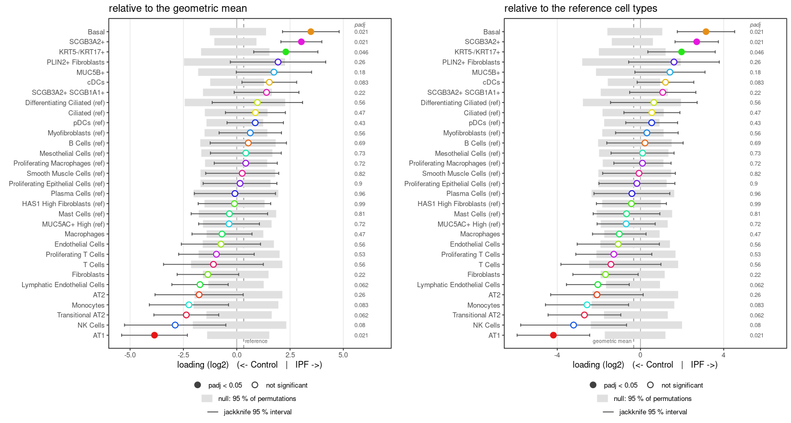<!-- -->

Four populations change significantly, all epithelial: the basal cells, the `SCGB3A2+` secretory cells and the
aberrant basaloid `KRT5-/KRT17+` cells expand in IPF, the AT1 cells contract (adjusted p 0.021-0.046). This is the
picture of the paper and of the preprint: loss of the alveolar epithelium and expansion of a bronchiolized, partly
aberrant epithelium. The next in line (transitional AT2 cells and the lymphatic endothelium 0.062, NK cells 0.08,
monocytes 0.083, all lower in IPF; cDCs 0.083 higher) have the direction reported in the preprint but do not pass
the adjustment. Centered on the reference block (right panel), which lies 0.3 log2 above the geometric mean here, the
picture is the same; the filled points are the reference-free test in both panels.

The reference set is the largest block of cell types whose proportions do not change relative to each other (pairwise
permutation tests of the loading differences): here thirteen populations, the ciliated, differentiating ciliated and
proliferating epithelial cells, the `MUC5AC+ High` cells, the mesothelium, the myofibroblasts, the smooth muscle, the
`HAS1 High` fibroblasts, B and plasma cells, pDCs, mast cells and proliferating macrophages, whose loadings lie between
-0.4 and 1.0 log2 relative to the geometric mean. With 31 populations and the spread of this
cohort the block is not sharply defined (a different permutation draw can pick a smaller central block); the test
relative to the geometric mean of all cell types remains the primary one.

``` r
cao$plotContrastTree()
```

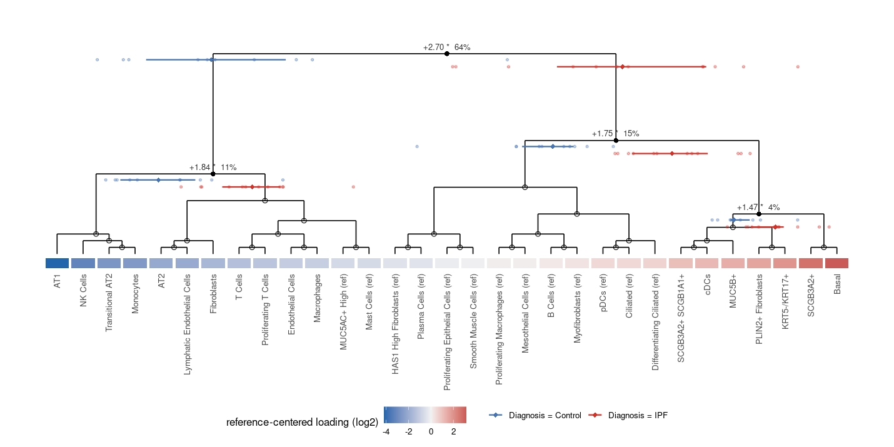<!-- -->

The contrast tree explains the compositional shift with as few balances as possible: each node compares the
geometric-mean proportions of its two sides between the conditions (the log2 ratio, the significance code of its
permutation p-value and the share of the shift it explains); the samples' own ratios are shown at the significant nodes,
and the tiles are the reference-centered loadings. The root balance sets the alveolar, immune and vascular populations,
the fibroblasts and the `MUC5AC+ High` cells (13) against the bronchiolar epithelium, the dendritic, mesothelial,
smooth-muscle and remaining fibroblast populations, B and plasma cells and the proliferating macrophages (18): a log2
ratio of 2.7 with 64 % of the shift (adjusted p 0.02). Below it, the aberrant basaloid, basal, `SCGB3A2+`,
`SCGB3A2+ SCGB1A1+`, `MUC5B+`, cDC and `PLIN2+` fibroblast populations against the rest of that side (1.75, 0.02, 15 %)
and the AT1 cells, NK cells, transitional AT2 cells and monocytes against the other populations of their side (1.84,
0.045, 11 %); three balances explain 90 % of the shift. A fourth significant balance sets the basal and `SCGB3A2+` cells
against the other five populations of their group (1.47, 0.02, 4 %).

``` r
cao$plotCodaCellTypes(value = "predicted")
```

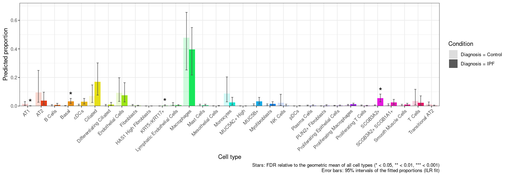<!-- -->

The model-predicted proportions at the two conditions do not depend on the reference set (the stars are the per-type
test relative to the geometric mean, the error bars 95 % intervals of the fitted proportions): AT1 cells go from 1.4 % of the cells in the controls to 0.1 % in IPF, AT2 cells
from 10 % to 4 %, monocytes from 9 % to 2.5 % and macrophages from 48 % to 40 %, while ciliated cells go from 7 % to
17 %, basal cells from 0.2 % to 3.3 %, `SCGB3A2+` cells from 0.5 % to 5.5 % and `MUC5B+` cells from 0.7 % to 3.2 %.

The same check for the composition: the loadings refitted under alternative covariate sets, with jackknife intervals
from leaving out each sample.

``` r
cao$checkSensitivity(analysis = "composition", covariate.sets = list(current = ~ Diagnosis, "plus Processing_site" = ~ Diagnosis + Processing_site,
                                           "plus Age" = ~ Diagnosis + Age, "plus percent.mt" = ~ Diagnosis + percent.mt),
                     n.permutations = 199)
```

    Sensitivity of 'Diagnosis: IPF vs Control' (loading) across 4 models: current [~Diagnosis]; plus Processing_site [~Diagnosis + Processing_site]; plus Age [~Diagnosis + Age]; plus percent.mt [~Diagnosis + percent.mt]
      magnitude: loading (log2, relative to the geometric mean); significance: permutation test (vs the geometric mean) (adjusted p < 0.05)
      AT1                            magnitude stable; significant in 3 of 4 models (not with: plus Age)
      Basal                          magnitude stable; significant in 3 of 4 models (not with: plus Age)
      SCGB3A2+                       magnitude stable; significant in 3 of 4 models (not with: plus Age)
      NK Cells                       magnitude driven by sample VUILD63; not significant in any of 4 models
      Transitional AT2               magnitude estimate changes by 56% (plus Age); significant in 1 of 4 models (only with: plus percent.mt)
      KRT5-/KRT17+                   magnitude driven by sample VUILD64; significant in 2 of 4 models (not with: plus Age, plus percent.mt)
      Monocytes                      magnitude estimate changes by 55% (plus Age); not significant in any of 4 models
      PLIN2+ Fibroblasts             magnitude near zero (within the relabeling band); not significant in any of 4 models
      AT2                            magnitude near zero (within the relabeling band); not significant in any of 4 models
      MUC5B+                         magnitude driven by sample VUHD071; not significant in any of 4 models
      Lymphatic Endothelial Cells    magnitude driven by sample VUHD071; not significant in any of 4 models
      cDCs                           magnitude driven by sample VUHD65; not significant in any of 4 models
      SCGB3A2+ SCGB1A1+              magnitude near zero (within the relabeling band); not significant in any of 4 models
      Fibroblasts                    magnitude near zero (within the relabeling band); not significant in any of 4 models
      T Cells                        magnitude near zero (within the relabeling band); not significant in any of 4 models
      Differentiating Ciliated       magnitude near zero (within the relabeling band); not significant in any of 4 models
      Proliferating T Cells          magnitude near zero (within the relabeling band); not significant in any of 4 models
      Ciliated                       magnitude near zero (within the relabeling band); not significant in any of 4 models
      pDCs                           magnitude near zero (within the relabeling band); not significant in any of 4 models
      Endothelial Cells              magnitude near zero (within the relabeling band); not significant in any of 4 models
      Macrophages                    magnitude near zero (within the relabeling band); not significant in any of 4 models
      Myofibroblasts                 magnitude near zero (within the relabeling band); not significant in any of 4 models
      B Cells                        magnitude near zero (within the relabeling band); not significant in any of 4 models
      Mesothelial Cells              magnitude near zero (within the relabeling band); not significant in any of 4 models
      Proliferating Macrophages      magnitude near zero (within the relabeling band); not significant in any of 4 models
      MUC5AC+ High                   magnitude near zero (within the relabeling band); not significant in any of 4 models
      Mast Cells                     magnitude near zero (within the relabeling band); not significant in any of 4 models
      Smooth Muscle Cells            magnitude near zero (within the relabeling band); not significant in any of 4 models
      Proliferating Epithelial Cells magnitude near zero (within the relabeling band); not significant in any of 4 models
      HAS1 High Fibroblasts          magnitude near zero (within the relabeling band); not significant in any of 4 models
      Plasma Cells                   magnitude near zero (within the relabeling band); not significant in any of 4 models

``` r
cao$plotSensitivity(analysis = "composition")
```

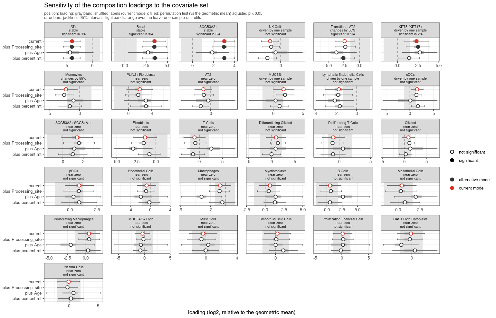<!-- -->

AT1, basal and `SCGB3A2+` cells are significant under the current model and when the site or the mitochondrial
fraction is added; the age adjustment removes their significance and widens the jackknife intervals of all cell types
(1.3 to 4.4 times, median 2.2), for the reason given above (the age effect is estimated almost entirely from the
diagnosis). The `KRT5-/KRT17+` loading is set by one sample (`VUILD64`) and loses its significance with the
mitochondrial fraction (2.3 to 1.4 log2, adjusted p 0.12); the transitional AT2 cells pass the threshold only with the
mitochondrial fraction (adjusted p 0.039), and the transitional AT2 and monocyte loadings change by more than half with
the age. With the site or the mitochondrial fraction added, every loading stays within the jackknife 95 % interval of
the current model.

## Differential expression per cell type

Pseudobulk differential expression with limma-voom on the same model; positive fold changes are higher in IPF.

``` r
de <- cao$estimateDEPerCellType(test = "limma-voom")
head(de[["Transitional AT2"]]$res[, c("Gene", "log2FoldChange", "pvalue", "padj", "CellFrac")], 10)
```

             Gene log2FoldChange       pvalue         padj   CellFrac
    PDLIM3 PDLIM3       4.352740 5.300025e-08 0.0005326525 0.17089844
    SCG5     SCG5       3.702606 2.448145e-07 0.0012301931 0.09765625
    CRIP2   CRIP2       2.958265 6.177316e-07 0.0020694009 0.62597656
    DKK3     DKK3       4.679848 1.079082e-06 0.0020851928 0.14160156
    SPOCK2 SPOCK2       3.826654 1.109518e-06 0.0020851928 0.13085938
    LGALS1 LGALS1       3.945919 1.244891e-06 0.0020851928 0.41113281
    SEPW1   SEPW1       1.963667 1.465071e-06 0.0021034228 0.93261719
    NXN       NXN       1.928795 1.695562e-06 0.0021300492 0.25195312
    RPS2     RPS2      -1.153300 2.170838e-06 0.0021555369 0.98730469
    NDNF     NDNF       2.241398 2.328934e-06 0.0021555369 0.55078125

``` r
cao$plotNumberOfDEGenes()
```

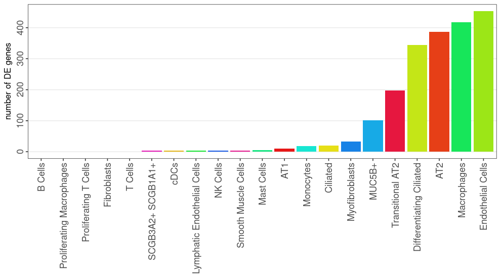<!-- -->

``` r
cao$plotVolcano(cell.types = "Transitional AT2")
```

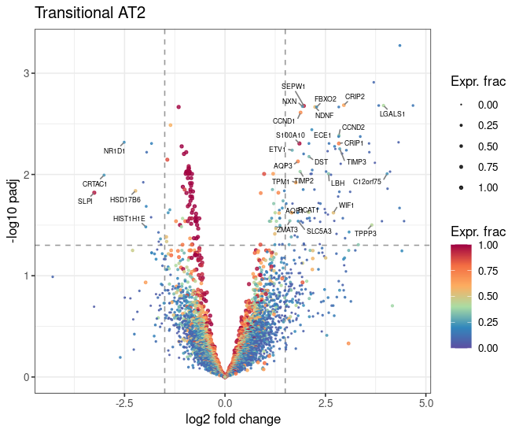<!-- -->

The endothelial cells, macrophages, AT2 and differentiating ciliated cells have the most DE genes (about 350-450 at
FDR 5%), followed by the transitional AT2 cells (about 200) and `MUC5B+` (about 100): the group of significant
expression shifts, with the macrophages promoted. The populations with a small shift have a handful of DE genes or none
(fibroblasts, cDCs, mast cells, B cells). Nine of the ten top transitional AT2 genes are higher in IPF; they include matrix and
cytoskeletal genes (`SPOCK2`, `PDLIM3`, `CRIP2`, `LGALS1`; `TIMP3` further down), in line with the profibrotic transitional state
the paper describes; the genes with the largest fold changes (`DKK3`, `PDLIM3`, log2 fold change 4.7 and 4.4) are detected in only 14-17 %
of the cells.

## Functional interpretation

Gene set enrichment (GSEA over the GO categories) on the per-cell-type DE statistics: the genes of every tested cell
type are ranked by their signed DE z-score and tested against the GO terms with `fgsea`. The collapsed heatmaps
group the enriched biological-process terms into clusters named by their most frequent words (generic words
excluded; the number before a label is the number of terms in the cluster), one column per cell type, separately for
the terms up and down in IPF; the dot plot lists the top terms of one cell type. The chunks run only when `clusterProfiler`, `DOSE`, `enrichplot`, `fgsea` and `org.Hs.eg.db` are
installed (`gsea.available` in the setup chunk); the run is seeded on one core so that the figures are reproducible.

``` r
cao$estimateOntology(type = "GSEA", org.db = org.Hs.eg.db::org.Hs.eg.db, seed = TRUE, n.cores = 1)
```

``` r
cao$plotOntologyHeatmapCollapsed(name = "GSEA", genes = "up", n = 25, clust.method = "ward.D",
                                 exclude.words = c("regulation", "process", "cell", "cellular", "positive", "negative"))
```

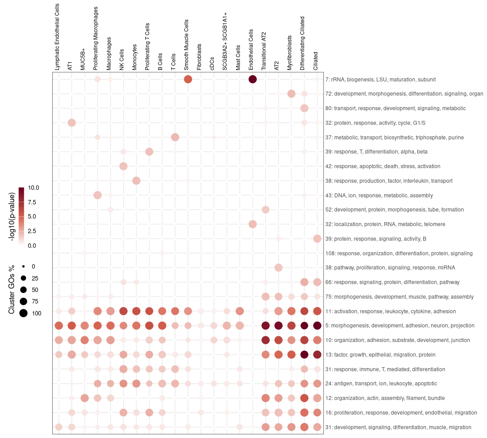<!-- -->

``` r
cao$plotOntologyHeatmapCollapsed(name = "GSEA", genes = "down", n = 25, clust.method = "ward.D",
                                 exclude.words = c("regulation", "process", "cell", "cellular", "positive", "negative"))
```

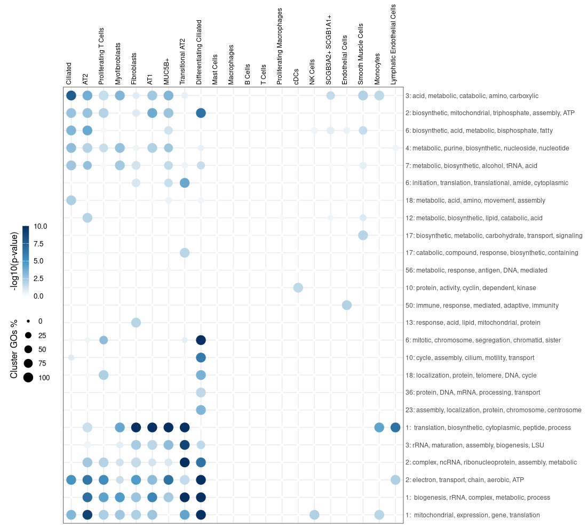<!-- -->

``` r
cao$plotOntology(cell.type = "Transitional AT2", name = "GSEA", genes = "up", n = 15)
```

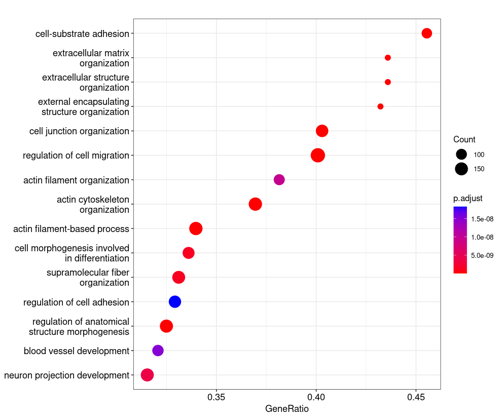<!-- -->

The terms up in IPF are shared across the epithelium and the myofibroblasts: cell adhesion and cell-substrate
adhesion, cell migration, actin cytoskeleton and extracellular-matrix organization, wound healing, strongest in the
differentiating ciliated, ciliated, transitional AT2 and AT2 cells and the myofibroblasts, weaker in AT1, `MUC5B+`, the
smooth muscle, the myeloid cells and the lymphatic endothelium, nearly absent in the fibroblasts; the lymphoid populations
show immune-activation and cytokine terms. The findings of the preprint are recovered where the cell type is
testable: extracellular-matrix organization is up in AT2 (NES 2.1) and is among the top terms of the transitional
AT2 cells (NES 2.5); the epithelial-cell apoptotic process is up in AT1, AT2 and transitional AT2 (NES 1.7-2.1,
adjusted p 0.0004-0.02); the inflammatory side is up in AT2 (type I interferon and cytokine signaling, adjusted p
0.002-0.03) and in AT1 (cytokine signaling, adjusted p 0.0004; type I interferon production just above the threshold,
0.055-0.067).
Of the inflammatory terms reported as down in `MUC5B+`, the humoral and antimicrobial immune responses are down here
(adjusted p 0.01-0.04), and `SCGB3A2+` and `KRT5-/KRT17+` have too few control samples for
the DE. The terms down in IPF are translation, ribosome biogenesis and oxidative phosphorylation in about half of the
populations (the epithelium, fibroblasts, myofibroblasts, monocytes, lymphatic endothelium; not the macrophages,
B and T cells, mast cells or cDCs), and, the other way round, up in the endothelium and smooth muscle: a ribosomal and mitochondrial gene signature shared by
unrelated cell types, more likely a sample-level technical difference (the sites differ in sequencing saturation and
mitochondrial fraction) than cell-type biology. Two caveats: GSEA ranks all genes, so cell types without a single
DE gene (B and T cells, proliferating T cells and macrophages, fibroblasts) still return hundreds of terms, driven by co-regulated gene
families; and the cluster names of the collapsed heatmaps are word lists, the full term names are in the dot plots.

## Cluster-free analyses

The two cluster-free maps ask the composition and the expression question in neighborhoods of the cell graph instead of
in the annotated cell types, so that a change confined to part of a type, or spread across types, is found where it is.
A neighborhood is a diffusion neighborhood: the cells a heat kernel on the graph reaches from a cell, with the kernel
strength set so that a typical neighborhood covers a given share of the cells (`scale`). The default `scale = "auto"`
runs a scan over 1, 3 and 10 % of the cells (1, 3 and 5 % for the expression-shift map, whose neighborhoods at 10 % would take in the halo around a changed population) under the same relabelings, picks the scale whose own map calls the most
cells (the finest one when a scale calls nearly every cell), and reports the map at that scale alone, so that the q-values and effects of the map belong to one neighborhood
size; one value tests a single scale, and a vector reports the scan itself. Cells are adjusted by the pooled permutation
false-discovery rate (the number of cells beyond a threshold under the relabelings, pooled over all cells, against the
observed number), and the adjusted z-score of a cell is the tail z of its q-value. The chunks print the scales tried and
the one chosen, and the annotated embedding is drawn next to each map so that the populations can be followed. The thin black
lines outline the regions where the cells significant at an adjusted p of 0.05 are the majority.

### Cluster-free density shifts

The density map tests, in every neighborhood, whether the arms differ in how many of their cells fall there: each
sample's kernel density is tested on the log scale with the same model. The panels show the annotation, the effect (the
log2 fold change of the density) and the adjusted z-scores.

``` r
cao$estimateCellDensity(method = "graph")
```

    kNN neighborhoods of at least 220 cells (10.0 per sample)

``` r
cao$estimateDiffCellDensity()
```

    diffusion neighborhoods at 1 %, 3 %, 5 % of the cells (auto: one scale is chosen)

    scale 0.01: heat kernel beta 55

    scale 0.03: heat kernel beta 84.9

    scale 0.05: heat kernel beta 131

    0 of 89326 cells at FDR 10 % (scale 1 % chosen)

``` r
cowplot::plot_grid(cao$plotEmbedding(color.by = "cell.groups", title = "cell type"),
                   cao$plotDiffCellDensity(what = "effect", title = "density change (log2 FC)", outline = TRUE),
                   cao$plotDiffCellDensity(title = "adjusted z", outline = TRUE), ncol = 3)
```

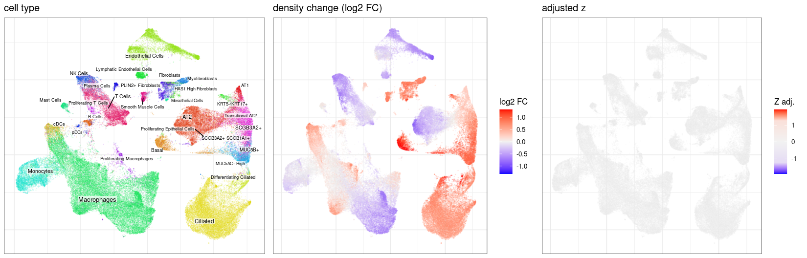<!-- -->

The scan picks the 1 % scale (neighborhoods of about 900 cells) and no cell passes FDR 10 % at any of the three
scales, although the composition analysis calls the basal, `SCGB3A2+`, `KRT5-/KRT17+` and AT1 changes clearly. The map
points the right way (the basal cells are the strongest region, median log2 fold change 1.2, followed by the
mesothelial, `MUC5AC+ High` and `MUC5B+` cells at about 1.0; per type the permutation test gives mesothelial 0.004,
basal and `MUC5AC+ High` 0.006, `MUC5B+` 0.008, adjusted 0.06), but the per-cell effects are far below the compositional fold changes and no cell
reaches the threshold. The reason is the graph, not the test (`pf_density_diagnosis.md`): the Conos graph consists of
links between lungs, and a population that a lung lacks is linked to that lung through other cell types, so the kernel
that defines a neighborhood spreads out of the IPF-emergent populations (a basal cell's neighborhood keeps two thirds of
its weight on basal cells, an AT1 cell's a fifth) and every sample seems to contribute cells to every region. The
one-hop kNN neighborhoods on the same graph (`scale = NULL`) call 4,599 cells, 82 % of the basal cells among them, and on
a Harmony-aligned graph of the same cells (`pf_cacoa_harmony.Rmd`) the kernel map calls 11,452 cells with the basal,
`KRT5-/KRT17+` and `SCGB3A2+` populations leading. The cohorts of the other notebooks, whose populations are present in
every sample, are not affected.

### Cluster-free expression shifts

The expression map tests the contrast in each neighborhood with the per-gene statistic of the per-type test
(`statistic = "gsd"`: the contrast of each gene over its standard error, combined adaptively over the genes detected in
at least 5 % of the neighborhood's cells), on neighborhoods of the scale's size around centers that cover the graph (the message gives their number and size);
each cell averages the tested neighborhoods that contain it. The shift panel shows the size of the change (the mean
squared gene z-score of the neighborhood, about 1 without a change) and the right panel the adjusted z-scores, one-sided
(0 means not significant).

``` r
cao$estimateClusterFreeExpressionShifts(n.permutations = 499)
```

    14640 genes (per neighborhood: those detected in >= 5 % of its cells)

    diffusion neighborhoods at 1 %, 3 %, 5 % of the cells (auto: one scale is chosen), at least 220 cells each (10.0 per sample)

    scale 0.01: heat kernel beta 55, 2157 centers, neighborhoods of 895 cells (median, 319 smallest)

    scale 0.03: heat kernel beta 84.9, 300 centers, neighborhoods of 2690 cells (median, 1072 smallest)

    scale 0.05: heat kernel beta 131, 129 centers, neighborhoods of 4488 cells (median, 1771 smallest)

    80509 of 89326 cells keep adjusted z >= 1.28 (scale 3 % chosen)

``` r
cao$plotClusterFreeExpressionShifts(adjusted = TRUE, font.size = c(2, 3), outline = TRUE)
```

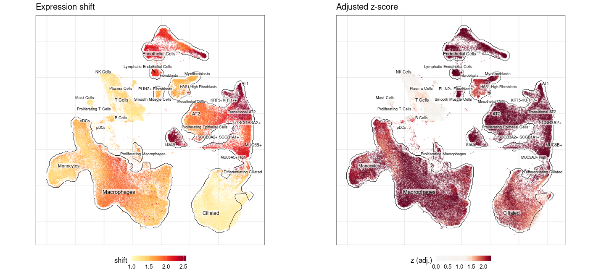<!-- -->

The scan picks the 3 % scale (300 neighborhoods of about 2,700 cells). The cluster-free view agrees with the
cluster-based one and extends it: 25 of the 31 types are significant in the per-type summary, and in all but two
of them (ciliated cells and pDCs) at least 95 % of the cells pass FDR 5 % (86 % of all cells). The strongest shifts (median effect 2.2-2.8)
are in `AT1`, the IPF-expanded `KRT5-/KRT17+` cells (which could not be tested per cell type, having one control
sample), `Basal`, transitional AT2, `SCGB3A2+`, `MUC5AC+ High`, `MUC5B+` and the endothelial cells; the disease-
associated fibroblast states (`PLIN2+`, `HAS1 High`), also untestable per cell type, are shifted as well (1.6). The
lymphocytes (T, NK, B and plasma cells), the proliferating T cells and the mast cells are not significant (median
1.3; 2-35 % of their cells called), the pDCs just are (58 % called), and the ciliated cells have the smallest shift
among the significant types (1.16, 83 % called). Every cell is tested.

Both maps are summarized per cell type by an exact group-level permutation test: the mean per-cell statistic of the type
is compared with the same mean under the relabelings shared by all cells, so the dependence between neighboring cells is
carried along, and the result is adjusted across types. The labels give the share of the type's cells called at FDR 5 %.

``` r
cao$estimateClusterFreeSummary("cell.density")
cao$estimateClusterFreeSummary("cluster.free.expr.shifts")
cowplot::plot_grid(cao$plotClusterFreeSummary("cell.density"), cao$plotClusterFreeSummary("cluster.free.expr.shifts"), ncol = 2)
```

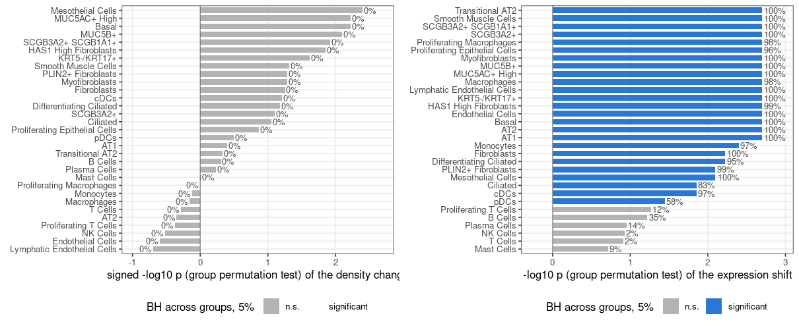<!-- -->

## Summary

- IPF lung differs from control lung in expression in 19 of the 28 testable populations, most in the epithelium
  (proliferating epithelial and `MUC5B+` secretory cells, transitional AT2, differentiating ciliated cells, AT2) and the
  endothelium, less in the stromal and myeloid populations, not in the lymphocytes; the pseudobulk DE counts give about
  the same group (with the macrophages promoted).
- The composition shows the expansion of the basal, secretory and aberrant basaloid epithelium and the loss of AT1
  cells (transitional AT2 just short of significance), as in the paper. The cluster-free expression map confirms most of the expression result with a different ranking (strongest in AT1,
basal, transitional AT2, `SCGB3A2+` and the secretory cells) and adds the aberrant basaloid epithelium
(`KRT5-/KRT17+`), which cannot be tested per cell type because it has almost no control cells; the density map calls no cell at FDR 10 % on the Conos graph, whose alignment joins the IPF-emergent populations to other types in the lungs lacking them (`pf_density_diagnosis.md`); on the nearest-neighbor units and on a Harmony-aligned graph it calls the basal, `KRT5-/KRT17+` and `SCGB3A2+` cells.
- The GSEA recovers the preprint's epithelial findings (matrix organization, epithelial apoptosis and interferon /
  cytokine signaling up in the alveolar epithelium) and adds a ribosomal / mitochondrial signature shared by about half
  of the cell types, which looks technical.
- The processing site is the strongest covariate in the expression data (the largest unique fraction of the
  between-sample variation in most cell types, visible in the sample maps) but it is balanced between the arms, and
  adjusting for it leaves the estimates and the significant cell types about the same (16 instead of 18). The technical summaries follow the site (mitochondrial fraction, sequencing
  saturation) and are equally harmless.
- The age is aliased with the diagnosis (controls are young donors, IPF patients are 54-74): it cannot be adjusted
  for, and the age-adjusted models of the sensitivity analysis, with no significant cell type and erratic estimates, say
  so rather than contradicting the main result.
- The effects rest on few samples in several cell types: `VUILD59`, `VUHD66` and `THD0005` set the size of several shifts,
  and the smallest populations (6-7 samples) have raised p-value floors.

## Session info

``` r
sessionInfo()
```

    R version 4.2.2 Patched (2022-11-10 r83330)
    Platform: x86_64-pc-linux-gnu (64-bit)
    Running under: Ubuntu 20.04.6 LTS

    Matrix products: default
    BLAS:   /usr/lib/x86_64-linux-gnu/blas/libblas.so.3.9.0
    LAPACK: /usr/lib/x86_64-linux-gnu/lapack/liblapack.so.3.9.0

    locale:
     [1] LC_CTYPE=en_US.UTF-8       LC_NUMERIC=C              
     [3] LC_TIME=en_US.UTF-8        LC_COLLATE=en_US.UTF-8    
     [5] LC_MONETARY=en_US.UTF-8    LC_MESSAGES=en_US.UTF-8   
     [7] LC_PAPER=en_US.UTF-8       LC_NAME=C                 
     [9] LC_ADDRESS=C               LC_TELEPHONE=C            
    [11] LC_MEASUREMENT=en_US.UTF-8 LC_IDENTIFICATION=C       

    attached base packages:
    [1] stats     graphics  grDevices utils     datasets  methods   base     

    other attached packages:
    [1] dplyr_1.1.4    ggplot2_4.0.2  cacoa_0.5.0    Matrix_1.6-1.1

    loaded via a namespace (and not attached):
      [1] N2R_1.0.4                   uuid_1.2-1                 
      [3] shadowtext_0.1.6            circlize_0.4.16            
      [5] fastmatch_1.1-6             systemfonts_1.3.2          
      [7] plyr_1.8.9                  igraph_2.1.4               
      [9] lazyeval_0.2.2              splines_4.2.2              
     [11] BiocParallel_1.32.6         GenomeInfoDb_1.34.9        
     [13] urltools_1.7.3              digest_0.6.37              
     [15] foreach_1.5.2               yulab.utils_0.2.5          
     [17] htmltools_0.5.8.1           GOSemSim_2.24.0            
     [19] viridis_0.6.4               GO.db_3.16.0               
     [21] RMTstat_0.3.1               magrittr_2.0.3             
     [23] memoise_2.0.1               cluster_2.1.4              
     [25] doParallel_1.0.17           tzdb_0.5.0                 
     [27] annotate_1.76.0             readr_2.1.5                
     [29] ComplexHeatmap_2.14.0       Biostrings_2.66.0          
     [31] graphlayouts_1.2.2          matrixStats_1.5.0          
     [33] vroom_1.6.5                 R.utils_2.12.2             
     [35] sccore_1.0.6                enrichplot_1.18.4          
     [37] colorspace_2.1-0            blob_1.2.4                 
     [39] rappdirs_0.3.3              ggrepel_0.9.6              
     [41] pagoda2_1.0.11              xfun_0.53                  
     [43] crayon_1.5.2                RCurl_1.98-1.12            
     [45] jsonlite_2.0.0              scatterpie_0.2.5           
     [47] brew_1.0-10                 iterators_1.0.14           
     [49] ape_5.8-1                   glue_1.8.0                 
     [51] polyclip_1.10-7             gtable_0.3.6               
     [53] zlibbioc_1.44.0             XVector_0.38.0             
     [55] DelayedArray_0.24.0         GetoptLong_1.0.5           
     [57] leidenAlg_1.1.5             Rook_1.2                   
     [59] shape_1.4.6.1               BiocGenerics_0.44.0        
     [61] abind_1.4-8                 scales_1.4.0               
     [63] DOSE_3.24.2                 DBI_1.1.3                  
     [65] Rcpp_1.1.0                  coda.base_1.0.3            
     [67] xtable_1.8-4                viridisLite_0.4.2          
     [69] clue_0.3-65                 gridGraphics_0.5-1         
     [71] tidytree_0.4.6              bit_4.6.0                  
     [73] stats4_4.2.2                htmlwidgets_1.6.4          
     [75] httr_1.4.7                  fgsea_1.24.0               
     [77] RColorBrewer_1.1-3          XML_3.99-0.14              
     [79] pkgconfig_2.0.3             R.methodsS3_1.8.2          
     [81] farver_2.1.2                locfit_1.5-9.8             
     [83] labeling_0.4.3              ggplotify_0.1.2            
     [85] tidyselect_1.2.1            rlang_1.1.7                
     [87] reshape2_1.4.4              AnnotationDbi_1.60.2       
     [89] pbmcapply_1.5.1             tools_4.2.2                
     [91] cachem_1.1.0                downloader_0.4.1           
     [93] cli_3.6.5                   generics_0.1.4             
     [95] RSQLite_2.3.1               gson_0.1.0                 
     [97] evaluate_1.0.5              stringr_1.5.1              
     [99] fastmap_1.2.0               yaml_2.3.10                
    [101] ggtree_3.6.2                org.Hs.eg.db_3.16.0        
    [103] knitr_1.50                  bit64_4.6.0-1              
    [105] fs_1.6.6                    tidygraph_1.3.1            
    [107] purrr_1.1.0                 KEGGREST_1.38.0            
    [109] ggraph_2.2.2                nlme_3.1-161               
    [111] R.oo_1.25.0                 ggiraph_0.9.0              
    [113] aplot_0.2.8                 compiler_4.2.2             
    [115] png_0.1-8                   treeio_1.22.0              
    [117] geneplotter_1.76.0          tibble_3.3.0               
    [119] tweenr_2.0.3                stringi_1.8.7              
    [121] drat_0.2.3                  lattice_0.20-45            
    [123] psych_2.5.6                 vctrs_0.6.5                
    [125] pillar_1.11.0               lifecycle_1.0.4            
    [127] triebeard_0.4.1             GlobalOptions_0.1.2        
    [129] irlba_2.3.5.1               data.table_1.17.8          
    [131] cowplot_1.2.0               bitops_1.0-9               
    [133] GenomicRanges_1.50.2        patchwork_1.3.2            
    [135] conos_1.5.4                 qvalue_2.30.0              
    [137] R6_2.6.1                    gridExtra_2.3              
    [139] IRanges_2.32.0              codetools_0.2-18           
    [141] MASS_7.3-58                 SummarizedExperiment_1.28.0
    [143] DESeq2_1.38.3               rjson_0.2.21               
    [145] withr_3.0.2                 mnormt_2.1.1               
    [147] S4Vectors_0.36.2            GenomeInfoDbData_1.2.9     
    [149] hms_1.1.3                   mgcv_1.8-41                
    [151] parallel_4.2.2              clusterProfiler_4.6.2      
    [153] grid_4.2.2                  ggfun_0.2.0                
    [155] tidyr_1.3.1                 HDO.db_0.99.1              
    [157] rmarkdown_2.29              MatrixGenerics_1.10.0      
    [159] dendsort_0.3.4              S7_0.2.0                   
    [161] Rtsne_0.17                  ggforce_0.5.0              
    [163] Biobase_2.58.0             

