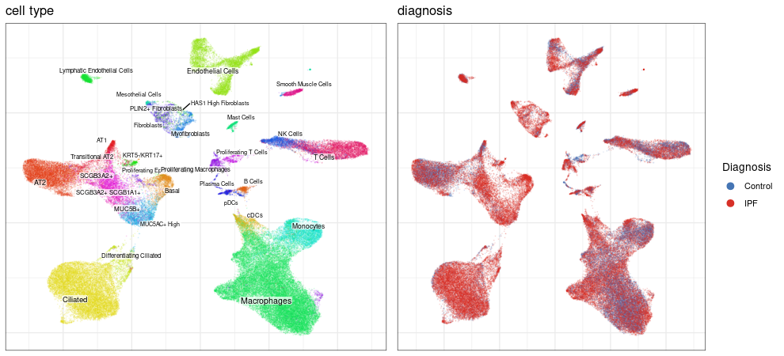
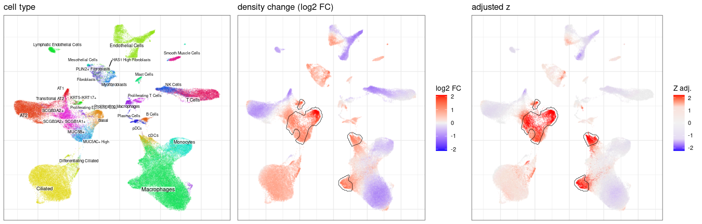
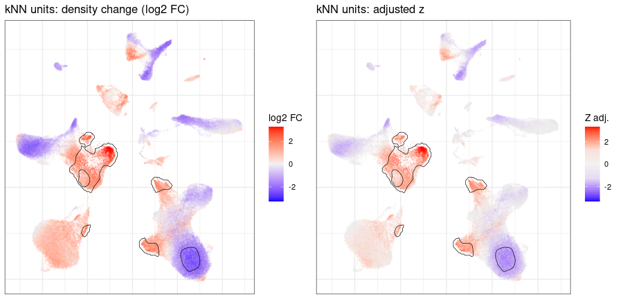
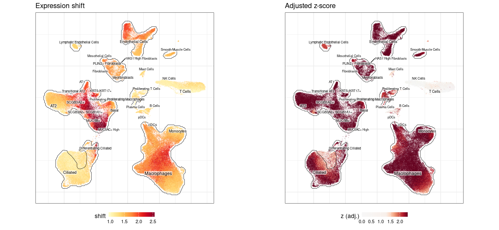
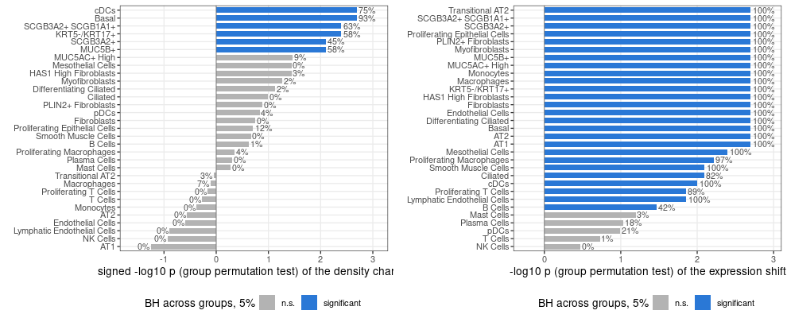

Cacoa on the pulmonary fibrosis dataset: the cluster-free maps on a
Harmony-aligned graph
================
Cacoa developers
2026-11-15

- <a href="#load-data" id="toc-load-data">Load data</a>
- <a href="#cluster-free-density-shifts"
  id="toc-cluster-free-density-shifts">Cluster-free density shifts</a>
- <a href="#cluster-free-expression-shifts"
  id="toc-cluster-free-expression-shifts">Cluster-free expression
  shifts</a>
- <a href="#session-info" id="toc-session-info">Session info</a>

This notebook is a companion of `pf_cacoa.Rmd`. The main notebook runs
on the Conos object of the Cacoa preprint, whose graph is the
mutual-nearest-neighbor alignment of the 22 lungs, and its cluster-free
density map calls no cell at FDR 10 % although the composition analysis
calls the basal cells, the `SCGB3A2+` cells, the aberrant basaloid
`KRT5-/KRT17+` cells and the AT1 cells clearly.
`pf_density_diagnosis.md` traces that to the alignment: the Conos graph
consists almost entirely of cross-sample edges, and a population that a
sample lacks is matched to that sample’s closest other population, so
the heat kernel of the density map leaks out of the IPF-emergent
populations (an AT1 cell’s kernel keeps a fifth of its mass on AT1
cells). Here the same cells, counts and annotation are placed on a kNN
graph of a Harmony embedding (`prepare_pf_harmony.R`: 2,000 variable
genes, 50 PCs, Harmony by sample, 30 nearest neighbors on 30 Harmony
dimensions, UMAP on the same), and only the parts of the analysis that
depend on the graph are rerun: the cluster-free density and
expression-shift maps. The cell-type-level analyses (composition,
expression shifts, differential expression) use the counts and the
annotation alone and are the same as in the main notebook.

``` r
library(cacoa)
library(ggplot2)
library(dplyr)
```

## Load data

``` r
seu <- readRDS(params$data.file)
lib.meta <- readr::read_csv(params$lib.meta, show_col_types = FALSE, na = c("", "NA", "Unknown")) %>%
  filter(Diagnosis %in% c("Control", "IPF"))
cell.meta <- read.csv(params$cell.meta, row.names = 1) %>% filter(Diagnosis %in% c("Control", "IPF"))
sample.meta <- lib.meta %>%
  group_by(Sample_Name) %>%
  summarise(Diagnosis = first(Diagnosis), Processing_site = first(Processing_site), Chemistry = first(Chemistry),
            Gender = first(Gender), Age = as.integer(first(Age)), Tobacco = first(Tobacco), Flowcell_ID = first(Flowcell_ID),
            seq.saturation = mean(readr::parse_number(Sequencing_Saturation))) %>%
  left_join(cell.meta %>% group_by(Sample_Name) %>%
              summarise(Sample_Source = first(Sample_Source), n.cells = n(), median.umi = median(nCount_RNA), percent.mt = median(percent.mt)),
            by = "Sample_Name") %>%
  tibble::column_to_rownames("Sample_Name")
samples <- sort(unique(seu$sample))
sample.meta <- sample.meta[samples, c("Diagnosis", "Processing_site", "Sample_Source", "Chemistry", "Gender", "Age", "Tobacco",
                                     "Flowcell_ID", "n.cells", "median.umi", "percent.mt", "seq.saturation")]
table(sample.meta$Diagnosis)
```

    ## 
    ## Control     IPF 
    ##      10      12

``` r
cao <- Cacoa$new(seu, sample.metadata = sample.meta, sample.per.cell = factor(seu$sample), cell.groups = factor(seu$celltype),
                 embedding = seu@reductions$umap@cell.embeddings, graph.name = "RNA_nn", data.layer = "data", n.cores = params$n.cores)
```

    ## Sample metadata: 22 samples, 12 columns
    ##   usable (11): Diagnosis [Control 10, IPF 12], Processing_site [TGen 8, Vanderbilt 14], Sample_Source [DNA 3, NTI 5, Vanderbilt 14], Chemistry [3_prime_V2 1, 5_prime 21], Gender [F 7, M 14], Age [num, 17-74], Tobacco [N 7, Y 13], n.cells [num, 800-15142], ...
    ##   excluded from screening (1): Flowcell_ID (high-cardinality)
    ##   missing values: Gender (1), Age (1), Tobacco (2)

    ## Next: cao$checkDesign() and cao$screenCovariates(), or cao$setModel(test = "<variable>").

``` r
cao$setOptions(n.permutations = 499, seed = 1)
cao$plot.params <- list(size = 0.1, alpha = 0.1, font.size = c(2, 3))
cao$sample.groups.palette <- c(Control = "#4575b4", IPF = "#d73027")
```

The graph used is Seurat’s kNN graph on the Harmony embedding (`RNA_nn`,
symmetrized; the shared-neighbor graph `RNA_snn` has two components). It
differs from the Conos graph in one respect that matters for the maps:
31 % of its edge weight joins cells of the same sample (2 % on the Conos
graph), so a cell whose population is absent from the other samples is
linked to its own sample’s cells of that population instead of to other
populations elsewhere.

``` r
cowplot::plot_grid(cao$plotEmbedding(color.by = "cell.groups", title = "cell type"),
                   cao$plotEmbedding(color.by = "Diagnosis", title = "diagnosis", mark.groups = FALSE, show.legend = TRUE), ncol = 2)
```

<!-- -->

``` r
cao$setModel(~ Diagnosis, test = "Diagnosis")
```

    ## Model: ~Diagnosis      dispersion: ~Diagnosis
    ## Test: Diagnosis: IPF vs Control  (reference 'Control': matched a control-like name; to change: test = "Diagnosis: Control vs IPF")
    ##        unadjusted; permutations: block (646,646 distinct); 22 of 22 samples can change their value; smallest p-value 0.002
    ##        shift > 0: IPF samples differ from Control samples in a common direction, beyond within-group variability
    ## Samples: 22 used.   Issues: none

## Cluster-free density shifts

The same map as in the main notebook: the default diffusion
neighborhoods (`scale = "auto"`, a scan over 1, 3 and 5 % of the cells),
each sample’s kernel density tested on the log scale with the model,
cells adjusted by the pooled permutation false-discovery rate.

``` r
cao$estimateCellDensity(method = "graph")
```

    ## kNN neighborhoods of at least 220 cells (10.0 per sample)

``` r
cao$estimateDiffCellDensity()
```

    ## diffusion neighborhoods at 1 %, 3 %, 5 % of the cells (auto: one scale is chosen)

    ## scale 0.01: heat kernel beta 28.7

    ## scale 0.03: heat kernel beta 46.3

    ## scale 0.05: heat kernel beta 71.4

    ## 11452 of 89326 cells at FDR 10 % (scale 1 % chosen)

``` r
cowplot::plot_grid(cao$plotEmbedding(color.by = "cell.groups", title = "cell type"),
                   cao$plotDiffCellDensity(what = "effect", title = "density change (log2 FC)", outline = TRUE),
                   cao$plotDiffCellDensity(title = "adjusted z", outline = TRUE), ncol = 3)
```

<!-- -->

On this graph the scan picks the 1 % scale (neighborhoods of about 870
cells) and calls 11,452 cells (13 %) at FDR 10 %, where the Conos graph
called none. The calls are the populations the composition analysis
names: 96 % of the basal cells (log2 fold change 1.9), 79 % of the
`KRT5-/KRT17+` cells (1.4), 59 % of the `SCGB3A2+` cells (1.0), 84-86 %
of the `MUC5B+`, `SCGB3A2+ SCGB1A1+` and cDC populations (1.1-1.2), and
six types pass the per-type test (basal and cDCs 0.002, `KRT5-/KRT17+`
and `SCGB3A2+ SCGB1A1+` 0.004, `MUC5B+` and `SCGB3A2+` 0.008; adjusted
0.03-0.04). The losses show in the effect (AT1 -0.8, NK cells -0.9, AT2
-0.6, monocytes -0.3) but are not called at this scale: the AT1 cells
are 568 cells, fewer than a neighborhood holds, and their neighbors, the
transitional AT2 and `SCGB3A2+` cells, go the other way (6 % of the AT1
cells called, per-type p 0.056). The effects stay well below the
compositional fold changes (basal 4.2, `KRT5-/KRT17+` 4.2, AT1 -4.1): a
neighborhood of 870 cells around a cell of a 400-cell population is
mostly other cells, and the tail of the kernel adds more.

The kNN neighborhoods of the graph itself (`scale = NULL`: the stored
units of `estimateCellDensity()`, about 220 cells each) are the other
neighborhood definition available; they are one hop wide, so they cannot
leak the way a kernel can.

``` r
cao$estimateCellDensity(method = "graph", name = "cell.density.knn")
```

    ## kNN neighborhoods of at least 220 cells (10.0 per sample)

``` r
cao$estimateDiffCellDensity(name = "cell.density.knn", scale = NULL)
```

    ## 25886 of 89326 cells at FDR 10 %

``` r
cowplot::plot_grid(cao$plotDiffCellDensity(name = "cell.density.knn", what = "effect", title = "kNN units: density change (log2 FC)", outline = TRUE),
                   cao$plotDiffCellDensity(name = "cell.density.knn", title = "kNN units: adjusted z", outline = TRUE), ncol = 2)
```

<!-- -->

The kNN units resolve the small populations better: 25,886 cells (29 %)
at FDR 10 %, with the same leading types (basal 96 % at log2 2.8,
`KRT5-/KRT17+` 89 % at 2.3, `MUC5B+` 76 %, cDCs 81 %, `SCGB3A2+` 55 %)
and now the losses as well: 51 % of the AT1 cells (-1.5; per-type p
0.03), 24 % of the AT2 cells (-1.5), and parts of the macrophage (41 %,
-0.7) and endothelial (41 %, -0.8) populations, which the composition
does not call as types (fold changes -0.3 and -0.2) but which the units
see as local shifts within the types. The per-type test calls the same
six types (adjusted p 0.037-0.052). On the Conos graph the kNN units
called 4,599 cells and the kernel none (`pf_density_diagnosis.md`).

## Cluster-free expression shifts

``` r
cao$estimateClusterFreeExpressionShifts(n.permutations = 499)
```

    ## 14640 genes (per neighborhood: those detected in >= 5 % of its cells)

    ## diffusion neighborhoods at 1 %, 3 %, 5 % of the cells (auto: one scale is chosen), at least 220 cells each (10.0 per sample)

    ## scale 0.01: heat kernel beta 28.7, 353 centers, neighborhoods of 895 cells (median, 233 smallest)

    ## scale 0.03: heat kernel beta 46.3, 125 centers, neighborhoods of 2128 cells (median, 576 smallest)

    ## scale 0.05: heat kernel beta 71.4, 68 centers, neighborhoods of 3705 cells (median, 766 smallest)

    ## 80800 of 89326 cells keep adjusted z >= 1.28 (scale 3 % chosen)

``` r
cao$plotClusterFreeExpressionShifts(adjusted = TRUE, font.size = c(2, 3), outline = TRUE)
```

<!-- -->

The expression-shift map depends much less on the graph: its
neighborhoods are large (the scan picks the 3 % scale, as on the Conos
graph: 125 neighborhoods of about 2,100 cells here, 300 of about 2,700
there) and the test is on expression, which the alignment does not
change. 87 % of the cells pass FDR 5 % (86 % on the Conos graph) and 26
of the 31 types are significant (25 there; the B cells and the
proliferating T cells are significant here and not there, the pDCs the
other way round). The ranking of the strongest shifts differs: here the
`MUC5AC+ High` and `MUC5B+` secretory cells lead (median 3.0 and 2.7),
followed by `SCGB3A2+` and `SCGB3A2+ SCGB1A1+` (2.3), the transitional
AT2 cells (2.1), AT1 and `KRT5-/KRT17+` (2.0) and the endothelial cells
(1.8), while the basal cells, among the strongest on the Conos graph
(2.6), have a median of 1.6. The T and NK cells are not shifted (medians
1.14 and 1.07, under 1 % of their cells called), nor are the plasma
cells (18 %), the pDCs (21 %) and the mast cells (3 %); the
proliferating macrophages are significant (97 % of their cells called),
and the proliferating T cells and the ciliated cells have the smallest
significant shifts (1.20 and 1.21; 89 % and 82 % of their cells called).

``` r
cao$estimateClusterFreeSummary("cell.density")
cao$estimateClusterFreeSummary("cluster.free.expr.shifts")
cowplot::plot_grid(cao$plotClusterFreeSummary("cell.density"), cao$plotClusterFreeSummary("cluster.free.expr.shifts"), ncol = 2)
```

<!-- -->

Per type, six populations change in density on this graph (the basal,
`KRT5-/KRT17+`, `SCGB3A2+`, `SCGB3A2+ SCGB1A1+`, `MUC5B+` and cDC
populations, 45-93 % of their cells called at FDR 5 %) and 26 of 31 in
expression. Together with `pf_density_diagnosis.md` this settles the
null density map of the main notebook: the statistic finds the
compositional changes once the neighborhoods stay within the
populations, and on the Conos alignment of this cohort, where
populations present in only part of the lungs are matched to other
populations in the lungs lacking them, they do not.

## Session info

``` r
sessionInfo()
```

    ## R version 4.2.2 Patched (2022-11-10 r83330)
    ## Platform: x86_64-pc-linux-gnu (64-bit)
    ## Running under: Ubuntu 20.04.6 LTS
    ## 
    ## Matrix products: default
    ## BLAS:   /usr/lib/x86_64-linux-gnu/blas/libblas.so.3.9.0
    ## LAPACK: /usr/lib/x86_64-linux-gnu/lapack/liblapack.so.3.9.0
    ## 
    ## locale:
    ##  [1] LC_CTYPE=en_US.UTF-8       LC_NUMERIC=C              
    ##  [3] LC_TIME=en_US.UTF-8        LC_COLLATE=en_US.UTF-8    
    ##  [5] LC_MONETARY=en_US.UTF-8    LC_MESSAGES=en_US.UTF-8   
    ##  [7] LC_PAPER=en_US.UTF-8       LC_NAME=C                 
    ##  [9] LC_ADDRESS=C               LC_TELEPHONE=C            
    ## [11] LC_MEASUREMENT=en_US.UTF-8 LC_IDENTIFICATION=C       
    ## 
    ## attached base packages:
    ## [1] stats     graphics  grDevices utils     datasets  methods   base     
    ## 
    ## other attached packages:
    ## [1] dplyr_1.1.4    ggplot2_4.0.2  cacoa_0.5.0    Matrix_1.6-1.1
    ## 
    ## loaded via a namespace (and not attached):
    ##   [1] Seurat_4.3.0.1         Rtsne_0.17             colorspace_2.1-0      
    ##   [4] deldir_2.0-4           ggridges_0.5.7         spatstat.data_3.1-8   
    ##   [7] leiden_0.4.3           listenv_0.9.1          farver_2.1.2          
    ##  [10] ggrepel_0.9.6          bit64_4.6.0-1          codetools_0.2-18      
    ##  [13] splines_4.2.2          knitr_1.50             polyclip_1.10-7       
    ##  [16] jsonlite_2.0.0         ica_1.0-3              cluster_2.1.4         
    ##  [19] png_0.1-8              uwot_0.2.3             shiny_1.11.1          
    ##  [22] sctransform_0.4.2      spatstat.sparse_3.1-0  readr_2.1.5           
    ##  [25] compiler_4.2.2         httr_1.4.7             SeuratObject_4.1.3    
    ##  [28] fastmap_1.2.0          lazyeval_0.2.2         cli_3.6.5             
    ##  [31] later_1.4.4            htmltools_0.5.8.1      tools_4.2.2           
    ##  [34] igraph_2.1.4           gtable_0.3.6           glue_1.8.0            
    ##  [37] RANN_2.6.2             reshape2_1.4.4         Rcpp_1.1.0            
    ##  [40] scattermore_1.2        spatstat.univar_3.1-4  vctrs_0.6.5           
    ##  [43] ape_5.8-1              spatstat.explore_3.5-2 nlme_3.1-161          
    ##  [46] progressr_0.15.1       lmtest_0.9-40          sccore_1.0.6          
    ##  [49] spatstat.random_3.4-1  xfun_0.53              stringr_1.5.1         
    ##  [52] globals_0.18.0         mime_0.13              miniUI_0.1.2          
    ##  [55] lifecycle_1.0.4        irlba_2.3.5.1          goftest_1.2-3         
    ##  [58] future_1.67.0          MASS_7.3-58            zoo_1.8-14            
    ##  [61] scales_1.4.0           vroom_1.6.5            hms_1.1.3             
    ##  [64] promises_1.3.3         spatstat.utils_3.1-5   parallel_4.2.2        
    ##  [67] RColorBrewer_1.1-3     yaml_2.3.10            reticulate_1.43.0     
    ##  [70] pbapply_1.7-4          gridExtra_2.3          stringi_1.8.7         
    ##  [73] rlang_1.1.7            pkgconfig_2.0.3        matrixStats_1.5.0     
    ##  [76] evaluate_1.0.5         lattice_0.20-45        ROCR_1.0-11           
    ##  [79] purrr_1.1.0            tensor_1.5.1           labeling_0.4.3        
    ##  [82] patchwork_1.3.2        htmlwidgets_1.6.4      bit_4.6.0             
    ##  [85] cowplot_1.2.0          tidyselect_1.2.1       parallelly_1.45.1     
    ##  [88] RcppAnnoy_0.0.22       plyr_1.8.9             magrittr_2.0.3        
    ##  [91] R6_2.6.1               generics_0.1.4         pillar_1.11.0         
    ##  [94] withr_3.0.2            fitdistrplus_1.2-4     survival_3.4-0        
    ##  [97] abind_1.4-8            sp_2.2-0               tibble_3.3.0          
    ## [100] future.apply_1.20.0    crayon_1.5.2           KernSmooth_2.23-20    
    ## [103] spatstat.geom_3.5-0    plotly_4.11.0          tzdb_0.5.0            
    ## [106] rmarkdown_2.29         grid_4.2.2             data.table_1.17.8     
    ## [109] S7_0.2.0               digest_0.6.37          xtable_1.8-4          
    ## [112] tidyr_1.3.1            httpuv_1.6.16          viridisLite_0.4.2
