Cutaneous squamous cell carcinoma: tumor versus matched normal skin
================
Cacoa developers
2026-11-19

- <a href="#load-data" id="toc-load-data">Load data</a>
- <a href="#check-the-design" id="toc-check-the-design">Check the design</a>
- <a href="#screen-covariates" id="toc-screen-covariates">Screen covariates</a>
  - <a href="#sample-maps" id="toc-sample-maps">Sample maps</a>
- <a href="#set-the-model" id="toc-set-the-model">Set the model</a>
- <a href="#expression-shifts-per-cell-type" id="toc-expression-shifts-per-cell-type">Expression shifts per cell type</a>
  - <a href="#behind-one-cell-type" id="toc-behind-one-cell-type">Behind one cell type</a>
  - <a href="#residuals-and-the-technical-summaries" id="toc-residuals-and-the-technical-summaries">Residuals and the technical summaries</a>
- <a href="#robustness" id="toc-robustness">Robustness</a>
- <a href="#composition" id="toc-composition">Composition</a>
- <a href="#what-the-pairing-changes" id="toc-what-the-pairing-changes">What the pairing changes</a>
- <a href="#differential-expression-per-cell-type" id="toc-differential-expression-per-cell-type">Differential expression per cell type</a>
- <a href="#functional-interpretation" id="toc-functional-interpretation">Functional interpretation</a>
- <a href="#cluster-free-analyses" id="toc-cluster-free-analyses">Cluster-free analyses</a>
  - <a href="#cluster-free-density-shifts" id="toc-cluster-free-density-shifts">Cluster-free density shifts</a>
  - <a href="#cluster-free-expression-shifts" id="toc-cluster-free-expression-shifts">Cluster-free expression shifts</a>
- <a href="#summary" id="toc-summary">Summary</a>
- <a href="#session-info" id="toc-session-info">Session info</a>

Ji et al. (2020, Cell) profiled cutaneous squamous cell carcinoma (cSCC) and matched normal skin of the same patients
by scRNA-seq. The object used here is the one of the Cacoa preprint: 39,074 cells of 17 samples from 10 patients after
the preprint's filtering (cells with a mitochondrial fraction above 0.1, the cells annotated `Multiplet` and the cluster
annotated `Keratinocyte` removed, as in the study; three samples with fewer than 500 cells left out, `P4_Normal`,
`P8_Normal` and `P3_Tumor`): 7 patients contribute a tumor and a normal sample, three (P3, P4, P8) one sample only. The
annotation is the paper's level-2 annotation with the
tumor and normal keratinocyte states merged into `KC_Basal`, `KC_Cyc` and `KC_Diff`, so that keratinocytes can be
compared between the conditions; the tumor-specific keratinocytes (`TSK`) remain a separate, tumor-only population.

The contrast of interest is **tumor versus normal skin**, with `~ condition + (1 | patient)` as the model: the pairing
by patient enters as a grouping term, which restricts the relabeling of the condition to within patients. Two technical
sample summaries are not in the model; the relevance of the pairing and of the summaries is examined at every step:
design check, covariate screen, variance partition, sensitivity of the main result to adding them, a comparison of the
ways to model the pairing, and sample-distance plots colored by patient.

``` r
library(cacoa)
library(ggplot2)
library(dplyr)
```

## Load data

`prepare_scc_data.R` (next to this notebook) refreshes the Conos object of the Cacoa preprint and stores it with the
annotation and the embedding. The sample metadata is built from the paper's cell metadata, restricted to the
cells of the object: one row per sample with the condition, the patient (the pairing) and two technical summaries,
the number of cells and the median UMI count per cell.

``` r
scc <- readRDS(params$data.file)
cell.meta <- read.delim(params$cell.meta, check.names = FALSE)[names(scc$cell.groups), ]
sample.meta <- cell.meta %>%
  group_by(sample = paste(patient, tum.norm, sep = "_")) %>%
  summarise(condition = first(tum.norm), patient = first(patient), n.cells = n(), median.umi = median(nCount_RNA)) %>%
  tibble::column_to_rownames("sample")
sample.meta
```

               condition patient n.cells median.umi
    P10_Normal    Normal     P10    2032    10040.5
    P10_Tumor      Tumor     P10    2244     9672.5
    P1_Normal     Normal      P1     937    10694.0
    P1_Tumor       Tumor      P1    1378    22269.0
    P2_Normal     Normal      P2    3972     7447.5
    P2_Tumor       Tumor      P2    2438    10499.0
    P3_Normal     Normal      P3    1224     2759.0
    P4_Tumor       Tumor      P4    2987     6751.0
    P5_Normal     Normal      P5     982     8040.0
    P5_Tumor       Tumor      P5    1477     7744.0
    P6_Normal     Normal      P6    4329     7869.0
    P6_Tumor       Tumor      P6    2008    11222.5
    P7_Normal     Normal      P7    2161     9377.0
    P7_Tumor       Tumor      P7    3190    12070.0
    P8_Tumor       Tumor      P8    1441     5899.0
    P9_Normal     Normal      P9    4641     8667.0
    P9_Tumor       Tumor      P9    1633    12283.0

The constructor classifies the metadata columns. `patient` has 10 levels for 17 samples and is set aside as
"high-cardinality": it is not screened by default, but it can be named explicitly (below), and the design check
recognizes it as the pairing factor.

``` r
cao <- Cacoa$new(scc$con, sample.metadata = sample.meta, cell.groups = scc$cell.groups, sample.per.cell = scc$sample.per.cell,
                 embedding = scc$embedding, n.cores = params$n.cores)
```

    Sample metadata: 17 samples, 4 columns
      usable (3): condition [Normal 8, Tumor 9], n.cells [num, 937-4641], median.umi [num, 2759-22269]
      excluded from screening (1): patient (high-cardinality)

    Next: cao$checkDesign() and cao$screenCovariates(), or cao$setModel(test = "<variable>").

``` r
cao$setOptions(n.permutations = 999, seed = 1)
cao$plot.params <- list(size = 0.2, alpha = 0.2, font.size = c(2, 3))
cao$sample.groups.palette <- c(Normal = "#4575b4", Tumor = "#d73027")
```

The condition palette is named so that the plots made before the model is set use the same two colors as the ones
made after it.

``` r
cowplot::plot_grid(cao$plotEmbedding(color.by = "cell.groups", title = "cell type"),
                   cao$plotEmbedding(color.by = "condition", title = "condition", mark.groups = FALSE, show.legend = TRUE), ncol = 2)
```

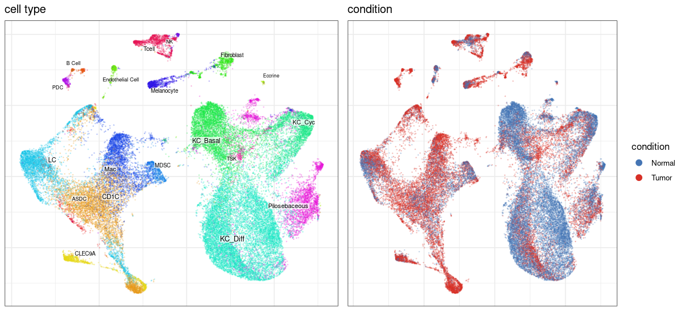<!-- -->

The keratinocyte compartment separates by condition on the embedding (normal keratinocytes on the left of `KC_Diff`
and `KC_Basal`, tumor keratinocytes toward the right); the immune and stromal populations mix more.

## Check the design

The check recognizes the pairing: every patient holds at most one sample per condition, which makes `patient` a
blocking factor rather than a covariate, and permutations within patient (`block.vars = "patient"`) are suggested.
The median UMI count is higher in the tumor samples (association 0.36; 0.20 for the number of cells), which the check flags for the sensitivity analysis.

``` r
cao$checkDesign(test = "condition")
```

    Design check: 17 samples, 3 covariates, test variable 'condition'
      association with 'condition': median.umi 0.36, n.cells 0.20
      Warning (2):
        - 6 of 8 'Normal' samples have 'n.cells' outside the range of 'Tumor' (1380-3190): adjusted for 'n.cells', the condition effect there rests on a fitted trend of 'n.cells' beyond the values observed in 'Tumor' -> compare with the samples in the common range of 'n.cells' (cao$excludeSamples())
        - 4 of 9 'Tumor' samples have 'median.umi' above the range of 'Normal' (2760-10700): adjusted for 'median.umi', the condition effect there rests on a fitted trend of 'median.umi' beyond the values observed in 'Normal' -> compare with the samples in the common range of 'median.umi' (cao$excludeSamples())
      Note (2):
        - 'median.umi' differs between the levels of 'condition' (association 0.36) -> adjust for 'median.umi' and compare with the unadjusted result (cao$checkSensitivity())
        - 'patient' pairs the samples across 'condition' (7 of 10 patients have a sample at more than one level): a blocking factor -> use block.vars = "patient" (permutations within patient), or add it to the model if the degrees of freedom allow

``` r
cao$plotDesign("balance")
```

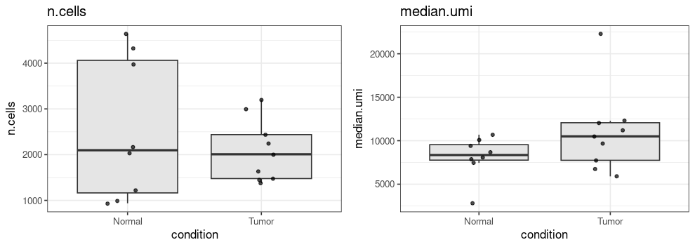<!-- -->

## Screen covariates

The screen tests every usable covariate against the sample-to-sample expression distances of each cell type. Two
tumor-only populations, `TSK` and `PDC`, have enough samples for the screen but a constant condition among them;
the screen skips the condition there and says so.

``` r
cao$screenCovariates(n.permutations = 199)
```

    Covariate screen: 3 covariates x 16 cell types, marginal + partial mode, permutation p-values (199 permutations)
      not screened (fewer than 6 samples): B Cell, NK
      partial mode fell back to marginal in 3 of 16 cell types (too few residual degrees of freedom for the full covariate set)
    Associated with expression in >= 3 cell types (partial, FDR 5%): condition (10 types, global p 0.005)
    Marginal only (not separable from the other covariates): median.umi
    all cell types (partial, FDR 5%): condition (adj. R2 0.19)
    composition (partial, FDR 5%): median.umi (adj. R2 0.32), condition (adj. R2 0.25)
    Suggested model: ~condition   (not applied; see cao$setModel())
    Note: constant within a cell type (not tested there): condition in PDC; condition in TSK

``` r
cao$plotCovariateScreen()
```

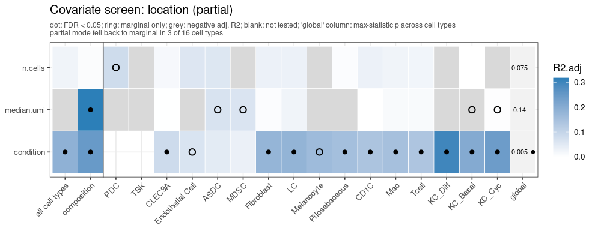<!-- -->

The condition dominates: a significant location association in 10 of 14 cell types (no covariate has a significant dispersion association in the partial mode). The number of cells per sample has no partial association; the median UMI count is associated with the cell types only marginally (its marginal association is explained by the other covariates), but has the largest partial association with the composition (adj. R2 0.32). The screen suggests no addition to `~ condition`; the sensitivity analysis below shows what the additions would change.

The patient can be screened when named explicitly. With its 9 degrees of freedom the partial mode has no residual
degrees of freedom left in any cell type and falls back to the marginal test, where the patient explains nothing
on its own (median chance-corrected R2 about 0, no cell type significant). With 17 samples the partial mode falls back to the marginal test in the summaries as well: over all cell types the condition leads (adj. R2 0.24), in the composition the patient (0.42, the median UMI count 0.17):

``` r
cao$screenCovariates(covariates = c("condition", "patient", "n.cells", "median.umi"), n.permutations = 199,
                     name = "covariate.screen.patient")
```

    Covariate screen: 4 covariates x 16 cell types, marginal + partial mode, permutation p-values (199 permutations)
      not screened (fewer than 6 samples): B Cell, NK
      partial mode fell back to marginal in 16 of 16 cell types (too few residual degrees of freedom for the full covariate set)
    Associated with expression in >= 3 cell types (partial, FDR 5%): condition (11 types, global p 0.005), median.umi (3 types, global p 0.045)
    Associated with sample dispersion: condition (6 types)
    all cell types (marginal, partial fell back, FDR 5%): condition (adj. R2 0.24)
    composition (marginal, partial fell back, FDR 5%): patient (adj. R2 0.42), median.umi (adj. R2 0.17)
    Suggested model: ~condition + median.umi   (not applied; see cao$setModel())
    Note: constant within a cell type (not tested there): condition in PDC; condition in TSK

Its suggested model differs from the first screen's (`~ condition + median.umi` against `~ condition`): the
suggestion depends on the covariate set, one more reason to keep `~ condition` and to look at the alternatives in the
sensitivity analysis instead.

The variance partition asks how much of the between-sample variation is condition, how much is patient, and how much
is shared (the tumor-only and sparse populations, with no residual degrees of freedom once the 10-level patient factor
is in, are skipped).

``` r
cao$plotVariancePartition(c("condition", "patient"))
```

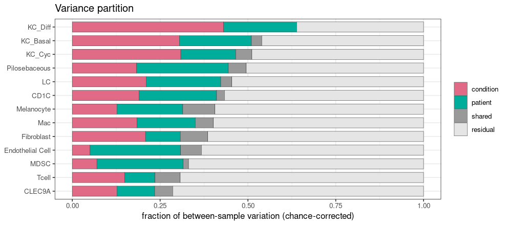<!-- -->

The patient's unique fraction is comparable to the condition's in most cell types and larger in the endothelial cells and `MDSC` (three to five times the condition's), the melanocytes and the pilosebaceous cells; the condition leads in the keratinocyte states (0.30-0.43), the fibroblasts, T cells and `CLEC9A`. The "shared" fractions reflect the 10-level factor in 9-15 samples (few residual degrees of freedom), not a confounding, since every patient has at most one sample per condition.

### Sample maps

The maps show the samples in two dimensions (MDS of the sample distances) for one cell type, for all cell types combined, or for the cell-type composition; the subtitles give the chance-corrected R² and permutation p-value of each color and shape variable on its own (the screen's marginal mode; the screen's summary lines print the partial mode where the degrees of freedom allow it).

The sample distances of one cell type, averaged over all cell types, and the composition, colored by the patient with
the condition as the shape. The condition separates the arms along the first axis (adj. R² 0.41 in `KC_Diff`, 0.24 over all cell types), and the second axis orders both arms in nearly the same patient order: the pairing. On its own the patient explains nothing (adj. R² below zero), because the condition takes most of the variation; its share with the condition accounted for is the patient fraction of the variance partition above (the screen’s partial mode has no room with 17 samples). In the composition the arms overlap more (adj. R² 0.12) and the patient explains most (0.42): most normal samples lie close together, the tumors spread around them.

``` r
cowplot::plot_grid(cao$plotSampleDistances(cell.type = "KC_Diff", color.by = "patient", shape.by = "condition"),
                   cao$plotSampleDistances(color.by = "patient", shape.by = "condition"),
                   cao$plotSampleDistances(space = "composition", color.by = "patient", shape.by = "condition"), ncol = 3)
```

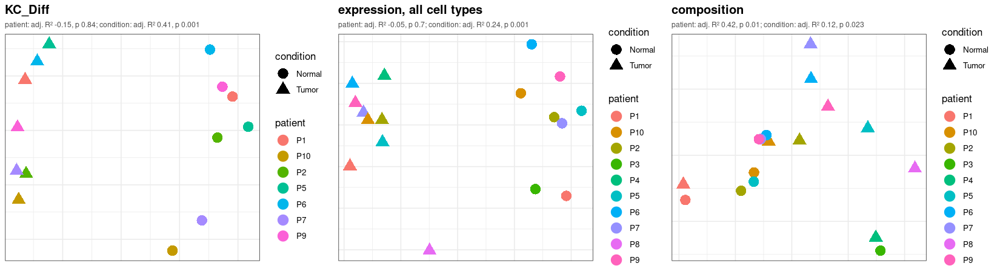<!-- -->

## Set the model

The reference level is `Normal`, matched by name; the contrast is tumor versus normal. The pairing enters the model as a
grouping term, `(1 | patient)`: it is not fitted, it restricts the relabeling of the condition to within patients. The
7 pairs flip their labels (128 arrangements), and the three patients with one sample (`P3_Normal`, `P4_Tumor`,
`P8_Tumor`) exchange their labels among themselves as whole patients (3 arrangements of one normal and two tumor
labels): 384 relabelings, so the smallest attainable p-value is 1/384 = 0.0026. The section "What the pairing changes"
below compares this model with the unpaired one and with the patient as a fitted factor.

``` r
cao$setModel(~ condition + (1 | patient), test = "condition")
```

    Model: ~condition + (1 | patient)      dispersion: ~condition
           grouping term (1 | patient): not fitted; the tested variable is exchanged within its levels; levels that hold one value of it are exchanged as wholes
    Test: condition: Tumor vs Normal  (reference 'Normal': matched a control-like name; to change: test = "condition: Normal vs Tumor")
           unadjusted; permutations: block within 8 strata (384 distinct); 17 of 17 samples can change their value; smallest p-value 0.0026
           shift > 0: Tumor samples differ from Normal samples in a common direction, beyond within-group variability
    Samples: 17 used.   Issues: 1 note
      note: test 'condition: Tumor vs Normal': 3 of the 3 levels of 'patient' that hold one value of the tested variable are exchanged as wholes, among levels with the same make-up

## Expression shifts per cell type

For every cell type, each sample's cells are pooled into a profile, and two questions are asked. Whether the type
changed is tested gene by gene (the contrast of each gene over its standard error, the gene z-scores combined
adaptively; `statistic = "gsd"`), with permutation p-values adjusted across cell types. How much it changed comes from a
model of the sample-to-sample distances: `shift` is the distance between the arm means relative to the within-arm
spread, `var` the log2 ratio of the arm dispersions at equal cell numbers (tested by the distance model), `total` the
combination.

``` r
res <- cao$estimateExpressionShiftMagnitudes()
res
```

    Expression shifts: condition: Tumor vs Normal; unadjusted; 384 block permutations (smallest p 0.0026-0.12); statistic gsd
             celltype  n n.mag shift padj.shift   var padj.var total padj.total
              KC_Diff 14    14  1.37      0.019 -0.53    0.051  1.00      0.025
               KC_Cyc 14    13  1.03      0.019 -0.36    0.051  0.81      0.025
             KC_Basal 13    13  0.92      0.019 -0.44    0.051  0.67      0.041
           Fibroblast 15    12  0.75      0.014 -0.14    0.310  0.67      0.030
                Tcell 15    13  0.58      0.019  0.21    0.320  0.71      0.025
                   LC 15    15  0.57      0.014  0.07    0.320  0.61      0.025
                  Mac 15    14  0.57      0.014  0.08    0.720  0.62      0.025
        Pilosebaceous 15    15  0.54      0.014 -0.15    0.051  0.46      0.025
                 CD1C 15    15  0.48      0.014 -0.06    0.720  0.45      0.025
           Melanocyte 12     9  0.47      0.019 -0.06    0.540  0.44      0.049
               CLEC9A 14    14  0.42      0.014  0.29    0.054  0.58      0.025
     Endothelial Cell 12    11  0.21      0.019 -0.27    0.054  0.10      0.054
                 MDSC 13     9  0.10      0.065  0.02    0.830  0.11      0.460
                 ASDC  9    NA    NA      0.019    NA       NA    NA         NA
              Eccrine  6    NA    NA      0.250    NA       NA    NA         NA
                   NK  5    NA    NA      0.210    NA       NA    NA         NA
      13 of 16 cell types with a significant shift (BH 5%); global p: shift 0.0026, var 0.0156, total 0.0156
      tested without a magnitude (fewer than 2 samples per level with >= 10 cells): ASDC, Eccrine, NK
      not tested: B Cell, PDC, TSK
      (normalized effects; full tables in $results and $wide)

Three populations are not tested: `TSK`, `PDC` and `B Cell` occur in tumor samples only. Cell types are tested in the
samples with at least 5 cells (`n`), and their magnitudes come from the samples with at least 10 (`n.mag`), because a
profile of a handful of cells is mostly sampling noise, which shrinks the distance-based shift; `ASDC`, eccrine and NK
cells have too few such samples and are tested without a magnitude. Of the 16 tested, 13 show a significant shift
(`ASDC` among them). The keratinocytes change most (`KC_Diff`, `KC_Cyc`, `KC_Basal`, normalized shift 0.9-1.4),
followed by the fibroblasts (0.75) and a group of similar size: T cells, macrophages, Langerhans cells, pilosebaceous cells and `CD1C` dendritic cells (0.48-0.58); melanocytes, `CLEC9A` and endothelial cells shift less, and `MDSC` (adjusted p 0.065), eccrine cells and NK cells do not reach significance.

``` r
cao$plotExpressionShiftMagnitudes(show.ci = TRUE, show.genes = TRUE)
```

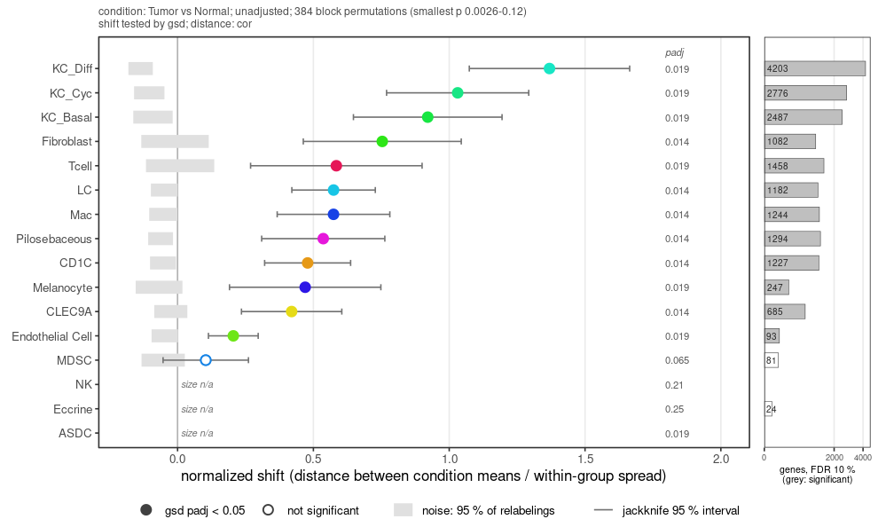<!-- -->

Cell types are ordered by the size of the shift; filled points have a significant shift by the gene-level test, the gray
band is the range of the shift with shuffled labels, and the intervals are the jackknife 95 % intervals, which show how
firmly the samples determine the size (widest for the T cells, `KC_Diff`, the fibroblasts and the melanocytes, the last with 9 samples). The margin counts the genes changed at a gene-level FDR of 10 %; the counts follow the
shifts but also the numbers of cells (thousands in the abundant keratinocyte states), so they are a cross-check, not a
ranking.

The dispersion change, compared at equal numbers of cells per sample: the tumor samples of the keratinocyte states, the pilosebaceous cells and the endothelial cells tend to be more similar to each other than the normal samples are (negative `var`), and `CLEC9A` tends to be more heterogeneous in tumors, but no cell type passes the adjustment (adjusted p 0.051-0.054 for these six; the global p of `var` is 0.016). A dagger marks cell types whose numbers of cells are tied to the condition, for which the dispersion test may be anticonservative: `KC_Diff`, `CLEC9A`, the macrophages and `CD1C`.

``` r
cao$plotExpressionShiftMagnitudes(effect = "var")
```

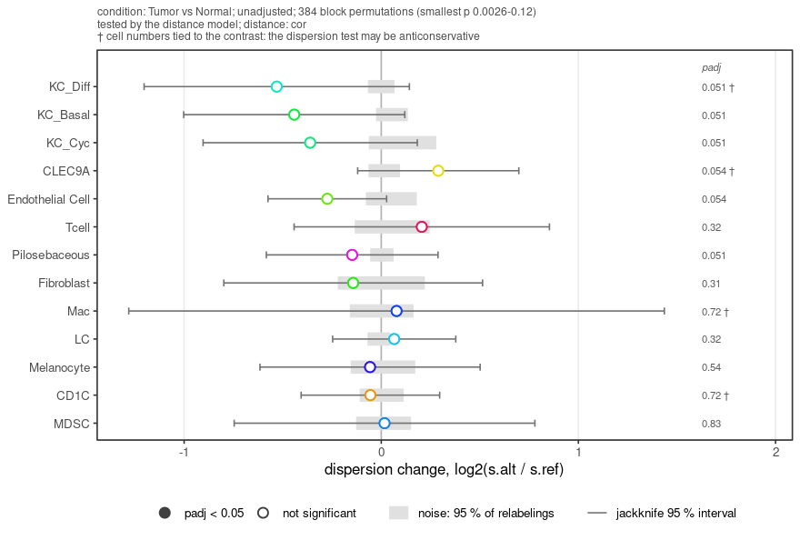<!-- -->

### Behind one cell type

`plotShiftDetail()` shows the sample-level picture for one cell type: the samples in the adjusted distance space, the
distribution of pair distances within and between the arms, and the per-sample dispersion.

``` r
cao$plotShiftDetail("Fibroblast")
```

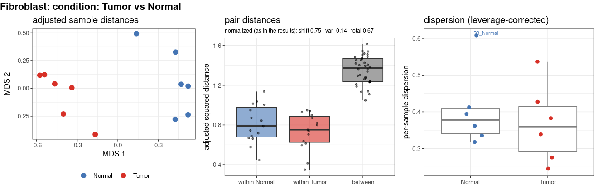<!-- -->

The fibroblast arms are fully separated; `P3_Normal` (the unpaired patient, with the lowest median UMI count of all samples) and `P2_Tumor` are the samples that move the estimate most when left out.

``` r
cao$plotSampleInfluence()
```

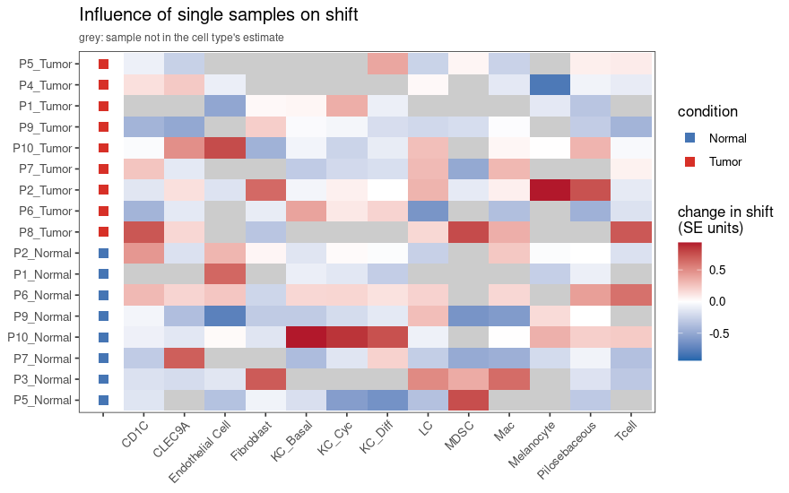<!-- -->

Leaving out single samples changes the shift estimates by less than one jackknife standard error; the largest changes come from `P2_Tumor` and `P4_Tumor` for the melanocytes (in opposite directions), `P10_Normal` for `KC_Basal`, `P3_Normal` for the fibroblasts, and `P8_Tumor` and `P6_Normal` for the T cells.

### Residuals and the technical summaries

``` r
cowplot::plot_grid(cao$plotSampleDistances(values = "residual", color.by = "median.umi", shape.by = "condition"),
                   cao$plotSampleDistances(values = "residual", color.by = "n.cells", shape.by = "condition"), ncol = 2)
```

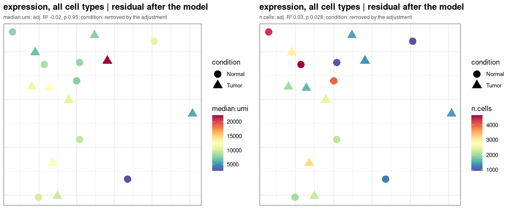<!-- -->

``` r
cao$plotFitDiagnostics("expression.shifts", color.by = "median.umi")
```

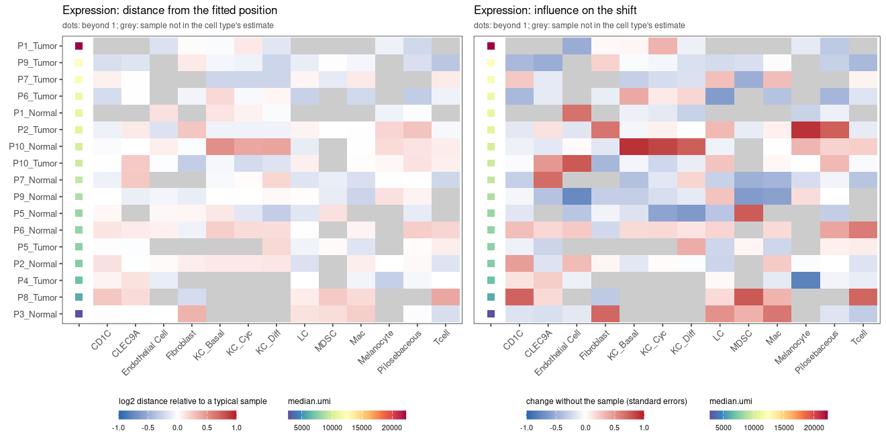<!-- -->

The residual maps show the samples on the distances left once the condition is removed (`values = "residual"`),
colored by the two technical summaries, which are not in the model: the median UMI count explains nothing of them
(p 0.95), the number of cells a little (3 %, p 0.028). The fit diagnostics colored by the median UMI count show no
sample far from its fitted position (no cell beyond a log2 distance of 1); the influence of single samples is largest for
`P10_Normal` in the keratinocyte states and for `P2_Tumor` in the melanocytes and the pilosebaceous cells, as in the
influence plot above.

## Robustness

The shifts are re-estimated under alternative adjustment sets, given explicitly: each technical summary and the
patient. The set named `current` is the stored main model, which the verdicts refer to. Each cell type gets two verdicts:
the size of the shift (the distance-model magnitude: stable, changes by more than half, driven by one sample, or near
zero when the current shift lies within the noise band of shuffled labels) and its significance (the gene-level test of
the main result, refitted under every model; filled points).

``` r
cao$checkSensitivity(covariate.sets = list(current = ~ condition + (1 | patient), "plus n.cells" = ~ condition + n.cells + (1 | patient),
                                           "plus median.umi" = ~ condition + median.umi + (1 | patient), "unpaired" = ~ condition,
                                           "patient as a factor" = ~ condition + patient),
                     n.permutations = 199)
```

    Sensitivity of 'condition: Tumor vs Normal' (shift) across 5 models: current [~condition + (1 | patient)]; plus n.cells [~condition + n.cells + (1 | patient)]; plus median.umi [~condition + median.umi + (1 | patient)]; unpaired [~condition]; patient as a factor [~condition + patient]
      magnitude: distance model; significance: gsd (adjusted p < 0.05)
      KC_Diff          magnitude estimate changes by 74% (patient as a factor); significant in 4 of 5 models (not with: patient as a factor)
      KC_Cyc           magnitude stable; significant in 4 of 5 models (not with: patient as a factor)
      KC_Basal         magnitude estimate changes by 56% (patient as a factor); significant in 4 of 5 models (not with: patient as a factor)
      Fibroblast       magnitude stable; significant in 4 of 5 models (not with: patient as a factor)
      Tcell            magnitude stable; significant in 4 of 5 models (not with: patient as a factor)
      Mac              magnitude estimate changes by 50% (patient as a factor); significant in 4 of 5 models (not with: patient as a factor)
      LC               magnitude estimate changes by 68% (patient as a factor); significant in 4 of 5 models (not with: patient as a factor)
      Pilosebaceous    magnitude estimate changes by 69% (patient as a factor); significant in 4 of 5 models (not with: patient as a factor)
      Melanocyte       magnitude driven by sample P2_Tumor; significant in 4 of 5 models (not with: patient as a factor)
      CD1C             magnitude estimate changes by 75% (patient as a factor); significant in 4 of 5 models (not with: patient as a factor)
      CLEC9A           magnitude stable; significant in 4 of 5 models (not with: patient as a factor)
      Endothelial Cell magnitude stable; significant in 4 of 5 models (not with: patient as a factor)
      MDSC             magnitude estimate changes by 202% (patient as a factor); significant in 1 of 5 models (only with: plus median.umi)

``` r
cao$plotSensitivity()
```

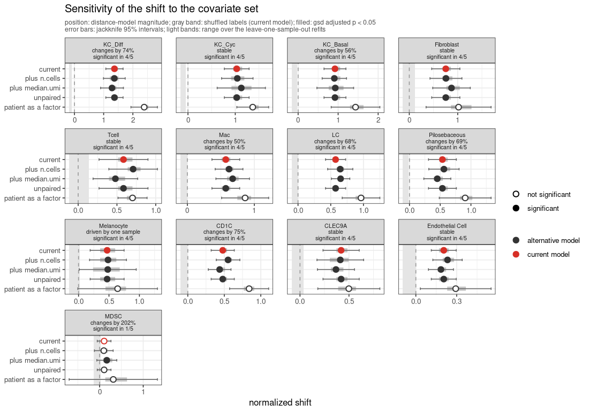<!-- -->

Adjusting for the technical summaries changes little: every significant cell type stays significant and the sizes move by up to about a fifth (T cells 0.58 to 0.71 with the number of cells, 0.48 with the median UMI count). Adjusting for the patient as a fitted factor (11 parameters for 17 samples, 6 residual degrees of freedom) increases the normalized shifts of six cell types by a half to three quarters (`KC_Diff` 1.37 to 2.4, `KC_Basal` 0.92 to 1.4, the pilosebaceous cells 0.54 to 0.91, also the macrophages, Langerhans cells and `CD1C`) and those of the others by a fifth to two fifths, except `MDSC` (0.10 to 0.31), because the within-arm distances that normalize them shrink once the patient effects are removed; the T-cell shift grows by only a fifth (0.58 to 0.70), so T cells fall from fifth to ninth in size. With the patient as a factor the gene-level test calls no cell type (adjusted p 0.055-0.13 on 6 residual degrees of freedom). `MDSC` is called only with the median UMI count in the model (adjusted p 0.042, against 0.054-0.13 under the other four models), so its call is not robust. In a paired design the two arm dispersions are not
identifiable once the patient is in the model, so `var` and `total` are reported as `NA` under that model and only the
shift is compared. A single sample sets the size of one shift: `P2_Tumor` for the melanocytes (see the influence plot).

## Composition

Compositional changes are tested on the same contrast (cell-type loadings of tumor versus normal). As in the preprint,
the tumor-specific keratinocytes (`TSK`) are left out of this test: they occur in tumor samples only, so their change
is a property of the annotation rather than a finding (they stay in the cluster-free maps below, where they are tested
through their neighborhoods). Relative to the geometric mean of all cell types, seven cell types are significant after
adjustment (adjusted p 0.035-0.047): the tumor-enriched `PDC`, `ASDC`, B cells and macrophages, and the differentiated and
cycling keratinocytes and the eccrine cells, which take a smaller share of the tumor samples; `CLEC9A` (0.053) and
`KC_Basal` (0.062) follow. The melanocytes, pilosebaceous and endothelial cells also have negative loadings, without
passing the adjustment.

``` r
cao$estimateCellLoadings(cells.to.remove = "TSK")
cao$plotCellLoadings(center = "both")
```

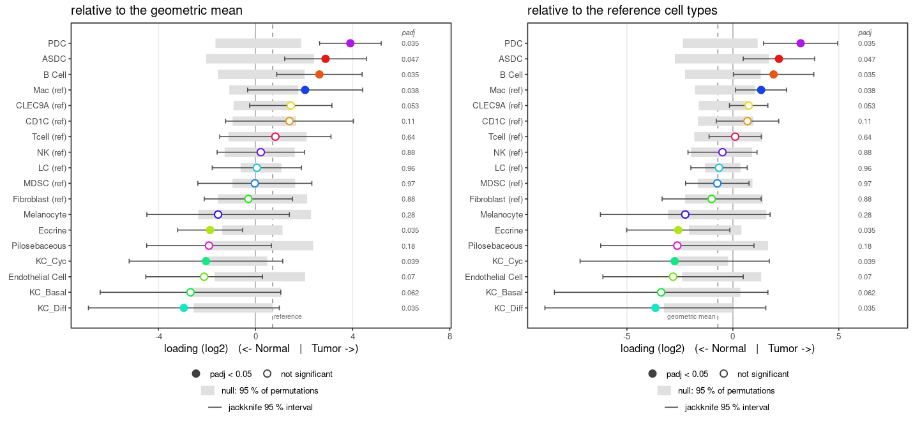<!-- -->

The left panel shows the loadings relative to the geometric mean of all cell types, the right panel centers them on
the reference set, the largest block of cell types whose proportions do not change relative to each other (pairwise
permutation tests of the loading differences). The block spans 8 of the 18 populations (the T, NK and Langerhans cells,
the macrophages, `CD1C`, `CLEC9A`, the fibroblasts and `MDSC`); `PDC`, `ASDC` and the B cells lie above it, the
keratinocyte states, the melanocytes and the pilosebaceous, eccrine and endothelial cells below. The filled points and
p-values are the reference-free test in both panels: the seven cell types named above are significant (adjusted p
0.035-0.047), `CLEC9A` (0.053) and `KC_Basal` (0.062) follow.

``` r
cao$plotContrastTree()
```

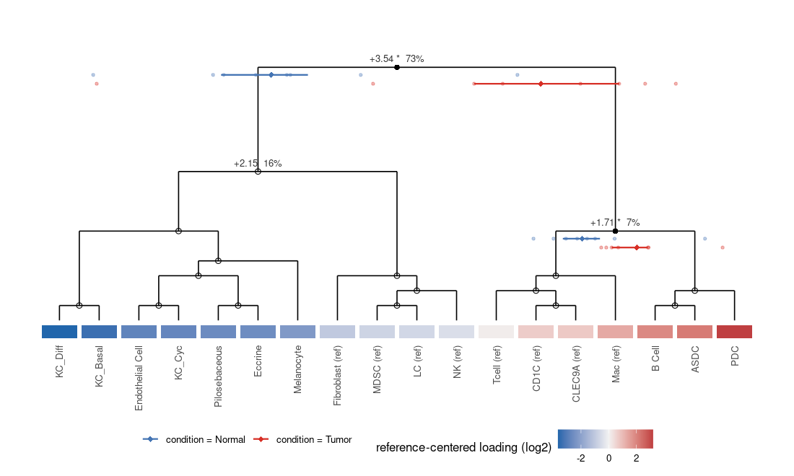<!-- -->

The contrast tree explains the compositional shift with as few balances as possible: each node compares the
geometric-mean proportions of its two sides between the conditions (the log2 ratio, the significance code of its
adjusted permutation p-value and the share of the shift it explains); the samples' own ratios are shown at the significant nodes,
and the tiles are the reference-centered loadings. The root balance sets the T cells, macrophages, dendritic cells
(`CD1C`, `CLEC9A`, `ASDC`, `PDC`) and B cells, which take a larger share of the tumor samples, against the keratinocyte,
pilosebaceous, eccrine, endothelial and melanocyte populations together with the fibroblasts, `MDSC`, Langerhans and NK
cells: a log2 ratio of 3.5 that carries 73 % of the shift and passes the adjustment (p 0.0052, adjusted 0.044). The
next balance, within the second side, sets the fibroblasts, `MDSC`, Langerhans
and NK cells against the keratinocyte, pilosebaceous, eccrine, endothelial and melanocyte populations and carries 16 %
(log2 ratio 2.1, p 0.031, adjusted 0.13); the third, the plasmacytoid and `ASDC` dendritic cells and B cells against
the T cells, macrophages, `CD1C` and `CLEC9A`, carries 7 % (log2 ratio 1.7, p 0.0026, adjusted 0.044). The first and the
third balance pass the adjustment; two balances explain 89 % of the shift, three 96 %.

``` r
cao$plotCodaCellTypes(value = "predicted")
```

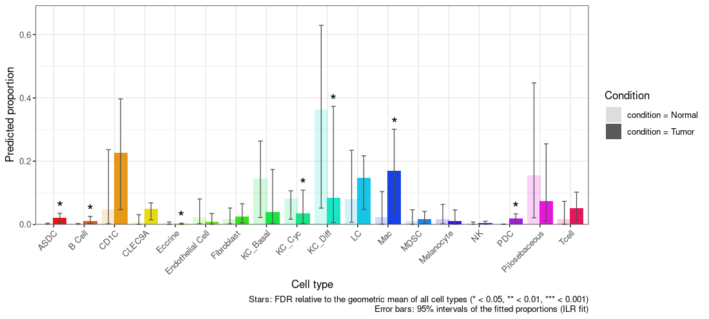<!-- -->

The model-predicted proportions at the two conditions do not depend on the reference set (the stars are the per-type
test relative to the geometric mean, the error bars 95 % intervals of the fitted proportions): the differentiated and basal keratinocytes make up 36 % and 14 % of the cells in
normal skin against 8 % and 4 % in tumor, while `CD1C` dendritic cells go from 5 % to 23 %, macrophages from 2 % to
17 % and Langerhans cells from 8 % to 15 %.

The same check for the composition: the loadings refitted under alternative covariate sets, with jackknife intervals
from leaving out each sample.

``` r
cao$checkSensitivity(analysis = "composition", covariate.sets = list(current = ~ condition + (1 | patient), "plus n.cells" = ~ condition + n.cells + (1 | patient),
                                           "plus median.umi" = ~ condition + median.umi + (1 | patient), "unpaired" = ~ condition),
                     n.permutations = 199)
```

    Sensitivity of 'condition: Tumor vs Normal' (loading) across 4 models: current [~condition + (1 | patient)]; plus n.cells [~condition + n.cells + (1 | patient)]; plus median.umi [~condition + median.umi + (1 | patient)]; unpaired [~condition]
      magnitude: loading (log2, relative to the geometric mean); significance: permutation test (vs the geometric mean) (adjusted p < 0.05)
      PDC              magnitude stable; significant in 3 of 4 models (not with: plus n.cells)
      KC_Diff          magnitude driven by sample P3_Normal; significant in 2 of 4 models (not with: plus n.cells, unpaired)
      ASDC             magnitude stable; significant in 3 of 4 models (not with: plus n.cells)
      KC_Basal         magnitude near zero (within the relabeling band); significant in 1 of 4 models (only with: plus median.umi)
      B Cell           magnitude stable; significant in 3 of 4 models (not with: plus n.cells)
      Endothelial Cell magnitude stable; significant in 1 of 4 models (only with: plus median.umi)
      Mac              magnitude driven by sample P1_Tumor; significant in 2 of 4 models (not with: plus n.cells, unpaired)
      KC_Cyc           magnitude driven by sample P3_Normal; significant in 2 of 4 models (not with: plus n.cells, unpaired)
      Pilosebaceous    magnitude near zero (within the relabeling band); not significant in any of 4 models
      Eccrine          magnitude stable; significant in 2 of 4 models (not with: plus n.cells, unpaired)
      Melanocyte       magnitude near zero (within the relabeling band); not significant in any of 4 models
      CLEC9A           magnitude driven by sample P1_Tumor; significant in 1 of 4 models (only with: plus median.umi)
      CD1C             magnitude near zero (within the relabeling band); not significant in any of 4 models
      Tcell            magnitude near zero (within the relabeling band); not significant in any of 4 models
      Fibroblast       magnitude near zero (within the relabeling band); not significant in any of 4 models
      NK               magnitude near zero (within the relabeling band); not significant in any of 4 models
      LC               magnitude near zero (within the relabeling band); not significant in any of 4 models
      MDSC             magnitude near zero (within the relabeling band); not significant in any of 4 models

``` r
cao$plotSensitivity(analysis = "composition")
```

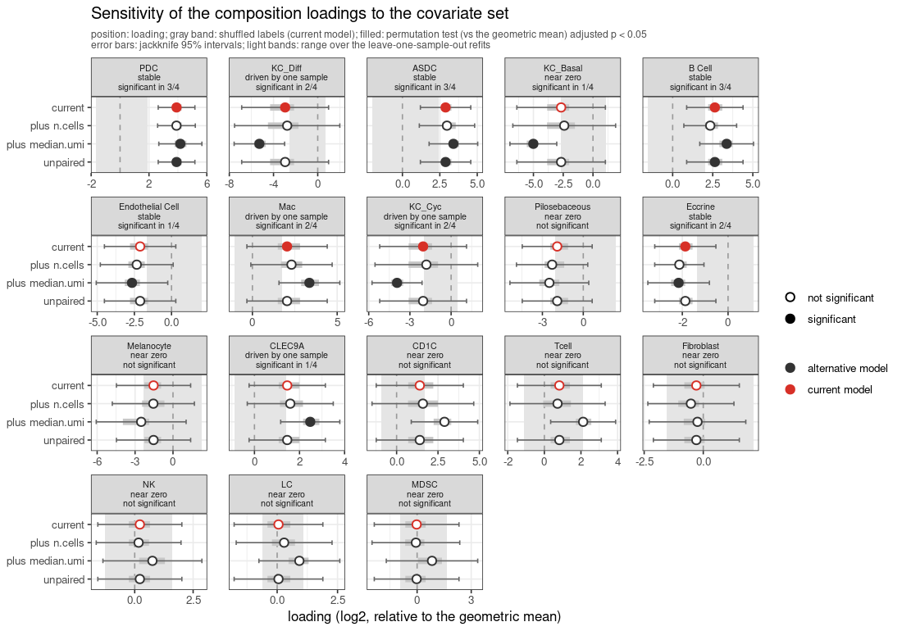<!-- -->

The loadings change little between the models: most estimates under the alternative sets lie within the jackknife
intervals of the current model. Their significance depends more on the model. The current model, refitted with 199
relabelings, calls the same 7 cell types as the main fit above. Without the pairing, 3 cell types are significant in
this refit (`PDC`, `ASDC`, B cells; in the unpaired fit with 999 relabelings in the next section only `PDC`, with `ASDC`
and the B cells at adjusted p 0.054 and 0.066: they are borderline, and the 199 relabelings of the sensitivity refit
move them across 0.05). Adding the number of cells leaves no cell type significant: 6 of the 8 normal samples have cell numbers outside
the range of the tumor samples, so the adjustment rests on a trend fitted beyond the observed values (the design check
warns of this), and with a continuous covariate and a grouping term the relabeling is approximate. Adding the median
UMI count makes more types significant (10) and enlarges some loadings (`KC_Basal` from -2.7 to about -5), because it
is associated with the condition (0.36). Neither technical summary structures the residuals of the expression (see
above), so the paired model without them is the one reported. Four loadings are each set by one sample (`P3_Normal`
for `KC_Diff` and `KC_Cyc`, `P1_Tumor` for the macrophages and `CLEC9A`).

## What the pairing changes

``` r
models <- list(unpaired = ~ condition, paired = ~ condition + (1 | patient), "patient as a factor" = ~ condition + patient)
for (k in names(models)) {
  cao$setModel(models[[k]], test = "condition", verbose = FALSE)
  cao$estimateCellLoadings(cells.to.remove = "TSK", name = paste0("coda.", k), verbose = FALSE)
  cao$estimateExpressionShiftMagnitudes(name = paste0("shifts.", k), verbose = FALSE)
}
cao$setModel(~ condition + (1 | patient), test = "condition", verbose = FALSE)
cao$estimateCellLoadings(cells.to.remove = "TSK", random.baseline = TRUE, name = "coda.random", verbose = FALSE)
round(cao$test.results$coda.random$random$icc, 2)   # share of each cell type's log-ratio variance between patients
```

                ASDC           B Cell             CD1C           CLEC9A 
                0.00             0.50             0.82             0.76 
             Eccrine Endothelial Cell       Fibroblast         KC_Basal 
                0.50             0.59             0.09             0.82 
              KC_Cyc          KC_Diff               LC             MDSC 
                0.94             0.91             0.76             0.87 
                 Mac       Melanocyte               NK              PDC 
                0.82             0.82             0.50             0.00 
       Pilosebaceous            Tcell 
                0.50             0.50 

``` r
ct <- names(cao$test.results$coda.unpaired$contrast$loadings$obs)
cmp <- sapply(c("unpaired", "paired", "random", "patient as a factor"), function(k) cao$test.results[[paste0("coda.", k)]]$contrast$per_cell$padj[ct])
lo <- sapply(c("unpaired", "paired", "random", "patient as a factor"), function(k) cao$test.results[[paste0("coda.", k)]]$contrast$loadings$obs[ct] / log(2))
colSums(cmp < 0.05)                                   # cell types with adjusted p < 0.05
```

               unpaired              paired              random patient as a factor 
                      1                   7                   9                   0 

``` r
signif(cbind(loading = lo, padj = cmp)[order(cmp[, "paired"]), ], 2)
```

                     unpaired paired random patient as a factor unpaired paired
    B Cell              2.600  2.600   2.50               2.400    0.066  0.035
    Eccrine            -1.900 -1.900  -1.70              -1.500    0.085  0.035
    KC_Diff            -2.900 -2.900  -2.50              -2.500    0.320  0.035
    PDC                 3.900  3.900   3.90               3.500    0.018  0.035
    Mac                 2.000  2.000   1.80               1.800    0.320  0.038
    KC_Cyc             -2.000 -2.000  -1.70              -1.600    0.320  0.039
    ASDC                2.900  2.900   2.90               3.200    0.054  0.047
    CLEC9A              1.500  1.500   1.40               1.400    0.320  0.053
    KC_Basal           -2.700 -2.700  -2.40              -2.300    0.320  0.062
    Endothelial Cell   -2.100 -2.100  -2.10              -2.100    0.320  0.070
    CD1C                1.400  1.400   1.40               1.400    0.470  0.110
    Pilosebaceous      -1.900 -1.900  -1.80              -1.700    0.320  0.180
    Melanocyte         -1.500 -1.500  -2.20              -2.400    0.470  0.280
    Tcell               0.820  0.820   0.84               0.900    0.640  0.640
    Fibroblast         -0.290 -0.290  -0.28              -0.055    0.920  0.880
    NK                  0.220  0.220   0.15               0.071    0.940  0.880
    LC                  0.056  0.056  -0.17              -0.250    0.980  0.960
    MDSC               -0.026 -0.026  -0.23              -0.260    0.980  0.970
                     random patient as a factor
    B Cell            0.034                0.11
    Eccrine           0.034                0.11
    KC_Diff           0.034                0.07
    PDC               0.018                0.07
    Mac               0.034                0.11
    KC_Cyc            0.034                0.07
    ASDC              0.034                0.11
    CLEC9A            0.034                0.11
    KC_Basal          0.056                0.11
    Endothelial Cell  0.057                0.13
    CD1C              0.110                0.13
    Pilosebaceous     0.160                0.13
    Melanocyte        0.034                0.07
    Tcell             0.480                0.64
    Fibroblast        0.830                0.98
    NK                0.830                0.98
    LC                0.830                0.70
    MDSC              0.790                0.70

``` r
cao$plotCodaSamples(name = "coda.paired", n.top = 8, pair.by = "patient")
```

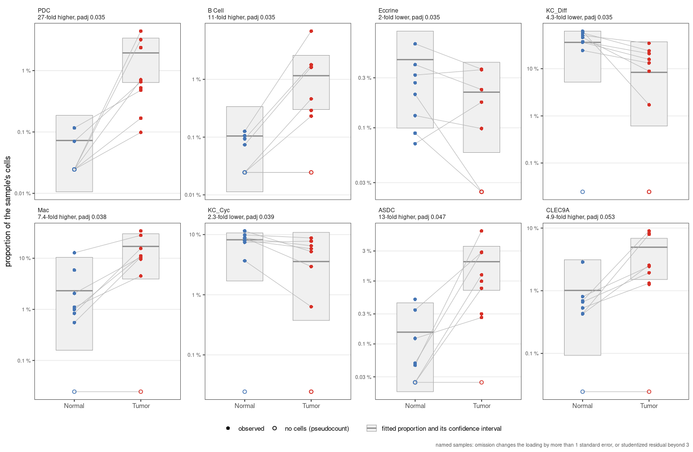<!-- -->

Each patient's normal and tumor samples are joined by a line. The patients differ widely in the proportions of most
cell types, but the change from normal to tumor goes the same way in nearly every patient: the differentiated and
cycling keratinocytes fall, the macrophages and the plasmacytoid dendritic cells rise. Comparing the samples within
patients removes the differences between patients from the comparison; that is what the grouping term does.

``` r
cowplot::plot_grid(cao$plotCellLoadings(name = "coda.unpaired", center = "none", title = "unpaired"),
                   cao$plotCellLoadings(name = "coda.paired", center = "none", title = "paired (1 | patient)"),
                   cao$plotCellLoadings(name = "coda.random", center = "none", title = "random intercept per patient"), ncol = 3)
```

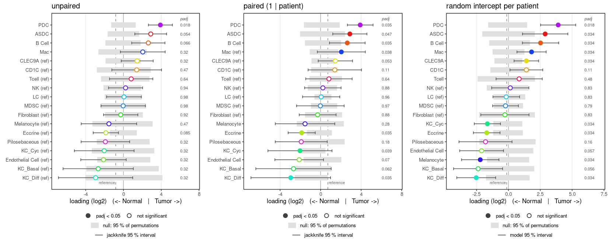<!-- -->

The loadings are identical in the unpaired and the paired model (the grouping term is not fitted) and nearly the same
with a random intercept (the largest difference, for the melanocytes, -1.5 against -2.2); what changes is how much they
stand out from the relabeling noise (gray bands). Without the pairing one cell type is significant (`PDC`), with the
relabeling within patients 7, with a random intercept per patient 9: the random-intercept fit estimates that most of
the variation of many cell types' log ratios lies between patients (0.76-0.94 for the keratinocyte states, the
macrophages, the Langerhans, `CD1C` and `CLEC9A` dendritic cells, the melanocytes and `MDSC`; 0 for the tumor-enriched
`PDC` and `ASDC`) and removes it. Fitting the patient as a factor instead spends 9 of the 16 degrees of freedom and finds
nothing.

``` r
sh <- function(k) { r <- cao$test.results[[paste0("shifts.", k)]]$results; r <- r[r$effect == "shift", ]; r }
S <- Reduce(function(a, b) merge(a, b, by = "celltype", all = TRUE), lapply(names(models), function(k) { r <- sh(k)
  d <- data.frame(celltype = r$celltype, shift = r$estimate.norm, ci.width = (r$ci.high - r$ci.low) * r$estimate.norm / r$estimate, padj = r$padj)   # jackknife 95 % interval, on the normalized scale
  names(d)[-1] <- paste(names(d)[-1], k, sep = "."); d }))
S[, -1] <- signif(S[, -1], 2); S[order(S$padj.paired), ]
```

               celltype shift.unpaired ci.width.unpaired padj.unpaired shift.paired
    2              CD1C           0.48              0.32        0.0016         0.48
    3            CLEC9A           0.42              0.37        0.0016         0.42
    6        Fibroblast           0.75              0.58        0.0016         0.75
    10               LC           0.57              0.31        0.0016         0.57
    11              Mac           0.57              0.41        0.0016         0.57
    15    Pilosebaceous           0.54              0.45        0.0016         0.54
    1              ASDC             NA                NA        0.0094           NA
    5  Endothelial Cell           0.21              0.18        0.0210         0.21
    7          KC_Basal           0.92              0.55        0.0016         0.92
    8            KC_Cyc           1.00              0.52        0.0016         1.00
    9           KC_Diff           1.40              0.59        0.0016         1.40
    13       Melanocyte           0.47              0.56        0.0044         0.47
    16            Tcell           0.58              0.63        0.0016         0.58
    12             MDSC           0.10              0.31        0.0530         0.10
    14               NK             NA                NA        0.2200           NA
    4           Eccrine             NA                NA        0.1200           NA
       ci.width.paired padj.paired shift.patient as a factor
    2             0.32       0.014                      0.84
    3             0.37       0.014                      0.50
    6             0.58       0.014                      1.00
    10            0.31       0.014                      0.96
    11            0.41       0.014                      0.86
    15            0.45       0.014                      0.91
    1               NA       0.019                        NA
    5             0.18       0.019                      0.29
    7             0.55       0.019                      1.40
    8             0.52       0.019                      1.40
    9             0.59       0.019                      2.40
    13            0.56       0.019                      0.64
    16            0.63       0.019                      0.70
    12            0.31       0.065                      0.31
    14              NA       0.210                        NA
    4               NA       0.250                        NA
       ci.width.patient as a factor padj.patient as a factor
    2                          0.53                    0.055
    3                          0.63                    0.080
    6                          1.30                    0.080
    10                         0.58                    0.055
    11                         0.70                    0.055
    15                         0.84                    0.055
    1                            NA                       NA
    5                          0.52                    0.130
    7                          1.20                    0.055
    8                          0.67                    0.055
    9                          0.91                    0.055
    13                         1.30                    0.080
    16                         0.37                    0.055
    12                         2.00                    0.130
    14                           NA                       NA
    4                            NA                    0.250

``` r
colSums(S[, grep("^padj", names(S))] < 0.05, na.rm = TRUE)
```

               padj.unpaired              padj.paired padj.patient as a factor 
                          13                       13                        0 

For the expression shifts the pairing changes nothing here. The grouping term only restricts the relabeling, so the
magnitudes and their jackknife intervals are those of the unpaired model, and the same 13 cell types are significant;
their adjusted p-values are larger (0.014-0.019 against 0.0016-0.021), because the 384 relabelings within patients allow
a smallest p-value of 0.0026 (the paired p-values are 0.0026-0.016). The unpaired test already gives 10 of these 13 cell
types its smallest p-value (1/1000), so there is nothing for the pairing to gain here. The patient as a fitted factor makes the normalized shifts larger (the within-group spread
shrinks once the patients are removed) but leaves 6 residual degrees of freedom, and no cell type is significant.

``` r
# limma-voom fits the grouping term (1 | patient) as a random intercept per patient (limma::duplicateCorrelation); the patient as a
# fixed factor and the unpaired model for comparison
de.models <- list(unpaired = ~ condition, "patient as a factor" = ~ condition + patient, "random intercept" = ~ condition + (1 | patient))
n.de <- sapply(names(de.models), function(k) { cao$setModel(de.models[[k]], test = "condition", verbose = FALSE)
  de <- cao$estimateDEPerCellType(test = "limma-voom", name = paste0("de.", k), verbose = FALSE)
  vapply(de, function(x) if (is.null(x$res)) NA_integer_ else sum(x$res$padj < 0.05, na.rm = TRUE), integer(1)) })
cao$setModel(~ condition + (1 | patient), test = "condition", verbose = FALSE)
cbind(n.de, within.patient.correlation = round(attr(cao$test.results[["de.random intercept"]], "block.correlation")[rownames(n.de)], 2))[order(-n.de[, "unpaired"]), ]
```

                     unpaired patient as a factor random intercept
    KC_Diff              3999                4902             4927
    KC_Cyc               2596                2306             3345
    KC_Basal             2491                3332             3321
    Pilosebaceous        1019                1145             1672
    LC                    930                 805             1224
    Fibroblast            894                 529              987
    Mac                   851                1754              967
    Melanocyte            626                 566              856
    CD1C                  624                 771              850
    Tcell                 353                 922              448
    CLEC9A                192                 604              231
    Endothelial Cell       16                  21               27
    MDSC                    0                 415               14
                     within.patient.correlation
    KC_Diff                                0.30
    KC_Cyc                                 0.20
    KC_Basal                               0.23
    Pilosebaceous                          0.30
    LC                                     0.16
    Fibroblast                             0.09
    Mac                                    0.12
    Melanocyte                             0.23
    CD1C                                   0.16
    Tcell                                  0.09
    CLEC9A                                 0.06
    Endothelial Cell                       0.21
    MDSC                                   0.25

Differential expression takes its p-values from the fitted model, so the pairing has to enter the model. limma-voom
fits `(1 | patient)` as a random intercept: one correlation between the two samples of a patient, shared by all genes of
a cell type and estimated from them (0.06 in `CLEC9A` to 0.30 in the differentiated keratinocytes and pilosebaceous
cells). With it, more genes are found than without the pairing in every one of the 13 cell types (differentiated
keratinocytes 3,999 to 4,927, cycling keratinocytes 2,596 to 3,345, Langerhans cells 930 to 1,224). The patient as a
fixed factor finds fewer genes than the random intercept in 8 cell types (cycling keratinocytes 2,306, fibroblasts 529
against 987), about as many in the basal keratinocytes (3,332 against 3,321) and many more in four immune populations:
macrophages (1,754 against 967), T cells (922 against 448), `CLEC9A` (604 against 231) and `MDSC` (415 against 14, and
none without the pairing). Three of these have small estimated correlations (`CLEC9A` 0.06, T cells 0.09, macrophages
0.12), but `MDSC` has 0.25, and the fibroblasts, where the fixed factor finds fewer genes, have 0.09, so the size of the
correlation does not by itself explain the difference. One possible reason, not tested here, is that a single correlation for all genes removes less of the patient differences than a parameter per patient
when only some genes differ between patients. Which count is closer to the truth cannot be decided from these data;
the expression-shift test of the main model does not call `MDSC` (adjusted p 0.065).

## Differential expression per cell type

Pseudobulk differential expression with limma-voom on the main model; the grouping term `(1 | patient)` is fitted as a
random intercept per patient (the same fit as "random intercept" in the previous section). Positive fold changes are
higher in tumor.
The tumor-only populations (the contrast is not estimable there) and the sparse `ASDC`, eccrine, NK and B cells are
skipped; the warnings saying so are hidden in this chunk. Nine of the ten top fibroblast genes are lower in tumor,
among them dermal fibroblast markers lost in the tumor stroma (`OGN`, `GSN`, `CD34`, `CFD`); `SLC16A3` is the one
higher in tumor.

``` r
de <- cao$estimateDEPerCellType(test = "limma-voom")
head(de[["Fibroblast"]]$res[, c("Gene", "log2FoldChange", "pvalue", "padj", "CellFrac")], 10)
```

               Gene log2FoldChange       pvalue         padj  CellFrac
    OGN         OGN      -6.676167 1.505576e-09 1.090856e-05 0.1123986
    SEPP1     SEPP1      -5.417308 2.802932e-09 1.090856e-05 0.3001159
    GSN         GSN      -4.737874 3.551350e-09 1.090856e-05 0.5631518
    ITM2A     ITM2A      -4.998161 6.500013e-09 1.497441e-05 0.1066049
    CD34       CD34      -6.266381 9.973019e-09 1.838027e-05 0.1123986
    SLC16A3 SLC16A3       5.715304 1.646635e-08 2.186926e-05 0.6106605
    EPHX1     EPHX1      -2.585512 1.784677e-08 2.186926e-05 0.3395133
    ANK2       ANK2      -5.410331 1.918604e-08 2.186926e-05 0.1436848
    CFD         CFD      -9.138704 2.135902e-08 2.186926e-05 0.2572422
    CP           CP      -4.790220 3.550529e-08 3.271812e-05 0.1657010

``` r
cao$plotNumberOfDEGenes()
```

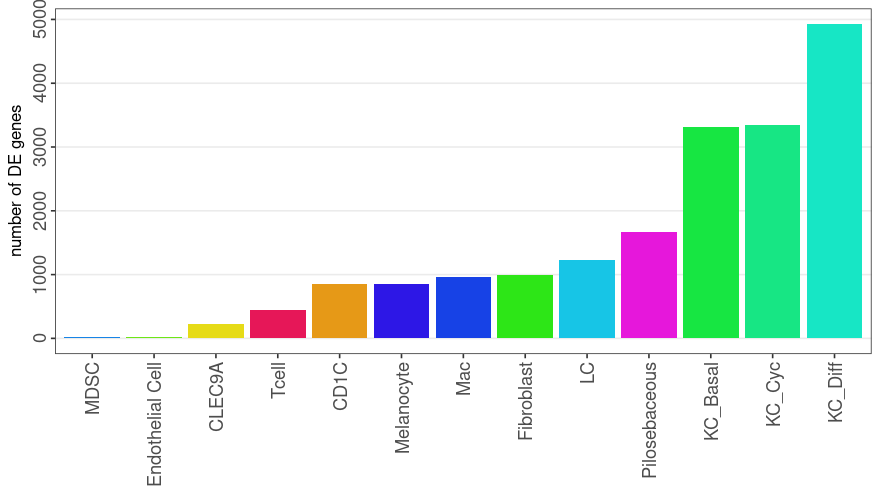<!-- -->

The number of DE genes follows the expression shifts in part: the keratinocyte states come first (3,300-4,900 at FDR
5 %), then the pilosebaceous cells (1,672) and the Langerhans cells (1,224), and `MDSC` (14) and the endothelial cells
(27) come last; the fibroblasts, fourth by the size of the shift, have 987 DE genes, sixth among the 13.

``` r
cao$plotVolcano(cell.types = "Fibroblast")
```

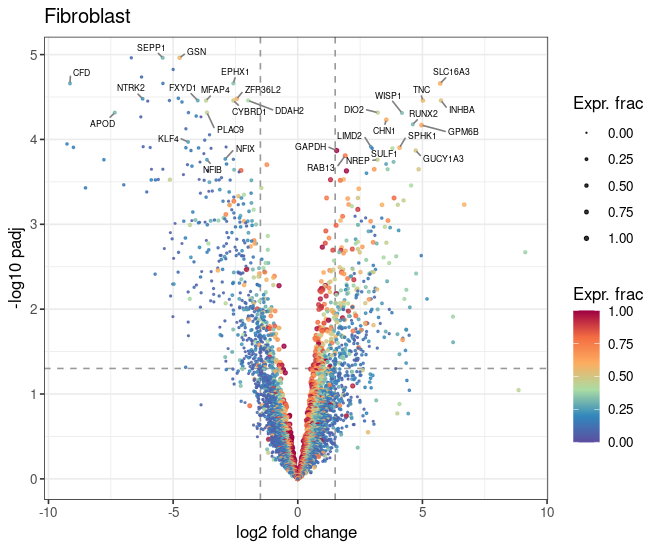<!-- -->

## Functional interpretation

Gene set enrichment (GSEA over GO biological processes) on the per-cell-type DE statistics. The collapsed heatmap
clusters the enriched terms by their shared genes and their enrichment pattern across cell types and labels each
cluster by the words that recur in its term names (the number before the label is the number of terms in the cluster;
generic words are excluded). The run is seeded on one core so that the figures are reproducible.

``` r
cao$estimateOntology(type = "GSEA", org.db = org.Hs.eg.db::org.Hs.eg.db, seed = TRUE, n.cores = 1)
```

``` r
cao$plotOntologyHeatmapCollapsed(name = "GSEA", genes = "up", n = 25, clust.method = "ward.D",
                                 exclude.words = c("regulation", "process", "cell", "cellular", "positive", "negative", "pathway"))
```

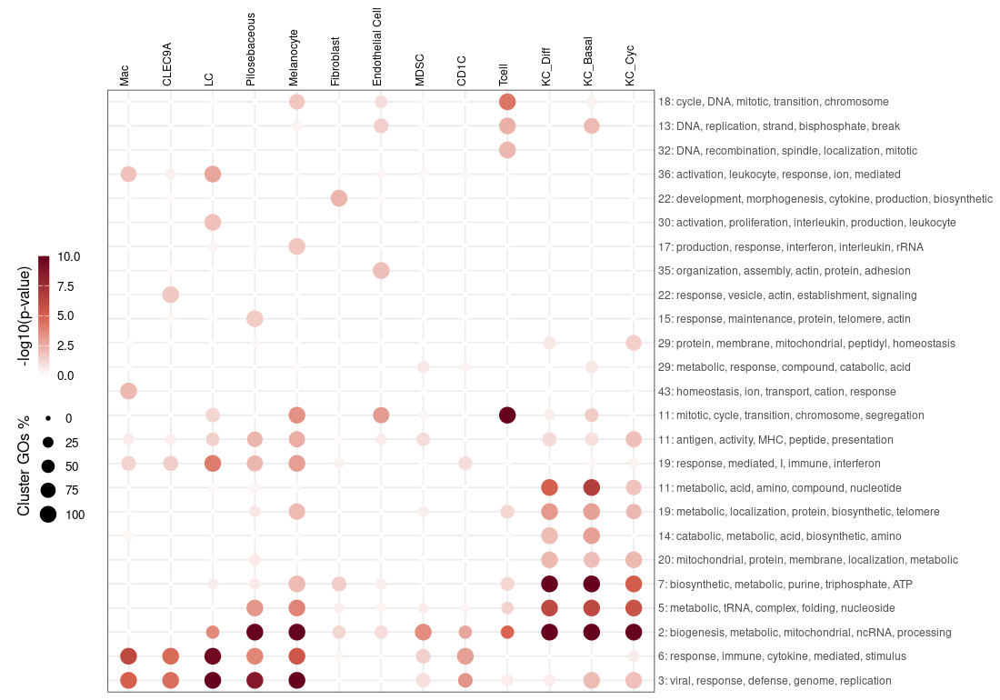<!-- -->

``` r
cao$plotOntologyHeatmapCollapsed(name = "GSEA", genes = "down", n = 25, clust.method = "ward.D",
                                 exclude.words = c("regulation", "process", "cell", "cellular", "positive", "negative", "pathway"))
```

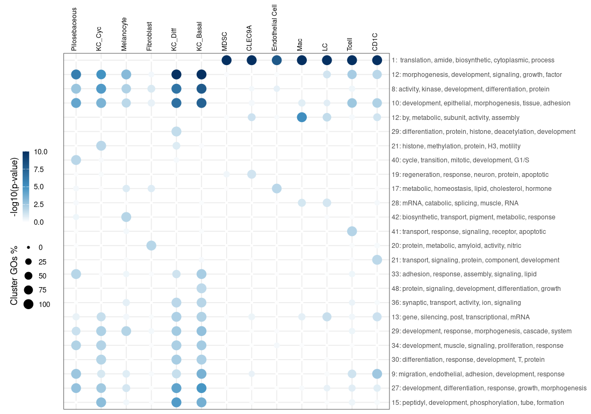<!-- -->

Up in tumor: the three keratinocyte states share a block of mitochondrial / ncRNA-biogenesis and purine /
nucleotide-metabolism terms (the increased metabolism of `KC_Diff` and `KC_Basal` reported in the paper), and a group of immune-response
clusters (defense and innate response, type I interferon, cytokine response, antigen presentation) runs across the
myeloid populations (`Mac`, `LC`, `CD1C`, `CLEC9A`), the pilosebaceous keratinocytes and the melanocytes, as in the
paper (NK cells are not testable here). T cells gain DNA-replication and mitotic cell-cycle terms,
the proliferation signal of the paper. The immune-cell migration terms reported for NK cells, macrophages and
Langerhans cells appear in the macrophages and Langerhans cells: the chemotaxis and leukocyte-migration terms fall into
the cluster labeled "activation, leukocyte, response, ion, mediated", shared by the two types, together with
leukocyte-activation and calcium-ion terms; a further cluster of ion-homeostasis and ion-transport terms, which also
holds some macrophage-migration terms, is up in the macrophages only.

Down in tumor: the immune populations (`MDSC`, `LC`, `CD1C`, `CLEC9A`, `Mac`, T cells) and, less strongly, the
endothelial cells lose cytoplasmic translation terms (and ribosome-biogenesis and translation-initiation terms, most
strongly in `Mac`; weaker mRNA-processing terms in `Mac` and `LC`), the
keratinocyte states lose epidermal development and differentiation programs. The per-cell-type dot plot shows the
ten strongest terms behind one column; for the fibroblasts these are the negative regulation of amyloid-beta formation,
protein-lipid complex organization, complement activation, sterol and cholesterol transport, lipid and primary-alcohol
metabolism, among others (the humoral immune response mediated by circulating immunoglobulin and the negative
regulation of cytoskeleton organization are also lower, adjusted p 0.042 and 0.048, but not among the ten shown).

``` r
cao$plotOntology(cell.type = "Fibroblast", name = "GSEA", genes = "down", n = 10)
```

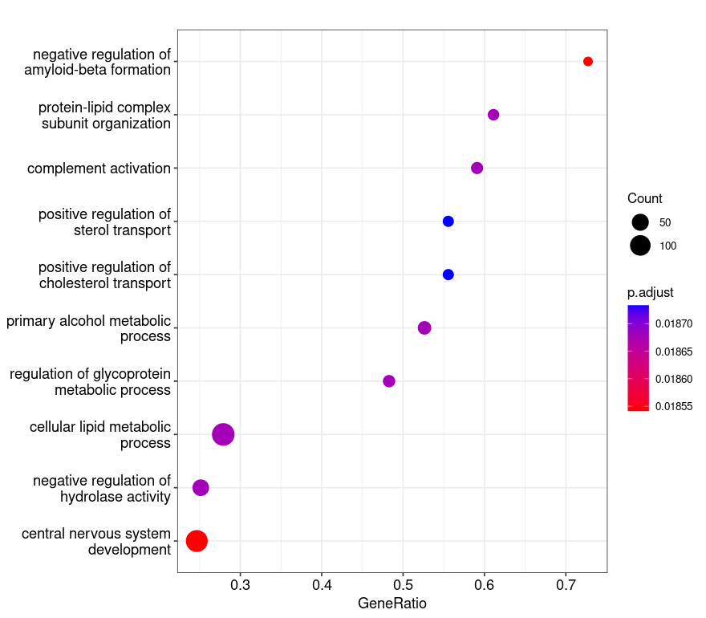<!-- -->

## Cluster-free analyses

The two cluster-free maps ask the composition and the expression question in neighborhoods of the cell graph instead of
in the annotated cell types, so that a change confined to part of a type, or spread across types, is found where it is.
A neighborhood is a diffusion neighborhood: the cells a heat kernel on the graph reaches from a cell, with the kernel
strength set so that a typical neighborhood covers a given share of the cells (`scale`). The default `scale = "auto"`
runs a scan over 1, 3 and 5 % of the cells (for both maps) under the same relabelings, picks the scale whose own map calls the most
cells (the finest one when a scale calls nearly every cell), and reports the map at that scale alone, so that the q-values and effects of the map belong to one neighborhood
size; one value tests a single scale, and a vector reports the scan itself. Cells are adjusted by the pooled permutation
false-discovery rate (the number of cells beyond a threshold under the relabelings, pooled over all cells, against the
observed number), and the adjusted z-score of a cell is the tail z of its q-value. The chunks print the scales tried and
the one chosen, and the annotated embedding is drawn next to each map so that the populations can be followed. The thin black
lines outline the regions where the cells significant at an adjusted p of 0.05 are the majority.

### Cluster-free density shifts

The density map tests, in every neighborhood, whether the arms differ in how many of their cells fall there: each
sample's kernel density is tested on the log scale with the same model. The panels show the annotation, the effect (the
log2 fold change of the density) and the adjusted z-scores.

``` r
cao$estimateCellDensity(method = "graph")
```

    kNN neighborhoods of at least 170 cells (10.0 per sample)

``` r
cao$estimateDiffCellDensity()
```

    diffusion neighborhoods at 1 %, 3 %, 5 % of the cells (auto: one scale is chosen)

    scale 0.01: heat kernel beta 18.6

    scale 0.03: heat kernel beta 27.5

    scale 0.05: heat kernel beta 35.7

    21726 of 39074 cells at FDR 10 % (scale 5 % chosen)

``` r
cowplot::plot_grid(cao$plotEmbedding(color.by = "cell.groups", title = "cell type"),
                   cao$plotDiffCellDensity(what = "effect", title = "density change (log2 FC)", outline = TRUE),
                   cao$plotDiffCellDensity(title = "adjusted z", outline = TRUE), ncol = 3)
```

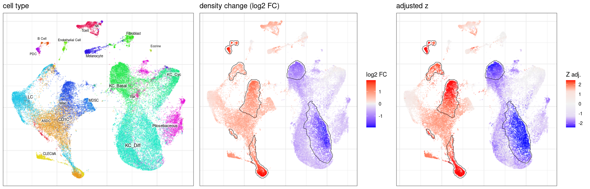<!-- -->

The scan picks the 5 % scale (neighborhoods of about 2,000 cells), the coarsest of the shared 1, 3 and 5 % set: the changes are broad enough for the widest kernel to call the most cells. The map calls the direction the loadings gave. The tumor-enriched immune populations stand out (`PDC` in 97 % of its cells at FDR 5 %, median log2 fold change +1.8; `B Cell` 81 %, `Mac` 72 %, `ASDC` 64 %, `CLEC9A` 53 %), the gain extends through the `CD1C` dendritic cells (35 %), and the differentiated and basal keratinocytes are depleted (`KC_Diff` in 44 % of its cells, -0.8; `KC_Basal` -0.8 in 44 %). `TSK`, tumor-only, is not called, presumably because its neighborhoods are shared with the depleted `KC_Basal` (not tested). In the per-type summary no cell type passes FDR 5 %: `PDC`, the macrophages, `CLEC9A`, `ASDC`, `CD1C`, `KC_Diff` and `KC_Basal` have adjusted p 0.056 and the B cells 0.062, with the 384 relabelings within patients. The per-cell map resolves what the type-level test does not, at a calibrated error: 33 % of the cells are called at FDR 5 % and 56 % at FDR 10 % (the count in the message).

### Cluster-free expression shifts

The expression map tests the contrast in each neighborhood with the per-gene statistic of the per-type test
(`statistic = "gsd"`: the contrast of each gene over its standard error, combined adaptively over the genes detected in
at least 5 % of the neighborhood's cells), on neighborhoods of the scale's size around centers that cover the graph (the message gives their number and size);
each cell averages the tested neighborhoods that contain it. The shift panel shows the size of the change (the mean
squared gene z-score of the neighborhood, about 1 without a change) and the right panel the adjusted z-scores, one-sided
(0 means not significant).

``` r
cao$estimateClusterFreeExpressionShifts()
```

    13654 genes (per neighborhood: those detected in >= 5 % of its cells)

    diffusion neighborhoods at 1 %, 3 %, 5 % of the cells (auto: one scale is chosen), at least 170 cells each (10.0 per sample)

    scale 0.01: heat kernel beta 18.6, 362 centers, neighborhoods of 406 cells (median, 274 smallest)

    scale 0.03: heat kernel beta 27.5, 89 centers, neighborhoods of 1214 cells (median, 577 smallest)

    scale 0.05: heat kernel beta 35.7, 52 centers, neighborhoods of 2032 cells (median, 816 smallest)

    38512 of 39074 cells keep adjusted z >= 1.28 (scale 1 % chosen)

``` r
cao$plotClusterFreeExpressionShifts(adjusted = TRUE, outline = TRUE)
```

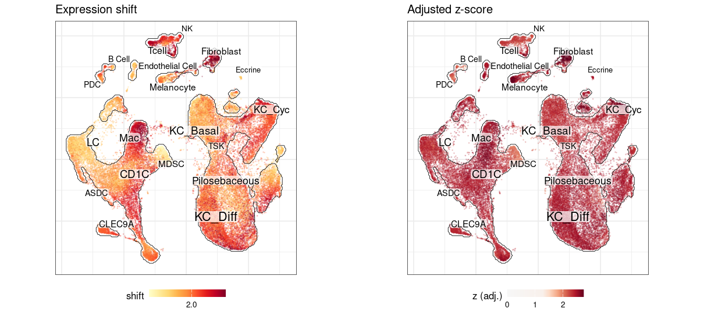<!-- -->

Tumor and normal skin differ in expression everywhere (the scan picks the 1 % scale, 362 neighborhoods of about 400 cells): all 19 types are significant in the per-type summary and 96-100 % of the cells of each type pass FDR 5 % (83 % of the B cells), so the adjusted z-score panel carries no information beyond "changed", and the ordering is in the shift panel (the mean squared gene z-score of the neighborhood, about 1 without a change): largest in the T cells, the fibroblasts and `TSK` (median 2.3-2.4), then the macrophages, NK cells, `KC_Cyc`, `KC_Diff` and `CLEC9A` (2.0-2.2), smallest in the Langerhans, endothelial and eccrine cells and `MDSC` (1.5-1.7). Cells at the boundary between two cell types
whose composition differs between the arms can show a shift that is a neighborhood effect (the neighborhood's
cell-type mix differs between tumor and normal samples) rather than a change within one cell type.

Both maps are summarized per cell type by an exact group-level permutation test: the mean per-cell statistic of the type
is compared with the same mean under the relabelings shared by all cells, so the dependence between neighboring cells is
carried along, and the result is adjusted across types. The labels give the share of the type's cells called at FDR 5 %.

``` r
cao$estimateClusterFreeSummary("cell.density")
cao$estimateClusterFreeSummary("cluster.free.expr.shifts")
cowplot::plot_grid(cao$plotClusterFreeSummary("cell.density"), cao$plotClusterFreeSummary("cluster.free.expr.shifts"), ncol = 2)
```

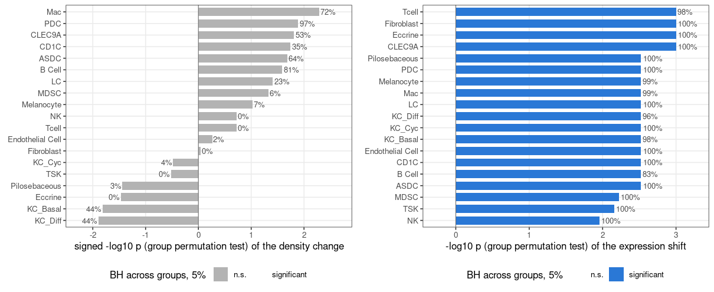<!-- -->

## Summary

- Tumor versus normal skin is a strong contrast in almost every population: 13 of 16 testable cell types show a
  significant expression shift, led by the keratinocyte states, then fibroblasts, T cells, Langerhans cells,
  pilosebaceous cells, dendritic cells and macrophages; the tumor-only populations show up in the composition instead, where the paired test calls seven cell types (`PDC`, `ASDC`, the B cells and macrophages up, `KC_Diff`, `KC_Cyc` and the eccrine cells down; `TSK` is left out of that test), and the density map calls most cells of `PDC`, the B cells, the macrophages, `ASDC` and `CLEC9A` (enriched) and 44 % of the differentiated and basal keratinocytes (depleted), although its per-type summary passes FDR 5 % for no cell type (adjusted p 0.056-0.062). The pseudobulk DE broadly agrees
  (keratinocyte states first, `MDSC` and endothelial cells last), and the cluster-free map finds every population changed; GSEA shows metabolic activation in the keratinocyte states, an
  immune-response program across the myeloid populations, pilosebaceous cells and melanocytes, and proliferation
  in T cells.
- The tumor samples of the keratinocyte states, the pilosebaceous and the endothelial cells tend to be more similar to each other than the normal samples are (a negative dispersion change at equal cell numbers), `CLEC9A` more heterogeneous; none of these changes passes the adjustment (adjusted p 0.051-0.054).
- The patient pairing is a sizable second source of variation: its unique fraction is comparable to the condition's in most cell types and larger in several, it explains most of the composition (adj. R² 0.42), and the sample maps order both arms by patient along the second axis. As a fitted factor it leaves only 6 residual degrees of freedom, and with it in the model no cell type is called, in the expression shifts or in the composition; as a grouping term it restricts the relabeling to 384 arrangements (the label flips of the 7 pairs, combined with exchanges among the three patients with one sample), calls the same 13 of 16 cell types as the unpaired model in the expression shifts, and 7 cell types in the composition against 1 without the pairing. The technical summaries (cells per sample, median UMI) are mildly associated with the condition and
  adjusting for them changes little.

## Session info

``` r
sessionInfo()
```

    R version 4.2.2 Patched (2022-11-10 r83330)
    Platform: x86_64-pc-linux-gnu (64-bit)
    Running under: Ubuntu 20.04.6 LTS

    Matrix products: default
    BLAS:   /usr/lib/x86_64-linux-gnu/blas/libblas.so.3.9.0
    LAPACK: /usr/lib/x86_64-linux-gnu/lapack/liblapack.so.3.9.0

    locale:
     [1] LC_CTYPE=en_US.UTF-8       LC_NUMERIC=C              
     [3] LC_TIME=en_US.UTF-8        LC_COLLATE=en_US.UTF-8    
     [5] LC_MONETARY=en_US.UTF-8    LC_MESSAGES=en_US.UTF-8   
     [7] LC_PAPER=en_US.UTF-8       LC_NAME=C                 
     [9] LC_ADDRESS=C               LC_TELEPHONE=C            
    [11] LC_MEASUREMENT=en_US.UTF-8 LC_IDENTIFICATION=C       

    attached base packages:
    [1] stats     graphics  grDevices utils     datasets  methods   base     

    other attached packages:
    [1] dplyr_1.1.4    ggplot2_4.0.2  cacoa_0.5.0    Matrix_1.6-1.1

    loaded via a namespace (and not attached):
      [1] uuid_1.2-1                  shadowtext_0.1.6           
      [3] N2R_1.0.4                   circlize_0.4.16            
      [5] fastmatch_1.1-6             systemfonts_1.3.2          
      [7] plyr_1.8.9                  igraph_2.1.4               
      [9] lazyeval_0.2.2              splines_4.2.2              
     [11] BiocParallel_1.32.6         GenomeInfoDb_1.34.9        
     [13] urltools_1.7.3              digest_0.6.37              
     [15] foreach_1.5.2               yulab.utils_0.2.5          
     [17] htmltools_0.5.8.1           GOSemSim_2.24.0            
     [19] viridis_0.6.4               GO.db_3.16.0               
     [21] magrittr_2.0.3              RMTstat_0.3.1              
     [23] memoise_2.0.1               cluster_2.1.4              
     [25] doParallel_1.0.17           ComplexHeatmap_2.14.0      
     [27] Biostrings_2.66.0           annotate_1.76.0            
     [29] graphlayouts_1.2.2          matrixStats_1.5.0          
     [31] R.utils_2.12.2              sccore_1.0.6               
     [33] enrichplot_1.18.4           colorspace_2.1-0           
     [35] rappdirs_0.3.3              blob_1.2.4                 
     [37] ggrepel_0.9.6               pagoda2_1.0.11             
     [39] xfun_0.53                   jsonlite_2.0.0             
     [41] crayon_1.5.2                RCurl_1.98-1.12            
     [43] scatterpie_0.2.5            brew_1.0-10                
     [45] iterators_1.0.14            ape_5.8-1                  
     [47] glue_1.8.0                  polyclip_1.10-7            
     [49] gtable_0.3.6                zlibbioc_1.44.0            
     [51] XVector_0.38.0              GetoptLong_1.0.5           
     [53] DelayedArray_0.24.0         leidenAlg_1.1.5            
     [55] Rook_1.2                    shape_1.4.6.1              
     [57] BiocGenerics_0.44.0         abind_1.4-8                
     [59] scales_1.4.0                DOSE_3.24.2                
     [61] DBI_1.1.3                   Rcpp_1.1.0                 
     [63] coda.base_1.0.3             viridisLite_0.4.2          
     [65] xtable_1.8-4                clue_0.3-65                
     [67] tidytree_0.4.6              gridGraphics_0.5-1         
     [69] bit_4.6.0                   stats4_4.2.2               
     [71] htmlwidgets_1.6.4           httr_1.4.7                 
     [73] fgsea_1.24.0                RColorBrewer_1.1-3         
     [75] pkgconfig_2.0.3             XML_3.99-0.14              
     [77] R.methodsS3_1.8.2           farver_2.1.2               
     [79] locfit_1.5-9.8              ggplotify_0.1.2            
     [81] tidyselect_1.2.1            labeling_0.4.3             
     [83] rlang_1.1.7                 reshape2_1.4.4             
     [85] AnnotationDbi_1.60.2        pbmcapply_1.5.1            
     [87] tools_4.2.2                 cachem_1.1.0               
     [89] downloader_0.4.1            cli_3.6.5                  
     [91] generics_0.1.4              RSQLite_2.3.1              
     [93] gson_0.1.0                  evaluate_1.0.5             
     [95] stringr_1.5.1               fastmap_1.2.0              
     [97] yaml_2.3.10                 ggtree_3.6.2               
     [99] org.Hs.eg.db_3.16.0         fs_1.6.6                   
    [101] knitr_1.50                  bit64_4.6.0-1              
    [103] tidygraph_1.3.1             purrr_1.1.0                
    [105] KEGGREST_1.38.0             ggraph_2.2.2               
    [107] nlme_3.1-161                R.oo_1.25.0                
    [109] ggiraph_0.9.0               aplot_0.2.8                
    [111] compiler_4.2.2              png_0.1-8                  
    [113] treeio_1.22.0               tibble_3.3.0               
    [115] tweenr_2.0.3                geneplotter_1.76.0         
    [117] stringi_1.8.7               drat_0.2.3                 
    [119] lattice_0.20-45             psych_2.5.6                
    [121] vctrs_0.6.5                 pillar_1.11.0              
    [123] lifecycle_1.0.4             triebeard_0.4.1            
    [125] GlobalOptions_0.1.2         data.table_1.17.8          
    [127] cowplot_1.2.0               bitops_1.0-9               
    [129] irlba_2.3.5.1               patchwork_1.3.2            
    [131] conos_1.5.4                 GenomicRanges_1.50.2       
    [133] qvalue_2.30.0               R6_2.6.1                   
    [135] gridExtra_2.3               IRanges_2.32.0             
    [137] codetools_0.2-18            MASS_7.3-58                
    [139] SummarizedExperiment_1.28.0 DESeq2_1.38.3              
    [141] rjson_0.2.21                withr_3.0.2                
    [143] mnormt_2.1.1                S4Vectors_0.36.2           
    [145] GenomeInfoDbData_1.2.9      mgcv_1.8-41                
    [147] parallel_4.2.2              clusterProfiler_4.6.2      
    [149] ggfun_0.2.0                 grid_4.2.2                 
    [151] tidyr_1.3.1                 HDO.db_0.99.1              
    [153] rmarkdown_2.29              S7_0.2.0                   
    [155] MatrixGenerics_1.10.0       dendsort_0.3.4             
    [157] Rtsne_0.17                  ggforce_0.5.0              
    [159] Biobase_2.58.0             

