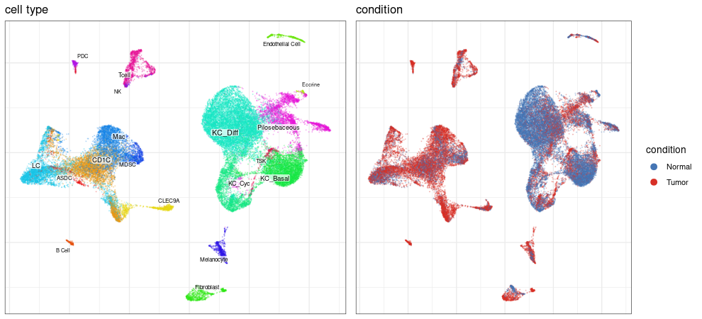
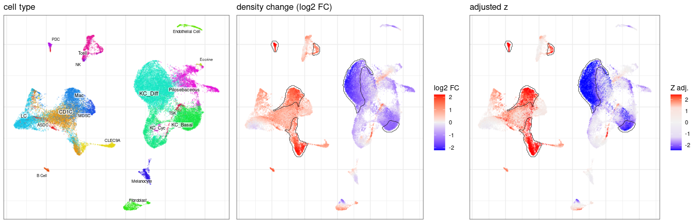
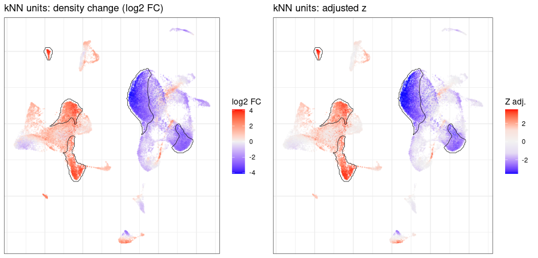
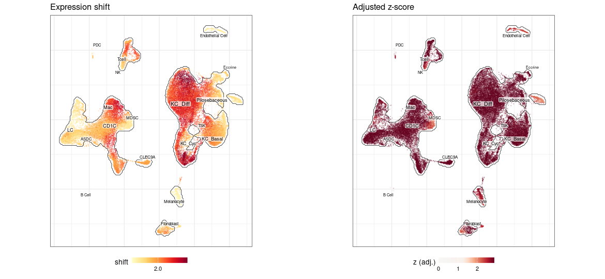
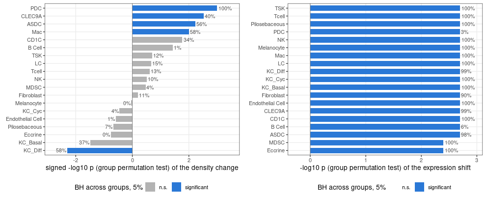

Cacoa on the cutaneous squamous cell carcinoma dataset: the cluster-free
maps on a Harmony-aligned graph
================
Cacoa developers
2026-11-15

- <a href="#load-data" id="toc-load-data">Load data</a>
- <a href="#cluster-free-density-shifts"
  id="toc-cluster-free-density-shifts">Cluster-free density shifts</a>
- <a href="#cluster-free-expression-shifts"
  id="toc-cluster-free-expression-shifts">Cluster-free expression
  shifts</a>
- <a href="#session-info" id="toc-session-info">Session info</a>

This notebook is a companion of `scc_cacoa.Rmd`: the same cells, counts
and annotation on a kNN graph of a Harmony embedding
(`prepare_scc_harmony.R`: 2,000 variable genes, 50 PCs, Harmony by
sample, 30 nearest neighbors on 30 Harmony dimensions, UMAP on the same)
instead of the Conos alignment graph. Only the graph-dependent parts are
rerun, the cluster-free density and expression-shift maps; the
cell-type-level analyses use the counts and the annotation alone and are
those of the main notebook. The PF companion
(`../pf/pf_cacoa_harmony.Rmd`, `../pf/pf_density_diagnosis.md`) shows
why the graph matters there: on the Conos alignment of that cohort the
density kernel leaks out of the populations present in only part of the
samples. Here the question is whether the maps of a cohort where the
Conos graph worked change with the alignment.

``` r
library(cacoa)
library(ggplot2)
library(dplyr)
```

## Load data

``` r
seu <- readRDS(params$data.file)
cell.meta <- read.delim(params$cell.meta, check.names = FALSE)[colnames(seu), ]
sample.meta <- cell.meta %>%
  group_by(sample = paste(patient, tum.norm, sep = "_")) %>%
  summarise(condition = first(tum.norm), patient = first(patient), n.cells = n(), median.umi = median(nCount_RNA)) %>%
  tibble::column_to_rownames("sample")
sample.meta <- sample.meta[sort(unique(seu$sample)), ]
table(sample.meta$condition)
```

    ## 
    ## Normal  Tumor 
    ##      8      9

``` r
cao <- Cacoa$new(seu, sample.metadata = sample.meta, sample.per.cell = factor(seu$sample), cell.groups = factor(seu$celltype),
                 embedding = seu@reductions$umap@cell.embeddings, graph.name = "RNA_nn", data.layer = "data", n.cores = params$n.cores)
```

    ## Sample metadata: 17 samples, 4 columns
    ##   usable (3): condition [Normal 8, Tumor 9], n.cells [num, 937-4641], median.umi [num, 2759-22269]
    ##   excluded from screening (1): patient (high-cardinality)

    ## Next: cao$checkDesign() and cao$screenCovariates(), or cao$setModel(test = "<variable>").

``` r
cao$setOptions(n.permutations = 999, seed = 1)
cao$plot.params <- list(size = 0.2, alpha = 0.2, font.size = c(2, 3))
cao$sample.groups.palette <- c(Normal = "#4575b4", Tumor = "#d73027")
```

The graph used is Seurat’s kNN graph on the Harmony embedding (`RNA_nn`,
symmetrized). The thin black lines on the maps below outline the regions
where the cells significant at an adjusted p of 0.05 are the majority
(`outline = TRUE`).

``` r
cowplot::plot_grid(cao$plotEmbedding(color.by = "cell.groups", title = "cell type"),
                   cao$plotEmbedding(color.by = "condition", title = "condition", mark.groups = FALSE, show.legend = TRUE), ncol = 2)
```

<!-- -->

``` r
cao$setModel(~ condition, test = "condition")
```

    ## Model: ~condition      dispersion: ~condition
    ## Test: condition: Tumor vs Normal  (reference 'Normal': matched a control-like name; to change: test = "condition: Normal vs Tumor")
    ##        unadjusted; permutations: block (24,310 distinct); 17 of 17 samples can change their value; smallest p-value 0.001
    ##        shift > 0: Tumor samples differ from Normal samples in a common direction, beyond within-group variability
    ## Samples: 17 used.   Issues: none

## Cluster-free density shifts

The same map as in the main notebook: the default diffusion
neighborhoods (`scale = "auto"`, a scan over 1, 3 and 5 % of the cells),
each sample’s kernel density tested on the log scale with the model,
cells adjusted by the pooled permutation false-discovery rate.

``` r
cao$estimateCellDensity(method = "graph")
```

    ## kNN neighborhoods of at least 170 cells (10.0 per sample)

``` r
cao$estimateDiffCellDensity()
```

    ## diffusion neighborhoods at 1 %, 3 %, 5 % of the cells (auto: one scale is chosen)

    ## scale 0.01: heat kernel beta 16.4

    ## scale 0.03: heat kernel beta 25.2

    ## scale 0.05: heat kernel beta 35.7

    ## 17753 of 39074 cells at FDR 10 % (scale 1 % chosen)

``` r
cowplot::plot_grid(cao$plotEmbedding(color.by = "cell.groups", title = "cell type"),
                   cao$plotDiffCellDensity(what = "effect", title = "density change (log2 FC)", outline = TRUE),
                   cao$plotDiffCellDensity(title = "adjusted z", outline = TRUE), ncol = 3)
```

<!-- -->

On the Harmony graph the scan picks the 1 % scale (neighborhoods of
about 390 cells; 5 % on the Conos graph) and calls 17,753 of the 39,074
cells at FDR 10 % (45 %; 47 % there). The same immune expansions lead:
every PDC (log2 fold change 2.2), 84 % of the ASDCs, 62 % of the
`CLEC9A` dendritic cells, 69 % of the macrophages and half of the `CD1C`
cells. The differentiated keratinocytes are called more fully than on
the Conos graph (65 % at -1.2, against 52 % there) and with a larger
loss, the basal ones about as fully (54 %, against 59 % there); the
per-type test calls `KC_Diff` on both graphs (adjusted p 0.028; 0.035 on
Conos), while the B cells drop to 0.088 (0.025 there). Five types pass
here, PDC, `CLEC9A`, ASDC, the macrophages and `KC_Diff`; the Conos
graph adds the B cells.

The kNN neighborhoods of the graph itself (`scale = NULL`: the stored
units of `estimateCellDensity()`, about 170 cells each) are the other
neighborhood definition available; they are one hop wide, so they cannot
leak the way a kernel can.

``` r
cao$estimateCellDensity(method = "graph", name = "cell.density.knn")
```

    ## kNN neighborhoods of at least 170 cells (10.0 per sample)

``` r
cao$estimateDiffCellDensity(name = "cell.density.knn", scale = NULL)
```

    ## 16994 of 39074 cells at FDR 10 %

``` r
cowplot::plot_grid(cao$plotDiffCellDensity(name = "cell.density.knn", what = "effect", title = "kNN units: density change (log2 FC)", outline = TRUE),
                   cao$plotDiffCellDensity(name = "cell.density.knn", title = "kNN units: adjusted z", outline = TRUE), ncol = 2)
```

<!-- -->

The kNN neighborhoods (170 cells) call about as many cells (16,994) with
larger effects (PDC 3.7, `KC_Diff` -2.1, macrophages 2.1) and seven
significant types, adding the basal keratinocytes (0.035) and `CD1C`
(0.043).

## Cluster-free expression shifts

``` r
cao$estimateClusterFreeExpressionShifts(n.permutations = 499)
```

    ## 13654 genes (per neighborhood: those detected in >= 5 % of its cells)

    ## diffusion neighborhoods at 1 %, 3 %, 5 % of the cells (auto: one scale is chosen), at least 170 cells each (10.0 per sample)

    ## scale 0.01: heat kernel beta 16.4, 326 centers, neighborhoods of 394 cells (median, 171 smallest)

    ## scale 0.03: heat kernel beta 25.2, 116 centers, neighborhoods of 981 cells (median, 206 smallest)

    ## scale 0.05: heat kernel beta 35.7, 68 centers, neighborhoods of 1955 cells (median, 440 smallest)

    ## 38458 of 39074 cells keep adjusted z >= 1.28 (scale 1 % chosen)

``` r
cao$plotClusterFreeExpressionShifts(adjusted = TRUE, font.size = c(2, 3), outline = TRUE)
```

<!-- -->

The expression-shift map is the same on both graphs: the scan picks 1 %,
98 % of the cells pass FDR 5 % and all 19 types are significant. The
strongest shifts here are the cycling and differentiated keratinocytes
(median 2.4), `TSK` and the macrophages (2.2) and the T cells (2.0); on
the Conos graph the T cells, fibroblasts and `TSK` (2.3-2.4) led. Two
small populations are called per type but hardly per cell on this graph,
the B cells (6 % of their cells) and the PDCs (3 %; 83 % and 100 % on
the Conos graph), both islands of their own on this embedding.

``` r
cao$estimateClusterFreeSummary("cell.density")
cao$estimateClusterFreeSummary("cluster.free.expr.shifts")
cowplot::plot_grid(cao$plotClusterFreeSummary("cell.density"), cao$plotClusterFreeSummary("cluster.free.expr.shifts"), ncol = 2)
```

<!-- -->

Per type the two maps agree between the graphs: the density map on the
Harmony graph puts more weight on the keratinocyte losses and the Conos
graph on the B cells, and the expression-shift map is unchanged.

## Session info

``` r
sessionInfo()
```

    ## R version 4.2.2 Patched (2022-11-10 r83330)
    ## Platform: x86_64-pc-linux-gnu (64-bit)
    ## Running under: Ubuntu 20.04.6 LTS
    ## 
    ## Matrix products: default
    ## BLAS:   /usr/lib/x86_64-linux-gnu/blas/libblas.so.3.9.0
    ## LAPACK: /usr/lib/x86_64-linux-gnu/lapack/liblapack.so.3.9.0
    ## 
    ## locale:
    ##  [1] LC_CTYPE=en_US.UTF-8       LC_NUMERIC=C              
    ##  [3] LC_TIME=en_US.UTF-8        LC_COLLATE=en_US.UTF-8    
    ##  [5] LC_MONETARY=en_US.UTF-8    LC_MESSAGES=en_US.UTF-8   
    ##  [7] LC_PAPER=en_US.UTF-8       LC_NAME=C                 
    ##  [9] LC_ADDRESS=C               LC_TELEPHONE=C            
    ## [11] LC_MEASUREMENT=en_US.UTF-8 LC_IDENTIFICATION=C       
    ## 
    ## attached base packages:
    ## [1] stats     graphics  grDevices utils     datasets  methods   base     
    ## 
    ## other attached packages:
    ## [1] dplyr_1.1.4    ggplot2_4.0.2  cacoa_0.5.0    Matrix_1.6-1.1
    ## 
    ## loaded via a namespace (and not attached):
    ##   [1] nlme_3.1-161           spatstat.sparse_3.1-0  matrixStats_1.5.0     
    ##   [4] RcppAnnoy_0.0.22       RColorBrewer_1.1-3     httr_1.4.7            
    ##   [7] sctransform_0.4.2      tools_4.2.2            R6_2.6.1              
    ##  [10] irlba_2.3.5.1          KernSmooth_2.23-20     colorspace_2.1-0      
    ##  [13] uwot_0.2.3             lazyeval_0.2.2         withr_3.0.2           
    ##  [16] sp_2.2-0               tidyselect_1.2.1       gridExtra_2.3         
    ##  [19] compiler_4.2.2         progressr_0.15.1       cli_3.6.5             
    ##  [22] spatstat.explore_3.5-2 plotly_4.11.0          labeling_0.4.3        
    ##  [25] Seurat_4.3.0.1         scales_1.4.0           spatstat.data_3.1-8   
    ##  [28] lmtest_0.9-40          S7_0.2.0               ggridges_0.5.7        
    ##  [31] pbapply_1.7-4          goftest_1.2-3          stringr_1.5.1         
    ##  [34] digest_0.6.37          spatstat.utils_3.1-5   rmarkdown_2.29        
    ##  [37] pkgconfig_2.0.3        htmltools_0.5.8.1      parallelly_1.45.1     
    ##  [40] fastmap_1.2.0          htmlwidgets_1.6.4      rlang_1.1.7           
    ##  [43] shiny_1.11.1           farver_2.1.2           generics_0.1.4        
    ##  [46] zoo_1.8-14             jsonlite_2.0.0         spatstat.random_3.4-1 
    ##  [49] ica_1.0-3              magrittr_2.0.3         patchwork_1.3.2       
    ##  [52] Rcpp_1.1.0             abind_1.4-8            ape_5.8-1             
    ##  [55] reticulate_1.43.0      lifecycle_1.0.4        stringi_1.8.7         
    ##  [58] yaml_2.3.10            MASS_7.3-58            Rtsne_0.17            
    ##  [61] plyr_1.8.9             grid_4.2.2             parallel_4.2.2        
    ##  [64] listenv_0.9.1          promises_1.3.3         ggrepel_0.9.6         
    ##  [67] deldir_2.0-4           miniUI_0.1.2           lattice_0.20-45       
    ##  [70] sccore_1.0.6           cowplot_1.2.0          splines_4.2.2         
    ##  [73] tensor_1.5.1           knitr_1.50             pillar_1.11.0         
    ##  [76] igraph_2.1.4           spatstat.geom_3.5-0    future.apply_1.20.0   
    ##  [79] reshape2_1.4.4         codetools_0.2-18       leiden_0.4.3          
    ##  [82] glue_1.8.0             evaluate_1.0.5         SeuratObject_4.1.3    
    ##  [85] spatstat.univar_3.1-4  data.table_1.17.8      png_0.1-8             
    ##  [88] vctrs_0.6.5            httpuv_1.6.16          polyclip_1.10-7       
    ##  [91] gtable_0.3.6           RANN_2.6.2             purrr_1.1.0           
    ##  [94] tidyr_1.3.1            scattermore_1.2        future_1.67.0         
    ##  [97] xfun_0.53              mime_0.13              xtable_1.8-4          
    ## [100] later_1.4.4            survival_3.4-0         viridisLite_0.4.2     
    ## [103] tibble_3.3.0           cluster_2.1.4          globals_0.18.0        
    ## [106] fitdistrplus_1.2-4     ROCR_1.0-11
