Cacoa on the lupus PBMC dataset (Perez et al. 2022): covariates and an
entangled processing cohort
================
Cacoa developers
2026-11-19

- <a href="#load-data" id="toc-load-data">Load data</a>
- <a href="#check-the-design" id="toc-check-the-design">Check the design</a>
- <a href="#screen-covariates" id="toc-screen-covariates">Screen covariates</a>
  - <a href="#sample-maps" id="toc-sample-maps">Sample maps</a>
- <a href="#sle-versus-healthy-without-covariates" id="toc-sle-versus-healthy-without-covariates">SLE versus healthy, without covariates</a>
- <a href="#sle-versus-healthy-with-the-covariates-and-the-cohort" id="toc-sle-versus-healthy-with-the-covariates-and-the-cohort">SLE versus healthy, with the covariates and the cohort</a>
  - <a href="#behind-one-cell-type" id="toc-behind-one-cell-type">Behind one cell type</a>
- <a href="#differential-expression-per-cell-type" id="toc-differential-expression-per-cell-type">Differential expression per cell type</a>
- <a href="#functional-interpretation" id="toc-functional-interpretation">Functional interpretation</a>
- <a href="#cluster-free-analyses" id="toc-cluster-free-analyses">Cluster-free analyses</a>
  - <a href="#cluster-free-density-shifts" id="toc-cluster-free-density-shifts">Cluster-free density shifts</a>
  - <a href="#cluster-free-expression-shifts" id="toc-cluster-free-expression-shifts">Cluster-free expression shifts</a>
- <a href="#sle-in-asian-and-european-american-donors" id="toc-sle-in-asian-and-european-american-donors">SLE in Asian and European American donors</a>
- <a href="#flare-versus-managed-disease" id="toc-flare-versus-managed-disease">Flare versus managed disease</a>
- <a href="#plasmacytoid-dendritic-cells-and-age-in-healthy-donors" id="toc-plasmacytoid-dendritic-cells-and-age-in-healthy-donors">Plasmacytoid dendritic cells and age in healthy donors</a>
- <a href="#summary" id="toc-summary">Summary</a>
- <a href="#session-info" id="toc-session-info">Session info</a>

Perez et al. (2022, Science) profiled peripheral blood mononuclear cells (PBMC) of 162 patients with systemic lupus
erythematosus (SLE) and 99 healthy donors by multiplexed scRNA-seq (10x). The data are taken from CELLxGENE with the
authors' cell-type annotation (11 populations) and subsampled to at most 600 cells per donor, which leaves 156,456 cells
of 261 donors; the cells are placed on a kNN graph of a Harmony embedding (`prepare_sle_harmony.R`, next to this
notebook). The donors were processed in four processing cohorts (`C1`-`C4`), and the study records their ancestry
(`ethnicity`), sex and age, and, for the patients, the disease state at sampling (`flare`, `managed`, `treated`).

The contrast of interest is **SLE versus healthy**. This notebook is about the covariates: it fits the contrast
without them and with age, ethnicity and the processing cohort, shows which results depend on that choice, and then
turns to a second contrast, flare versus managed disease, that cannot be separated from the processing cohort at all.
In short: the classical monocytes expand and the CD4 T cells contract in SLE, and the expression of every major
population shifts, with or without the covariates; adjusting for them removes the plasmacytoid dendritic cells from the
composition result. The flare samples all come from one processing cohort, and healthy donors of that cohort differ
from the other healthy donors in the expression of every major population, so the expression differences between
flare and managed disease in these data cannot be attributed to the flare.

``` r
library(cacoa)
library(ggplot2)
```

## Load data

``` r
seu <- readRDS(params$data.file)
samples <- sort(unique(seu$sample))
sample.meta <- readRDS(params$meta.file)[samples, c("condition", "disease_state", "cohort", "ethnicity", "sex", "age", "n.cells")]
sample.meta$disease_state[sample.meta$condition == "Healthy"] <- "healthy"
sample.meta$n.cells <- as.vector(table(seu$sample)[samples])   # cells in this object (at most 600 per donor)
summary(sample.meta)
```

       condition   disease_state      cohort               ethnicity       sex     
     Healthy: 99   Length:261         C1: 38   African American :  3   female:244  
     SLE    :162   Class :character   C2:121   Asian            :107   male  : 17  
                   Mode  :character   C3: 24   European American:149               
                                      C4: 78   Hispanic or Latin:  2               
                                                                                   
                                                                                   
          age           n.cells     
     Min.   :20.00   Min.   :456.0  
     1st Qu.:29.00   1st Qu.:600.0  
     Median :37.00   Median :600.0  
     Mean   :41.16   Mean   :599.4  
     3rd Qu.:53.00   3rd Qu.:600.0  
     Max.   :83.00   Max.   :600.0  

``` r
table(sample.meta$condition, sample.meta$cohort)
```

             
               C1  C2  C3  C4
      Healthy  38  12   7  42
      SLE       0 109  17  36

``` r
table(seu$celltype)
```

         B    cDC     cM    ncM     NK     PB    pDC Progen Prolif     T4     T8 
     19069   2230  38695   6097  11429    187    554    102   1081  46162  30850 

The design is unbalanced in two ways that matter below. Cohort `C1` holds only healthy donors, and nearly all patients
are in `C2` and `C4`. Women are 244 of the 261 donors. `n.cells` is the number of cells per donor in this object.

``` r
cao <- Cacoa$new(seu, sample.metadata = sample.meta, sample.per.cell = factor(seu$sample), cell.groups = factor(seu$celltype),
                 embedding = seu@reductions$umap@cell.embeddings, graph.name = "RNA_nn", data.layer = "data", n.cores = params$n.cores)
```

    Sample metadata: 261 samples, 7 columns
      usable (7): condition [Healthy 99, SLE 162], disease_state [4 levels], cohort [4 levels], ethnicity [4 levels], sex [female 244, male 17], age [num, 20-83], n.cells [num, 456-600]

    Next: cao$checkDesign() and cao$screenCovariates(), or cao$setModel(test = "<variable>").

``` r
cao$setOptions(n.permutations = 499, seed = 1)
cao$plot.params <- list(size = 0.1, alpha = 0.1, font.size = c(2, 3))
cao$sample.groups.palette <- c(Healthy = "#4575b4", SLE = "#d73027")
```

``` r
cowplot::plot_grid(cao$plotEmbedding(color.by = "cell.groups", title = "cell type"),
                   cao$plotEmbedding(color.by = "condition", title = "condition", mark.groups = FALSE, show.legend = TRUE), ncol = 2)
```

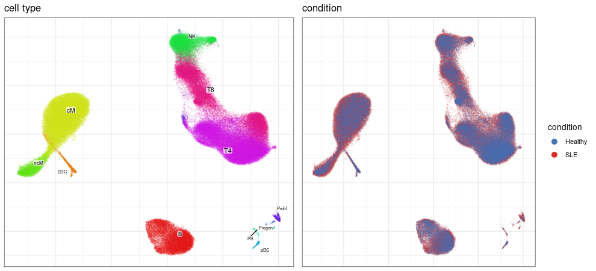<!-- -->

The embedding separates the myeloid populations (classical and non-classical monocytes, `cM` and `ncM`, and the
conventional dendritic cells, `cDC`), the CD4 and CD8 T cells (`T4`, `T8`) and the NK cells, the B cells, and a small
group of plasmablasts (`PB`), plasmacytoid dendritic cells (`pDC`), proliferating lymphocytes (`Prolif`) and progenitor
cells (`Progen`).

## Check the design

``` r
cao$checkDesign(test = "condition")
```

    Design check: 261 samples, 7 covariates, test variable 'condition'
      association with 'condition': disease_state 1.00, cohort 0.65, ethnicity 0.27, age 0.22, sex 0.13, n.cells 0.08
      Error (1):
        - 'condition' is fully determined by 'disease_state' (each disease_state contains one condition): the condition effect cannot be separated from disease_state -> do not adjust for 'disease_state', or test it instead
      Warning (2):
        - 'disease_state' is strongly associated with 'condition' (1.00): adjusting for it estimates the condition effect not explained by disease_state -> consider reporting both models (cao$checkSensitivity())
        - 'cohort' is strongly associated with 'condition' (0.65): adjusting for it estimates the condition effect not explained by cohort -> consider reporting both models (cao$checkSensitivity())
      Note (8):
        - 'disease_state' and 'cohort' are associated (0.60) -> adjusting for both estimates each one's unique contribution only
        - 'disease_state' and 'ethnicity' are associated (0.32) -> adjusting for both estimates each one's unique contribution only
        - 'cohort' and 'ethnicity' are associated (0.31) -> adjusting for both estimates each one's unique contribution only
        - 'disease_state' and 'age' are associated (0.33) -> adjusting for both estimates each one's unique contribution only
        - 'cohort' and 'age' are associated (0.36) -> adjusting for both estimates each one's unique contribution only
        - 1 empty cell(s) in condition x cohort -> the design is unbalanced; a marginal contrast cannot average over empty cells
        - 2 cell(s) of condition x ethnicity hold a single sample -> estimates in those cells rest on one sample
        - 1 empty cell(s) in condition x ethnicity -> the design is unbalanced; a marginal contrast cannot average over empty cells

The design check reports what is known about the study: `disease_state` is defined only for patients and determines
the condition, so it cannot be a covariate of this contrast (it is the variable of the second contrast below). The
processing cohort is associated with the condition (0.65 on the check's association scale) because cohort `C1` holds only healthy donors and `C2` mostly patients (109 of 121);
age and ethnicity are weakly associated (0.22 and 0.27).

``` r
cao$plotDesign("balance")
```

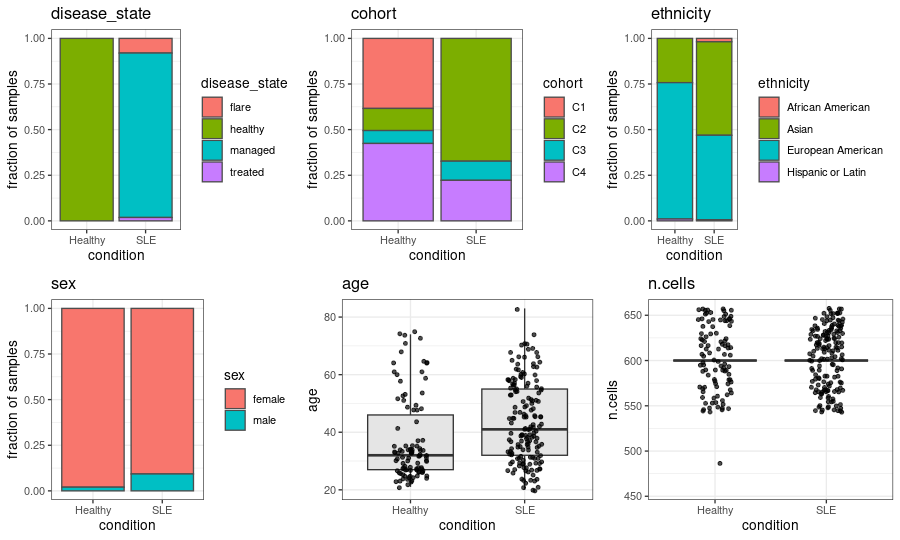<!-- -->

``` r
cao$plotDesign("associations")
```

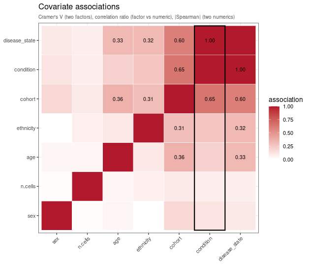<!-- -->

The association matrix shows every pair of metadata columns (Cramér's V for two factors, the correlation ratio for a
factor and a number). The processing cohort is associated with the condition (0.65) and also with age (0.36) and
ethnicity (0.31): the cohorts differ in whom they recruited, so adjusting for any of these covariates also partly
adjusts for the others.

## Screen covariates

``` r
cao$screenCovariates(n.permutations = 199)
```

    Covariate screen: 7 covariates x 8 cell types, marginal + partial mode, permutation p-values (199 permutations)
      not screened (fewer than 6 samples): pDC
    Associated with expression in >= 2 cell types (partial, FDR 5%): cohort (8 types, global p 0.005), ethnicity (7 types, global p 0.005), sex (7 types, global p 0.005), age (6 types, global p 0.005)
    Marginal only (not separable from the other covariates): condition, disease_state
    Associated with sample dispersion: cohort (6 types)
    Strongly tied to 'condition' (possible over-adjustment): disease_state (1.00), cohort (0.65)
    all cell types (partial, FDR 5%): cohort (adj. R2 0.10), ethnicity (adj. R2 0.01), age (adj. R2 0.01), sex (adj. R2 0.00)
    composition (partial, FDR 5%): ethnicity (adj. R2 0.02), cohort (adj. R2 0.02), disease_state (adj. R2 0.01), age (adj. R2 0.01)
    Suggested model: ~condition + ethnicity + sex + age   (not applied; see cao$setModel())
    Note: constant within a cell type (not tested there): n.cells in cDC; n.cells in ncM; condition/sex/n.cells in Prolif

``` r
cao$plotCovariateScreen()
```

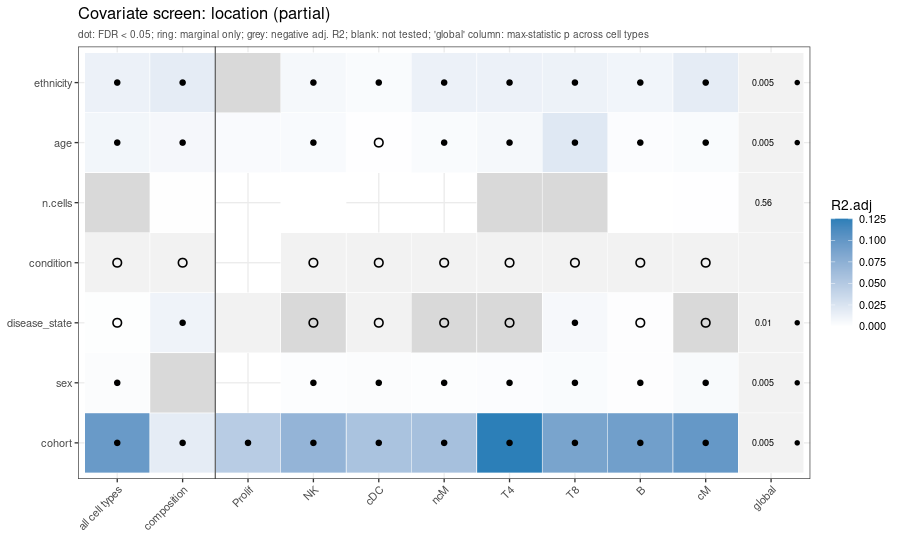<!-- -->

``` r
cao$plotCovariateSummary()
```

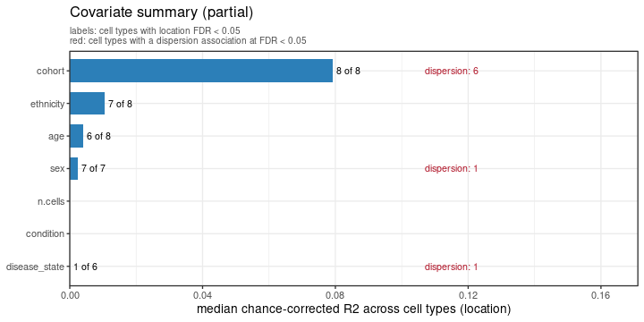<!-- -->

The covariate screen tests each covariate's association with each cell type's expression after the other covariates
(partial mode). The processing cohort is associated with the expression of all 8 screened cell types and explains the
most (adjusted R2 0.10 for all cell types together, median 0.08 over the cell types), and with the spread of the samples (dispersion) in 6; ethnicity, sex and age follow
with much smaller shares (adjusted R2 0.01 or less). The screen suggests `~ condition + ethnicity + sex + age`; it does
not propose the cohort, which is strongly tied to the condition. The model below adjusts for age and ethnicity and
treats the cohort as a grouping term: `(1 | cohort)` is not fitted, it restricts the relabeling of the condition to
within cohorts, so that no cohort difference can enter the null distribution as a condition effect. Sex is left out
(17 men); the sensitivity analysis adds it.

``` r
cao$plotVariancePartition(c("condition", "cohort", "ethnicity", "age"))
```

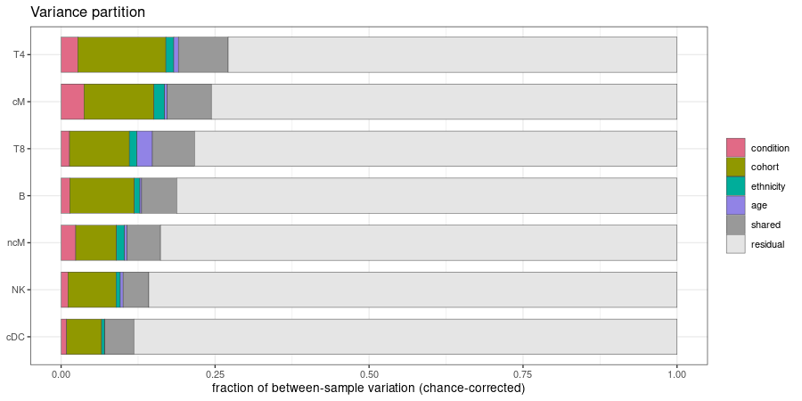<!-- -->

The variance partition splits the between-donor variation of each cell type's expression into the parts explained
by each variable alone, a shared part and a residual. The processing cohort explains far more than the condition in
every cell type: about 14 % against 3 % in the CD4 T cells, 11 % against 4 % in the classical monocytes. The
processing cohort, not the condition, is the largest structured source of variation in these data.

### Sample maps

``` r
cowplot::plot_grid(
  cao$plotSampleDistances(cell.type = "cM", color.by = "cohort", shape.by = "condition"),
  cao$plotSampleDistances(color.by = "cohort", shape.by = "condition"),
  cao$plotSampleDistances(space = "composition", color.by = "cohort", shape.by = "condition"), ncol = 3)
```

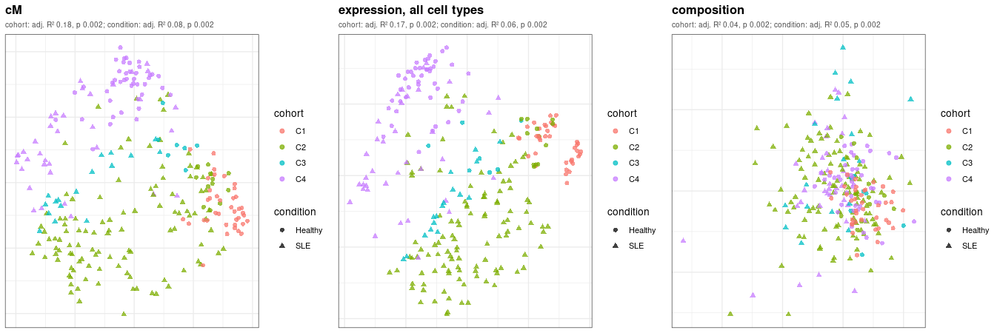<!-- -->

The sample maps place the donors by the distances between their profiles: of the classical monocytes (left), of all
cell types together (middle) and of the composition (right); color is the cohort, shape the condition. The subtitles
give the share of the distances explained by each variable. On the expression maps the cohort explains 17-18 % and the
condition 6-8 %: the donors group by cohort first (`C1` and `C4` apart from `C2`), and within a cohort by condition.
The composition is much less structured by the cohort (4 %) than the expression.

## SLE versus healthy, without covariates

First the contrast without any covariate, stored under separate names so that the two models can be compared.

``` r
cao$setModel(~ condition, test = "condition")
```

    Model: ~condition      dispersion: ~condition
    Test: condition: SLE vs Healthy  (reference 'Healthy': matched a control-like name; to change: test = "condition: Healthy vs SLE")
           unadjusted; permutations: block (> 10 million distinct); 261 of 261 samples can change their value; smallest p-value 0.002
           shift > 0: SLE samples differ from Healthy samples in a common direction, beyond within-group variability
    Samples: 261 used.   Issues: none

``` r
cao$estimateCellLoadings(name = "coda.plain")
cao$estimateExpressionShiftMagnitudes(name = "shifts.plain")
```

## SLE versus healthy, with the covariates and the cohort

``` r
cao$setModel(~ condition + age + ethnicity + (1 | cohort), test = "condition")
```

    Model: ~condition + age + ethnicity + (1 | cohort)      dispersion: ~condition
           grouping term (1 | cohort): not fitted; the tested variable is exchanged within its levels
    Test: condition: SLE vs Healthy  (reference 'Healthy': matched a control-like name; to change: test = "condition: Healthy vs SLE")
           adjusted for age, ethnicity; permutations: block within 9 strata (> 10 million distinct); 220 of 261 samples can change their value; smallest p-value 0.002
           shift > 0: SLE samples differ from Healthy samples in a common direction, beyond within-group variability
    Samples: 261 used.   Issues: 2 notes
      note: test 'condition: SLE vs Healthy': continuous covariate(s) age with grouping variable(s) cohort: the rows of the design are exchanged within the groups (the covariate moves with the tested variable; approximate)
      note: 'cohort': 1 of 4 levels hold one value of 'condition'; their samples keep it in every relabeling (220 of 261 samples can change their value)

With the grouping term the condition is exchanged within the cohorts, and within each cohort among donors of the same
ethnicity (9 strata, as the report says); the 38 healthy donors of `C1` and the 3 African American patients of `C3`
are in strata that hold only one condition and keep their label in every relabeling, so 220 of the 261 donors can change their value. Age is continuous, so the exchange of the
rows of the design within cohorts is approximate (the note says so).

``` r
cao$estimateCellLoadings()
cao$plotCellLoadings(center = "both")
```

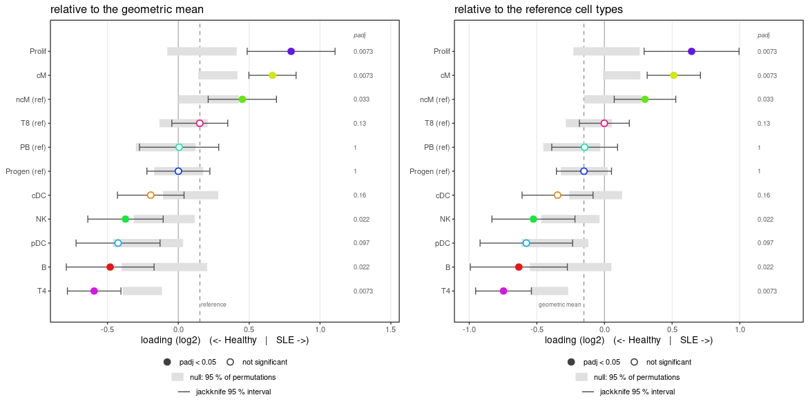<!-- -->

The composition test fits the log ratios of the cell-type proportions with the model and tests each cell type's
loading by relabeling. Classical monocytes and proliferating cells are enriched in SLE, CD4 T cells, B cells and NK cells
depleted (adjusted p 0.007-0.022); the non-classical monocytes are enriched (0.033).

``` r
knitr::kable(codaLoadingsTable(cao$test.results$coda, min.effect = 1.25), digits = 3)
```

| celltype | loading | fold.change |    se | ci.low | ci.high |  pval |  padj | reference | median.cells | n.zero | pseudocount.shift | beyond.min.effect |
|:---------|--------:|------------:|------:|-------:|--------:|------:|------:|:----------|-------------:|-------:|------------------:|:------------------|
| Prolif   |   0.796 |       1.736 | 0.155 |  0.490 |   1.102 | 0.002 | 0.007 | FALSE     |            3 |     25 |             0.706 | TRUE              |
| cM       |   0.665 |       1.585 | 0.088 |  0.491 |   0.838 | 0.002 | 0.007 | FALSE     |          132 |      0 |             0.203 | TRUE              |
| T4       |  -0.594 |       0.662 | 0.096 | -0.784 |  -0.405 | 0.002 | 0.007 | FALSE     |          176 |      0 |             0.160 | TRUE              |
| NK       |  -0.373 |       0.772 | 0.145 | -0.658 |  -0.088 | 0.008 | 0.022 | FALSE     |           40 |      2 |             0.083 | FALSE             |
| B        |  -0.481 |       0.716 | 0.175 | -0.826 |  -0.137 | 0.010 | 0.022 | FALSE     |           66 |      4 |             0.133 | FALSE             |
| ncM      |   0.452 |       1.368 | 0.122 |  0.212 |   0.692 | 0.018 | 0.033 | TRUE      |           20 |      0 |             0.153 | FALSE             |
| pDC      |  -0.426 |       0.745 | 0.148 | -0.718 |  -0.133 | 0.062 | 0.097 | FALSE     |            2 |     66 |             0.708 | FALSE             |
| T8       |   0.151 |       1.110 | 0.102 | -0.049 |   0.351 | 0.096 | 0.132 | TRUE      |          112 |      0 |             0.166 | FALSE             |
| cDC      |  -0.195 |       0.874 | 0.122 | -0.436 |   0.046 | 0.128 | 0.156 | FALSE     |            8 |      3 |             0.167 | FALSE             |
| PB       |   0.005 |       1.004 | 0.137 | -0.265 |   0.276 | 0.968 | 0.996 | TRUE      |            0 |    163 |             0.141 | FALSE             |
| Progen   |   0.000 |       1.000 | 0.114 | -0.223 |   0.224 | 0.996 | 0.996 | TRUE      |            0 |    181 |             0.017 | FALSE             |

``` r
cao$plotCodaSamples(n.top = 8)
```

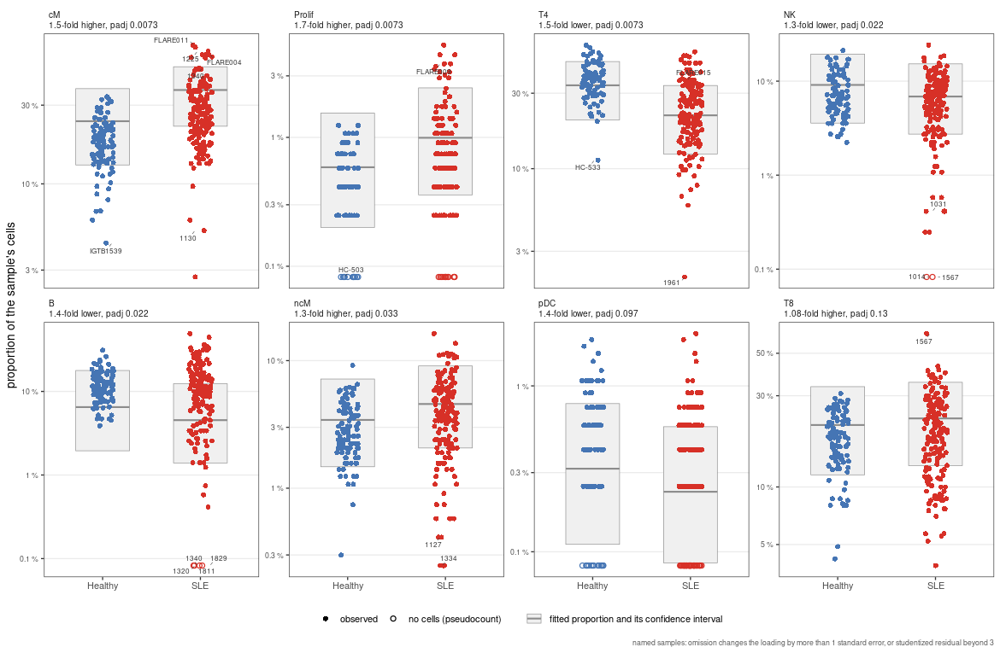<!-- -->

The per-donor proportions show the data behind each loading: the eight cell types with the smallest p-values, the
healthy donors on the left, the patients on the right, with the fitted proportion and its interval. The changes are
shifts of broad distributions, not of a few donors: the patients' classical-monocyte fraction overlaps that of the
healthy donors for most of its range. The named donors are those whose omission changes the loading by more than a
standard error or whose residual exceeds three.

``` r
cao$plotContrastTree()
```

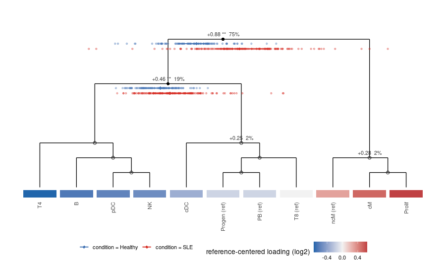<!-- -->

``` r
cao$plotCodaCellTypes(value = "predicted")
```

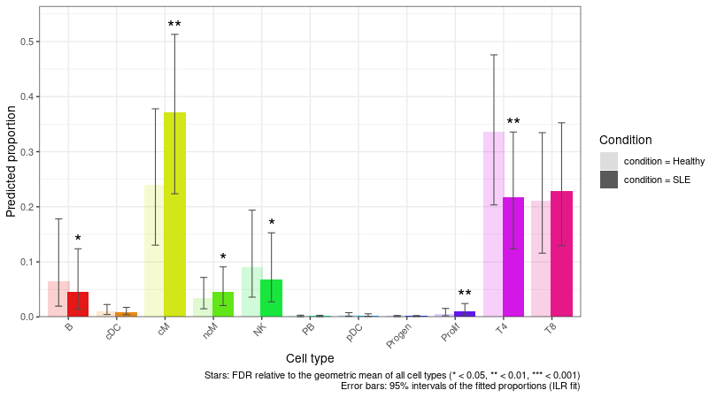<!-- -->

The contrast tree summarizes the composition change by successive splits: the first (0.88 log2 units, 75 % of the
change) separates the classical and non-classical monocytes and proliferating cells, which expand, from the rest; the
second (0.46, 19 %) separates the CD4 T, B, pDC and NK cells, which contract, from the CD8 T cells, conventional
dendritic cells, plasmablasts and progenitors. The predicted proportions translate the loadings into fractions of
the PBMC: classical monocytes from 24 % to 37 %, CD4 T cells from 34 % to 22 %, at the reference values of the
covariates.

``` r
cao$plotFitDiagnostics("composition")
```

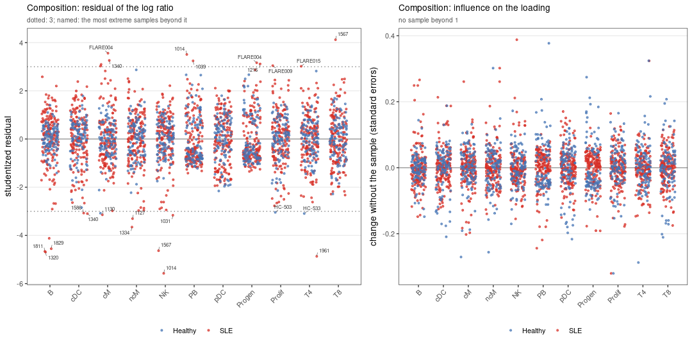<!-- -->

The fit diagnostics show, for every donor and cell type, the studentized residual of the log ratio (left) and the
change of the loading without the donor (right). Of the 22 donors with a residual beyond three in at least one cell
type, 14 are managed patients, 4 flare patients, 3 healthy donors and 1 a treated patient; the flare patients are
over-represented relative to their number (4 of 13, against 14 of 146 managed patients). No single donor changes a
loading by a standard error (largest change 0.39 standard errors).

``` r
res <- cao$estimateExpressionShiftMagnitudes()
```

    Building pseudobulk profiles per cell type...

    Testing 11 cell type(s), 1 test(s) with gsd (10079 genes, per type those in >= 5 % of its cells), 499 permutations...

    Building pseudobulk profiles per cell type...

    Testing 9 cell type(s), 1 test(s), 499 permutations (auto)...

    Skipped 1 cell type/test combination(s): too few samples with enough cells

    Note: continuous covariate(s) age with grouping variable(s) cohort: the rows of the design are exchanged within the groups (the covariate moves with the tested variable; approximate)

    Note: B: block permutation with continuous covariate(s) age is not exact

    Note: cDC: block permutation with continuous covariate(s) age is not exact

    Note: cM: block permutation with continuous covariate(s) age is not exact

    Note: ncM: block permutation with continuous covariate(s) age is not exact

    Note: NK: block permutation with continuous covariate(s) age is not exact

    Note: T4: block permutation with continuous covariate(s) age is not exact

    Note: T8: block permutation with continuous covariate(s) age is not exact

    8 of 10 cell types with a significant shift at FDR 5% (global p = 0.002).

``` r
res
```

    Expression shifts: condition: SLE vs Healthy; adjusted for age, ethnicity; 499 block permutations (smallest p 0.002-0.17); statistic gsd
     celltype   n n.mag shift padj.shift  var padj.var total padj.total
           cM 261   261  0.17     0.0029 0.30   0.0023  0.31      0.002
           T4 261   261  0.17     0.0029 0.40   0.0023  0.35      0.002
          ncM 249   224  0.12     0.0029 0.21   0.0023  0.20      0.002
           T8 261   261  0.10     0.0029 0.30   0.0023  0.22      0.002
            B 254   248  0.09     0.0029 0.19   0.0023  0.17      0.002
          cDC 203    99  0.07     0.0029 0.11   0.0080  0.12      0.002
           NK 252   247  0.07     0.0029 0.14   0.0023  0.12      0.002
           PB   8    NA    NA     0.3300   NA       NA    NA         NA
          pDC  29    NA    NA     0.3200   NA       NA    NA         NA
       Prolif  76    NA    NA     0.0075   NA       NA    NA         NA
      8 of 10 cell types with a significant shift (BH 5%); global p: shift 0.002, var 0.002, total 0.002
      tested without a magnitude (fewer than 2 samples per level with >= 10 cells): PB, pDC, Prolif
      not tested: Progen
      (normalized effects; full tables in $results and $wide)

``` r
cao$plotExpressionShiftMagnitudes(show.ci = TRUE, show.genes = TRUE)
```

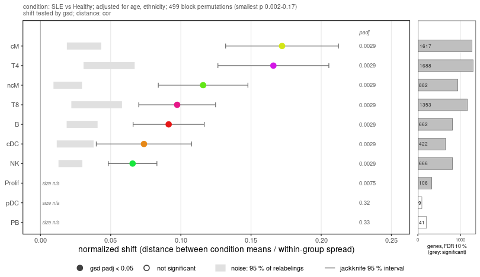<!-- -->

The seven major populations shift in expression (gsd, adjusted p 0.003), and so do the proliferating cells (0.0075);
the plasmablasts and plasmacytoid dendritic cells do not (0.33 and 0.32). The
largest normalized shifts are those of the classical monocytes and the CD4 T cells (0.17), the smallest those of the
conventional dendritic cells and the NK cells (0.07); the bars on the right count the genes with a change at FDR 10 %
(among the seven major populations, from 422 in cDC to about 1,600-1,700 in cM and T4). The plasmablasts, plasmacytoid dendritic cells and proliferating cells
have too few donors with 10 or more cells for a magnitude.

``` r
cao$plotExpressionShiftMagnitudes(effect = "var")
```

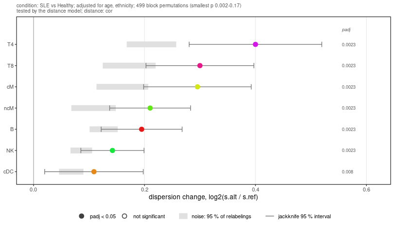<!-- -->

The dispersion effect tests whether the patients differ more from each other than the healthy donors do. They do,
in all seven populations (adjusted p 0.002-0.008), most in the CD4 T cells (log2 ratio of the spreads 0.40) and least
in the conventional dendritic cells (0.11): in addition to the common shift, the patients vary more among themselves.

### Behind one cell type

``` r
cao$plotShiftDetail("cM")
```

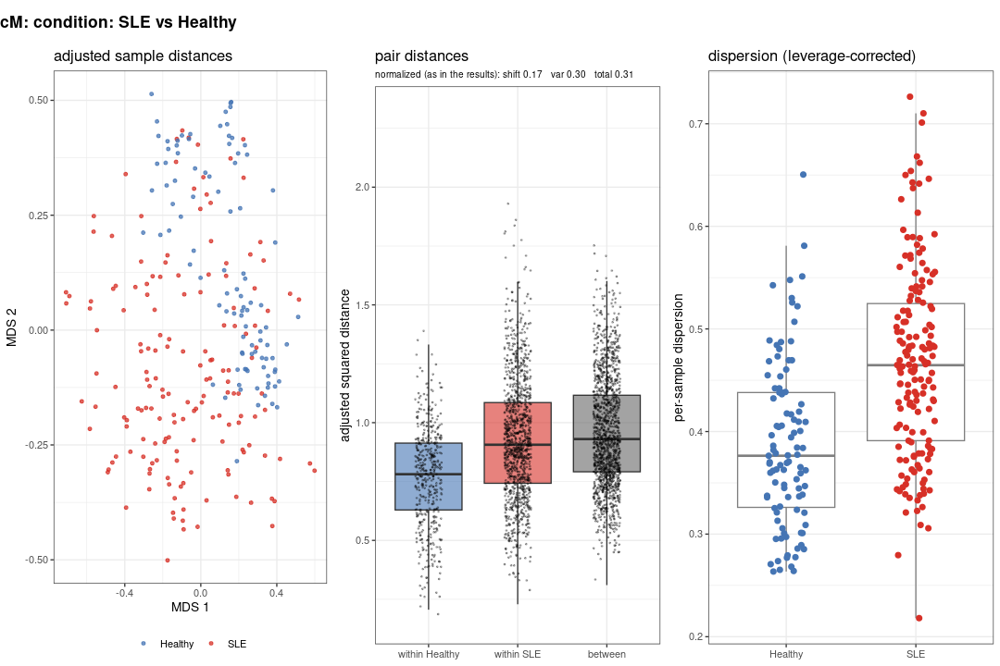<!-- -->

The detail of the classical monocytes shows the three quantities behind the result: the donors on the adjusted
distances (left), the distances between pairs of donors within each condition and between them (middle), and each
donor's dispersion (right). Pairs of patients are about as different as pairs of a patient and a healthy donor, and
both more than pairs of healthy donors: the shift (0.17) and the larger spread of the patients (0.30) together make
the total difference (0.31).

``` r
cao$plotSampleInfluence()
```

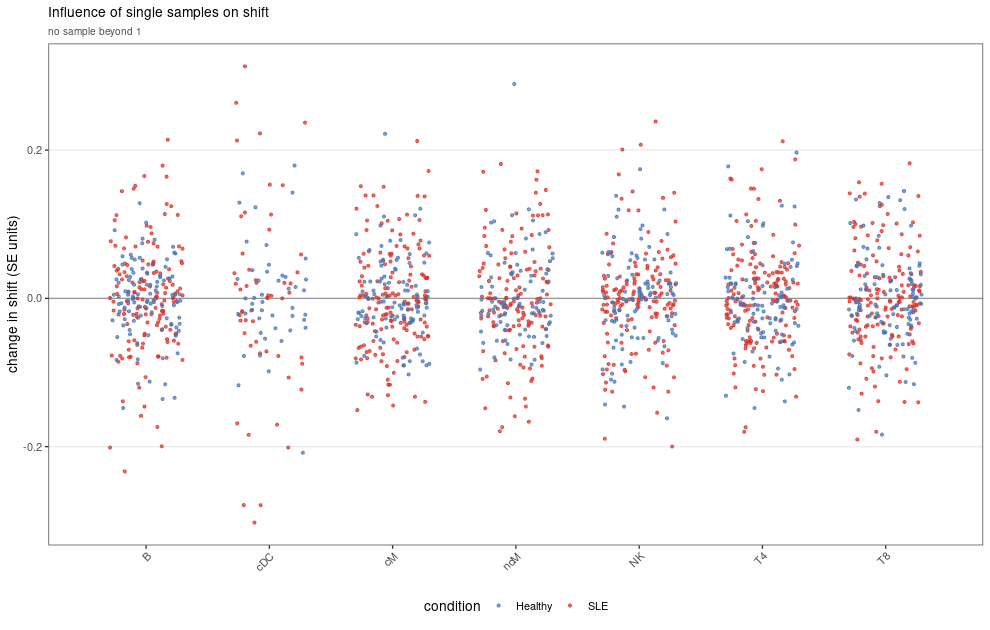<!-- -->

``` r
cao$plotFitDiagnostics("expression.shifts")
```

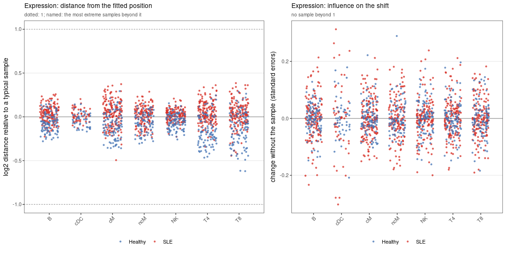<!-- -->

``` r
cowplot::plot_grid(cao$plotSampleDistances(values = "residual", color.by = "cohort", shape.by = "condition"),
                   cao$plotSampleDistances(values = "residual", color.by = "sex", shape.by = "condition"),
                   cao$plotSampleDistances(values = "residual", color.by = "disease_state", shape.by = "condition"), ncol = 3)
```

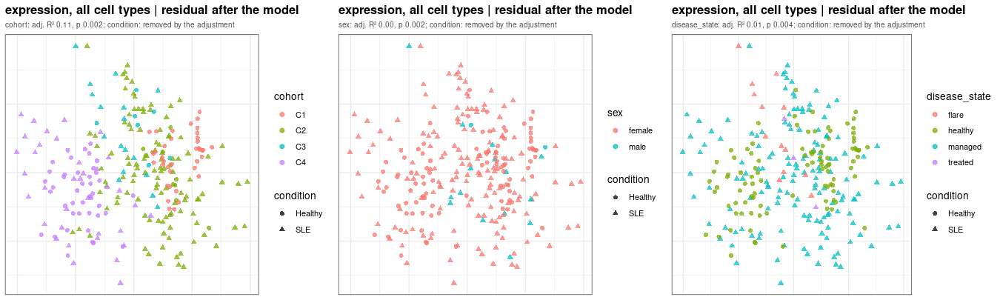<!-- -->

``` r
cao$plotFitDiagnostics("expression.shifts", color.by = "cohort")
```

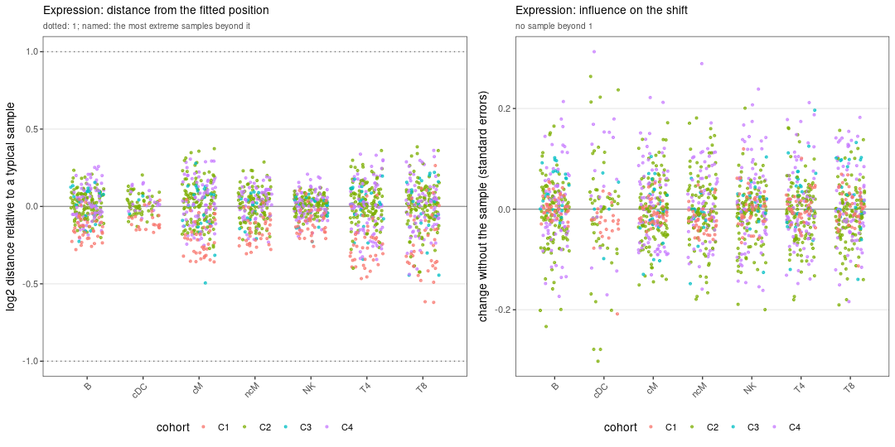<!-- -->

With 261 donors the diagnostics are drawn as one dot per donor and cell type. The patients' profiles lie mostly
farther from their fitted position than the healthy donors' (red dots above, blue below), the larger spread of the
patients seen above; every donor lies within 1.3-fold farther and 1.5-fold closer than a typical one (log2 -0.62 to 0.39), and no single donor changes
a shift by more than 0.31 standard errors.

The residual maps show the donor distances left once the model's fixed part (condition, age, ancestry) is removed.
The processing cohort still structures them (11 %, p 0.002): it is a grouping term, so its differences are not fitted
but the condition is relabeled only within cohorts, and they do not enter the comparison. The cohort also shows in the
diagnostics colored by it: the donors of `C1`, all healthy, lie closer to their fitted position than the other donors
in all seven populations, most in the monocytes and T cells, so part of the healthy donors' smaller spread is a property of this cohort. Sex explains
almost nothing (adjusted R² 0.00, although with p 0.002; 17 of the 261 donors are men). The disease state (healthy, managed, flare, treated) explains
1 % (p 0.004), with no group forming a separate region; the flare samples are examined below.

``` r
cmp <- function(a, b, what) { x <- cao$test.results[[a]]; y <- cao$test.results[[b]]
  if (what == "coda") { p1 <- x$contrast$per_cell$padj; p2 <- y$contrast$per_cell$padj[names(p1)]; return(data.frame(plain = signif(p1, 2), adjusted = signif(p2, 2))[order(p1), ]) }
  r1 <- x$results[x$results$effect == "shift", ]; r2 <- y$results[y$results$effect == "shift", ]; m <- merge(r1[, c("celltype", "padj", "estimate.norm")], r2[, c("celltype", "padj", "estimate.norm")], by = "celltype", suffixes = c(".plain", ".adjusted"))
  m[order(m$padj.plain), ] }
cmp("coda.plain", "coda", "coda")
```

            plain adjusted
    cM     0.0044   0.0073
    ncM    0.0044   0.0330
    pDC    0.0044   0.0970
    Prolif 0.0044   0.0073
    T4     0.0044   0.0073
    NK     0.0260   0.0220
    B      0.0310   0.0220
    cDC    0.1000   0.1600
    T8     0.1300   0.1300
    PB     0.7000   1.0000
    Progen 0.9100   1.0000

``` r
cmp("shifts.plain", "expression.shifts", "shifts")
```

       celltype  padj.plain estimate.norm.plain padj.adjusted
    1         B 0.002222222          0.10279544   0.002857143
    2       cDC 0.002222222          0.08728198   0.002857143
    3        cM 0.002222222          0.19360294   0.002857143
    4       ncM 0.002222222          0.14226236   0.002857143
    5        NK 0.002222222          0.07517201   0.002857143
    7       pDC 0.002222222          0.12791108   0.315555556
    8    Prolif 0.002222222                  NA   0.007500000
    9        T4 0.002222222          0.17696548   0.002857143
    10       T8 0.002222222          0.12280918   0.002857143
    6        PB 0.087962963                  NA   0.333333333
       estimate.norm.adjusted
    1              0.09132849
    2              0.07372708
    3              0.17210622
    4              0.11587080
    5              0.06563130
    7                      NA
    8                      NA
    9              0.16592165
    10             0.09737376
    6                      NA

The two tables compare the model without covariates (`plain`) with the adjusted one. In the composition, the
plasmacytoid dendritic cells (`pDC`) are depleted at adjusted p 0.0044 without covariates and not significant with them
(0.097), and the non-classical monocytes weaken (0.0044 to 0.033); the other results hold. In the expression shifts,
the pDC shift is significant without covariates and grouping term but not in the adjusted model (0.002 against 0.32),
and the magnitudes of the other types
shrink by 6-21 % with the covariates. Which covariate matters is shown by the sensitivity analyses below.

``` r
cao$checkSensitivity(n.permutations = 199)
```

    Sensitivity of 'condition: SLE vs Healthy' (shift) across 6 models: unadjusted [~condition + (1 | cohort)]; current [~condition + age + ethnicity + (1 | cohort)]; minus age [~condition + ethnicity + (1 | cohort)]; minus ethnicity [~condition + age + (1 | cohort)]; minus (1 | cohort) [~condition + age + ethnicity]; plus sex [~condition + age + ethnicity + sex + (1 | cohort)]
      magnitude: distance model; significance: gsd (adjusted p < 0.05)
      cM       magnitude stable; significant in all 6 models
      T4       magnitude stable; significant in all 6 models
      ncM      magnitude stable; significant in all 6 models
      T8       magnitude stable; significant in all 6 models
      B        magnitude stable; significant in all 6 models
      cDC      magnitude stable; significant in all 6 models
      NK       magnitude stable; significant in all 6 models
      pDC      magnitude sign depends on the model; not significant in any of 3 models

``` r
cao$plotSensitivity()
```

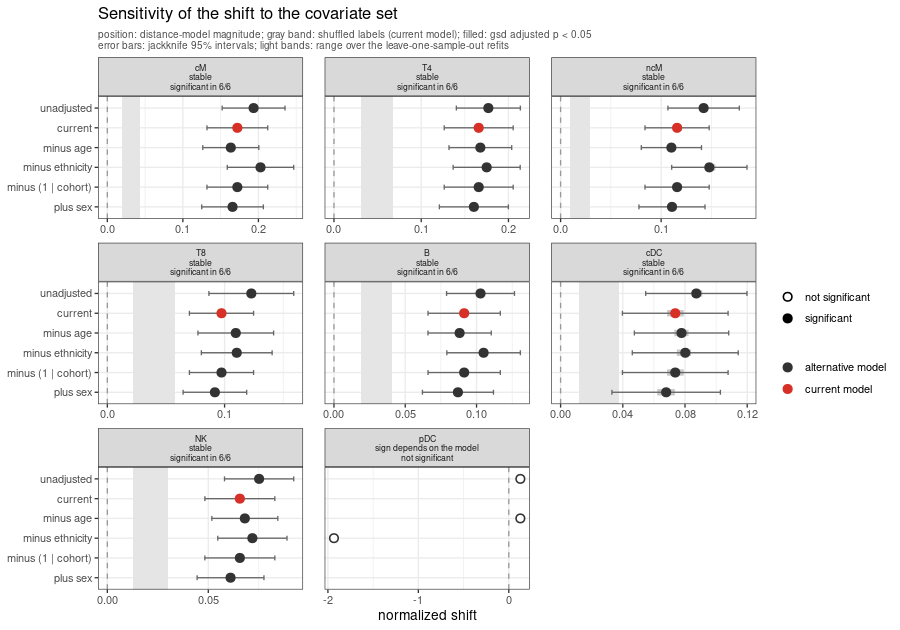<!-- -->

The sensitivity analysis refits the shift under alternative covariate sets: without covariates, without each
adjusting covariate, without the grouping term (`minus (1 | cohort)`: the condition exchanged among all donors, the
cohort ignored) and with sex added. The seven major populations are significant in all six models and their
magnitudes stay within a narrow range; for the contrast between SLE and healthy donors the processing cohort changes
little, because both conditions are present in three of the four cohorts. The pDC magnitude rests on 4 donors with
enough cells (2 per condition); it is estimated in three of the models only, changes sign between them, and is not
significant in any of them (within the strata these 4 donors allow a single distinct relabeling).

``` r
cao$checkSensitivity(analysis = "composition", n.permutations = 199)
```

    Sensitivity of 'condition: SLE vs Healthy' (loading) across 6 models: unadjusted [~condition + (1 | cohort)]; current [~condition + age + ethnicity + (1 | cohort)]; minus age [~condition + ethnicity + (1 | cohort)]; minus ethnicity [~condition + age + (1 | cohort)]; minus (1 | cohort) [~condition + age + ethnicity]; plus sex [~condition + age + ethnicity + sex + (1 | cohort)]
      magnitude: loading (log2, relative to the geometric mean); significance: permutation test (vs the geometric mean) (adjusted p < 0.05)
      Prolif   magnitude stable; significant in all 6 models
      cM       magnitude stable; significant in all 6 models
      T4       magnitude stable; significant in all 6 models
      B        magnitude stable; significant in all 6 models
      ncM      magnitude stable; significant in all 6 models
      pDC      magnitude near zero (within the relabeling band); significant in 3 of 6 models (only with: minus ethnicity, minus (1 | cohort), plus sex)
      NK       magnitude stable; significant in 4 of 6 models (not with: unadjusted, minus age)
      cDC      magnitude stable; significant in 1 of 6 models (only with: minus ethnicity)
      T8       magnitude near zero (within the relabeling band); not significant in any of 6 models
      PB       magnitude near zero (within the relabeling band); not significant in any of 6 models
      Progen   magnitude near zero (within the relabeling band); not significant in any of 6 models

``` r
cao$plotSensitivity(analysis = "composition")
```

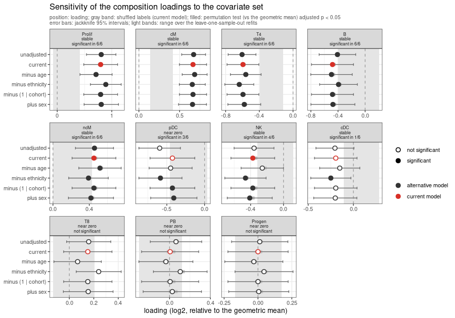<!-- -->

The composition refitted under the same six models shows where the covariates matter. Five cell types (proliferating
cells, classical and non-classical monocytes, CD4 T and B cells) are significant in all six. The pDC depletion is
significant only without ethnicity, without the grouping term, or with sex added, and not in the current model, the
model without age, or the model without both age and ethnicity (adjusted p 0.018-0.11 over the six models): it lies near the significance threshold, its significance changes with
the adjustment set rather than with one covariate, and its size lies within the range of shuffled labels. The NK
cells are significant only in the models that include age.

## Differential expression per cell type

``` r
cao$estimateDEPerCellType(test = "limma-voom")
```

``` r
cao$plotNumberOfDEGenes()
```

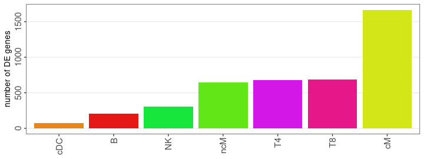<!-- -->

Differential expression per cell type uses limma-voom, which fits the grouping term `(1 | cohort)` as a random intercept
(one correlation between the donors of a processing cohort, shared by all genes of a cell type: 0.03 to 0.17, largest in
the CD4 T cells). It finds the most genes in the classical monocytes (1,665), then the CD8 and CD4 T cells (686 and
678) and the non-classical monocytes (645), and the fewest in the conventional dendritic cells (71); the classical
monocytes and CD4 T cells also have the largest shifts.

``` r
cao$plotVolcano(cell.types = "cM")
```

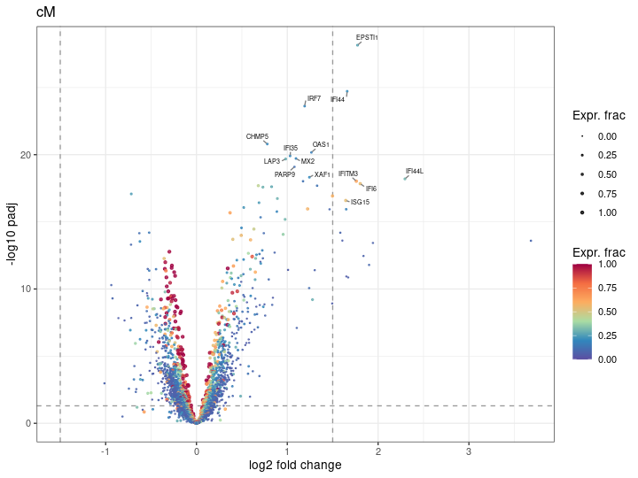<!-- -->

The volcano plot of the classical monocytes shows the differential expression behind their shift. Of the 20 most
significant genes, 19 are higher in SLE, and most of them are interferon-stimulated genes (EPSTI1, IFI44, IRF7, OAS1,
MX2, XAF1, IFI44L, IFI6; ISG15 follows at rank 22), the interferon signature known from SLE blood: a positive control
for the analysis.

## Functional interpretation

``` r
cao$estimateOntology(type = "GSEA", org.db = org.Hs.eg.db::org.Hs.eg.db, seed = TRUE, n.cores = 1)
```

``` r
cao$plotOntologyHeatmapCollapsed(name = "GSEA", genes = "up", n = 25, clust.method = "ward.D")
```

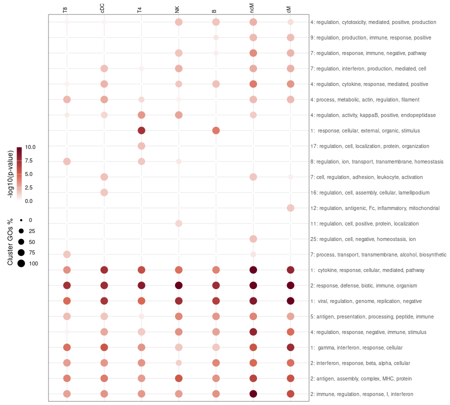<!-- -->

``` r
cao$plotOntologyHeatmapCollapsed(name = "GSEA", genes = "down", n = 25, clust.method = "ward.D")
```

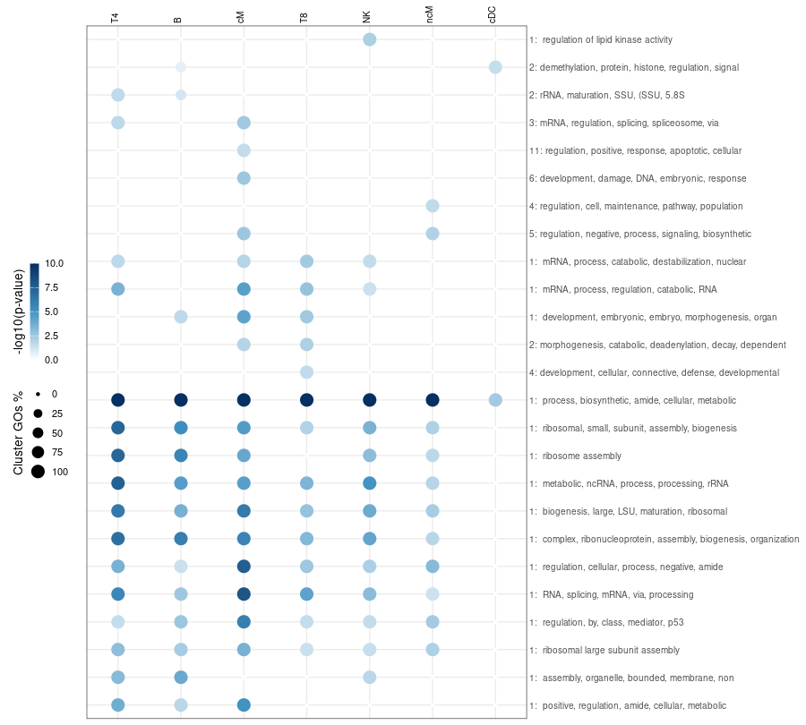<!-- -->

``` r
cao$plotOntology(cell.type = "cM", name = "GSEA", genes = "up", n = 15)
```

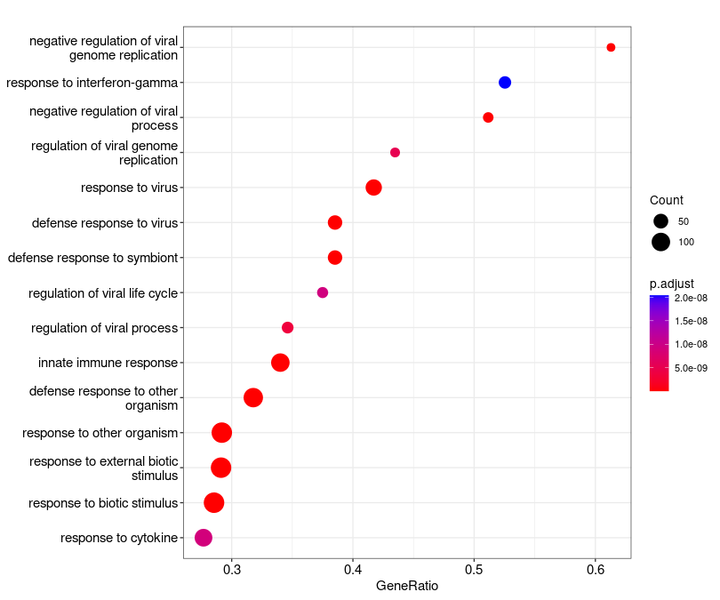<!-- -->

Gene set enrichment on the DE results ranks GO terms per cell type. In every population the leading increased terms
are the antiviral and interferon responses (defense response to virus, negative regulation of viral genome
replication, response to type I interferon), most significant in the monocytes; in the classical monocytes all 15
increased terms shown are antiviral, interferon or other immune responses. The leading decreased term is cytoplasmic
translation in all seven populations. In six of them, all except the conventional dendritic cells, it is followed by
other translation and ribosome biogenesis terms and is the most significant term in either direction; in the
conventional dendritic cells it is weak (adjusted p 0.009).

## Cluster-free analyses

### Cluster-free density shifts

``` r
cao$estimateCellDensity(method = "graph")
```

    kNN neighborhoods of at least 1564 cells (6.0 per sample)

``` r
cao$estimateDiffCellDensity()
```

    diffusion neighborhoods at 1 %, 3 %, 5 % of the cells (auto: one scale is chosen)

    scale 0.01: heat kernel beta 32.7

    scale 0.03: heat kernel beta 42.4

    scale 0.05: heat kernel beta 50.5

    79973 of 156456 cells at FDR 10 % (scale 5 % chosen)

``` r
cowplot::plot_grid(cao$plotEmbedding(color.by = "cell.groups", title = "cell type"),
                   cao$plotDiffCellDensity(what = "effect", title = "density change (log2 FC)", outline = TRUE),
                   cao$plotDiffCellDensity(title = "adjusted z", outline = TRUE), ncol = 3)
```

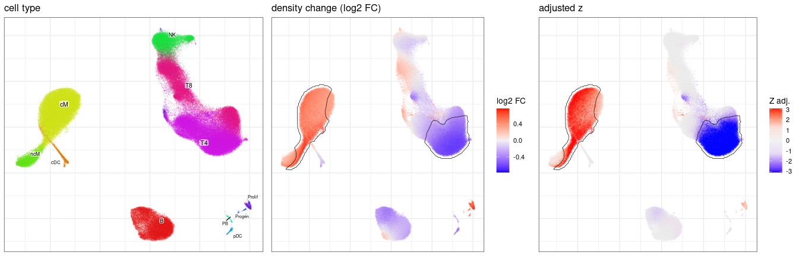<!-- -->

The density map tests the change of cell density on the graph, cell by cell, with the same model. At the scale chosen
(diffusion neighborhoods of 5 % of the cells) 79,973 of the 156,456 cells are called at FDR 10 %: the classical
monocytes gain density, a large part of the CD4 T cells loses it (outlined regions), in agreement with the composition.

### Cluster-free expression shifts

``` r
cao$estimateClusterFreeExpressionShifts(n.permutations = 499)
```

    8630 genes (per neighborhood: those detected in >= 5 % of its cells)

    diffusion neighborhoods at 1 %, 3 %, 5 % of the cells (auto: one scale is chosen), at least 1564 cells each (6.0 per sample)

    scale 0.01: heat kernel beta 32.7, 412 centers, neighborhoods of 1571 cells (median, 1565 smallest)

    scale 0.03: heat kernel beta 42.4, 133 centers, neighborhoods of 4698 cells (median, 1571 smallest)

    scale 0.05: heat kernel beta 50.5, 77 centers, neighborhoods of 7835 cells (median, 2448 smallest)

    156456 of 156456 cells keep adjusted z >= 1.28 (scale 1 % chosen)

``` r
cao$plotClusterFreeExpressionShifts(adjusted = TRUE, font.size = c(2, 3), outline = TRUE)
```

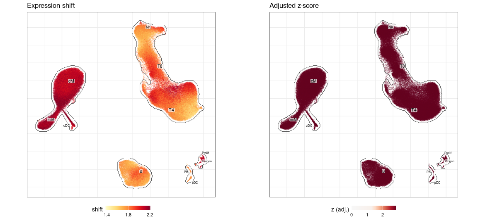<!-- -->

``` r
cao$estimateClusterFreeSummary("cell.density")
cao$estimateClusterFreeSummary("cluster.free.expr.shifts")
cowplot::plot_grid(cao$plotClusterFreeSummary("cell.density"), cao$plotClusterFreeSummary("cluster.free.expr.shifts"), ncol = 2)
```

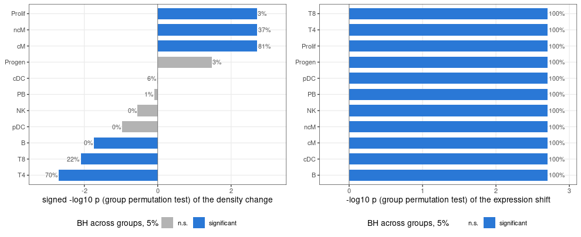<!-- -->

The expression-shift map calls every one of the 156,456 cells (at the finest scale, diffusion neighborhoods of 1 %
of the cells), and the population summaries (right) are significant for all eleven populations: the interferon
response affects every cell type, so the map adds no localization here beyond the cell-type test. The density
summaries (left) largely repeat the composition: proliferating cells and monocytes gain density, the CD4 and CD8 T
cells and B cells lose it. They differ from it for two cell types: the CD8 T cells lose density, while their loading
is not significant (and positive), and the NK cells, depleted in the composition, show no significant density change.

## SLE in Asian and European American donors

Perez et al. asked whether SLE affects the immune cells of donors of Asian and European ancestry alike. With the
interaction of condition and ancestry in the model, the comparison of SLE with healthy donors can be made within each
ancestry group (a test at a fixed level of the other factor), on the 256 donors of the two groups.

``` r
cao$excludeSamples(rownames(sample.meta)[!sample.meta$ethnicity %in% c("Asian", "European American")])
for (anc in c("Asian", "European American")) {
  cao$setModel(~ condition * ethnicity + age + (1 | cohort), contrast = list(type = "simple", term = "condition", num = "SLE", den = "Healthy", at = list(ethnicity = anc)),
               verbose = anc == "Asian")
  cao$estimateCellLoadings(name = paste("coda", anc), verbose = FALSE)
  cao$estimateExpressionShiftMagnitudes(name = paste("shifts", anc), verbose = FALSE)
}
```

    Model: ~condition * ethnicity + age + (1 | cohort)      dispersion: ~condition
           grouping term (1 | cohort): not fitted; the tested variable is exchanged within its levels
    Test: condition: SLE vs Healthy at ethnicity = Asian  (reference 'Healthy': as requested)
           adjusted for ethnicity, age; permutations: block within 7 strata (> 10 million distinct); 107 of 256 samples can change their value; smallest p-value 0.002
           shift > 0: SLE samples differ from Healthy samples in a common direction, beyond within-group variability
    Samples: 256 used.   Issues: 2 notes
      note: test 'condition: SLE vs Healthy at ethnicity = Asian': continuous covariate(s) age with grouping variable(s) cohort: the rows of the design are exchanged within the groups (the covariate moves with the tested variable; approximate)
      note: 'cohort': 1 of 4 levels hold one value of 'condition'; their samples keep it in every relabeling (107 of 256 samples can change their value)

``` r
cao$excludeSamples(NULL)
cao$setModel(~ condition + age + ethnicity + (1 | cohort), test = "condition", verbose = FALSE)
sh <- function(nm) { r <- cao$test.results[[nm]]$results; r <- r[r$effect == "shift", ]; r[, c("celltype", "estimate.norm", "padj")] }
m <- merge(sh("shifts Asian"), sh("shifts European American"), by = "celltype", suffixes = c(".Asian", ".European"))
m[, -1] <- signif(m[, -1], 2); m[order(m$padj.Asian), ]
```

      celltype estimate.norm.Asian padj.Asian estimate.norm.European padj.European
    1        B                0.19      0.003                  0.087        0.0029
    3       cM                0.29      0.003                  0.170        0.0029
    4      ncM                0.16      0.003                  0.120        0.0029
    5       NK                0.12      0.003                  0.072        0.0029
    8       T4                0.33      0.003                  0.160        0.0029
    9       T8                0.21      0.003                  0.099        0.0029
    2      cDC                0.11      0.021                  0.083        0.0029
    7   Prolif                  NA      0.027                     NA        0.0100
    6       PB                  NA      0.540                     NA        0.0510

``` r
lo <- function(nm) { x <- cao$test.results[[nm]]$contrast; data.frame(loading = x$loadings$obs / log(2), padj = x$per_cell$padj[names(x$loadings$obs)]) }
l1 <- lo("coda Asian"); l2 <- lo("coda European American")[rownames(l1), ]
signif(data.frame(loading.Asian = l1$loading, padj.Asian = l1$padj, loading.European = l2$loading, padj.European = l2$padj, row.names = rownames(l1)), 2)
```

           loading.Asian padj.Asian loading.European padj.European
    B             -0.210      0.700           -0.670         0.028
    cDC           -0.027      0.980           -0.250         0.110
    cM             0.720      0.011            0.630         0.011
    ncM            0.740      0.011            0.350         0.110
    NK            -0.560      0.180           -0.300         0.110
    PB            -0.280      0.700            0.190         0.240
    pDC           -0.015      0.980           -0.660         0.110
    Progen        -0.094      0.770            0.072         0.620
    Prolif         0.570      0.011            0.840         0.011
    T4            -1.100      0.011           -0.320         0.022
    T8             0.260      0.250            0.100         0.380

``` r
cowplot::plot_grid(cao$plotExpressionShiftMagnitudes(name = "shifts Asian") + ggplot2::ggtitle("Asian donors"),
                   cao$plotExpressionShiftMagnitudes(name = "shifts European American") + ggplot2::ggtitle("European American donors"), ncol = 2)
```

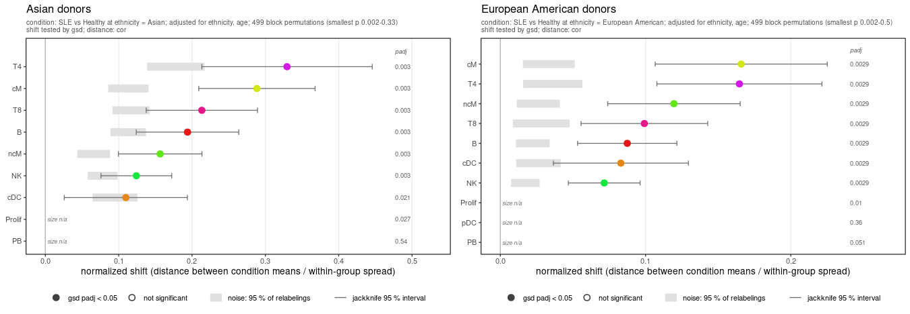<!-- -->

The model report shows how the comparison within one ancestry is made: only the 107 Asian donors change their label
(24 healthy, 83 SLE), the European American donors keep theirs. Most Asian healthy donors come from one cohort (21 of
24 in `C4`), and the cohort `C2`, with 59 Asian patients, has a single Asian healthy donor; the Asian comparison
therefore rests mainly on the donors of `C4`. The European American comparison has 74 healthy and 75 SLE donors; 38 of the healthy donors are in `C1`, which
holds no patients, so they keep their label in every relabeling.

The seven major populations and the proliferating cells shift significantly in both groups (in the Asian donors the
conventional dendritic cells and the proliferating cells at adjusted p 0.021 and 0.027, the others at 0.003). The normalized shifts of the Asian donors are larger
(CD4 T cells 0.33 against 0.16, CD8 T cells 0.21 against 0.10, B cells 0.19 against 0.09), but so is their noise band
(note the different axes): with 24 healthy donors 95 % of the relabeled data sets give shifts of up to 0.09-0.22
(depending on the cell type), against up to 0.03-0.06 with 74. A larger estimate in the smaller group is in part this noise, and the difference between the groups
was not tested (a test of the interaction is not available for the expression shifts). In the composition, the
classical monocytes and the proliferating cells increase in both groups (adjusted p 0.011); the CD4 T cells decrease in
both, more in the Asian patients (log2 loading -1.1 against -0.32), the non-classical monocytes increase significantly
only in the Asian patients and the B cells decrease significantly only in the European American patients (-0.67,
p 0.028). With these group sizes, the data show the same direction of change in both ancestries for every cell type
that changes significantly in either group; they do not establish that the size differs.

## Flare versus managed disease

``` r
table(sample.meta$disease_state, sample.meta$cohort)
```

             
               C1  C2  C3  C4
      flare     0   0  13   0
      healthy  38  12   7  42
      managed   0 109   1  36
      treated   0   0   3   0

All 13 flare samples were processed in cohort `C3`, which holds only one managed patient; the other 145 managed
patients are in `C2` and `C4`. Flare versus managed disease is therefore entangled with the processing cohort.

``` r
cao$excludeSamples(rownames(sample.meta)[!sample.meta$disease_state %in% c("flare", "managed")])
cao$setModel(~ disease_state + age + ethnicity + (1 | cohort), test = "disease_state: flare vs managed")
```

    Model: ~disease_state + age + ethnicity + (1 | cohort)      dispersion: ~disease_state
           grouping term (1 | cohort): not fitted; the tested variable is exchanged within its levels
    Test: disease_state: flare vs managed  (reference 'managed': as requested)
           adjusted for age, ethnicity; permutations: block within 8 strata (5 distinct); 5 of 159 samples can change their value; smallest p-value 0.2
           shift > 0: flare samples differ from managed samples in a common direction, beyond within-group variability
    Samples: 159 used.   Issues: 2 warnings, 2 notes
      warning: test 'disease_state: flare vs managed': 88 of 146 'managed' samples have 'age' outside the range of 'flare' (22-40): adjusted for 'age', the disease_state effect there rests on a fitted trend of 'age' beyond the values observed in 'flare' -> compare with the samples in the common range of 'age' (cao$excludeSamples())
      warning: test 'disease_state: flare vs managed': only 5 distinct permutations; the smallest attainable p-value is 0.2 -> fewer strata (block.vars), or more samples
      note: test 'disease_state: flare vs managed': continuous covariate(s) age with grouping variable(s) cohort: the rows of the design are exchanged within the groups (the covariate moves with the tested variable; approximate)
      note: 'cohort': 2 of 3 levels hold one value of 'disease_state'; their samples keep it in every relabeling (5 of 159 samples can change their value)

With the cohort as a grouping term, the disease state can only be exchanged within `C3`, and there only among the
Asian donors (four flare patients and the one managed patient; the strata are cohort and ethnicity): 5 of the 159 patients can
change their value, there are 5 distinct relabelings, and the smallest attainable p-value is 0.2. Nothing can be
tested. The model report gives this before any analysis is run.

``` r
cowplot::plot_grid(
  cao$plotSampleDistances(color.by = "cohort", shape.by = "disease_state"),
  cao$plotSampleDistances(cell.type = "cM", color.by = "cohort", shape.by = "disease_state"), ncol = 2)
```

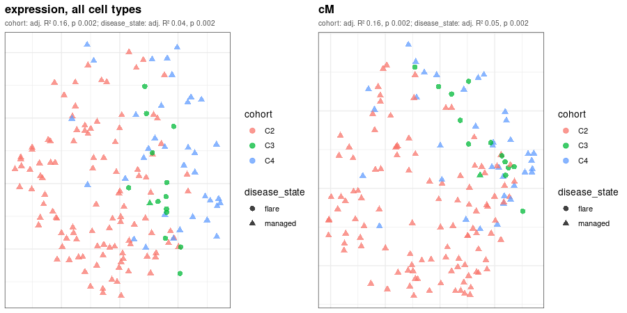<!-- -->

The sample maps of the patients make the entanglement visible: the flare samples (circles, all in cohort `C3`, green)
lie in one region of each map, overlapping with some managed patients of `C2` and `C4`, and the one managed patient
of `C3` (green triangle) lies among them. The cohort explains 16 % of the distances, the disease
state 4-5 %; on the map one cannot tell which of the two separates the flare samples.

Without the grouping term the contrast can be tested, but whatever differs between cohort `C3` and the others becomes
part of the flare effect.

``` r
cao$setModel(~ disease_state + age + ethnicity, test = "disease_state: flare vs managed")
```

    Model: ~disease_state + age + ethnicity      dispersion: ~disease_state
    Test: disease_state: flare vs managed  (reference 'managed': as requested)
           adjusted for age, ethnicity; permutations: freedman-lane (> 10 million distinct); 158 of 159 samples can change their value; smallest p-value 0.002
           shift > 0: flare samples differ from managed samples in a common direction, beyond within-group variability
    Samples: 159 used.   Issues: 1 warning, 2 notes
      warning: test 'disease_state: flare vs managed': 88 of 146 'managed' samples have 'age' outside the range of 'flare' (22-40): adjusted for 'age', the disease_state effect there rests on a fitted trend of 'age' beyond the values observed in 'flare' -> compare with the samples in the common range of 'age' (cao$excludeSamples())
      note: test 'disease_state: flare vs managed': continuous covariate(s) age: using Freedman-Lane residual permutation (approximate)
      note: test 'disease_state: flare vs managed': residuals are exchanged within the levels of ethnicity

``` r
cao$estimateCellLoadings(name = "coda.flare")
cao$estimateExpressionShiftMagnitudes(name = "shifts.flare")
```

``` r
cowplot::plot_grid(cao$plotCellLoadings(name = "coda.flare", center = "none"),
                   cao$plotExpressionShiftMagnitudes(name = "shifts.flare", show.ci = TRUE), ncol = 2, rel_widths = c(1, 1.3))
```

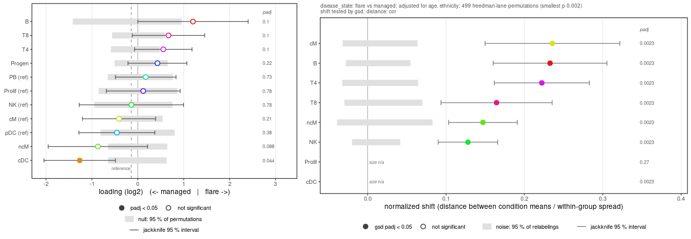<!-- -->

Without the cohort, flare and managed disease differ in the expression of every major population (adjusted p 0.002),
with larger normalized shifts (0.13-0.24) than between SLE and healthy donors; in the composition only the conventional
dendritic cells are depleted (0.044).

Whether these differences belong to the flare or to the processing cohort can be checked on the healthy donors, who
have no disease state: the 7 healthy donors of `C3` against the 92 of the other cohorts, with the same covariates.

``` r
cao$excludeSamples(NULL)
sample.meta$cohort.C3 <- factor(ifelse(sample.meta$cohort == "C3", "C3", "other"), levels = c("other", "C3"))
cao$sample.meta <- sample.meta
cao$excludeSamples(rownames(sample.meta)[sample.meta$condition != "Healthy"])
cao$setModel(~ cohort.C3 + age + ethnicity, test = "cohort.C3: C3 vs other")
```

    Model: ~cohort.C3 + age + ethnicity      dispersion: ~cohort.C3
    Test: cohort.C3: C3 vs other  (reference 'other': as requested)
           adjusted for age, ethnicity; permutations: freedman-lane (> 10 million distinct); 98 of 99 samples can change their value; smallest p-value 0.002
           shift > 0: C3 samples differ from other samples in a common direction, beyond within-group variability
    Samples: 99 used.   Issues: 3 notes
      note: test 'cohort.C3: C3 vs other': 22 of 92 'other' samples have 'age' outside the range of 'C3' (26-65): adjusted for 'age', the cohort.C3 effect there rests on a fitted trend of 'age' beyond the values observed in 'C3' -> compare with the samples in the common range of 'age' (cao$excludeSamples())
      note: test 'cohort.C3: C3 vs other': continuous covariate(s) age: using Freedman-Lane residual permutation (approximate)
      note: test 'cohort.C3: C3 vs other': residuals are exchanged within the levels of ethnicity

``` r
cao$estimateCellLoadings(name = "coda.c3.healthy")
cao$estimateExpressionShiftMagnitudes(name = "shifts.c3.healthy")
```

``` r
sh <- function(nm) { r <- cao$test.results[[nm]]$results; r <- r[r$effect == "shift", ]; setNames(r$padj, r$celltype) }
lo <- function(nm) { x <- cao$test.results[[nm]]$contrast; data.frame(loading = x$loadings$obs / log(2), padj = x$per_cell$padj[names(x$loadings$obs)]) }
ct <- union(names(sh("shifts.flare")), names(sh("shifts.c3.healthy")))
data.frame(shift.padj.flare = signif(sh("shifts.flare")[ct], 2), shift.padj.C3.healthy = signif(sh("shifts.c3.healthy")[ct], 2), row.names = ct)
```

           shift.padj.flare shift.padj.C3.healthy
    B                0.0023                0.0028
    cM               0.0023                0.0028
    T4               0.0023                0.0028
    T8               0.0023                0.0028
    ncM              0.0023                0.0060
    NK               0.0023                0.0047
    cDC              0.0023                0.0028
    Prolif           0.2700                    NA

``` r
l1 <- lo("coda.flare"); l2 <- lo("coda.c3.healthy")[rownames(l1), ]
data.frame(loading.flare = signif(l1$loading, 2), padj.flare = signif(l1$padj, 2), loading.C3.healthy = signif(l2$loading, 2), padj.C3.healthy = signif(l2$padj, 2), row.names = rownames(l1))
```

           loading.flare padj.flare loading.C3.healthy padj.C3.healthy
    B               1.20      0.100              0.024            0.97
    cDC            -1.30      0.044              0.540            0.68
    cM             -0.41      0.210              0.190            0.97
    ncM            -0.87      0.088             -0.011            0.97
    NK             -0.14      0.780              0.034            0.97
    PB              0.17      0.730             -0.480            0.97
    pDC            -0.46      0.380              0.240            0.97
    Progen          0.43      0.220             -0.510            0.75
    Prolif          0.12      0.780             -0.100            0.97
    T4              0.55      0.100              0.120            0.97
    T8              0.67      0.100             -0.050            0.97

Healthy donors of cohort `C3` differ from the other healthy donors in the expression of all seven populations (adjusted
p 0.003-0.006); their composition does not differ. The expression differences between flare and managed disease are
therefore of the kind that the processing cohort alone produces, and these data cannot attribute them to the flare. The
composition difference (the depletion of `cDC`) is not seen between the cohorts in healthy donors, but 7 healthy donors
of `C3` give that comparison little power. A design that separates the two would need flare and managed samples within
the same cohorts.

## Plasmacytoid dendritic cells and age in healthy donors

``` r
cao$excludeSamples(NULL)
cao$excludeSamples(rownames(sample.meta)[sample.meta$condition != "Healthy"])
cao$setModel(~ age + sex + ethnicity + (1 | cohort), test = "age", numeric.step = 10)
```

    Model: ~age + sex + ethnicity + (1 | cohort)      dispersion: ~age
           grouping term (1 | cohort): not fitted; the tested variable is exchanged within its levels
    Test: age: per 10 units
           adjusted for sex, ethnicity; permutations: block within 10 strata (> 10 million distinct); 95 of 99 samples can change their value; smallest p-value 0.002
           shift > 0: samples move in a common direction as age increases (per 10 units)
    Samples: 99 used.   Issues: none

``` r
cao$estimateCellLoadings(name = "coda.healthy.age")
x <- cao$test.results$coda.healthy.age$contrast
signif(data.frame(loading.per.decade = x$loadings$obs / log(2), padj = x$per_cell$padj[names(x$loadings$obs)])[order(x$per_cell$padj[names(x$loadings$obs)]), ], 2)
```

           loading.per.decade padj
    ncM                0.0830 0.25
    NK                 0.1400 0.25
    pDC               -0.1400 0.25
    T4                 0.0710 0.25
    T8                -0.1000 0.46
    cM                 0.0300 0.83
    Progen            -0.0380 0.83
    Prolif            -0.0320 0.83
    PB                -0.0250 0.91
    cDC                0.0160 0.93
    B                 -0.0021 0.97

``` r
cao$plotCodaSamples(name = "coda.healthy.age", n.top = 4)
```

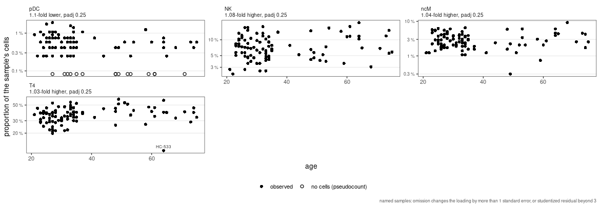<!-- -->

Among the 99 healthy donors, age is tested per decade, adjusted for sex and ethnicity and relabeled within cohorts.
No cell type changes significantly (adjusted p 0.25 or more); the pDC fraction declines by about 0.14 log2 units per
decade, a trend in the expected direction that these donors cannot confirm. These data therefore give no evidence that
the pDC result of the main comparison is an age effect, but they cannot exclude a part of it; in the composition
sensitivity above, removing age from the model does not make the pDC depletion significant.

``` r
cao$excludeSamples(NULL)
```

## Summary

- SLE versus healthy donors, adjusted for age and ethnicity and relabeled within processing cohorts: the classical
  monocytes and proliferating cells expand, the CD4 T cells, B cells and NK cells contract, and all seven major
  populations shift in expression, the classical monocytes and CD4 T cells most.
- The processing cohort is the largest structured source of variation in the expression (variance partition, sample
  maps), but it is spread across the conditions, and ignoring it changes little for SLE versus healthy.
- The covariates matter for the plasmacytoid dendritic cells: their depletion is significant in three of the six models
  (without the adjustment for ethnicity, without relabeling within cohorts, or with sex added) and lies near the
  threshold, and their expression shift is significant only without covariates and grouping term. Among the healthy
  donors their fraction shows a decline with age that is not significant. The other results are stable across the six
  models, except the NK depletion, which is significant only in the models that adjust for age, and the cDC depletion,
  which is significant only without ethnicity.
- The patients are more heterogeneous than the healthy donors in all seven populations tested, and the increased expression is led
  by the interferon response in all seven, and the leading decreased gene set is cytoplasmic translation.
- Flare versus managed disease cannot be separated from the processing cohort: with the cohort as a grouping term no
  test is possible (5 relabelings), and without it the expression differences are as broad as those that the cohort
  alone produces among healthy donors (all seven populations) and in the T and B cells of similar size (normalized
  shifts 0.17-0.19 for `C3` against the other healthy donors, 0.16-0.23 for flare against managed disease); in the
  monocytes and NK cells the cohort difference among healthy donors is smaller (0.06-0.13 against 0.13-0.24).

## Session info

``` r
sessionInfo()
```

    R version 4.2.2 Patched (2022-11-10 r83330)
    Platform: x86_64-pc-linux-gnu (64-bit)
    Running under: Ubuntu 20.04.6 LTS

    Matrix products: default
    BLAS:   /usr/lib/x86_64-linux-gnu/blas/libblas.so.3.9.0
    LAPACK: /usr/lib/x86_64-linux-gnu/lapack/liblapack.so.3.9.0

    locale:
     [1] LC_CTYPE=en_US.UTF-8       LC_NUMERIC=C              
     [3] LC_TIME=en_US.UTF-8        LC_COLLATE=en_US.UTF-8    
     [5] LC_MONETARY=en_US.UTF-8    LC_MESSAGES=en_US.UTF-8   
     [7] LC_PAPER=en_US.UTF-8       LC_NAME=C                 
     [9] LC_ADDRESS=C               LC_TELEPHONE=C            
    [11] LC_MEASUREMENT=en_US.UTF-8 LC_IDENTIFICATION=C       

    attached base packages:
    [1] stats     graphics  grDevices utils     datasets  methods   base     

    other attached packages:
    [1] ggplot2_4.0.2  cacoa_0.5.0    Matrix_1.6-1.1

    loaded via a namespace (and not attached):
      [1] spatstat.explore_3.5-2      reticulate_1.43.0          
      [3] tidyselect_1.2.1            RSQLite_2.3.1              
      [5] AnnotationDbi_1.60.2        htmlwidgets_1.6.4          
      [7] grid_4.2.2                  BiocParallel_1.32.6        
      [9] Rtsne_0.17                  scatterpie_0.2.5           
     [11] codetools_0.2-18            ica_1.0-3                  
     [13] future_1.76.0               miniUI_0.1.2               
     [15] withr_3.0.2                 spatstat.random_3.4-1      
     [17] colorspace_2.1-0            GOSemSim_2.24.0            
     [19] progressr_0.15.1            Biobase_2.58.0             
     [21] knitr_1.50                  uuid_1.2-1                 
     [23] Seurat_4.3.0.1              stats4_4.2.2               
     [25] ROCR_1.0-11                 tensor_1.5.1               
     [27] pbmcapply_1.5.1             DOSE_3.24.2                
     [29] listenv_0.9.1               MatrixGenerics_1.10.0      
     [31] labeling_0.4.3              GenomeInfoDbData_1.2.9     
     [33] mnormt_2.1.1                polyclip_1.10-7            
     [35] bit64_4.6.0-1               farver_2.1.2               
     [37] downloader_0.4.1            parallelly_1.45.1          
     [39] vctrs_0.7.3                 treeio_1.22.0              
     [41] generics_0.1.4              gson_0.1.0                 
     [43] xfun_0.53                   R6_2.6.1                   
     [45] GenomeInfoDb_1.34.9         graphlayouts_1.2.2         
     [47] locfit_1.5-9.8              spatstat.univar_3.1-4      
     [49] ggiraph_0.9.0               DelayedArray_0.24.0        
     [51] bitops_1.0-9                spatstat.utils_3.1-5       
     [53] cachem_1.1.0                fgsea_1.24.0               
     [55] gridGraphics_0.5-1          promises_1.3.3             
     [57] scales_1.4.0                ggraph_2.2.2               
     [59] enrichplot_1.18.4           gtable_0.3.6               
     [61] globals_0.20.0              goftest_1.2-3              
     [63] tidygraph_1.3.1             S7_0.2.0                   
     [65] rlang_1.1.7                 systemfonts_1.3.2          
     [67] splines_4.2.2               lazyeval_0.2.2             
     [69] dichromat_2.0-1             spatstat.geom_3.5-0        
     [71] yaml_2.3.10                 reshape2_1.4.4             
     [73] abind_1.4-8                 httpuv_1.6.16              
     [75] qvalue_2.30.0               clusterProfiler_4.6.2      
     [77] tools_4.2.2                 psych_2.5.6                
     [79] ggplotify_0.1.2             sccore_1.0.6               
     [81] RColorBrewer_1.1-3          coda.base_1.0.3            
     [83] BiocGenerics_0.44.0         ggridges_0.5.7             
     [85] Rcpp_1.1.0                  plyr_1.8.9                 
     [87] zlibbioc_1.44.0             purrr_1.2.2                
     [89] RCurl_1.98-1.12             deldir_2.0-4               
     [91] pbapply_1.7-4               viridis_0.6.4              
     [93] cowplot_1.2.0               S4Vectors_0.36.2           
     [95] zoo_1.8-14                  SummarizedExperiment_1.28.0
     [97] SeuratObject_4.1.3          ggrepel_0.9.6              
     [99] cluster_2.1.4               fs_1.6.6                   
    [101] magrittr_2.0.3              data.table_1.17.8          
    [103] scattermore_1.2             lmtest_0.9-40              
    [105] RANN_2.6.2                  fitdistrplus_1.2-4         
    [107] matrixStats_1.5.0           patchwork_1.3.2            
    [109] mime_0.13                   evaluate_1.0.5             
    [111] xtable_1.8-4                XML_3.99-0.14              
    [113] HDO.db_0.99.1               IRanges_2.32.0             
    [115] gridExtra_2.3               compiler_4.2.2             
    [117] tibble_3.3.0                KernSmooth_2.23-20         
    [119] crayon_1.5.2                shadowtext_0.1.6           
    [121] htmltools_0.5.8.1           ggfun_0.2.0                
    [123] later_1.4.4                 geneplotter_1.76.0         
    [125] tidyr_1.3.2                 aplot_0.2.8                
    [127] DBI_1.1.3                   tweenr_2.0.3               
    [129] MASS_7.3-58                 rappdirs_0.3.3             
    [131] cli_3.6.5                   parallel_4.2.2             
    [133] igraph_2.1.4                GenomicRanges_1.50.2       
    [135] pkgconfig_2.0.3             sp_2.2-0                   
    [137] plotly_4.11.0               spatstat.sparse_3.1-0      
    [139] annotate_1.76.0             ggtree_3.6.2               
    [141] XVector_0.38.0              yulab.utils_0.2.5          
    [143] stringr_1.5.1               digest_0.6.37              
    [145] sctransform_0.4.2           RcppAnnoy_0.0.22           
    [147] spatstat.data_3.1-8         Biostrings_2.66.0          
    [149] rmarkdown_2.29              leiden_0.4.3               
    [151] fastmatch_1.1-6             tidytree_0.4.6             
    [153] uwot_0.2.3                  shiny_1.11.1               
    [155] lifecycle_1.0.5             nlme_3.1-161               
    [157] jsonlite_2.0.0              viridisLite_0.4.2          
    [159] pillar_1.11.0               lattice_0.20-45            
    [161] KEGGREST_1.38.0             fastmap_1.2.0              
    [163] httr_1.4.7                  survival_3.4-0             
    [165] GO.db_3.16.0                glue_1.8.0                 
    [167] png_0.1-8                   bit_4.6.0                  
    [169] ggforce_0.5.0               stringi_1.8.7              
    [171] blob_1.2.4                  DESeq2_1.38.3              
    [173] org.Hs.eg.db_3.16.0         memoise_2.0.1              
    [175] dplyr_1.2.1                 irlba_2.3.5.1              
    [177] future.apply_1.20.0         ape_5.8-1                  

